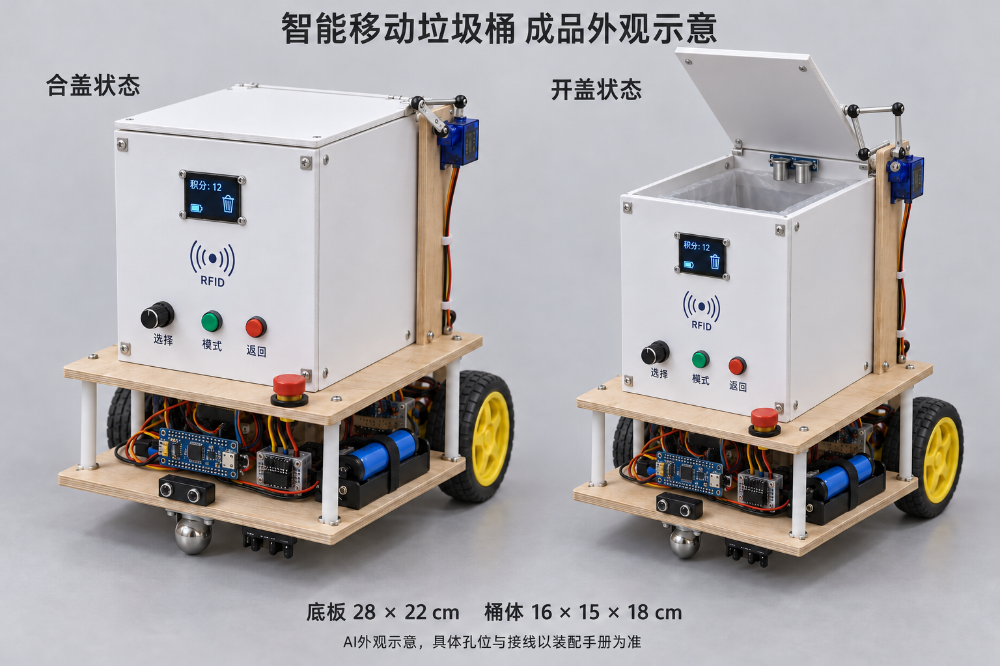

# 成品外观示意

这张图用于理解白色PVC桶体、双层木板底盘、两侧驱动轮、前万向球、侧面开盖机构和前面板的总体布局。底板28×22 cm，桶体16×15×18 cm，合盖时整体高度约30 cm；实际外包络以装配后的轮组和支架为准。

这是用内置 image_gen 生成的概念图，并非已完成样机的照片。传感器的朝向、开盖连杆的精确尺寸、芯片接口和安装孔位须遵循[逐步装配手册](../manual/ASSEMBLY.md)。图中按钮外形和模块支架是外观表达，不新增采购要求。

[完整生成说明及提示词](generation-notes.md)
