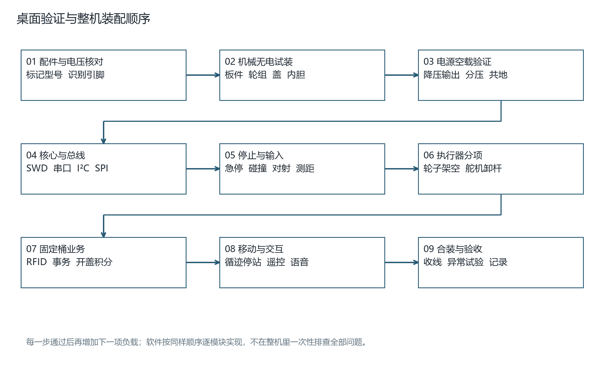
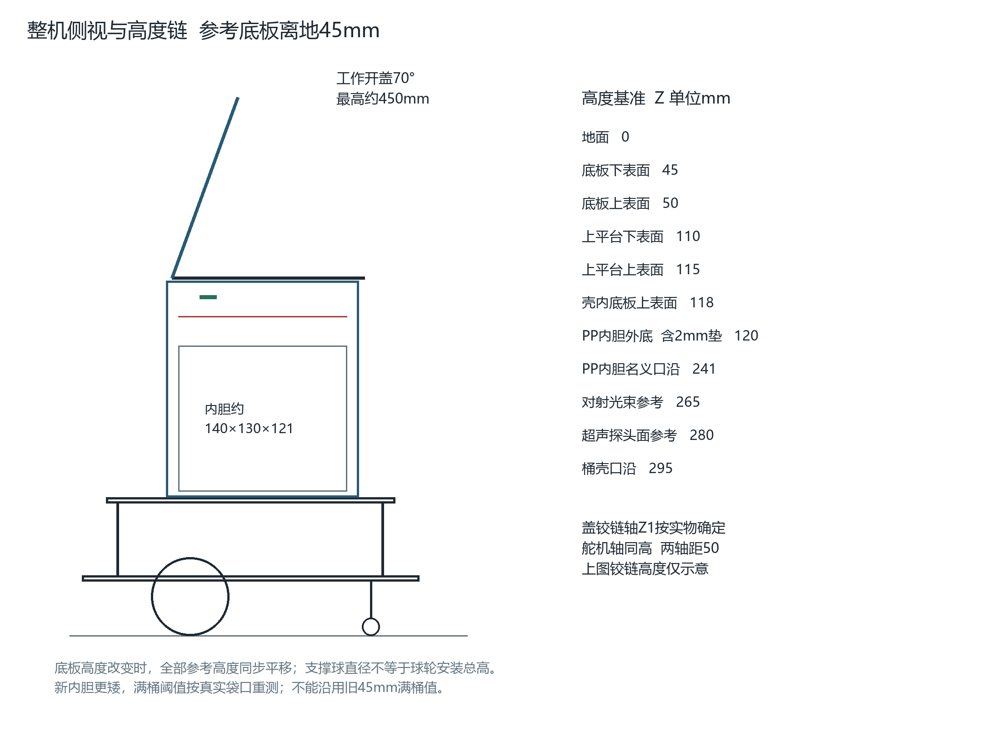
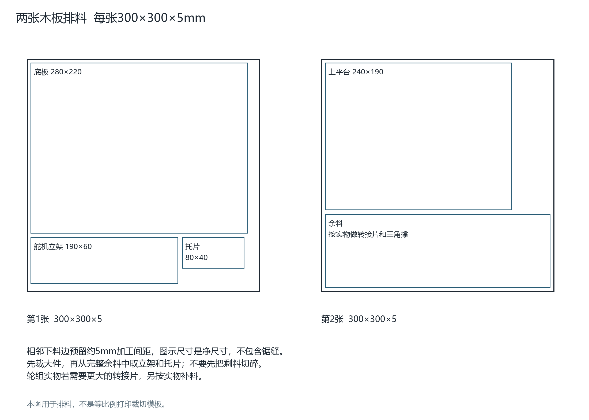
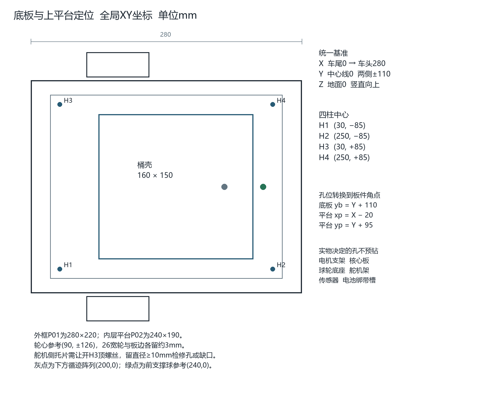
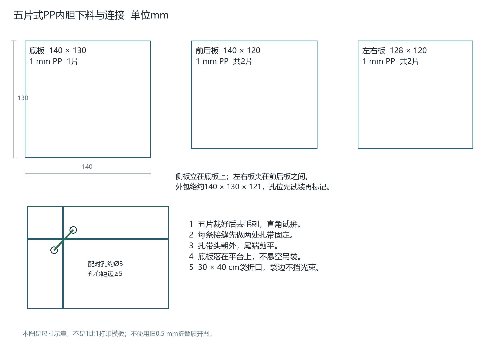
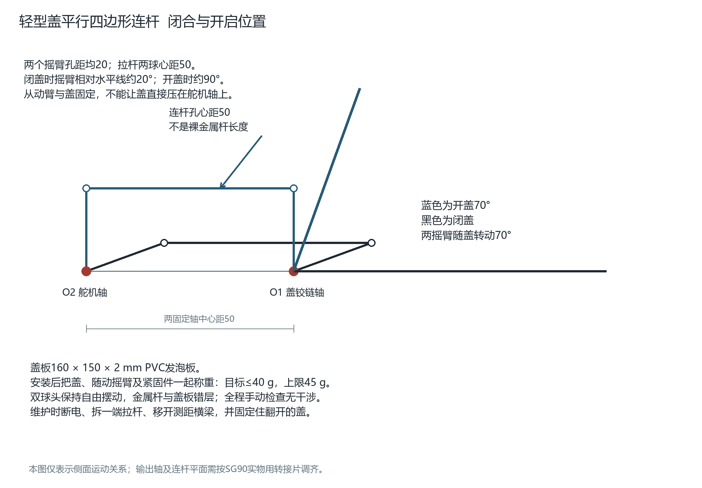
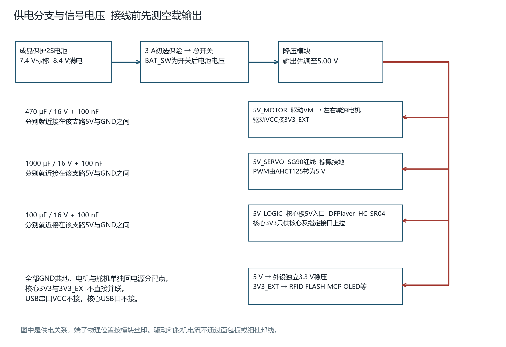

# STM32与RFID智能移动垃圾桶逐步组装与调试

本文件保留原330个步骤的在线阅读文字，编号不重编。当前采用A1：已购模块与直插件复用、100×100mm裸PCB自行焊接。完整图解以[同名图解增强版Word](STM32与RFID智能移动垃圾桶_逐步组装与调试实施手册_图解增强版.docx)第63章及图45—49为准；机械裁剪仍见第62章及[裁剪图](cutting-diagrams-20261010/)。[SG90等图解](illustrated-additions-20261010/)继续保留，[原PWR/IO洞洞板资料](../../hardware/current-low-cost/perfboard/)改作历史参考。设计和测试步骤不代表已完成实物验证，实际记录按制作结果填写。

## A1制作入口与版本差异（不重编原步骤）

先读[A1 PCB说明](../../hardware/current-low-cost/pcb-a/README.md)、[逐针接口CSV](../../hardware/current-low-cost/pcb-a/connector-map.csv)、[BOM](../../hardware/current-low-cost/pcb-a/manufacturing/bom.csv)及[当前接线表](../../hardware/current-low-cost/WIRING.md)。一块PCB代替原PWR和IO两块洞洞板，板内铜箔已完成连接；原330步继续用于元件核对、机械装配、上电顺序与功能验收，不再照旧142条飞线或孔号在新板上补线。第21/23章的PWR/IO称呼在A1分别表示同一PCB的电源区/信号区。

接口位号已改变：核心用J8/J9，MCP用J10/J11/J12共19线；商品模块按信号名逐根接，不能按商品未知排针顺序整排直插。AO3400A仍是裸管，先焊转接板后接J28；BSS138和有条件的5V数字输入适配仍外置。采购已完成，优先复用，不因换PCB重买整套模块。

新PCB只有JP3—JP10共8组跳帽，没有JP1/JP2。特别注意新JP9是ADC采样断开跳帽，不是旧洞洞板ADC/GND接口；新JP10是MCP复位点，不是原灯控制入口。AHCT第三通道已固定9脚接PB9、10脚接GND，经JP3选蜂鸣输入，不执行旧孔位图的“五拆六增”。旧洞洞板元件位号、JCORE/JMCP/JACT及孔位说明只用于归档；本页相应段落已给A1替换接法，最终逐针以新CSV/原理图为准。

PCB采用0.20mm间距、信号常规0.30mm/局部0.25mm、过孔0.8/0.4mm、电源主干/分支3/2mm。实物封装、焊接与3A分级带载仍须逐项验收；制造文件和设计检查不等于实物已经合格。

软件路线已于2026-10-13确定为 **Keil µVision + Arm Compiler 6**。现有[A1固件](../../firmware/a1/README.md)已提供工程和烧录文件，不需从空工程重写，不要求安装CubeMX、CubeIDE或CubeProgrammer。本页第37章已改为Keil操作；Word中的旧软件工具步骤及本页后续设计示例，以当前固件说明中的实际文件名、命令、接口和标定流程为准。33项实物验收仍需执行。

## 01 使用方法与本次装配基线

本手册用于制作一台基于STM32与RFID的积分式智能移动垃圾桶。按低成本、复用现有普中高配套装的路线，将中等及以下的33项功能落实为材料核对、机械加工、逐线连接、程序实现和验收步骤。制作时打印接线表与检查记录，在完成一项后签记结果。

执行顺序：先阅读本章和材料清单；完成无电机械试装；在桌面分别验证电源、核心板和各传感器；再接架空的电机及卸载的舵机；最后装入桶体、实现业务程序并逐项验收。每一步都包含操作与检查要求，不通过时留在本步骤排查。

| 项目 | 统一采用的规格或规则 |
| --- | --- |
| 主控与接线 | STM32F103C8T6核心板从教学底板拆出，独立固定；模块使用有编号的线束接A1 PCB汇总。 |
| 扩展器 | 采用MCP23017，全部信号按本册映射。旧SmartBin Carrier V2.1及PCF8574底板不能直接替代。 |
| 桶体与盖板 | 固定外壳保留3 mm PVC发泡板；活动盖另购200×200×2 mm PVC发泡板，裁成160×150 mm。 |
| 内胆 | 1 mm PP板五片组装，底140×130；前后各140×120；左右各128×120 mm。加30×40 cm平口垃圾袋。 |
| 移动机构 | 双减速电机配65 mm轮；正文先按一个前万向球支撑装配，另列两个前万向轮的调整步骤。 |
| 电源 | 成品带保护2S 18650电池包，标称7.4 V、满电8.4 V；5 V降压后分电机、舵机、逻辑支路。 |
| 载荷 | 干燥轻小样品不超过0.30 kg；整机含样品目标不超过1.60 kg；平整室内地面演示。 |
| 运动盖质量 | 盖板、随盖运动的摇臂及紧固件一起称重，目标不超过40 g，设计上限45 g。 |
| 软件交付边界 | 已提供A1固件及Keil工程，完成编译和主机模拟测试；装配后仍须核对配置、烧录、标定和联调。不要直接烧录旧V2.1工程并接上全部负载。 |

“设定值”用于第一次调试，“实测值”须由万用表、电子秤或试验填写。模块名称不保证引脚顺序、供电方式或安装孔距一致；把实际丝印与引脚表对照后再接。所有结构图标注单位为mm，图形不是可直接打印描孔的等比例模板。

打开Word后可用“视图 → 导航窗格”按标题跳转。章节中的检查框是实际制作记录，空框表示尚未验证。开始运行前应完成电源、急停、轮子方向和开盖互锁的检查。

## 02 全部功能与实际效果

本项目选择低、低至中、中三档，共33项。下面按演示内容归组；后文逐项给出实现与验收步骤。

| 分组 | 功能编号与内容 |
| --- | --- |
| RFID和账户 共9项 | A1刷卡识别；A2注册注销挂失；A3有效投放计分；A4掉电保存；A5查询积分；A6卡片数据块读写回读；A7管理员权限；A8记录及排行；A9虚拟奖励兑换。 |
| 桶体和投放 共6项 | B1刷卡开盖；B2投放事件检测；B3防重复计分；B4靠近开盖；B5满桶提示；B8维护清桶。 |
| 移动和检测 共7项 | C1差速移动；C2障碍停车；C3循迹；C4指定站点停靠；C6蓝牙遥控；C8倾斜报警；C9触边停车。 |
| 交互与维护 共8项 | D1屏幕界面；D2蜂鸣提示；D3独立按键；D4旋钮菜单；D5停止按钮；D6开机自检；D7电量显示；D8电脑串口调试和数据导出。 |
| 环境与声音 共3项 | E1温湿度显示；E2光敏照明；E4语音播报。 |

障碍功能的效果是检测后停车，循迹停站依靠地面标记顺序计数。投放对射只能检测物体经过；不识别垃圾类别，也不证明物体最终落入袋内。未刷卡的便捷开盖不积分。UID管理用于课设演示，不具备防复制身份认证能力。

本册不纳入称重、摄像头分类、自动回充、轮编码器闭环、自动回起点和Wi-Fi上传。盖边没有完整的防夹检测；演示时使用纸团等干燥样品，人员不把手放进运动中的盖边。

## 03 工作台工具与基础操作

工具可借用学校实验室。先掌握断电测通断、识别正负极、剥线压接及简单焊接，再连接核心板。

| 物品 | 规格和数量 | 用于哪一步 |
| --- | --- | --- |
| 数字万用表 | 1台；直流电压、通断、电阻档 | 检查极性、短路、供电和信号电平。 |
| 可调限流直流电源 | 借用1台；输出覆盖8.4 V，能力满足分项试验 | 先小电流验证逻辑，再分阶段带负载。没有时仅用已检验模块逐级接入，不能跳过电压检查。 |
| 恒温电烙铁和支架 | 1套，适配细焊点的烙铁头 | 焊A1 PCB、MOS转接板、接线端子和电容。 |
| 焊锡和助焊剂 | 细焊锡、电子用助焊剂、吸锡带各1份 | 清理虚焊或连锡。按所用焊料确定温度，不长时间烫器件。 |
| 小螺丝刀与扳手 | 适配M2、M3和所购端子 | 紧固螺钉；用实物头型选工具。 |
| 剥线钳和剪线钳 | 各1把；能处理20至26 AWG | 剥电源线及信号线，剪扎带。 |
| 钢尺 直角尺 游标卡尺 | 各1件；钢尺至少300 mm | 板件尺寸、孔距、垂直度和输出轴位置。 |
| 美工刀 垫板 细齿锯 | 各1套 | 多次浅划PP及薄PVC；木板用细齿锯。 |
| 手钻 钻头 锉刀 砂纸 | 2.2、3.2、4 mm等钻头；按护线圈另备对应孔径 | 钻先导孔、扩孔、修槽和去毛刺。 |
| 小夹具与护目镜 | 夹具至少2个 | 固定板材后钻孔，防止板件跟钻头转动。 |
| 电子秤 | 分度值0.1 g或更细，另有能称整机的量程 | 分别记录活动盖总质量、整机质量和载荷。 |
| 胶带标签与记号笔 | 1份 | 给板件、线束、电机左右方向和电源端子编号。 |
| 热缩管与扎带 | 热缩管多种管径；2.5 mm宽小扎带 | 覆盖露铜、固定线束和装PP内胆。 |
| 调试支架 | 稳固垫块2个或小台架 | 让两驱动轮离开桌面，第一次通电时车身固定。 |

### 步骤 001 划分工作区

桌面划为无电机械区、焊接区、通电测试区；电池放在远离金属碎屑的位置；每次只给当前模块接电。

- [ ] **检查：**工具和裸线不会跨在电源正负端；通电区看得见总开关。

**未通过时：**清扫碎屑，盖住未使用的电池插头。

### 步骤 002 测电压

黑表笔插COM，红表笔插VΩ；选择直流电压档，先选足够量程；黑笔接地，红笔接被测点。

- [ ] **检查：**5 V母线测得正的约5 V；负号通常表示表笔或极性相反。

**未通过时：**立即核对正负，不能凭负号继续连接模块。

### 步骤 003 测通断

先拔电池和USB，再把表调到通断档；短接表笔确认蜂鸣，再测目标两点。

- [ ] **检查：**闭合开关/同一地网导通；相邻不相关焊点不导通。

**未通过时：**电容充电可能短暂蜂鸣；持续接近零欧时查连锡，不能带电测电阻。

### 步骤 004 制作一条电源线

量长度并加约30 mm余量，剪线；按端子要求剥约4至6 mm；绞齐铜丝，优先压合合适冷压端头，再锁入端子。

- [ ] **检查：**绝缘皮到端子边缘，外面无散丝；轻拉不脱。

**未通过时：**端子不容纳端头时按厂家方法处理裸绞线，不用过长露铜或大锡团硬塞。

### 步骤 005 完成一个焊点

断电固定器件；烙铁同时加热焊盘和引脚，送少量锡；先撤锡丝后撤烙铁；冷却后剪脚。

- [ ] **检查：**焊点覆盖焊盘与引脚、无活动裂纹、相邻焊盘无桥接。

**未通过时：**吸走多余锡后重焊；胶带和热熔胶不能补救电气接触不良。

### 步骤 006 检查一颗四脚轻触按键

用通断档找出未按下就导通的两脚为同一侧；选择两组中各一脚接入；按压复测。

- [ ] **检查：**松开断开、按下导通。

**未通过时：**换到另一组脚，不能只按外观把任意两脚作为开关。

### 步骤 007 检查双常闭急停

用通断档识别两组独立NC；释放时分别导通，按下锁住后均断开；旋转复位。

- [ ] **检查：**两组之间始终不互通，按下后保持断开。

**未通过时：**一组接点或复位不稳定就不装；接点额定条件还须符合后文接口电路。

## 04 已有配件逐一登记

将现有套装全部拿出拍照并贴标签。表中“核对后复用”表示先确认器件型号、电压和输出形式；已拥有并不等于适合直接连接。

| 编号与配件 | 数量与用途 | 装前动作 |
| --- | --- | --- |
| H01 STM32核心板 | 1块 主控 | 拆下前拍正反面；断电后两侧均匀拔出，不拉USB座。 |
| H02 OLED液晶模块 | 1块 菜单积分显示 | 确认I²C四线型，登记SCL/SDA与供电；SPI型不能照接。 |
| H03 MPU6050模块 | 1块 倾斜检测 | 核对供电稳压及I²C上拉，固定安装时标前向。 |
| H04 电机驱动模块 | 1块 两轮驱动 | 读芯片字样，须与TB6612FNG接口一致；若只有单向驱动器则另购双H桥。 |
| H05 蜂鸣器模块 | 1块 提示音 | 记录有源或无源、自带驱动与有效电平。 |
| H06 单路红外寻迹 | 1块 备用与光电标定 | 保留原模块；主循迹使用补购三路阵列，不能把一只单路当三路。 |
| H07 红外避障 | 1块 前方障碍 | 先测黑白目标与高低输出电平；靠近开盖另需一只。 |
| H08 FLASH模块 | 1块 日志账户保存 | 读取芯片型号与JEDEC ID；确认3.3 V SPI NOR。 |
| H09 光敏模块 | 1块 明暗检测 | 有AO时读ADC，无AO只读DO并只显示明暗。 |
| H10 热敏模块 | 1块 备用 | E1采用DHT11同时读温湿度；热敏模块不与光敏同时并到PB0。需要实验可断电换接并修改软件，不能将两模块输出并联。 |
| H11 旋转编码器 | 1块 旋钮菜单 | 登记CLK DT SW，常见模块需3.3 V供电避免5 V上拉。 |
| H12 SG90位置舵机 | 1个 轻型开盖 | 保留原螺丝、舵盘；先卸载测试；360°连续旋转版本不能代替。 |
| H13 DHT11 | 1只 温湿度 | 裸四脚与三脚模块不同，按正面图/丝印逐脚核对。 |
| H14 ARM仿真器 | 1个 SWD下载 | 确认支持STM32及其驱动；记录SWDIO/SWCLK/GND/电压参考。 |
| H15 杜邦线和面包板 | 已有数量 台架信号验证 | 检查插头压接；长期带电机电流不用面包板和普通杜邦供电。 |
| H16 USB线 | 已有数量 下载器及串口板 | 本版核心板USB数据口不使用，PA11/12已另有用途。 |
| H17 风扇电机与风叶 | 1套 备用 | 不能替代有减速箱的驱动车轮；不接本项目电机输出用于整机行走。 |
| H18 教学大底板 | 1块 课程独立实验 | 保留作为实验器材；本次样机使用拔出的核心板，不把整张大板堆入车体。 |

## 05 新增电子配件清单

以下数量按制作一台完整样机列出；线材和常用小件含少量余量。先从已有配件中抵扣。每种电阻的实际安装数取决于模块自带上拉、缓冲情况，以接线章逐点检查结果为准。

| 可直接搜索的名称 | 购买数量 | 规格与作用 |
| --- | --- | --- |
| RC522 RFID模块 13.56MHz SPI 配S50卡 | 1套 至少3张卡 | 3.3 V；管理员、普通用户、专用读写实验卡分别标记。 |
| MCP23017 I2C IO扩展模块 | 1块 | 使用3.3 V，A0至A2可接地，RESET可访问；GPA7/GPB7保留输出。 |
| 三路红外循迹传感器 数字输出 3.3V | 1块 | 三路独立L C R，支持3.3 V信号；安装高度及间距按实物标定。 |
| 红外对射传感器 发射接收一对 开集电极输出 | 1对 | 光束能跨过内胆，接收端可上拉到3.3 V；不要买仅模拟输出且无比较器的裸光敏对。 |
| 红外避障模块 可调距离 3.3V输出 | 1块补购 | 用于前操作区靠近开盖，与已有前障碍模块分开。 |
| HC-SR04 超声波测距模块 | 1块 | 5 V型，ECHO必须按本册分压后接STM32。 |
| HC-05 蓝牙串口模块 带稳压底板 | 1块 | Android SPP遥控，UART为3.3 V；供电按底板说明。 |
| CP2102 USB转TTL串口 3.3V逻辑 已焊排针 | 1块 | 只连TX RX GND；3.3 V电源针存在不代表TX一定为3.3 V，要核对。 |
| DFPlayer Mini MP3模块 | 1块 | 5 V支路供电，带TF槽，使用厂家串口协议。 |
| 小喇叭 8欧 1瓦 | 1只 | 配DFPlayer，小音量调试，跨SPK1/SPK2不接地。 |
| MicroSD TF卡 8GB 或16GB | 1张 | 可靠品牌，按DFPlayer支持格式FAT16/FAT32格式化，装专用语音文件。 |
| 6V微型直流减速电机 配65mm轮 支架 | 2套同型号 | 5 V使用；空载50至100 rpm优先50至60；工作扭矩至少0.3 kgf·cm；5 V堵转电流不超过1 A每只。参数不明先验证，不能按“TT电机”字样直接保证。 |
| 18650 2S带保护成品电池组 7.4V 2600mAh | 1组 | 满电8.4 V，持续放电能力至少5 A；带绝缘外皮与可靠成品接线，不自行焊裸电芯。 |
| 8.4V 1A 两串锂电池充电器 | 1个 | 插头和极性与电池成品包匹配，按电池厂家方式充电。 |
| DC-DC降压模块 可调输出5V 持续3A | 1块 | 输入覆盖2S电池范围，实测3 A持续，短时峰值至少4 A；散热条件计入。 |
| DC-DC或LDO 3.3V稳压模块 | 1块 | 输入5 V，输出至少200 mA；不与核心板3V3输出并联。 |
| 急停按钮 22mm 自锁旋转复位 2NC 红蘑菇头 | 1个 | 两组独立常闭，配后文电池侧偏置及三极管适配电路；接点可靠工作条件须核对，不能按旧3.3 V弱上拉直连。 |
| 微动开关 带滚轮或长柄 COM NO NC | 3个 | 左右碰撞各1，盖闭合1；按实际支架选择手柄长度。 |
| 轻触按键 6×6×5mm 四脚 插件 | 2个使用 可买10个包 | MODE与BACK；常开复位型，必须先测成对脚。 |
| AO3400A SOT23 N沟道MOS管 | 1只使用 可买3只 | 小灯低侧驱动；是场效应管，不是成品模块。 |
| SOT23-3 转DIP 2.54mm 转接板 | 1块，复用已购 | 先把AO3400A裸管焊好，核清G/S/D后用标记线束接A1 J28并独立绝缘固定；不按商品排针顺序猜接。 |
| 白色LED 5mm 直插 | 1只使用 可买3只 | 配220Ω串联限流，不用大功率灯珠。 |
| SN74AHCT125N DIP14 | 1只 标准装配 | 将舵机PWM及超声TRIG转换为5 V；VCC5 V，旁路100nF。 |
| DIP14 IC插座 2.54mm | 1只 | AHCT125插座，焊完检查后再插入芯片，缺口方向一致。 |
| 2N3904 NPN三极管 TO92 | 建议买10只 其中3只用于急停 | 其余用于传感器电平适配和备件；每批按厂家引脚图确认E B C。 |
| 金属膜电阻 1/4W 1% | 10kΩ 50只 100kΩ 20只 其余各10只 | 其余值为100Ω、220Ω、1kΩ、4.7kΩ、12kΩ、20kΩ、33kΩ；足量预留输入上拉及适配。 |
| 104 100nF独石或瓷片电容 | 10只起 | 电源旁路及两电机端子抑制干扰；按电路实际计数补足。 |
| 低ESR 高频低阻 电解电容 105℃ 16V | 100µF 3只 470µF 2只 1000µF 2只 | 逻辑与DFPlayer各100µF，驱动470µF，舵机1000µF就近安装，余量作备件。 |
| 5×20mm 带盖保险丝座 带线 | 1个 | 线至少20 AWG，额定直流条件适合本系统，座额定至少5 A。 |
| 5×20mm 3A保险丝 | 3只初选 | 通过启动与负载测试选最终动作特性；不能用铜丝短接。 |
| 直流电源总开关 带端子 | 1个 | 直流额定覆盖8.4 V及至少5 A，独立于信号急停。 |
| XT30U 公母对插 带线 18AWG或20AWG | 1对 | 每侧约10至15 cm；电池侧用接触件内凹端；按实际正负标识核对。 |
| KF301-2P 接线端子 5.08mm 直插 | 6个，复用已购 | 用于A1 J1—J6；先核实物脚距及壳体外形与PCB封装相容，十字/一字螺丝按工具匹配。 |
| A1 100×100mm双层裸PCB | 1块用于整机 | 替代原PWR/IO两块洞洞板，按厂家可选生产数量下单；已购洞洞板留作试验或外置小适配备用，不重复采购。 |
| 2.54mm 单排排针 排母 | 40Pin各2条起 | 按模块接口剪短，使用防呆标记；需要时增加。 |
| 软硅胶线 20AWG 红黑 | 各2 m参考 | 主电源和分支；18 AWG亦可。 |
| 镀锡实心铜线 直径0.8mm | 约10cm起，可买短段留加工余量 | PWR焊接面两根连续汇流线；一根V3到V9、一根X3到X11，支路搭焊；完成电气检查后覆盖可靠绝缘罩。 |
| 软硅胶线 22AWG 红黑 | 各1 m参考 | 短电机及舵机支线；按实物端子容纳范围。 |
| 杜邦线 26AWG 母对母等 | 已有优先 | 信号短线约10至20 cm；长度现场量后裁配。 |
| SG90 舵机延长线 JR 3P 公对母 30cm 22AWG | 1根 | 三根导体，针距2.54 mm；核对红5 V、棕/黑GND及信号顺序。 |

急停适配所需三极管和电阻已在常用小件中预留；按电气章的附加物料表核对实际安装数量。若采用裸磁性蜂鸣器，还需其驱动与续流元件；已有带驱动模块优先复用。型号未知的模块先按装前识别流程确认，暂不接入电源。

## 06 结构件与耗材清单

板材外形按下列采购尺寸准备，加工尺寸以机械章为准。孔距由实物描孔，不提前凭商品图钻完全部孔。

| 可搜索的名称 | 数量 | 明确规格与用途 |
| --- | --- | --- |
| 胶合板 木板 300×300×5mm | 2片 | 裁底板280×220、上平台240×190；剩料做舵机架和支撑。 |
| PVC发泡板 雪弗板 白色 500×500×3mm | 保留原有 共2片足够 | 固定桶壳与附件板；不是实心硬PVC。 |
| PVC发泡板 雪弗板 白色 200×200×2mm | 新增1片 | 只用于活动盖，裁160×150；剩料可做局部补强。 |
| PP塑料板 500×500×1mm | 1片 | 五片内胆；不用旧0.5mm折叠展开图。 |
| PE垃圾袋 平口 宽30×长40cm | 1小包 | 宽指平铺宽度，袋底落在内胆底板，不悬挂承重。 |
| 万向球轮 球直径15mm | 1个主方案 | 总安装高度加垫片达到底板离地45 mm；固定孔按实物。 |
| 1寸25mm万向轮 无刹车 PU或橡胶 | 仅选双前轮时买2个 | 替代主方案万向球，安装总高约35至40 mm加垫片至45 mm；不同时装三只前支撑。 |
| M3双通尼龙六角隔离柱 60mm | 4根 | 整根双内螺纹，支撑上平台；不拼接两根30mm。 |
| M3双通尼龙六角隔离柱 10mm | 12根 | 电路模块安装，不代替60mm平台柱。 |
| M3机牙螺丝 螺母 平垫片 | M3×6 20只；×10 30只；×12和×16各20只；M3螺母40只、平垫100只 | ×10约24只、×6约12只用于隔离柱；较长螺钉用于角码与转接件并留余量。按实际夹持厚度选；尼龙柱内不能拧到底硬顶。 |
| M2十字盘头螺丝 304不锈钢 | M2×8 10只 M2×10 10只 | 螺距0.4 mm；长度不含螺丝头，具体安装用量按实物。 |
| M2尼龙圈防松螺母 DIN985 | 20只 | 金属螺母内带尼龙圈，不是全塑料螺母。 |
| M2平垫片 内径2.2 外径5 厚0.3mm | 40只 | 用于分散塑料孔边压力，紧固不压坏PP或PVC。 |
| 小合页 铰链 约20mm | 2个 | 运动顺畅，无明显卡涩；把随盖运动部分计入盖质量。 |
| 航模M2双球头可调拉杆 孔中心距50mm | 1套 | 一根杆加两球头，调节范围覆盖50；配M2紧固件，球孔尺寸单独确认。 |
| SG90匹配舵盘 舵臂 | 复用原件 不足再补 | 需形成转轴到球头20 mm有效半径；花键匹配现有SG90。 |
| 小直角角码 20×20mm | 约10个 | 固定壳体、转接片和舵机架，数量随采用的连接方法调整。 |
| 方木条 5×5mm | 约1 m或复用边角料 | 用于外侧局部加固；本版壳体用外角码，不装占据内胆通道的全高内角木条。 |
| 魔术贴绑带 带塑料扣环 20×300mm 无背胶 | 2条 | 固定电池；缠回粘合至少50 mm。 |
| EVA泡棉胶条 单面背胶 宽10厚2mm | 1 m | 盖前缘缓冲与碰撞条局部垫；不要满圈压紧导致舵机过载。 |
| PE双面泡棉胶带 宽20厚1mm | 5 m 1卷 | 辅助固定轻件；电机、舵机架、重电池用机械紧固。 |
| 尼龙扎带 宽2.5长100mm | 50条参考 | 内胆接缝约16条，其他整理线束；剪平尾端。 |
| 橡胶护线圈 穿线内径8mm | 按实际过线孔 2至4个 | 壳体选卡槽适合3mm板厚，木板选适合5mm；安装开孔按商品尺寸图。 |
| 哑光白色海报纸 90×120cm | 已有5张 | 4张拼成180×240cm，1张备用；初调可用2张120×180cm。 |
| 黑色电工胶带 宽18mm | 1卷 | 无岔路循迹线；站点横条用多条拼成100×40mm。 |
| 标签纸 热缩管 布基胶带 | 各1份 | 线束编号、绝缘、防磨及纸张背面接缝。 |

### 步骤 008 按用途分袋

把电源件、逻辑板、传感器、机械紧固件分别装入袋；每袋贴名称、数量及去向，不混放M2与M3。

- [ ] **检查：**与上表逐项勾对；已拥有的物品没有再次计入采购。

**未通过时：**缺件先列入记录，不用临时裸线代替保险丝座和开关。

### 步骤 009 记录所有未知型号

对驱动芯片、FLASH、稳压板、OLED、急停接点拍清丝印；在后面的到货记录表填写型号与数据表来源。

- [ ] **检查：**至少明确电压、输出形式、额定负载、接口针序。

**未通过时：**找卖家或数据表确认；模块接线暂留空，不把猜测写成实测。

### 步骤 010 准备干燥投放样品

选轻纸团、小纸盒、泡棉块，单次尺寸确保不会卡住内胆开口；总样品质量称重。

- [ ] **检查：**全部干燥、无锐边，合计不超过0.30 kg。

**未通过时：**分成更小样品，移除金属重物、液体和有黏性的材料。

## 07 本次采用的结构与加工边界

先把最终结构锁定，再开料。本章是低成本单台样机的制作工艺，不把未实测的电机孔距、舵机花键或传感器外形当成统一标准。所有长度单位均为 mm；坐标用于定位，不代表电子模块的焊盘坐标。

| 部位 | 本版确定做法 | 不要沿用的旧说法 |
| --- | --- | --- |
| 承载结构 | 底板 P01：280×220×5 胶合板；上平台 P02：240×190×5；4 根 M3 双通尼龙六角柱 60 mm | 不把两根 30 mm 拼接当作本版默认做法 |
| 桶壳 | 外包络 160×150×180；仍用 3 mm PVC 发泡板，桶壳固定在 P02 | 不是实心硬 PVC；不把 PP 内胆尺寸当作桶壳尺寸 |
| 活动盖 | 160×150×2 PVC 发泡板；由另购 200×200×2 板裁出 | 旧版 3 mm 活动盖没有充分质量余量 |
| 质量 | 称量盖、随盖摇臂、活动连接件、加强片和胶带等；目标≤40 g，45 g 为本设计上限 | 达到质量限值也仍需验证摩擦、联动和舵机发热 |
| 内胆 | 1 mm PP 五片拼装；底 140×130；前后各 140×120；左右各 128×120；约 140×130×121 | 不照 0.5 mm PP 一体折叠展开图加工 |
| 垃圾袋 | 平口 PE 袋平铺尺寸 300×400；折边在内胆外侧，袋底落在内胆底部 | 垃圾袋本身不能承担悬挂载荷 |
| 开盖机构 | 两摇臂有效半径各 20；两固定轴中心距 50；双球头拉杆两孔中心距 50；常用开盖 70° | 拉杆商品所写 50 mm 不一定是装配后的孔心距 |
| 轮组 | 两只相同减速电机和配套轮；参考轮直径 65、轮宽 26；默认前部一个万向球 | 套装风扇用直流电机不能直接替代减速轮组 |
| 安装辅料 | 电池绑带 20×300 带扣环 2 条；EVA 10×2 单面背胶；双面 PE 泡棉胶 20×1 | MPU6050 要刚性固定；电机、舵机、电池不能仅依靠泡棉双面胶 |
| 电子固定 | M3 双通尼龙六角柱 10 mm 共 12 根；固定 3 块合适孔位的托板，每块 4 根 | 12 根不足以让十余块模块各用 4 根；小模块固定到托板 |

需补齐的普通紧固件：M3×10 机螺钉约 24 颗用于 4 根上下层立柱和 12 根托板立柱的底部；M3×6 约 12 颗用于薄托板上端；M3×12 或 ×16 螺钉、M3 螺母及平垫用于角码和转接片，按实际夹持厚度选用。尼龙柱有有效螺纹深度限制：5 mm 板加垫片后，M3×10 通常留下约 4～4.5 mm 咬合，必须实际试拧，不能靠过长螺钉顶紧柱内底部。M2×8 和 ×10、M2 防松螺母、2.2×5×0.3 平垫用于轻型连杆与小支架；SG90 舵盘中心螺钉保留原配。所有用量均含装配余量，实际位置先试装。

两处结构要增加转接件：电机与万向球之间采用按实物描孔的胶合板或金属转接片；舵机侧架需要一块约 80×40×5 的胶合板调节托片。两张 300×300×5 胶合板可以满足目前的主要木件：第 1 张放 280×220 底板，余下 80 mm 宽区域可放旋转后的 190×60 立架和 80×40 托片；第 2 张放 240×190 上平台，余料做转接片与三角撑。排料边界及相邻零件之间留约 5 mm，先画全再切。后部固定压条约 150×10～12×3，可从已有 3 mm PVC 余料做。摇臂、铰链固定区域要局部加强，但随盖加强件也必须计入 45 g。

## 08 工具、实测记录与纸样预装

真正开始钻孔前，先用纸样、实物和直尺证明各部分能够放下。对缺少可靠尺寸的模块，描孔比套用网图更可靠。

| 工具 / 辅助材料 | 用途 | 使用要点 |
| --- | --- | --- |
| 钢直尺、三角尺、细记号笔、游标卡尺 | 标外形、测孔距和厚度 | 板件每条边都标“零件号 / 内外面 / 前后方向” |
| 切割垫、美工刀、细齿锯或曲线锯 | PVC、PP、胶合板下料 | 胶合板以细齿锯加工；1 mm PP 多次浅划后再切透；不强掰粗糙切口 |
| 手钻、小夹具、废木垫板 | 打导孔、正式孔与槽端孔 | 工件先夹牢；孔下垫木；不得手持小片直接钻 |
| 1.5～2、2.3～2.5、3、3.4 mm 钻头，锉刀 | 导孔、M2 间隙孔、扎带孔、M3 间隙孔 | 实际螺钉必须能自然穿过，不能靠旋入薄板扩孔 |
| 电子秤、普通秤、水平尺 | 活动盖质量、整机质量、底盘调平 | 盖用分辨率 0.1 g 或更好的秤；整机记录空载和装样后质量 |
| 胶带、硬纸板、木块、纸片、尼龙扎带 | 模板、轮下支撑、间隙与线束检查 | 纸样只用于试装，不能替代最终承重件 |
| 十字螺丝刀、小扳手、剪钳 | 螺钉与防松螺母装配、剪扎带 | 一手固定螺钉、一手拧螺母；不得让旋转的螺母磨穿软板 |

### 步骤 011 M01｜建立零件分盒

把木板、PVC、PP、M2、M3、轮组、舵机机构和电池固定件分别装袋；袋外标名称和数量。对所有已到货模块拍正反面照片，照片放入项目目录的“实物记录”。

- [ ] **检查：**有一张实物数量表；相似尺寸螺钉没有混装；所有电子模块在切削区之外。

**未通过时：**缺零件先在清单上记录，不用不明螺钉或不合适支架强行代替。

### 步骤 012 M02｜测量轮组

记录轮实际外径、轮宽、轴孔型式、轮毂外伸、轮轴到电机安装面的距离、支架孔距。把轮子只装到一个电机轴上，手转一圈观察偏摆。

- [ ] **检查：**两轮直径相近；轮毂与轴匹配；轮子不明显晃动；轴与轮毂之间有可靠锁定方式。

**未通过时：**轴不配就更换匹配轮毂或轮子，不能靠热熔胶填孔承受驱动力；先解决偏摆再确定侧向间隙。

### 步骤 013 M03｜测量万向球与电池

把万向球平放硬板，测安装面到地面的真实高度和孔距。电池测长、宽、厚，包含套管、出线护套及弯线空间。电池全程不放在钻孔区域。

- [ ] **检查：**记录球轮总高度 Hc，而不是只记录球直径；电池能放在底层且有两条绑带包绕路径。

**未通过时：**球轮不够高时用刚性垫块补高；不能用多层软泡棉承担高度差。电池过高就调整托盘位置，不能压弯保护板或出线。

### 步骤 014 M04｜测量 SG90 与拉杆

卸下拉杆，保留原舵盘和中心螺钉。记录舵机安装耳孔、输出轴到壳体边缘距离、原盘最大可用孔半径。测双球头拉杆实际孔心距及其可调范围。

- [ ] **检查：**拉杆能调到 50 mm 并保留两端合理螺纹咬合；舵盘能实现 20 mm 有效半径，或已准备轻型延长臂。

**未通过时：**球头孔不能配 M2 螺钉时换匹配件；原盘半径不足时加轻型延长臂，不能把连杆接在任意孔后继续沿用 20 mm 参数。

### 步骤 015 M05｜制作底盘纸样

在硬纸板画 280×220 底板及 240×190 上平台。底板标车尾、车头、中线；把电池、模块、轮支架放在纸样上。检查螺钉从下方可装入、端子侧面能插线。

- [ ] **检查：**实物不堆叠挤压；电池与电路有各自区域；上平台可拆；万向球与传感器支架不会共用同一孔而打架。

**未通过时：**用铅笔改安装点和托盘布局，外形未确定前不在正式板上连钻多个孔。

### 步骤 016 M06｜制作桶壳与内胆纸样

用纸板临时围成 160×150×180 桶壳，另做 140×130×121 内胆；摆入假盖、超声横梁和舵机侧架。沿计划取袋方向手动拆出内胆。

- [ ] **检查：**在拆杆、开到维护角度并移走横梁后，内胆能垂直取出，侧面线束不随之拉动。

**未通过时：**先扩大可拆检修路径，不能先做窄死口再用力挤出正式 PP 内胆。

## 09 坐标、外形与孔槽：先标线后钻孔

统一规定：X 从车尾向车头，Y 从车体中线向舵机所在侧为正，Z 从地面向上。底板局部坐标的左下角为 (0,0)，板宽方向局部坐标 yb=Y+110。上平台左下角在底板坐标 (20,15)。

| 对象 | 定位 / 下料值 | 必须复核之处 |
| --- | --- | --- |
| P01 底板 | 280×220×5；四角去锐边约 C2 | 外形目标误差 ±1；用角尺核对相邻边 |
| P02 上平台 | 240×190×5；放在 P01 的 X=20～260、yb=15～205 | 两板长边平行；四柱连接不扭曲 |
| 4 个立柱孔 | P01：(30,25)、(250,25)、(30,195)、(250,195)，孔径 3.4 | P02 对应：(10,10)、(230,10)、(10,180)、(230,180) |
| 参考驱动轴 | 两轮轴心在 X≈90；轮中心参考 Y=±125 | 按轮宽、支架偏置和轴伸修正，轮胎到固定件实际净隙至少约 3 mm |
| 电机转接长槽 | 参考中心 X=65、115，yb=25、195；长边沿 X，20×3.4 | 只有实物转接片覆盖并避开立柱后才加工；不能直接当电机安装孔 |
| 电池绑带槽 | 2 条绑带；每条对应电池两侧一对槽。槽建议 24×4，长边沿 X | 槽宽为绑带厚度与穿带间隙；24 是 20 mm 绑带的横向余量。两侧位置按电池宽度决定 |
| 万向球支承 | 参考接地点 X≈240、Y≈0；用转接片配实际孔距 | 不预先套用固定孔距；传感器与转接片要错开 |
| 桶壳底部定位 | P02 上桶壳后缘 X=70、前缘 X=230、左右 Y=±75 | 开盖侧杆件需额外外部空间，不计入桶壳净口 |
| 高度链 | 底板底面 Hb；底板顶面 Hb+5；P02 底面 Hb+65；P02 顶面 Hb+70 | 参考 Hb=45 时对应 45 /50 /110 /115；实物不满足时统一更新所有 Z 值 |

高度链的含义：60 mm 立柱立在底板顶面上，托住 5 mm 厚上平台；不能把“底板底面到上平台顶面”误当成 60 mm。参考 65 mm 轮的轴心高为 32.5 mm。若 Hb=45，轴心比底板底面低 12.5 mm；这只是装配目标，实际电机壳体必须能在该高度下放入。高度需要改动时，用木块调平后记录新 Hb，而不是强行弯电机支架。

### 步骤 017 M07｜在板材上排版

先画 P01、P02、舵机立架 60×190、舵机调节托片约 80×40 和各转接片外形；每件之间留锯缝。把电池包、模块全部移离加工台。

- [ ] **检查：**有足够余料制作转接件；没有把锯缝计入成品尺寸。

**未通过时：**大板不够时优先保住 P01/P02 完整，不拼接主要承载板；支架用独立余料。

### 步骤 018 M08｜切割胶合板并校正

板下垫废木，沿线外侧锯切；锉到尺寸线，磨去毛刺；两片板放平检查翘曲。

- [ ] **检查：**长宽落在目标 ±1 范围；平放不明显摇晃，边缘不割手。

**未通过时：**翘曲明显的板换料；不要靠拧紧四根尼龙柱把翘板硬拉平。

### 步骤 019 M09｜上下平台配钻立柱孔

先只在 P01 标 4 孔，画十字并用小钻头打导孔。将 P02 按偏移 (20,15) 贴合在 P01 上，夹牢后配钻；最后扩至 3.4。每完成一孔可穿临时螺钉防滑移。

- [ ] **检查：**4 根 M3 螺钉都能自然穿入两板，放松时板不被迫扭曲。

**未通过时：**小于约 0.5 的误差可用锉刀轻修间隙孔；偏差很大重做局部转接，不把所有孔扩成松散大洞。

### 步骤 020 M10｜预装四根 60 mm 柱

把平垫、M3 螺钉、底板、60 mm 双通柱依次连接，先用手旋入。放上 P02 与上侧螺钉，按对角顺序拧到不松动即可。

- [ ] **检查：**四柱竖直；两板平行；手压对角无响动；尼龙螺纹未滑牙。

**未通过时：**螺钉未压住板却已拧不动，说明可能顶到底，换短螺钉或合适垫片；滑牙柱直接换新。

### 步骤 021 M11｜描电机转接槽

取下上平台；把实物电机支架、轮与转接片放到底板下方，按左右相同 X 定位。先描槽中心和转接片孔，检查与立柱、绑带槽不交叉，再钻槽两端并锉通。

- [ ] **检查：**20×3.4 长槽允许前后微调；支架螺钉和垫片覆盖槽边；转接片有足够宽度承托。

**未通过时：**若实物不适合参考槽位，保留原板不钻该槽，改转接片孔位；不能把电机只有一颗螺钉的状态当成最终固定。

### 步骤 022 M12｜加工电池绑带槽

电池放在纸模板上标外包络，先移开电池，再在底板上转印。两条带沿 Y 包绕，带中心沿 X 错开；每条带左右各留一槽，建议 24×4。钻两端后锉通，槽边磨圆。

- [ ] **检查：**20 mm 带能平顺穿过；带与电池出线、开关、底面传感器均不相撞。

**未通过时：**槽过窄先锉宽，不能割窄绑带；电池两侧槽间距不足时重做单独电池托片，避免乱开底板。

## 10 驱动轮、万向球和底盘调平

先搭建能被手推的无电底盘，再接电调试。所有“向前”均以 X 正向为准。第一次通电轮组必须架空；这一电气步骤在上电调试章执行。

### 步骤 023 M13｜装左右减速电机

给电机贴 L、R 标签。把配套支架固定到电机规定安装部位，再固定到转接片；不用螺钉顶住塑料齿轮箱或线端。支架下加平垫，螺母先半紧。

- [ ] **检查：**两个电机没有被支架挤变形；出线朝向能避免轮胎扫过；转接片不突出擦轮。

**未通过时：**若安装孔不匹配，重做转接片；不在齿轮箱上自行钻穿孔。

### 步骤 024 M14｜安装轮子并留侧隙

按轮轴结构装入轮毂并锁紧。测左右轮内侧与底板、螺钉、支架的最小距离，手转整圈。轮中心 X 尽量同为 90；Y 根据实物外移。

- [ ] **检查：**整个圆周无擦碰；最小净隙目标≥3；两个轮轴大致共线，左右轮前后错位目标≤1。

**未通过时：**参考 Y=±125 对 26 mm 宽轮只有约 2 mm 板边净隙，通常应外移到至少约 ±126；若轮宽更大或偏摆明显，继续按实测外移并更新总宽。

### 步骤 025 M15｜确认底板高度

用两轮接触地面，把车头用木块垫起。测底板四角离地高度，尝试接近 Hb=45；同时检查电机壳体与底板、地面的间隙。

- [ ] **检查：**电机固定牢且壳体不受压；底板左右水平；确定一个可实现的 Hb 并写在总装记录。

**未通过时：**目标 45 无法实现时，按实际轮组调高 Hb 并同步改变前支撑高度；不削薄电机壳体、不让轮胎压在底板边缘。

### 步骤 026 M16｜安装前万向球

制作刚性转接片；按实物描孔。万向球安装面到地面为 Hc，底板下所需刚性垫高约 Hb−Hc。装到参考 X=240、Y=0。用垫片微调但避免多层松散堆垫。

- [ ] **检查：**三处接地点同时着地；底板前后水平；球能自由滚动，转接片或螺钉不碰地。

**未通过时：**若 Hc 大于可用 Hb，选更低球轮或提高整个底盘；若垫高过大，制作一体木垫块并贯穿螺栓固定。

### 步骤 027 M17｜无电手推检查

把空底盘在平整硬面缓慢前推、后推、左右转向；观察轮子、万向球和支架。随后扭动底盘确认连接件不松。

- [ ] **检查：**移动平顺，无规律性蹭擦；没有一只驱动轮悬空；螺钉没有因转向松脱。

**未通过时：**阻力来源逐个隔离：先拆球轮检查，再单转驱动轮；修正机械阻力后再考虑软件 PWM。

### 步骤 028 M18｜紧固与标记

对支架、转接片和轮毂锁紧，尼龙柱保持适度紧固。用记号笔在关键螺母和固定板之间画对齐线。记录轮径、轮距、Hb 与当前空底盘质量。

- [ ] **检查：**标记线便于以后发现松动；不存在空转滑牙螺钉；车轮外侧没有尖锐螺栓。

**未通过时：**需穿出多余长度的螺钉换合适长度，不能留下会勾衣物或划手的长尖端。

双前万向轮分支：仅在用户实际选择 2 只前万向轮时执行。采用两只相同约 25 mm 轮径、无刹车型；测实际安装高度而非用轮径代替高度。前转轴参考 X=240、Y=±70，安装高度统一配到同一 Hb；旋转偏距导致轮实际接地点移动，不能把转轴坐标直接当固定支撑点。完整转一圈检查车架、循迹支架、电线不进入脚轮旋转包络。四点接地比三点更敏感，必须在平面上用纸条试拉检查四轮负载：一只驱动轮轻触或悬空就调垫片/支架，不能直接增加电机 PWM。装满载后再检查；若无法同时调平，退回单前万向球方案。

## 11 电池、电子托板和检修空间

电池与较重模块放低；上层用于桶壳与轻型人机界面。主承载件机械固定；泡棉胶只辅助固定轻小件或线夹。这里先装机械件，接电按电气章进行。

### 步骤 029 M19｜铺电池防滑垫

剪两条 10×2 单面背胶 EVA，贴在电池托放区域的底板上；垫条不要封住绑带槽。将电池放上，出线朝向接线区，留自然弯曲。

- [ ] **检查：**电池接触面平整；没有螺钉尖端顶住电池；EVA 不覆盖电池散热或说明标签的重要内容。

**未通过时：**有凸起先换螺钉或移位，不用加厚软垫掩盖硬物；电池外皮破损则停止使用该电池。

### 步骤 030 M20｜穿两条电池绑带

每条带从一侧槽穿出，经电池上方绕回另一侧槽，穿扣后反折。两条带平行且避开出线。反折后魔术贴有效重叠目标至少 50 mm，扎紧到电池不滑动但不变形。

- [ ] **检查：**握住底板轻轻改变方向，电池不移动；带尾不垂入车轮；能从检修侧解开带子。

**未通过时：**300 mm 长度无法获得足够重叠时按实测周长换更长同宽带，不能仅粘住很短一段；严禁挤压电池保护板或出线焊点。

### 步骤 031 M21｜规划三块电子托板

用 12 根 10 mm 双通柱，每块托板 4 根。第一块放核心板与低压信号汇总；第二块放传感总线与小模块；第三块放电源分配/驱动等，具体按实物大小确定。先纸板拟出托板外形和孔，再用薄绝缘板或洞洞板实现。

这里的三块托板是机械安装分区，不是三块电气板。A1只装一块100×100mm PCB；先用纸样试放、留端子进线和维修空间，再按四个安装孔定位。核心、MCP23017成品模块、TB6612与电源模块仍分别固定在合适托板上，不为硬凑旧托板尺寸折弯PCB。

- [ ] **检查：**每块托板底部与底板之间至少有立柱形成的间隙；插拔接头时可按住托板，不用拉线。

**未通过时：**核心板无适合螺孔时使用边缘卡持或独立绝缘小支架，不能随意在电路板上钻孔。托板不够大先调整布局而非让板件悬空。

### 步骤 032 M22｜固定核心板及 FLASH、扩展板

核心板脱离教学大底板后放在自己的绝缘托板上，保留 SWD 和 5 V 接口的接近路径。FLASH、MCP23017 等按排针和实际孔用螺钉/卡持固定；底面引脚避免接触螺钉。

- [ ] **检查：**每个模块可单独拔插；下面看不到与电路铜箔接触的金属；上平台合上时不挤排线。

**未通过时：**模块底部过长引脚加绝缘间距或剪短适当余量；不能用整块胶封住调试和检查位置。

### 步骤 033 M23｜固定驱动、电源与声频模块

电机驱动靠近电机线出口但与低电平总线保持空间；降压模块放在通风可调位置；DFPlayer 的 TF 卡面向可检修边。轻模块可少量泡棉胶辅助，重模块仍需支架。

- [ ] **检查：**调压器电位器可操作且不误触其它板；大电容顶部不顶上平台；电机电源线可走短路径。

**未通过时：**板高超过约 60 mm 层间净高时改横向放置或更换托板位置；不能把电容压弯顶到平台下。

### 步骤 034 M24｜刚性安装 MPU6050

把 MPU6050 固定在底板刚性区，标出模块 X/Y 方向与车体 X/Y 的关系。用对应小螺钉/硬支架，不在其底下贴厚软泡棉。

- [ ] **检查：**用手触碰外壳时模块不摇摆；姿态轴向能在记录表中明确说明。

**未通过时：**无法避开电机附近振动时先更换位置并整理轮组机械松动，不能仅靠提高软件滤波遮盖松支架。

### 步骤 035 M25｜做一次上平台拆装

先放上 P02 而不接桶壳，检查柱上螺钉能从外侧拧到；让所有检修线束留出卸下上平台的余量或可拆接头。完成一次拆、装。

- [ ] **检查：**无需剪线或拆电池焊接就能接近核心板；没有线束被 4 根柱挤住。

**未通过时：**调整接头到平台边缘、增加合理服务弯；别把线束扎到同时跨越固定底板与可拆平台的两端。

## 12 3 mm PVC 桶壳：下料、拼合、固定

桶壳采用 3 mm PVC 发泡板，固定件可以较坚固，但活动盖使用另购的 2 mm 板。PVC 发泡板切割后边缘容易被螺钉压陷，小螺钉要配垫片和局部加强。

| 零件 | 数量 / 下料尺寸 | 装配关系 |
| --- | --- | --- |
| 左右侧壁 P03 | 2 件，160×180×3 | 长度沿 X，位于 Y 两侧 |
| 前后壁 P04 | 2 件，144×180×3 | 夹在左右侧壁之间，组合后的外宽 150 |
| 壳底 P05 | 1 件，154×144×3 | 嵌在四壁内部，底面与壁板底缘齐平 |
| 新活动盖 P06 | 1 件，160×150×2 | 单独称重，暂不与壳体永久固定 |
| 前操作板 P07 | 毛坯 190×120×3 | 安装位置参考 X≈250；按开盖包络、开关和 OLED 外形微调 |
| 可拆超声横梁 P08 | 毛坯 150×35×3 | 跨 Y，位于桶口后部；两端用外置小托耳，不能永久封死 |
| 触边横杠 P10 | 毛坯约 180×25×3 | 轻量、带导向；固定限位承受撞击，微动开关只检测 |

### 步骤 036 M26｜先划后切 PVC

按下料表在 3 mm PVC 上用直尺画线，标出两侧壁和前后壁。压住直尺多次浅切，或用细齿锯切；修平切面。单独标好 2 mm 活动盖毛坯，避免混用。

- [ ] **检查：**侧壁高一致；前后壁宽为 144 而非 150；所有板厚已实际核对。

**未通过时：**若切口倾斜先锉平；偏小太多的壁板更换，不靠大胶缝补足外形。

### 步骤 037 M27｜四壁无胶试拼

在平面上用临时胶带拼四壁，前后壁夹在侧壁之间。用角尺检查四角；量外形约 160×150、上口净空约 154×144。测上口两条对角线。

- [ ] **检查：**四边垂直；两条对角线接近，差值目标≤2；PP 纸样能放入且取出。

**未通过时：**四壁装反时拆开重排；锯缝造成净口不足先修接触面，不能强压内胆进壳。

### 步骤 038 M28｜用外角件加强并保留内胆通道

本版采用外侧短角码或外侧局部加强片连接四壁，不再设置贯穿全高的内置 5×5 木角条。先给壁板钻间隙孔，短螺钉和垫片从合适方向装入，内侧螺纹突出尽量控制在约 2 以内，关键是实际不能刮袋。

- [ ] **检查：**四角保持方正；量出包含螺母/压片后的全高度最窄通道；它在长、宽两方向均应比装袋内胆的最大外包络至少多 4，即每侧约≥2。

**未通过时：**不要把名义154×144写成无障碍净通道。已做内角木条的，拆除改外角件；或重新定位局部固定件并用真实内胆全程试取，不能仅凭桶口顶部能进判断。

### 步骤 039 M29｜放入壳底并由平台承托

将四壁放在 P02 上，再把 154×144×3 壳底嵌入四壁，使壳底和壁板底缘都落在 P02 顶面；先干装不加底部垫条。壳底由 P02 全面支承，四壁限制横向移动，内胆从上方压住；这样壳底还可取出清理。

- [ ] **检查：**壳底平铺无翘起，内胆重量传到 P02；不能在齐平壳底下面再塞木条而无意抬高桶体。

**未通过时：**若需防翘，优先在边角加可拆轻压片并避开内胆；确实加胶带或垫层时记录新增高度，后续满桶参数重新计算。

### 步骤 040 M30｜将桶壳固定到 P02

在 P02 画 X=70～230、Y=±75 外形线，放壳后用四个可拆角码定位。桶体固定螺钉从检修侧可接近，不使角码跨越内胆取出通道。

- [ ] **检查：**桶壳与车体中线一致；推壳顶部不会在平台上滑动；四角码不挤压电路舱导线。

**未通过时：**壳体或平台局部过软时加固定加强片，不能把整个桶壳粘死后再要求拆修。

### 步骤 041 M31｜标记传感器区域后再开孔

在桶壳上标投放光束、侧面 DHT11、光敏及线孔候选位置。用实际传感器和插头对照，先画可见窗口与螺孔，不一次性切掉大块板。

- [ ] **检查：**传感窗口与内胆上缘、侧架、提取方向错开；电线从外侧沿壁走。

**未通过时：**需要穿过的插头比护线圈通径更大时使用可拆接头或先穿线再端接；不能硬拽插头过小孔。

## 13 1 mm PP 五片内胆与 30×40 cm 袋

本版内胆不热折弯、不依赖普通胶粘接，而是五片平板加尼龙扎带。为了满足外包络，两个 128 mm 侧片必须夹在两块 140 mm 前后片之间。

### 步骤 042 M32｜PP 板排料

在 500×500×1 PP 板上画底片 140×130 一块，前后片 140×120 两块，左右片 128×120 两块。各片间留切缝，写上“底、前、后、左、右”和内外面。

- [ ] **检查：**数量合计 5，尺寸没有把 128 写成 130；整张板仍有试钻孔余料。

**未通过时：**发现板厚不是约 1 时，先按实际厚度重算侧片长度=130−2×实测板厚，再裁正式片。

### 步骤 043 M33｜裁切去毛刺

用金属直尺压紧，多次浅划至切透或用合适剪切工具完成；圆滑所有角。用余料试钻约 3 mm 扎带孔，检查扎带可穿且不会拉裂边缘。

- [ ] **检查：**边缘无明显缺口，切口不会刮破袋子；2.5 mm 宽扎带可穿孔。

**未通过时：**孔拉裂时增大孔到边距离或增加小垫片；不能继续用裂口板作为受力底部。

### 步骤 044 M34｜立壁试装并确定扎带位置

底片平放，前后片立在底片的两条 140 mm 边上；左右片立在另两边并夹于前后片之间。临时胶带固定，再量外长宽与四角直角。

- [ ] **检查：**外形约 140×130，外高约 121；侧片端头没有挤开前后片。

**未通过时：**若外形偏大先检查“侧壁站在底上”的关系，不能把前后壁包到侧壁外再忽略尺寸变化。

### 步骤 045 M35｜打立角扎带孔

每条竖向角缝做上下两组孔；一组孔分布在相邻两片各一孔，离切边至少约 5，位置尽量对称。上下组距端部约 20～25 起步，按实际板强度调整。拆开板件夹在木垫上钻，不能拿着已拼的薄盒悬空钻。

- [ ] **检查：**4 条角缝共约 8 条扎带；扎带绕过角后能收紧而不把板折白。

**未通过时：**拉裂或明显白化就放松、更换片件或加小加强垫；不得用更大力强拉让歪盒变方。

### 步骤 046 M36｜打底部连接孔

每条底边做约两组孔，共约 8 条扎带。孔在底片靠边处与相应侧壁底部配对；孔到边保留≥5，避开立角已有孔。先以记号对应每对孔，再拆开钻。

- [ ] **检查：**底片被四面共同托住；孔不密集挤在一个角落；底部扎带结不影响平稳落地。

**未通过时：**底部扎带头形成高点时改到外壁侧，或在桶壳内底铺两条等高 EVA 支撑，使负载由平面承担。

### 步骤 047 M37｜穿约 16 条扎带并修整

先全部松穿，再对角依次收紧到消除缝隙。扎带锁头尽量朝外且贴角布置，剪短尾端，剪口转向外侧并去锐边。

- [ ] **检查：**手提空内胆不会散开；内侧无会划袋的毛刺；总体可通过真实桶口。

**未通过时：**扎带锁头外凸造成卡口时改朝外壁凹位或调整孔位；不要削掉扎带锁扣来强行缩小。

### 步骤 048 M38｜加袋并控制袋口

放入平铺 300×400 PE 袋，把袋底铺到内胆底，四角展开。上缘多余部分向外折 10～15 mm，用 2～4 个小夹子夹在可接近的边上；袋壁贴靠 PP 壁。量好袋边和扎带锁头的最大包络；外凸过大的夹子列入取出前先摘除的维护动作。

- [ ] **检查：**投物落在袋底；袋不悬空、不鼓进光束和超声视场；不含已摘除夹子的装袋内胆通过全高度最窄通道时每侧约留≥2。

**未通过时：**夹子过宽或袋折边太厚时换小夹或调整位置；不能把袋口拴在固定超声横梁上，否则维护时无法分离。

### 步骤 049 M39｜承托与取出试验

在壳内底按需铺 2 mm 防滑 EVA 条，放入装袋内胆。用不超过 0.30 kg 的干燥样品均匀装入，再执行一次取出、倒空、装回。

- [ ] **检查：**袋不漏挂；内胆底部有支承；PP 缝口没有继续拉裂；取出时不勾传感线。

**未通过时：**取出费力先找卡点和夹子外凸，不把载荷继续加大；本内胆不当作可盛水容器使用。

名义高度复算：参考 P02 顶面 Z=115，壳底厚 3，则壳内底面约 Z=118；若垫 2 mm EVA，内胆底外面约 Z=120，1 mm PP 底上表面约 Z=121，内胆口沿约 Z=241。实际 EVA 压缩、壳底支承方式和袋折边会改变有效口沿。因此使用实物尺测值，不直接把名义 Z=241 写成传感器已标定结果。

## 14 2 mm 轻型盖、铰链与 45 g 上限

盖的质量和摩擦先合格，才进入舵机连动。普通开盖角度约 70°；取内胆的维护角度约 120°，需要先断电、断开拉杆并移开超声横梁。

### 步骤 050 M40｜裁出新盖并称裸板

从 200×200×2 PVC 发泡板裁 160×150；去毛刺并轻微圆角。把新盖放秤上记录裸板质量，目标≤30 g。

- [ ] **检查：**厚度为约 2 mm，材质是轻质发泡 PVC；裸板未超过设计质量余量。

**未通过时：**裸板过重时先核实是否实心硬 PVC；换合适发泡板，不单靠减少所有紧固件来勉强压到上限。

### 步骤 051 M41｜确定闭盖位置与后压条

把盖长边沿 X 放置，盖后铰链轴参考 X=75、前缘约 X=235。桶壳后缘为 X=70，因此后部需固定覆盖条。用约 150×10×3 PVC 余料做条，俯视可先试放 X=64～74、Y=±75，使其向车尾略外伸、朝盖的一边预留约1的缝；在铰链叶片和轴桶处按实物开让位。压条由后壁/外角件固定，不跟随盖运动，不承担连杆转矩。

- [ ] **检查：**从上看后沿只留受控的铰链让位缝；前缘约外伸5；压条和盖全程不互顶，盖合上不压到传感横梁。

**未通过时：**若实物铰链轴必须改位置，先在纸样上调整盖覆盖关系，并同步让舵机轴始终位于盖轴后方50；不要仅移动铰链而保留旧舵机孔。

### 步骤 052 M42｜试放两个小铰链

铰链沿 Y 分开布置，尽量对称，避开测距横梁端耳和内胆取出路径。盖下面局部加轻量加强片；壳体铰链处可用更结实固定加强块。先用临时胶带定位，手动开闭。

- [ ] **检查：**两铰链转轴共线；盖可不借助外力保持顺畅运动；合盖时四角不过度翘起。

**未通过时：**出现忽松忽紧说明轴不共线，拆下重新定位。不要用 SG90 强行克服铰链卡滞。

### 步骤 053 M43｜固定铰链并记录实际轴高

用 M2 间隙孔、短螺钉、平垫及防松螺母或匹配的小连接件固定，先轻紧再微调。测实际铰链轴心高度 Z1；参考通常接近桶壳顶面，但以铰链桶形结构、软垫和盖厚实测为准。

- [ ] **检查：**记录 Z1；螺钉不顶进投入口；开至 120°时盖和铰链未撞侧架或被压条挡住。

**未通过时：**120°不可实现时先改变固定压条/铰链让位结构，或改为可拆盖维护；必须实测证明内胆可取出，不能只在文档写“快拆”。

### 步骤 054 M44｜贴最少必要软垫

从 10×2 EVA 剪 2～4 段短条，贴在固定桶口承托位置，避免把整圈都密封得很厚。压盖查看各触点是否均匀，给盖闭合微动开关预留独立轻触位置。

- [ ] **检查：**关盖不硬撞；盖能自然到位；EVA 没有向内翘起阻挡投物。

**未通过时：**盖被垫条顶歪就缩短或移位软垫；不能靠舵机长期施力把 EVA 压到极薄。

### 步骤 055 M45｜称活动总成

把盖、随盖侧臂、活动加强片、铰链中随盖部分、相关螺钉垫片和胶带一起称量；无法分开称铰链活动半片时，可保守地把整只铰链计入。拉杆不便分摊时可保守全部计入。记录质量。

- [ ] **检查：**目标≤40 g，最大不超过 45 g；记录称量包含哪些零件。

**未通过时：**40～45 g 只可视为余量偏小，继续减轻装饰和加强片；>45 g 必须减重或重新设计执行器，不能继续沿用既定 SG90 方案宣称符合。

固定在桶壳上的舵机本体、立架、固定压条和固定侧加强块不属于随盖质量。不要在盖上固定 HC-SR04、RC522、语音喇叭或较大装饰；超声必须固定在独立可拆横梁上，否则盖角度改变会破坏测满基准。

## 15 20 /50 /20 /50 连杆机构逐步装配

两个“20”是输出轴到连杆孔中心的有效半径；两个“50”分别是固定轴间距与拉杆两孔中心距。舵机转动方向和软件脉宽需按实际安装标定，不能用“SG90 90 度”字样替代实际角度测量。

### 步骤 056 M46｜先做纸板运动学模板

在硬纸板画两固定轴 O1、O2，水平相距 50，O2 在 O1 后方。各画长 20 的摇臂；闭合时两臂相对车头水平线向上 20°，展开时各向上至 90°。用纸铆钉和 50 mm 纸连杆演示。

- [ ] **检查：**从闭合到打开两臂始终平行；盖转动 70°；没有通过臂与固定轴连线重合的 0°或 180°死点。

**未通过时：**纸模板无法运动说明长度、孔距或臂初始方向错了，先改模板，不要加工金属臂后靠强拧矫正。

### 步骤 057 M47｜设置外侧运动平面

在桶壳 Y 正侧画侧臂投影，侧臂和球头均放在桶体外。先以距侧壁外表面约 5～10 的运动平面做样板，再用实际球头厚度确认全程净隙；推荐从 Y≈+82～+85 试排，最后取能避让的实测值。

- [ ] **检查：**运动平面不穿过 PP 内胆和桶壳；铰链/侧臂连接有刚性支承；球头和螺母距固定壁全程约≥3。

**未通过时：**空间不足时向外移动机构平面并加固定转接支承；不要用长悬臂螺钉硬把球头撑出去。

### 步骤 058 M48｜预装舵机立架与调节托片

将 60×190×5 木立架放在桶后侧附近，立架 X 范围参考 20～80；用两只角码加三角撑连接到约 80×40×5 调节托片。托片参考覆盖 X=20～100、Y=75～115，外伸到平台侧边以外；给后立柱顶螺钉 (30,+85) 留直径至少约 10 的检修孔或开口缺口，托片自身固定点参考 (60,+85)、(90,+85)，须按实际角码避让后确定。立架在托片上向外侧调整，先夹住不钻最终孔。

- [ ] **检查：**舵机轴能到达 O2=(O1x−50, 同一 Z1)；壳体朝桶外的一侧有空间；输出盘和盖侧臂处于所需运动平面；后立柱仍能拆装。

**未通过时：**旧 Y≈85 不是固定轴孔，立架也不能直接压住 (30,+85) 柱顶螺钉。若舵机碰桶壳、立柱或平台边，调整托片/角码，使输出轴定位满足后再描安装孔。

### 步骤 059 M49｜实物描舵机安装孔

按已经调好的轴心位置描安装耳孔；拆下舵机后钻孔或短调节槽，槽两端保留足够木料。安装螺钉不压坏舵机耳，角码和三角撑拧紧后再测轴距。

- [ ] **检查：**O1、O2 的水平距约 50，竖向高差目标≤0.5；舵机输出轴与铰链轴平行。

**未通过时：**轴距或高度偏差明显先调整固定架，不能靠歪斜球头吸收全部安装错误。

### 步骤 060 M50｜制作或选择 20 mm 舵臂

优先使用可靠匹配 SG90 花键的原盘作中心连接，在原盘上固定轻型延长片使连杆孔中心距轴心 20。延长片与原盘至少有两个分开的连接点或可靠防转结构；用原配舵盘中心螺钉。

- [ ] **检查：**轻推连杆孔，延长臂不相对原盘旋转；20 mm 是量到孔中心而非臂外端。

**未通过时：**不能直接将通用 M2 螺钉当花键中心螺钉；若臂刚度不足，重做轻而刚的臂，而不是增加大量厚钢片。

### 步骤 061 M51｜固定盖侧从动臂

从动臂有效半径 20，固定在盖的局部加强处，与盖之间形成闭合时约 20°的安装偏角。先临时定位，手动转盖确认侧臂孔从 20°到 90°的轨迹。

- [ ] **检查：**盖水平闭合时侧臂朝前上方，不是水平朝前；盖开 70°时侧臂约竖直向上。

**未通过时：**从动臂装反或偏角错误时重新定位，不能通过改变连杆孔距掩盖。新增随盖螺钉和加强片后重称总质量。

### 步骤 062 M52｜调双球头拉杆孔距

测量并旋转两端球头，使两连接孔中心距为 50。左右端保留足够且相近的有效螺纹咬合，按杆件结构锁定调节螺母；记录露出螺纹长度。

- [ ] **检查：**拉杆在手推拉时无松旷；长度不因转动球头自己变化。

**未通过时：**一端只剩少量螺纹咬合就换合适长度杆体；不靠螺纹胶把几圈危险咬合固定住。

### 步骤 063 M53｜先不接舵机电源做机构试装

断电状态把球头分别接到两臂，用 M2 螺钉、平垫和防松螺母；垫片错层保证转动。不要直接强推舵机齿轮走全行程：先从舵盘或一端断开，独立验证盖、臂与杆的自由运动，再接回检查位置。

- [ ] **检查：**球头可转，螺母不会压死球面；未依靠电机动力时盖机构本身顺畅；螺钉不扫桶壁。

**未通过时：**摩擦点用逐段拆解定位；不是所有防松螺母都需把活动关节夹死。螺钉长了就换长度。

### 步骤 064 M54｜与舵机空载标定衔接

先卸开连杆，按电气章完成 SG90 上电与中位测试。停在已经标定的安全角度后断执行电源，再把舵盘安装到使闭合臂约 20°的位置。重新上电时先输出已知安全脉宽，用小步长缓慢接近闭合位置。

- [ ] **检查：**舵机不会上电突然顶住盖；实际关盖可到位但不持续对软垫施加明显力。

**未通过时：**方向反了先改变软件映射；机械偏置不合适就断电重新装盘，不把脉宽推进未经验证的极限。

### 步骤 065 M55｜逐步标定开启位置

从闭合位置以小步脉宽指令缓慢打开，同时量盖角，先到 30°再到 50°，最后接近 70°。每步观察球头、摇臂、横梁、舵机壳体和线束。保存实际闭合/开启脉宽。

- [ ] **检查：**全过程无卡滞，盖约 70°；没有到达舵机内部止挡；连杆不蹭任何固定件。

**未通过时：**任何持续嗡鸣、支架弯曲或盖跳动均立即回到安全状态并断电排查；不能让舵机持续堵转。

### 步骤 066 M56｜装护罩与做 20 次循环

用轻型固定护罩遮住外侧杆件附近易误碰区域，护罩固定在不运动的侧架上，不能限制连杆。以正式开闭速度连续完成 20 次开关，记录耗时、闭合开关状态和是否发热。

- [ ] **检查：**20 次均能闭合确认，无松脱、明显持续嗡鸣或异常温升；护罩不参与承力。

**未通过时：**先减轻盖、纠正轴线和摩擦，再重新试验；失败不能仅通过延长电机通电时间判为通过。

## 16 传感器、面板和碰撞横杠逐件安装

功能位置不能混用：投放对射检查物体经过；超声测桶内高度；前避障检测车前障碍；靠近传感器响应用户；循迹探头看地面。安装后各自独立标定。

### 步骤 067 M57｜制作可拆超声横梁

用 150×35×3 PVC 毛坯跨过桶口后部，两端加可拆小托耳。按 HC-SR04 实物外形和孔距固定到横梁下面，使探头朝下；初始中心参考 X≈105、Y≈0，探头面参考 Z≈280。

- [ ] **检查：**横梁不随盖转动；传感器接口可拆；探头没有被横梁边缘遮住；横梁可从外侧卸下。

**未通过时：**探头或 PCB 撞到开盖轨迹时降低固定横梁或改变 X；同步记录新的探头高度，不沿用旧空桶距离。

### 步骤 068 M58｜检查超声视场与投入口

放入空内胆和袋，在横梁前方投放小样品，确认日常投放路径不直撞超声；传感器下方袋边不鼓起。空桶连续测量并记录稳定值。

- [ ] **检查：**空桶有效回波主要来自桶底，显示不持续跳到侧壁或袋褶；前方保留可用投入口。

**未通过时：**有固定短回波时调整探头位置、垂直角度、袋壁，不先在软件中强行忽略全部异常。

### 步骤 069 M59｜安装投放对射

在两相对侧壁上安装发射和接收端，使光束横跨 Y，参考桶口下 25～35，约 Z=260～270。线束沿外壁走，可拆接头放壳外。先用纸板小遮挡验证对准。

- [ ] **检查：**无物时稳定相通；遮挡时稳定变态；盖开闭、袋口轻晃不会自己挡住光束。

**未通过时：**两端不对准时用短调节槽修正；不要把接收端放到内胆上使其随取袋拔线。

### 步骤 070 M60｜重做满桶距离标定

量超声面到装袋后有效最高口沿的垂直距离；选安全最高料面至少低于有效口沿约 15～20。满桶阈值=探头面高度−最高料面高度；清除阈值应再大约 20。

- [ ] **检查：**参考 Zface=280、PP 口沿≈241 时，候选满阈值约 60～65、清除约 80～85；实物验证后填写最终值。

**未通过时：**旧 45/65 mm 参数不能直接套用。袋折边更低或探头位置改了必须重算；无回波要作为故障，不当作空桶。

### 步骤 071 M61｜安装盖闭合微动开关

把开关固定在桶口固定部位，盖上轻型小触片在最后几毫米行程触动开关。先用万用表通断档手动测试，再与 PB14 软件显示一起确认。

- [ ] **检查：**盖确实归位才显示闭合；开关只是检测，机械软垫承担盖的停止载荷。

**未通过时：**开关被压到底承力时后移或缩短触片；离盖仍有明显大缝就显示闭合时重新调整。

### 步骤 072 M62｜操作面板排版与固定

先在 190×120 纸样画 OLED 窗、编码器、MODE/BACK、RC522 区、靠近探头和停止按钮位置；手指实际按压检查。最后转到 PVC 板按实物开孔，用角码固定在车前附近。停止按钮开孔按实际规格图，不能把“22 mm 系列”直接当加工孔径。

- [ ] **检查：**手指有空间，急停可直接按到；面板不侵入盖前缘及维护拆盖空间；螺钉可从背面够到。

**未通过时：**排版太挤时把急停移到可达侧面独立小支架；不要让 RC522 天线被金属大垫片、按钮金属壳紧贴遮挡。

### 步骤 073 M63｜固定 RC522 和 OLED

RC522 平面朝向用户，隔着薄非金属区域刷卡；用尼龙件固定，天线区域周围尽量不放金属支架、电池和电机线。OLED 固定在看得清且不会被盖挡住的位置，窗口边缘与屏幕玻璃之间留余量。

- [ ] **检查：**用实际卡在最终面板上连续刷卡 10 次；屏幕不受螺钉挤压、线缆不拉插座。

**未通过时：**读卡距离变差时先拆金属遮挡并改变位置，再核电源与线长；不能把桌面读卡距离当装好后的保证。

### 步骤 074 M64｜安装编码器和两只轻触按键

有螺纹套筒的编码器按实际套筒孔固定；裸 6×6 轻触按键先焊到小托板，再把托板固定在面板后，使按钮帽突出可按。板上器件不直接靠脚承受手按力。

- [ ] **检查：**旋钮可转、可按；MODE/BACK 单手能按且托板不弯；按钮不会卡在面板切口里。

**未通过时：**按键行程被面板压住时调整垫高或开窗；不通过掰弯焊脚调整按钮高度。

### 步骤 075 M65｜靠近检测与前避障分开装

靠近探头装操作面板侧部，参考 Z≈210，朝向手靠近区域；前避障装车头低位，参考 X≈265、Z≈65～85，朝前且避免看到保险杠。两探头均保留角度微调。

- [ ] **检查：**手靠近只触发便捷开盖通道，车前障碍只触发停止通道；安装后仍可接近调节电位器。

**未通过时：**互相干扰或反光误触先改变方向和加遮光小罩；软件不得把一个探头的状态同时解释成两个独立事件。

### 步骤 076 M66｜装三路循迹支架

在底板下部 X≈200、Y≈0 固定可上下调节支架，探头朝下、左中右顺序明确。距地初始约 8，保留约 5～15 可调量，实际工作距离按所买模块调试。

- [ ] **检查：**探头不碰地；前万向球/脚轮旋转不扫过；线束不上垂；地面黑白可稳定区分。

**未通过时：**左右探头间距由模块决定，不能假定都为 15～20；黑胶带宽度和阈值随后按实物调整。

### 步骤 077 M67｜装碰撞横杠和两开关

将约 180×25 的轻横杠置于车头前缘，参考 X≈285、Z≈35～65，两端用导向或弹性支承允许少量后退。两微动开关布置在左右，外层贴 EVA 缓冲；设置固定机械止挡。

- [ ] **检查：**横杠轻压任一侧都能触发；松手能复位；开关触发后剩余碰撞位移由止挡承担而不继续压开关。

**未通过时：**2～3 mm 只是初始设计行程，必须依据实际开关动作/释放位置调整；不能固定死横杠再要求开关检测变形。

### 步骤 078 M68｜安装 DHT11、光敏与照明 LED

DHT11 放外侧通气处，远离降压、电机和功放热源；光敏探头朝环境光，避开自身照明 LED；LED 固定于桶口固定部位或操作面板，配绝缘套并有独立线夹。

- [ ] **检查：**盖动不牵动传感线；光敏不会因为自己点亮 LED 而来回闪烁；测到的是外界环境温湿度。

**未通过时：**光照反馈导致闪烁先移探头/加遮光，再调软件回差；不把热敏模块等同于烟雾或垃圾气味探测器。

### 步骤 079 M69｜安装喇叭、蓝牙及蜂鸣器

喇叭固定在带孔侧面，背面留空，不让磁体贴住 RFID 天线；蓝牙天线朝非金属外侧，远离强电流线；蜂鸣器的发声孔保持露出。TF 卡和相关接头保留检修路径。

- [ ] **检查：**声音清楚；低速转动时无线连接稳定；喇叭焊点不承受振动拉力。

**未通过时：**共振时加牢固定或少量垫片，不能把扬声器正面整片泡棉封住。

## 17 护线圈、端子、线束与总装顺序

穿板处保护的是线材绝缘，拉力由线夹承担。先放线、留维护余量、标记，再剪线和做端头；线束完成后重新检查活动范围。

### 步骤 080 M70｜按实物开护线圈孔

选择穿线通径约 8 的护线圈，PVC 处用适配 3 mm 板厚的槽型，胶合板处用适配 5 mm 板厚的槽型。安装孔径按护线圈图纸或实物槽底尺寸加工，先在余料试孔。

- [ ] **检查：**圈槽完整卡住板边；线穿过时不接触锐边；孔不会因为“通径8”而误钻成不适合的 8 mm 安装孔。

**未通过时：**圈易脱落就修正安装孔/换匹配圈，不用胶掩盖严重错径；插头过不了时先穿线再做端接或改可拆接头。

### 步骤 081 M71｜布电源线与电机线

电池、降压、驱动、电机、舵机主电流线先布短路径；电机双线绞合并固定在远离轮胎的静止结构上。电源接头靠近可检修边，保险丝座靠电池正端且固定。

- [ ] **检查：**上平台拆装不扯电池线；轮子全圈和万向轮全转向均不扫线；保险丝座可打开维护。

**未通过时：**线太短则重做适长线束，不拉紧跨过尖边；多余长线不要盘在 RFID 天线或电机旁。

### 步骤 082 M72｜布信号线和标识

按总线分组，I²C、SPI 与传感输入沿逻辑侧走；两端贴同一信号名和接口号，电源口标明电压与 GND。沿外壁固定对射和超声线，内胆通道保持空。

- [ ] **检查：**拔下任一接头后能按标签复原；线材颜色不是唯一识别依据；敏感线不与电机线捆成长束。

**未通过时：**线束跨过内胆提取口时先改路径；不得寄希望于每次取袋都小心避线。

### 步骤 083 M73｜端子与插头应力释放

KF301端子焊到A1 PCB的J1—J6，不悬空吊在线上。螺钉夹紧导线后轻拉检查；按端子要求处理多股线端，不把松散铜丝露在外部。XT30U接头外壳固定或设短服务线，杜邦信号插头加适度线夹。

- [ ] **检查：**机械拉力由外壳或线夹承担；接线端没有游离铜丝；没有两根导线靠挤入不合适单孔来并联。

**未通过时：**端子插孔不适合所选线径时更换匹配端子；不能削掉大量铜股来硬塞。

### 步骤 084 M74｜设置舵机服务线与拆杆通道

SG90 三线沿固定立架走并在插头附近留弯，避免进入摇臂。把可拆球头螺钉或连接端朝向外侧，准备合适小扳手。用空盖缓慢走全程。

- [ ] **检查：**连杆全行程不挂线；舵机插头可断开；维护断杆时不必拆整座舵机架。

**未通过时：**线绕在轴上必须重布；不把活动关节当线夹。

### 步骤 085 M75｜合装并做零件清点

装回上平台、桶壳、内胆、横梁、盖及侧罩。逐个检查松放的螺母、钻屑、金属丝，底层用灯照查。把备用热敏、单路循迹、套装风扇等收起，不作为悬空板挂在车上。

- [ ] **检查：**整机内部无散落导电物；全部接口有标签；重件均已固定；备用件不增加不必要重量。

**未通过时：**发现重量超目标时按部位称量查来源，不先拆保险丝、护线圈或必要支撑来减重。

## 18 维护取袋必须实际完成一次

普通 70°开盖是投放位置，不是检修位置。对本尺寸桶壳，只有把固定横梁移开并解除连杆约束，才可以给 PP 内胆足够的垂直取出通道。

### 步骤 086 M76｜进入维护并隔离执行电源

先在程序进入维护，确认轮子停止、不再响应刷卡开盖；再按总电源断开要求关机。断开电池或执行器供电前按电气章处理，防止拆杆时舵机意外动作。

- [ ] **检查：**车体静止；舵机确实不受电驱动；内胆内只装允许的干燥样品。

**未通过时：**仍有舵机保持力或自动转动时先检查供电支路是否断开，不能用手克服它。

### 步骤 087 M77｜解开一端拉杆并固定盖

托住盖，从易接近的一端卸 M2 球头连接螺钉，零件放小盒，不旋动已锁定的拉杆长度。手动把盖翻到约 120°并使用固定支撑或轻绳限制，避免砸落。

- [ ] **检查：**盖无需带动舵机转动即可打开；拉杆不会下垂撞电子板；支撑能稳住盖。

**未通过时：**铰链不允许到此角度则按已设计可拆盖路径卸盖；不强扳铰链和 2 mm 发泡板。

### 步骤 088 M78｜移开超声横梁

拔标识好的超声接头，松两端固定螺钉或卡扣，把横梁整体移到旁侧托放。固定在桶壁外的对射线通常不必拆；若阻挡出口则按编号拔其可拆接头。

- [ ] **检查：**净开口不再有横梁；拔的是插头而不是拽导线；所有小件集中存放。

**未通过时：**接头太深够不到应调整位置，在下次演示前完成，而不是把拉线当常规操作。

### 步骤 089 M79｜垂直取内胆并换袋

先摘除会外伸卡口的袋夹，手扶袋边不使其掉入；提内胆两侧可抓持的 PP 边，缓慢向上，不仅抓住垃圾袋。倒空或取走袋，检查内胆裂纹、扎带和毛刺；放新袋并展平袋底、折袋口。

- [ ] **检查：**带载内胆可取出；袋不被扎带头割破；没有线束随内胆被扯出；已验证整条通道而非仅顶部能进。

**未通过时：**卡住时停下找夹子、袋褶、角码等卡点，调整后再提；不得摇晃整机强拔。

### 步骤 090 M80｜逆序恢复并检查互锁

装回内胆与袋，横梁按原定位装紧并接回插头；盖回到原位置，接回同一端拉杆，不改变孔距。通电后检查空桶距离、对射通畅、盖闭合和维护退出。

- [ ] **检查：**所有互锁恢复才允许运动；有效空桶距离与此前相近；不会仅因为按了退出键就忽略缺失传感器。

**未通过时：**空桶距离大变先看横梁是否装斜或袋鼓起；闭合开关未到位先修机械，不在软件中永久屏蔽。

## 19 台面到地面：整机机械验收与故障处理

以下均为待做试验，不代表已经测过。先无电、再架空带电、最后落地低速；每次改轮高、盖结构或装载位置后重做受影响项目。

| 验收项目 | 具体方法 | 通过标准 / 记录 |
| --- | --- | --- |
| 紧固与线束 | 查螺母对齐线、端子拉力、轮胎与杆件全程；用灯检查底层 | 无松动、夹线、裸铜、钻屑；记录检查日期 |
| 盖质量 | 按 M45 完整称量，不扣除未能实际分离的活动件 | 目标≤40 g；上限45 g；实测____ g |
| 关盖与开盖 | 连续20次，观察角度、声音、闭合输入与供电 | 每次可到位；无卡滞/持续嗡鸣；开启约70° |
| 维护路径 | 完成 M76～M80 一整套，包含装样后的取出 | 无需剪线或破坏固定件，线束和盖机构不受拉 |
| 整机质量 | 称空载，然后加最大0.30 kg干燥样品再称 | 满载目标≤1.60 kg；空____ /满____ kg |
| 三点支承 | 空载、满载均在平面上手推；观察左右驱动轮与前球 | 都实接触且不擦碰；装载变化不抬起驱动轮 |
| 重心分配 | 在三个接地点下等高支承称反力，或逐点称且其它点保持同高 | 目标重心投影约(140,0)，实际记录；不能只由外形推断重心高度≤130 |
| 左右平衡 | 比较左右轮支承反力，电池在低位适当横移后再绑紧 | 没有显著偏向一侧；偏置已记录并纠正 |
| 最小离地与轮旁净隙 | 满载后测最低螺钉、循迹探头、线束；手转轮整圈 | 无拖地；轮旁实际全圈净隙约≥3；探头高度在有效范围 |
| 低速落地 | 按电气与固件验收后，从最小可稳定速度在平面短距离运行 | 速度目标0.08～0.12m/s、上限0.15；能可靠停止后再循迹 |
| 障碍停止 | 用不同颜色目标测实际停车距离，留人员可接近停止按钮 | 停车距离必须实测；待机滑行不能当作机械刹车 |
| 持续运行后复查 | 综合运行约30min，断电后查电机支架、轮毂、盖杆和绑带 | 对齐线不移位，板无裂纹，轮和盖的声音未恶化 |

三点反力与前后重心的可选记录方法：驱动轴位于 Xr≈90、前支撑位于 Xf≈240；总质量 M 与前支撑称得反力等效质量 Mf 在同一单位下，有 xcg≈Xr+(Mf/M)×(Xf−Xr)。称某一支点时，其余支点也必须垫到与秤面同高，否则结果不代表水平状态。这个方法估计水平投影，不能得到重心高度；不要把“设计高度≤130”写为已测结果。

| 观察到的问题 | 优先检查 | 处理后重做 |
| --- | --- | --- |
| 直行偏向一侧 | 轮径/支架角度、擦轮、某一轮承载不足、地面是否平 | 先机械修正，再做左右 PWM 补偿和速度标定 |
| 一给电就扭架或嘶响 | 盖轴与舵机轴不平行、连杆孔距不对、脉宽方向或极限不对 | 断执行电源，拆连杆分段排查，再20次开闭 |
| 超声经常显示很满 | 袋口鼓起、横梁倾斜、探头照到侧壁、内胆改高后未重标 | 空桶/半桶/安全满线分别测，重设满与清除阈值 |
| 清桶时勾线 | 接口在口内、夹子外凸、护线圈旁无线夹 | 重布外侧线，完整复做取袋 |
| 遇接缝就循迹丢线 | 地面纸张搭接翘边、探头高度变动、万向轮不顺 | 纸张对接背面贴平，调高度，再做低速路线 |
| 两前脚轮方案打滑 | 四点不共面或前脚轮承担过多导致驱动轮轻载 | 调整高度/电池位置；仍无稳定解则使用单前球轮 |
| 总质量或盖质量超出 | 装饰过重、重复板件、杆件与角码选择过大 | 逐件称量减轻非必要件；必要时重新核定电机/舵机，不能虚填通过 |

## 20 电气装配总则：先做可测的小系统

本章采用STM32F103C8T6可拆核心板＋A1 PCB＋外置MCP23017成品模块的单台方案。PA、PB为STM32端口名，GPA、GPB为MCP23017扩展口名；例如PB0与GPB0是不同引脚。按A1逐针CSV核线，不能把表格顺序当商品模块排针左右顺序。旧V2.1 PCF8574底板不适用于本章。以下“加上拉/串阻/分压”是电路功能说明：已在A1 BOM中有位置的件只焊到对应PCB焊位，不在外部线束重复装一份；明确要求模块就近去耦和条件电平转换的部分仍在板外完成。

归档边界：第61章孔位图仍保留原PWR和IO各一块7×9cm、2.54mm独立焊盘洞洞板，只供历史参考；A1施工使用第63章PCB图，不定义A—X、1—30孔区，也不重复焊142条内部飞线。电源、ADC、照明、AHCT和急停均已合并在A1 PCB；核心、MCP23017成品模块、TB6612、降压/稳压及传感器仍外置。

完成本章必须有万用表、烙铁及焊锡、助焊剂、剥线钳、斜口钳、热缩管和可调限流直流电源；示波器可借学校实验室用于电源跌落、PWM 和超声回波核验。万用表只能看慢变化和平均值，不能替代瞬态波形检查。所有“通过”均需装配者执行后记录，本手册没有替实物判定通过。

### 步骤 091 E001 建立台账和标签

把元件分为核心/通信、传感器、执行器、电源/接线、备用五盒。给新PCB和施工记录标记A1；线两端贴同名标签，例如SERVO_SIG_5V、RFID_CS、3V3_EXT。抄下每个模块丝印、芯片型号、供电额定值、输出类型和商家资料文件名。

- [ ] **检查：**元件照片与实物一一对应，电源线与信号线颜色能区分。

**未通过时：**无法识别的模块暂放备用盒，继续完成已确认模块；不要凭外观相似直接接电。

### 步骤 092 E002 固定线色与接口方向

红色标 5 V；橙色标 3V3_EXT；黑色标 GND；黄色为 PWM/普通信号；蓝色为总线。电池未稳压正极改用红线并另贴 VBAT_SW。每个可拆接头在 1 脚处做标记。插接前读两端标签。

- [ ] **检查：**同一条线两端标签相同；没有把两个稳压器输出一起标为普通“3.3V”。

**未通过时：**已有线颜色不一致时保留线色，补清楚文字，不按颜色推断功能。

### 步骤 093 E003 练习万用表与断电检查

黑表笔插 COM，红表笔插 VΩ 孔。断电时用蜂鸣/电阻档查导通；带电测电压改用直流电压档。只测需要检查的两点，不让两支表笔跨接邻脚。

- [ ] **检查：**表笔从电流孔移回 VΩ 孔后才测电源电压。

**未通过时：**电流测量必须串联且先断电改线；禁止把电流档直接跨在电池两端。

### 步骤 094 E004 焊接接头和线束

按A1装配图、丝印和BOM给电阻、IC座、电容、排针和端子定位，核实封装及极性，焊一个脚校正后再焊其余脚；DNP位置先空。柔性线剥约4—5mm，不能割伤铜股；端子压线用合适冷压端头或保持整齐裸铜，不把厚焊锡堆夹在螺丝下。PCB内部网络已由铜箔连好，不另拉旧洞洞板跳线。

- [ ] **检查：**每个焊点有完整润湿，轻拉线不松；放大检查无连锡；裸金属不越出绝缘保护区。

**未通过时：**虚焊补助焊剂重焊；连锡用吸锡带处理；端子夹不牢则重新剥线和压接。

### 步骤 095 E005 每增加一块模块先断电

断开电池 XT30U，等待电容放电，确认 5 V 母线低于 0.5 V，再插拔信号和模块。接完先查地、再查电源、最后查信号。

- [ ] **检查：**模块安装步骤、测量值、异常处理写入台账。

**未通过时：**发现线错时停在当前阶段修正，不用反复通电试接法。

| 线束/支路 | 推荐线材 | 落地要求 |
| --- | --- | --- |
| 电池→保险→总开关→降压输入；5 V 主干 | 20 AWG 多股铜线，短距离；已有 18 AWG 可用 | 不走面包板或细杜邦线；正负成对走线；尽量靠近底板。 |
| 单电机、舵机支路 | 22 AWG 短线；较长或电流偏大用 20 AWG | 电源和地一起从配电点分出，不串经核心板。 |
| 传感器和逻辑信号 | 26 AWG 或套装杜邦线 | 首版 I²C/SPI 线尽量 ≤20 cm，固定后留维修余量，不拉紧。 |
| SG90 延长线 | JR 3P 2.54 mm 公对母 30 cm，22 AWG | 通断测试确认三根线直通，电源/地/信号不交叉。 |
| 端子 | KF301-2P，5.08 mm 孔距，侧面进线 | 先确认已购端子脚距与A1封装及壳体外形相容；螺丝一字或十字不改变电气功能。 |

## 21 PWR 电源板：电池、保险、开关、降压与去耦

主方案使用成品带保护 2S 18650 电池包及匹配 8.4 V 充电器。整机调试不串入充电器；充电时从整机拔下电池包。2S 的最高电压是 8.4 V，不能把它直接送入本方案的 5 V 模块。

| 节点 | 接到哪里 | 实测目标/备注 |
| --- | --- | --- |
| BAT+ | 电池正极→5×20 保险座→总开关输入 | 保险座尽量靠近电池。F1 先装 3 A；最终需结合启动电流及保险曲线确认。 |
| VBAT_SW | 总开关输出→降压 IN+；另引细线到电压采样和急停接点偏置 | 总开关闭合时等于电池电压；关闭时消失。 |
| BAT−/GND | 电池负极→降压 IN−、OUT−和地汇流端 | 使用常见非隔离降压板时为共地；先按模块资料核对。 |
| 5V_BUS | 降压 OUT+→三条独立 5 V 支路 | 空载调 5.00 V；本项目带载验收目标 4.85–5.15 V。 |
| 5V_MOTOR | 5V_BUS→TB6612 VM | 驱动附近 470 μF/16 V 低阻电解＋100 nF。 |
| 5V_SERVO | 5V_BUS→SG90 红线 | 接口附近 1000 μF/16 V 低阻电解＋100 nF。 |
| 5V_LOGIC | 5V_BUS→核心板 5V、语音/超声等 | 入口 100 μF/16 V＋100 nF，分配给独立 3.3 V 稳压模块。 |
| 3V3_EXT | 3.3 V 模块输出→外设 3.3 V 母线 | 目标 3.20–3.40 V；能力至少 200 mA；实际总负载另测。 |
| 3V3_CORE | 核心板自带稳压输出 | 只作核心板参考和少数 MCU 输入上拉；不与 3V3_EXT 直接相连。 |

### 步骤 096 E006 安装保险座和 XT30U

采购 5×20 带盖串线保险座、3 A 保险管和 XT30U 预焊线一对。先不装保险管。把电池正极侧接点做成金属触点内缩的一侧，逐端测极性；从电池正极到保险座、再到总开关，负极直达地汇流端。

- [ ] **检查：**总开关断开后 VBAT_SW 与 BAT+ 不导通；连接器插接只能按正确极性；保险旁裸线绝缘完整。

**未通过时：**XT30 商品公母名称有歧义，以金属针/孔和正负标记为准；误接时重新制线，不调换整个工程的正负名称。

### 步骤 097 E007 安装降压板并单独调压

先将降压输出与所有负载分离。用限流电源向降压输入供 7.4 V，限流先 0.2 A。上电后测 OUT+/OUT−，轻转电位器把输出设为 5.00 V。断电，再把输入改为 8.4 V 和 6.6 V 分别复核。

- [ ] **检查：**在三种输入电压下空载输出保持约 5 V，电位器没有松动，输入/输出端子极性无误。

**未通过时：**输出不稳或最低输入下不能维持 5 V，换符合降压输入范围和压差能力的模块；不要先接 STM32 再调输出。

### 步骤 098 E008 给降压做分级负载

使用实验室电子负载，依次 0.2 A、1 A、2 A、3 A 加载，每档观察输出；3 A 档持续至少 10 min，记录最低电压和模块温度。再做短时阶跃负载，在模块规定条件内核对 4 A 短峰值。

- [ ] **检查：**3 A 持续输出符合模块温度额定条件且不掉压/保护；不存在仅靠宣传“峰值3A”的假持续能力。

**未通过时：**若没有负载设备，先接低功耗逻辑完成开发，把驱动负载测试安排到实验室；不得把尚未实测的板直接写为通过 3 A。

### 步骤 099 E009 安装 3.3 V 外设稳压

断电。将独立稳压模块 IN 接 5V_LOGIC、GND 接地、OUT 接标有 3V3_EXT 的端子。空载测 3.3 V，再用已知小负载分级检查至预期电流。线性稳压器在 5→3.3 V、200 mA 时耗散约 0.34 W，应保留散热空气。

- [ ] **检查：**无任何导线把 OUT 接核心板 3V3；只共地；实际外设总电流不超过该稳压模块的持续能力。

**未通过时：**若带 USB 电源的模块形成第二路反向供电，先断开其电源输出。不能用两块 3.3 V 模块并联“扩流”。

### 步骤 100 E010 焊入滤波电容

电解电容长脚通常为正、壳体条纹标负，以实际标识为准。正极焊到对应 5 V 支路，负极焊到地；100 nF 陶瓷无极性，贴近模块电源脚并联。电解尽量不悬在长线末端，焊后加机械固定。

- [ ] **检查：**对照表检查 470/1000/100 μF 未放错位置；16 V 耐压标记可读；两脚不碰壳体金属和底板螺丝。

**未通过时：**电解反装必须断电更换受损件并检查供电；外壳鼓起或漏液的电容不可继续使用。

### 步骤 101 E011 制作星形分支

在降压输出附近设置 5 V 正负配电端，各引一对线分别去驱动、舵机、逻辑；电机回流线不先穿过逻辑板。所有配电端加盖或热缩绝缘，端子附近用扎带作应力释放。

A1用J1 BAT_SW、J2 BUCK_IN、J3 BUCK_OUT、J4 MOTOR_PWR、J5 SERVO_PWR、J6 LOGIC_PWR六组5.08mm大电流端子。电池正极经板外保险和总开关进入J1，J2接板外降压输入；已调好5.00V的降压输出接J3，J4/J5/J6分别去电机、舵机、逻辑支路。每组1脚为标识正端、2脚为GND，接线前仍核PCB丝印及新CSV。J7仅接外置3.3V稳压模块IN/GND/OUT，不能承担动力电流。PCB铜箔已完成配电，不再焊旧洞洞板V3/X3等汇流线。板外电池和降压主干用20AWG，电机/舵机短支路用22AWG，较长或电流偏大用20AWG；不得使用细杜邦线或面包板承担电池、电机、舵机主电流。

- [ ] **检查：**电机/舵机插头拔掉后逻辑支路仍完整；三条支路地最终汇合；通电前任意正端与地无持续低阻短路。

**未通过时：**电容充电可能使蜂鸣档短响，应观察阻值变化；持续接近 0 Ω 才按短路追查，不能只听一声就判断。

### 步骤 102 E012 用电池替代限流电源

完成空载和逻辑负载检查后，先关总开关，装保险管，再插 XT30U，最后开总开关。测量 VBAT_SW、5V_BUS、3V3_EXT 和核心 3V3，填入记录。

- [ ] **检查：**每次上电逻辑稳定；保险不异常发热；降压输入范围覆盖实测电池电压。

**未通过时：**保险熔断先查短路和故障负载，不通过随意换更大保险来恢复运行。

3 A 保险管是初选值，保险熔断曲线和直流额定值需与实测启动电流、线材和电池保护板协调。电池保护板与保险不能相互省掉。SG90不能把0.8 A估算当上限，舵机支路先按约2 A瞬态留量并实测；正常控制禁止轮驱动与开盖并发。以两轮各约1 A＋其余约0.45 A估算，移动模式约2.45 A；舵机约2 A＋其余约0.45 A，开盖模式也约2.45 A。因此持续3 A、短时≥4 A的降压模块是分时正常工况的选型起点，不代表能支持电机和舵机同时堵转的约4.45 A。语音音量、电机和实际舵机不同会改变预算，最终以电压和电流测试确认。

## 22 STM32 核心板、SWD 与电脑串口：建立最小系统

先把可拆核心板从大型教学底板分离，消除教学板自带数码管、LED、键盘、EEPROM 等对本项目端口的占用。拆卸前拍清核心板方向及插座，断开教学板 USB 与电源。

### 步骤 103 E013 拔出并固定核心板

握住核心板两端，交替小幅上抬，不单侧猛撬排针。确认两排针无弯折后装到独立绝缘托盘；有真实安装孔才用合适螺丝和 10 mm 双通柱，无孔则用边缘夹持支架，避免压到元件。

- [ ] **检查：**核心板背面焊点离托盘和螺丝有间隙；轻晃整机不松动。

**未通过时：**没有孔不在焊有芯片的板上自行钻孔；改用夹持件/转接托盘。

### 步骤 104 E014 确认电源入口和保留口

按实物丝印找到 5V、GND、3V3、NRST、SWDIO/PA13、SWCLK/PA14、BOOT0。用断电导通核对 GND。只连接 5V_LOGIC→5V、GND→GND，先不接外设。BOOT0 置 Flash 正常启动位置。

A1 PCB的J8（CORE_PA，17针）与J9（CORE_PB，16针）是本项目自定义线束接口，不是核心板商品排针次序，不能整排直插。J8.1接核心5V、J8.2接GND、J8.3接核心3V3参考；J9.1也接GND，其他针逐项按新connector-map.csv接同名MCU端口。PA1已由PCB采样电路经JP9接到J8.5，SPI三线也已纳入J8；SWD仍直接接核心PA13、PA14和GND。J8.3的3V3_CORE不得与3V3_EXT相连。整机正常运行禁止插核心USB；要做核心独立USB台架测试，先断电并拆掉本PCB与核心之间的全部线束。旧洞洞板JCORE无5V的说明不适用于A1。

- [ ] **检查：**上电核心 3V3 约 3.3 V，芯片不过热，复位按钮可操作。

**未通过时：**无 3.3 V 则先确认 5V 入口和板上开关/二极管路径；不要将 8.4 V 送入 5V。

### 步骤 105 E015 连接 SWD 下载器

下载器 SWDIO→PA13、SWCLK→PA14、GND→GND；可选 NRST→NRST。若下载器有真正 VTref 输入，可接核心 3V3；若端子实际是 3.3 V 电源输出，不能当参考直接并接，按下载器型号处理。

- [ ] **检查：**调试软件识别 STM32F103C8；读取芯片 ID 正常；反复复位仍能连接。

**未通过时：**先降 SWD 时钟、检查地和线序；必须区分 VCC 输出与 VTref 输入。

### 步骤 106 E016 下载最小安全固件

工程选 STM32F103C8T6，Flash 64 KB、RAM 20 KB。上电最先将 PB5、PA8、PA11 置低，PA4/PA15 置高，再配置总线。仅关闭 JTAG，保留 SWD，使 PA15、PB3、PB4 可用。

- [ ] **检查：**未配置屏幕和传感器时，串口也能每秒输出 BOOT/版本信息；调试器没有失联。

**未通过时：**若选了完全禁用 SWJ，使用复位下连接恢复并改为 SWD 保留模式；不依赖芯片可能存在的超额 Flash。

### 步骤 107 E017 连接 3.3 V 逻辑 USB 串口

USB 串口板由电脑 USB 自供电。模块 TXD→PA10，RXD→PA9，GND→公共地；VCC/5V/3V3 脚全部不接。先查模块 TX 空闲高电平确为约 3.3 V，再接 MCU。

- [ ] **检查：**电脑打开相应 COM，115200、8 数据位、无校验、1 停止位、无流控，看到完整文本。

**未通过时：**无输出先交叉核对 TX/RX；乱码查波特率和系统时钟；不是靠接 VCC 来排障。

### 步骤 108 E018 禁止核心 USB 并用

给核心板 USB 插口贴“本机不接 USB，PA11/12 已分配”标签。下载使用 SWD，电脑通信使用外置串口。电脑串口连接时先给整机逻辑电源上电，关整机前拔串口/关闭外设通信。

- [ ] **检查：**核心 USB 口没有插线；外置串口只有 TX/RX/GND 三根系统连线。

**未通过时：**若必须 USB 供电调试，应先重新设计 PA11/PA12 隔离，不能直接插数据线继续本接线。

| MCU 端口 | 本版连接 | 配置/保留条件 |
| --- | --- | --- |
| PA0 / PA1 | SG90 信号经 AHCT 缓冲 / 电池 ADC | TIM2_CH1；ADC1_IN1，模拟输入。 |
| PA2 / PA3 | HC-05 RX / TX | USART2；本机 TX 接对方 RX。 |
| PA4 / PA5 / PA6 / PA7 | RC522 CS / SPI SCK / MISO / MOSI | SPI1 默认映射；FLASH 共享后三根。 |
| PA8 / PA11 | TB6612 PWMA / PWMB | TIM1_CH1/CH4，20 kHz；禁止 USB。 |
| PA9 / PA10 | 电脑串口 RX / TX | USART1，115200；不用硬件流控。 |
| PA12 / PA15 | 对射输出 / FLASH CS | PA12 每 1 ms 轮询，不能占 EXTI12；PA15 释放 JTAG。 |
| PA13 / PA14 | SWDIO / SWCLK | 永远保留下载。 |
| PB0 / PB1 | 光敏 AO/DO / 超声 ECHO 分压 | ADC1_IN8 或普通输入；PB1 EXTI1 双边沿。 |
| PB2 / PB3 / PB4 | BOOT1 保留 / 编码器 CLK / DT | PB3/4 释放 JTAG，GPIO 轮询或 EXTI3/4。 |
| PB5 / PB6 / PB7 | 电机使能请求 / I²C SCL / SDA | PB5 经本章急停门控；I²C1 默认脚。 |
| PB8 / PB9 | 前方障碍 DO / 蜂鸣器 IN | PB8 输入；PB9 GPIO 或 TIM4_CH4。 |
| PB10 / PB11 | DFPlayer RX / DHT11 DATA | USART3 只开 TX；不得启用 USART3 RX。 |
| PB12 / PB13 / PB14 / PB15 | 碰撞回路 / 急停反馈 / 闭盖 / 超声 TRIG | PB12 EXTI12；PB13 EXTI13；PB14 输入；PB15 普通推挽经 AHCT。 |
| PC13 / PC14 / PC15 / NRST | 保留 LED/晶振/复位 | 不再分配外设，NRST 不从另一路 3.3 V 强上拉。 |

资源审查结论：本表 GPIO 没有重复分配；TIM1 两路同频独立占空比，TIM2 用作舵机，TIM3 作 1 MHz 时间基准，TIM4_CH4 可供无源蜂鸣器。PA12 不用外部中断可避开 PB12 的 EXTI12 冲突；USART3 只发送可避开 PB11 的 DHT11 冲突。I²C 与 SPI 必须采用默认映射，不随意开启会挪动上述引脚的重映射。

## 23 IO 信号板：MCP23017、I²C 上拉与 OLED

扩展器是 MCP23017 I²C 型，不能购买/接成 MCP23S17 SPI 型，也不能继续套用旧 PCF8574 软件。MCP23017 的 GPA7、GPB7 按当前原厂资料只用于输出，本版均输出 0 且不接外部信号。

本次继续复用已焊好的MCP23017成品模块，模块外置。A1的J10五线接3V3_EXT、GND、SCL、SDA、RESET；J11七线分别接GPA0—GPA6，J12七线分别接GPB0—GPB6，共19根线。必须按商品模块信号名逐根接线，不能把PCB针序当作模块排针顺序。A0/A1/A2在模块侧接地，INTA/INTB不接；GPA7、GPB7留空且软件配置输出0，不再用作输入。RESET仅经R10上拉3V3_EXT，JP10为临时接地复位点，平时开路；不并接核心NRST。PCB已将14路功能线分配到相应接口，不再按旧JMCP方案逐根跨接模块输出。

| MCP23017 端子 | 接线 | 说明 |
| --- | --- | --- |
| VDD / GND | 3V3_EXT / GND | 引脚附近 100 nF；模块已有去耦也需确认。 |
| SCL / SDA | PB6 / PB7 | SCL、SDA 各一组有效上拉至 3V3_EXT。 |
| A0 / A1 / A2 | 全部 GND | 7 位地址 0x20。 |
| RESET | 10 kΩ 上拉 3V3_EXT；另留一只复位短接点到 GND | 本版不直接并到核心 NRST，避免两路稳压经上拉互馈；每次 MCU 开机重新写寄存器。 |
| INTA / INTB | 暂不接 | 本版扩展输入使用定时轮询。 |
| GPA0 / GPA1 / GPA2 / GPA3 | AIN1 / AIN2 / BIN1 / BIN2 | 输出初值全低。 |
| GPA4 / GPA5 / GPA6 / GPA7 | RC522 RST / 灯 MOS G / DFPlayer BUSY / 留空 | GPA6 为输入；GPA7 输出 0。 |
| GPB0 / GPB1 / GPB2 / GPB3 | 循迹左 / 中 / 右 / 靠近 DO | 都为输入，电平先适配。 |
| GPB4 / GPB5 / GPB6 / GPB7 | 编码器 SW / MODE / BACK / 留空 | 前三路按下接地；GPB7 输出 0。 |

### 步骤 109 E019 组装 I²C 主干

PB6、PB7 各串接到有清楚标签的分线排，再分别引至 MCP、OLED、MPU。总线地线与信号一同走线，远离电机电源。断电测各模块 SCL/SDA 对供电的上拉情况，保留等效约 4.7 kΩ 的一组，不把每块板的 4.7 kΩ 无条件叠加。

- [ ] **检查：**上电空闲 SCL/SDA 均在约 3.3 V；没有 5 V 上拉；首版线长控制在约 20 cm 以内。

**未通过时：**若某板 5 V 输入同时把总线拉到 5 V，改接其已确认的 3.3 V 上拉端或移除错误上拉。

### 步骤 110 E020 单独扫描 MCP

只接 MCP，先按住其 RESET 测试点到地再释放；PB5 始终低。I²C 配 100 kHz，用 7 位地址扫描，记录返回 0x20。

- [ ] **检查：**连续扫描 100 次均找到 0x20，没有 BUS BUSY 锁死。

**未通过时：**检查 A0/A1/A2 没悬空、RESET 为高、SDA/SCL 无反接；代码库需要左移地址时仅在调用 API 边界左移一次。

### 步骤 111 E021 初始化扩展端口

设 IOCON.BANK=0；OLATA(0x14)=0、OLATB(0x15)=0；IODIRA(0x00)=0x40、IODIRB(0x01)=0x7F。按传感器类型配置上拉，MODE/BACK/编码器开关至少使能；通用起点 GPPUB(0x0D)=0x70，其余输入按接线另设。

- [ ] **检查：**回读方向值一致；未接模块时方向输出均低，GPA7/GPB7 确为输出。

**未通过时：**地址/寄存器混淆时先检查 BANK 模式；不能沿用 PCF8574 直接写一个字节的驱动。

### 步骤 112 E022 检验每一路扩展输入输出

用 1 kΩ 串联的测试跳线逐个把输入接地，再断开，观察对应位。输出先不接电机，逐个输出低/高，用表测量；写端口使用 shadow 与 mask，保留无关位。

- [ ] **检查：**变化只发生在目标位；改变 GPA0 不会把 GPA4 的 RC522 复位拉低。

**未通过时：**读 GPIO 后原样写回会把输入读值混入输出锁存，应改用 OLAT 影子值。

### 步骤 113 E023 接 OLED 四根线

确认是 I²C 型并支持 3.3 V：GND→GND、VCC→3V3_EXT、SCL→PB6、SDA→PB7。扫描新增地址后初始化屏，依次显示全亮、全灭、边框和英文数字。

- [ ] **检查：**全屏像素范围正确，无偏移、闪烁；记录实际分辨率和控制芯片/驱动型号。

**未通过时：**0x3C/0x3D 只是常见地址；只有地址应答但显示错，需核对 SSD1306/SH1106、128×64/128×32，而非乱接线。

### 步骤 114 E024 合并 MCP 与 OLED 测试

OLED 分块刷新，不一次发送大屏阻塞安全输入；扫描两地址，在刷新时连续按 MODE/BACK。记录 I²C 错误计数。

- [ ] **检查：**按键及时响应，刷新不造成总线错误；主循环没有等待数十毫秒的长阻塞。

**未通过时：**减少刷新频率和单块长度，先查接地/上拉，最后才考虑调整总线速率。

## 24 MPU6050、RC522 与 FLASH：总线设备逐一验证

这三块模块都需要辨认版本。芯片的额定电压和带稳压模块的 VIN 额定电压不是一回事；3.3 V 只能接在已确认合适的供电脚。未知模块不必阻塞全部制作，可先完成同总线已确认模块并保留已标识插座。

### 步骤 115 E025 确认 MPU 模块的供电路径

看芯片为 MPU6050，找到稳压器及 VCC/VIN/3V3 标注。若 VCC 先经高压差稳压器，输入 3.3 V 可能让芯片供电不足；依据模块原理图决定给 VIN 5 V 或给已确认的 3.3 V 节点 3V3_EXT。接前测板上 I²C 上拉最后连到哪一路。

- [ ] **检查：**MPU 芯片实际供电在资料允许范围；SDA/SCL 空闲仍约 3.3 V，不随 VIN 升到 5 V。

**未通过时：**只有 VCC 标识而资料不清，先用表跟踪稳压输出或让商家提供原理图；不要把“模块常用5V”当作本块确认。

### 步骤 116 E026 接 MPU 数据线与固定

SCL→PB6、SDA→PB7、GND→GND、AD0→GND；INT/XDA/XCL 暂不接。用硬质支架固定到底盘，传感器轴向箭头记录在台账，不垫厚软泡棉。

- [ ] **检查：**扫描新增 0x68，WHO_AM_I 按芯片手册返回预期值；静放时加速度模长约 1 g。

**未通过时：**读数固定/全零先检查唤醒与量程寄存器；方向反转通过安装坐标转换处理，不能凭屏幕数字随意调阈值。

### 步骤 117 E027 MPU 零偏和倾斜检查

把底盘放在水平桌面，停止电机和语音振动，采 2 s 均值作静态基准；轻抬前、后、左、右四边，观察姿态变化符号。保存安装偏置，回水平检查回零。

- [ ] **检查：**四方向变化与实际一致，回水平无永久偏移；倾倒报警触发后锁存停车。

**未通过时：**静止抖动大先加固安装并检查电源，不能单纯把阈值放大到失去保护。

### 步骤 118 E028 焊 RC522 排针和线束

排针先垂直定位焊一脚，确认后焊齐。RC522 3.3V→3V3_EXT、GND→GND、SDA/SS→PA4、SCK→PA5、MISO→PA6、MOSI→PA7、RST→GPA4，IRQ 悬空。PA4 加 10 kΩ 上拉至 3V3_EXT。

- [ ] **检查：**逐线通断正确，无相邻脚短接；SDA 标签在此是 SPI 片选，不接 PB7。

**未通过时：**不能给普通 RC522 板 5 V；排针与芯片侧视图相反时按丝印而不是照片左右次序。

### 步骤 119 E029 单独测试 RFID

FLASH 暂不接；先让 GPA4 低后高释放 RC522 复位，再初始化 SPI1 Mode0、MSB first、1.125 MHz。读版本寄存器并记录；用本工程测试卡依次寻卡、读取完整 UID。

- [ ] **检查：**三张卡读数稳定，卡离开后再贴才能产生下一次事件；未知/克隆芯片版本必须与实际驱动兼容情况记录。

**未通过时：**一直 0x00/0xFF 优先查 3.3 V、RST、CS 和 MISO；不要用修改账号逻辑来掩盖底层 SPI 错误。

### 步骤 120 E030 定位 RFID 天线

把读卡板装到桶体外侧塑料读卡区，天线面向用户；先离电池、电机、金属支架和线束约 30 mm，再实测调整，天线区域不贴金属箔。

- [ ] **检查：**从规定刷卡位置连续读卡 20 次，位置标记可让使用者自然刷到卡。

**未通过时：**距离变差先移动天线板并缩短 SPI 线；30 mm 是试装起点，不是保证读距的厂商指标。

### 步骤 121 E031 确认 FLASH 型号再接电

抄下芯片完整印字，核对它是 3.3 V SPI NOR；不要把 1.8 V 型号直接接入。确认后 VCC→3V3_EXT、GND→GND、CS→PA15、CLK→PA5、DO/SO→PA6、DI/SI→PA7。PA15 加 10 kΩ 上拉；WP#/HOLD# 若引出且本项目不用，各按手册上拉 10 kΩ。

- [ ] **检查：**读 JEDEC ID 与型号容量一致；SPI 未选中器件不会驱动 MISO。

**未通过时：**不知道 ID 时程序报告 UNSUPPORTED_FLASH 并禁写擦；先查资料，不能把任何芯片都当 W25Q32。

### 步骤 122 E032 单 FLASH 擦写验证

先备份已有内容，选明确保留的测试扇区，读取→擦除→验证全 FF→跨不同字节写已知数据→读回逐字节比较；地址、页大小、擦除大小均以该芯片数据手册为准。

- [ ] **检查：**一页测试 0 错误；写前使能、BUSY 超时和页边界处理正确；重启读回一致。

**未通过时：**只有写第一个字节正常时查页编程规则；禁止在未确认数据归属时整片擦除。

### 步骤 123 E033 合并 SPI 共享总线

同时接回 RC522 和 FLASH，启动先把两个 CS 拉高，操作任一器件时只拉低它自己的 CS；交替每次读卡版本、读 FLASH ID，至少循环 100 次。

- [ ] **检查：**两器件在共享时均稳定；每次事务结束片选恢复高，异常路径也释放片选。

**未通过时：**单独正常并联异常，查某板 MISO 常驱动、两 CS 同时低、导线过长；不要让两个任务同时调用 SPI。

积分账本只保存在已验证的 FLASH 事务区；RC522 读到 UID 仅是课设标识，不等于防复制认证。卡片写入实验使用专用可擦写测试卡和明确的数据块，不碰厂商块及密钥/访问控制尾块。

## 25 输入电平适配：完成传感器后再接 MCU

STM32 与 MCP23017 本版只使用 3.3 V 逻辑连接。MCP23017 尤其不能直接承受 5 V 输入。对实际模块按下面三种情况只选一种适配，再记录在 SENSOR_POLARITY 配置中。

新两板孔位图仅固定通用电路。实际为5V数字输出的NPN适配在模块侧或另加绝缘小接线片完成；DHT的5V分支用开漏双向BSS138适配，5V模拟AO不能套用数字NPN。MODE、BACK、编码器SW的约10kΩ外部上拉（或已验证的MCP内部上拉）、蜂鸣不响电平偏置以及MCP/DFPlayer就近去耦仍按本章对应步骤完成，不能因两板图无焊位而省掉。

| 实物输出情况 | 明确接法 | 软件记录 |
| --- | --- | --- |
| 3.3 V 供电且 DO 电平为 0/3.3 V | DO 可直接进指定输入，必要时串 1 kΩ保护；共地 | 记录触发为高或低，统一归一为 triggered=true。 |
| 开集电极/开漏，板上没有接到5V的上拉 | DO→输入；10 kΩ 从 DO 上拉到 3V3_EXT | 记录传感器导通时代表遮挡还是畅通。 |
| 模块需5V且DO高电平/板上上拉为5V | DO→10 kΩ→2N3904 B；B→100 kΩ→GND；E→GND；C→目标输入；C以10 kΩ拉3V3_EXT | 这个适配会反相；模块DO高→MCU输入低。模块DO低→MCU输入高。 |
| HC-SR04 ECHO | 固定12 kΩ串联上臂、20 kΩ接地的分压 | 保持脉宽极性，不使用上行反相电路。 |
| 模拟AO信号 | 优先3.3V供电且AO≤3.3V；5VAO按量程另分压并校准 | 禁止把模拟AO接入上述开关三极管后再声称测模拟量。 |

### 步骤 124 E034 在未接 MCU 时测输出

模块先单独供额定电压。万用表量 DO 对 GND 在触发/不触发两态的电压，记录空闲高电平、触发低电平和反应；若可能开集电极，依据资料核实而不是只凭一次电压判定。

- [ ] **检查：**两态清楚，最大输出不超过目标输入电源；没有负电压/高压。

**未通过时：**测不到高电平时查是否缺上拉；外接上拉前必须确认输出允许上拉方式。

### 步骤 125 E035 制作一条 NPN 适配作为样板

用有厂家资料的 2N3904 TO-92，按其脚图识别 E/B/C。焊入 10 kΩ 基极串阻、100 kΩ B-E 下拉、10 kΩ C→3V3_EXT上拉，再把 C 引出作安全输出。贴“INV 反相”标签。

- [ ] **检查：**以模块 DO=0 V/5 V 分别测试，C 输出约 3.3 V/低于0.3 V；接线不会把5V送入GPIO。

**未通过时：**若输出不翻转先查 E/C 反接及基极电阻；导通与电平通过后再复制到其他 5 V 数字通道。

### 步骤 126 E036 编写极性表

为 trackL/C/R、frontObstacle、near、deposit 分别记录物理输出、是否经反相、最终有效电平。测试页面同时显示 raw bit 和 normalized bit。

- [ ] **检查：**用手实测触发时 normalized=1；三路循迹都以“黑线=1”统一。

**未通过时：**不要在每段业务代码中各写一次取反，集中在驱动入口转换避免重复反相。

HC-SR04 的电阻分压只用于它的已确认 5 V ECHO 脉冲。带 5 V 弱上拉的开集电极模块若直接加同一分压，原上拉也成为串联电阻，高电平可能低于 MCP23017 门限；所以本章不把一个分压模板套给全部传感器。NPN 适配输出高约等于 3V3_EXT，适合扩展口读取，但每条通道仍需实测。

## 26 按键、编码器、碰撞和盖闭合检测

按键与限位开关先用万用表确认常开/常闭。轻触开关四脚通常是同侧两脚内部相通，方向弄错会成为永久按下；不能只凭外壳四角接两脚。

### 步骤 127 E037 接旋转编码器

确认编码器模块可用3.3V，接A1的J24：VCC→3V3_EXT、GND→GND、CLK→PB3、DT→PB4、SW→GPB4。CLK/DT上拉只选一种：移除模块已有上拉后装PCB的R27/R28各10kΩ到3V3_CORE；或保留已确认拉3V3_EXT的模块上拉、不装R27/R28。两者不能同时装，以免两路稳压经上拉互馈；空闲和旋转电平必须实测。SW可装R33=10kΩ到3V3_EXT，若模块已有等效上拉则不重复。旧洞洞板的R22/R23位号不再用于这里。

- [ ] **检查：**旋钮静止时 CLK/DT 稳定；按下时 GPB4=0，释放=1。

**未通过时：**裸机械编码器公共端接地，按轴向脚图确认 A/B/开关，不照模块标签猜脚。

### 步骤 128 E038 验证编码器方向和去抖

用状态转移表解码四相，不用每条边沿都加菜单项。缓慢顺时针一格、逆时针一格，再快速转十格；按下确认单独做20 ms去抖。

- [ ] **检查：**顺时针稳定向下一项，逆时针向上一项；按压不会同时跳页。

**未通过时：**若方向反了仅交换软件A/B或调方向系数，记录修改；跳项先检查JTAG释放和接触抖动。

### 步骤 129 E039 接 MODE 和 BACK

各选一个常开瞬时轻触按钮。按键跨越按下才导通的两个端子；MODE→GPB5，BACK→GPB6，另端共同接GND。各用10 kΩ上拉3V3_EXT或已确认的MCP内部上拉。

- [ ] **检查：**空闲1、按下0；连续按10次只出现10次短按事件。

**未通过时：**一直0时查四脚同侧误接；长线误触时用外部10 kΩ上拉并缩短走线。

### 步骤 130 E040 接双碰撞常闭回路

左微动 COM→GND；左 NC→右 COM；右 NC→PB12；PB12经10 kΩ上拉3V3_CORE。左右触边机构在未碰撞时不压开关，碰撞压到动作点后NC断开。

- [ ] **检查：**正常PB12=0；任意一侧被压或任一串联线断开时PB12=1，触发停车锁。

**未通过时：**若两开关并联，会掩盖单边碰撞，应改串联。只报告碰撞发生，不声称本回路能区分左/右。

### 步骤 131 E041 接盖闭合开关

用一只微动 COM→GND、NO→PB14，PB14经10 kΩ上拉3V3_CORE。安装使桶盖完全闭合时机械压下开关，NO闭合。留微小过行程，不让开关本体承受整个盖的重量。

- [ ] **检查：**闭盖PB14=0；开盖或断线PB14=1；连续开关20次无漏触。

**未通过时：**盖半开已显示闭合则移动开关；不要靠放宽软件判断来允许半开行驶。

### 步骤 132 E042 输入故障注入

轮子架空，逐个拔掉碰撞线、闭盖线、编码器SW和按键线，观察状态。碰撞/盖线断开应禁止移动；普通按键断线应表现为未按，不能卡住整个程序。

- [ ] **检查：**故障码与实际断开的安全回路一致，复接后不自动行驶。

**未通过时：**误把安全开关接到常开串联回路会失去断线检测，按以上极性改线。

## 27 急停按钮：2S 偏置＋三管硬件钳位

本版修订旧“3.3 V/10 kΩ直接串NC”方案。Schneider XB5AS8444 官方列出洁净环境 5 V、1 mA 的电气可靠性条件；它不是对所有无品牌按钮的绝对最低负载保证。当前接口利用已经存在的 VBAT_SW=6.0–8.4 V 给接点约1.1–1.6 mA偏置，不增加24 V电源。采购的两组常闭触点仍须有适用于这一低电平条件的资料；外观相同不代表触点材料相同。

| 新增件 | 数量 | 用途 |
| --- | --- | --- |
| 2N3904 TO-92 NPN三极管 | 3只，另备1只可选 | QES1接收NC1、QES2钳位STBY、QES3接收NC2；按实际厂家脚图辨E/B/C。 |
| 4.7 kΩ，1/4 W | 3只 | R_ES1/R_ES2为两接点基极限流；R_ES3为QES2基极上拉。 |
| 100 kΩ，1/4 W | 3只 | QES1、QES2、QES3各一只B-E下拉。 |
| 1 kΩ，1/4 W | 1只 | PB5→STBY限流，允许QES2硬件拉低。 |
| 10 kΩ，1/4 W | 3只 | STBY下拉、PB5下拉、PB13上拉核心3V3。 |
| 2NC保持型红蘑菇急停按钮 | 1只 | 两常闭触点独立；按下保持、旋转释放，触点规格有依据。 |
| A1 J27和PCB急停区标签 | 1组 | 分开标识VBAT_SW、3V3_EXT、3V3_CORE，避免把电池电压接到GPIO。 |

| 接线节点 | 必须焊到的点 | 正常/按下的结果 |
| --- | --- | --- |
| NC1上端 | VBAT_SW | 总开关后电池电压，不能接5V或GPIO。 |
| NC1下端 | R_ES1 4.7k→QES1 B | QES1 B另经100k到GND，QES1 E→GND。 |
| KILL_BASE | QES1 C、QES2 B；R_ES3 4.7k到3V3_EXT；100k到GND | NC1闭合→低→QES2关；NC1断开→约0.7V→QES2开。 |
| STBY_OUT | QES2 C、TB6612 STBY、10k到GND；PB5经1k到此点 | QES2 E→GND。正常跟随PB5；急停钳低。 |
| PB5端 | PB5→1k→STBY_OUT；PB5另10k到GND | 复位时默认低；不能绕过1k直连STBY_OUT。 |
| NC2上端 | VBAT_SW | 与NC1为不同独立触点。 |
| NC2下端 | R_ES2 4.7k→QES3 B | QES3 B另100k到GND；QES3 E→GND。 |
| ESTOP_SENSE | QES3 C→PB13；10k上拉3V3_CORE | 正常=0；按下/断线=1。 |
| 共地 | QES1/2/3 E、电池地、驱动地、核心地 | 这不是隔离接口，所有地按规定汇合。 |

### 步骤 133 E043 先测按钮触点

按钮脱离电路，用蜂鸣档找两组独立NC。释放时每组导通，按下保持后每组断开；两组之间不导通。标NC1-A/B、NC2-A/B。

- [ ] **检查：**按下再松手仍保持断开，旋转释放才复原；接点之间没有误跨线。

**未通过时：**1NC按钮无法按本方案同时实现两个通道，应补正确2NC触点组件或换2NC总成。

### 步骤 134 E044 焊三个三极管及下拉

在A1 PCB按Q1/Q2/Q3位置装三只2N3904，分别对应本章QES1/QES2/QES3。按实物资料辨E/B/C，核脚序与封装一致后焊；三个E接地，每个B经100kΩ到各自E。焊后先不插其他模块、不接电池，量E到GND连续并核各下拉；整板并联通路可能影响在路阻值，不能仅凭单次100kΩ读数判定。

- [ ] **检查：**三只B-E下拉都存在；C未误短到GND；元件脚序记录可供复查。

**未通过时：**同为NPN的其他型号不能按2N3904脚位硬套；更换型号须重新认脚。

### 步骤 135 E045 焊NC1和钳位节点

VBAT_SW→NC1→4.7k→QES1 B；QES1 C连接QES2 B形成KILL_BASE；KILL_BASE经4.7k拉3V3_EXT。QES2 C→STBY_OUT，STBY_OUT经10k到地，PB5经1k到STBY_OUT；PB5再加10k到地。

- [ ] **检查：**断电查节点表，每个节点无误；VBAT_SW与PB5/PB13/STBY间没有直接铜线短连。

**未通过时：**急停线只接基极限流电阻输入端，不可把8.4V直接接QES2集电极或驱动STBY。

### 步骤 136 E046 焊NC2反馈

VBAT_SW→NC2→4.7k→QES3 B；QES3 C→PB13，PB13经10k到核心3V3。布好后把NC1、NC2线束分别扎成小束，接点端子加绝缘。

- [ ] **检查：**反馈线只承受0/核心3.3V；两个触点各自断线都可以单独模拟。

**未通过时：**PB13不能直接接NC2下端；这里的电池侧和逻辑侧由晶体管隔开电压。

### 步骤 137 E047 仅测接口，不接电机

电机和舵机都拔下。用限流电源模拟6.0V、7.4V、8.4V的VBAT_SW；保证核心与EXT正常供电。释放按钮，PB5先低后高，测STBY_OUT应分别低于0.3V、典型约3.0V且高于2.7V；PB13应低于0.3V。

- [ ] **检查：**三个输入电压点均满足；闭合触点回路电流不低于约1mA；电阻不发热。

**未通过时：**高电平不足先查1k/10k阻值、驱动STBY板载拉低过强、三极管接反；达不到门限不能接电机。

### 步骤 138 E048 证明硬件按下会钳位

仍不接电机，让测试固件保持PB5=1；按下急停后测STBY_OUT，必须低于0.3V，同时PB13升到核心高电平。保持按下，复位MCU，再测STBY仍低。

- [ ] **检查：**即使测试固件没有主动清PB5，按钮保持按下时STBY依然低。

**未通过时：**未钳低先查NC1接到了NO、QES2 E/C接反或1k被导线短接；故障解决前禁接轮组。

### 步骤 139 E049 测两组断线和软件锁存

关闭PB5后释放急停。正常运行固件中分别拔NC1回路线、NC2回路线；NC1断开应硬件去使能，NC2断开应软件故障锁。按下/释放急停后必须重新确认运行，旧命令不得恢复。

- [ ] **检查：**NC1和NC2各自故障可追踪；接回或释放后样机保持停机，直到明确操作。

**未通过时：**硬件只有按下/断线钳位，没有独立机械/继电器复位锁；禁止把固件失控后松开按钮也不复跑作为本接口已保证能力。

计算核对：VBAT_SW=6.0 V、按基极约0.85 V估算，4.7k支路约1.10mA，扣除100k下拉约0.009mA后仍约1.09mA；8.4V时约1.6mA。QES2导通时4.7k上拉提供约0.55mA基极电流，钳位电流由PB5串1k限制在约3mA。本结果是电路推导，实物需执行E047–E049。电池≤6.6V持续1s即锁停；≤6.0V为异常下限，应立即停止。≤7.0V持续3s提示电量低，恢复到≥7.0V并人工确认、收到新运动命令后才能恢复，不以保护板自动切断为日常停机阈值。

按下急停将TB6612置待机，是撤去轮电机驱动，不是机械刹车，车仍有滑行距离；舵机停止由软件处理，整机彻底断电靠总开关/电池插头。本课设接口不声明任何工业安全等级。外设3.3V失电或MCP通信异常时，固件必须保持PB5和两路PWM为0，不允许在驱动逻辑未供电时持续输出高电平。

## 28 SN74AHCT125N：统一装好舵机与超声触发电平缓冲

为避免不同 SG90/HC-SR04 对 3.3 V 高电平识别差异，本手册将缓冲器列为标准装配。采购 SN74AHCT125N，DIP-14 直插封装1只、DIP-14 IC座1只、100 nF陶瓷1只。不能用74HC125默认替换，因为输入门限不同。

| DIP-14 引脚 | 接线 | 作用 |
| --- | --- | --- |
| 14 VCC / 7 GND | 5V_LOGIC / GND；14和7附近并100nF | 5V供电，TTL兼容输入。 |
| 1 /OE1 / 2 A1 / 3 Y1 | GND / PA0 / SG90信号线 | 通道1把3.3V舵机PWM转5V。 |
| 4 /OE2 / 5 A2 / 6 Y2 | GND / PB15 / HC-SR04 TRIG | 通道2把触发脉冲转5V。 |
| 9 A3 / 10 /OE3 / 8 Y3 | PB9 / GND / BUZZ_5V至JP3.3 | A1第三通道固定启用；是否接蜂鸣器由JP3选择，不另改铜线。 |
| 12 A4 / 13 /OE4 / 11 Y4 | GND / 5V_BUS / 不接 | 仅第四通道禁用，输出不接地。 |
| PA0 / PB15 输入端 | 各加10kΩ到GND，若已有同等下拉不重复 | MCU复位时避免缓冲器输入悬空。 |

### 步骤 140 E050 焊IC座与去耦

按IC座缺口方向画1脚标记，先焊座对角两脚，检查贴平再焊全部。焊100nF，按上表做电源及未用脚连接；芯片先不插入。

- [ ] **检查：**IC座14脚到5V、7脚到GND；电源不短路，8脚只去JP3.3且不接地，11脚不接；9脚到PB9、10脚到GND。R36默认装而R37不装，确保输入有确定偏置。

**未通过时：**座缺口不是芯片电气自动定位功能，仍需按实际芯片圆点/缺口对1脚。

### 步骤 141 E051 插芯片并测试两路

断电后插芯片。先不给舵机/超声接输出。PA0/PB15依次输出低、高，用表测3脚/6脚对应0/5V；再输出PWM/10μs脉冲用示波器核对。

- [ ] **检查：**两路分别跟随，没有反相或互相影响；复位时输出保持低。

**未通过时：**若出现约3.3V输出，查VCC是否误接3V3；若始终悬空查/OE是否错误拉高。

### 步骤 142 E052 标记最终端口

把Y1引到SERVO_SIG插座，Y2引到US_TRIG插座，插座旁写5V LOGIC OUT。SG90信号只接Y1，不再另接PA0；超声TRIG只接Y2。

- [ ] **检查：**不会同时把PA0与5V缓冲输出直接短接到同一跳线。

**未通过时：**发现旁路旧线立即移除；缓冲器不是可随意并接的电压增强器。

## 29 TB6612、轮电机与SG90：先架空，再装机械负载

本章默认已核实驱动芯片确为TB6612FNG。左右轮由两个减速电机驱动，套装直流风扇电机不充当轮电机。若现有模块为L298N、L9110或别的驱动，不能按同名端子数量套线，应先按实际型号改驱动接线和电流核算。

| 驱动端子 | 目标线 | 说明 |
| --- | --- | --- |
| VM / VCC / GND | 5V_MOTOR / 3V3_EXT / GND | VM是电机电源；VCC是逻辑电源。 |
| AIN1 / AIN2 / BIN1 / BIN2 | GPA0 / GPA1 / GPA2 / GPA3 | 方向输出全部低为上电初值。 |
| PWMA / PWMB | PA8 / PA11 | 20kHz硬件PWM。 |
| STBY | 急停接口STBY_OUT | 不直接再跨一根PB5跳线。 |
| AO1/AO2 | 左电机两端 | 镜像安装后的正反方向通过测试确定。 |
| BO1/BO2 | 右电机两端 | 与左电机分开成对走线。 |
| 每只电机端子 | 100nF跨两电机端 | 陶瓷电容短脚焊，避开转轴与齿轮。 |

### 步骤 143 E053 检查驱动和轮电机规格

读取驱动芯片印字。检查新电机在5V的堵转电流资料，两只目标各≤1A，额定可用转矩各≥0.3kgf·cm。记录电机型号、减速比、轴型、轮径和对应支架。

- [ ] **检查：**两只为同型号匹配对，轮毂与轴配合不松；驱动平均能力与实际电流匹配。

**未通过时：**缺堵转电流资料可借限流电源做受控短时测量，不能长时间堵转；资料不足先不装上重载车测试。

### 步骤 144 E054 焊电机线和抑制电容

在电机外部两端子焊一对线，端子间直接并100nF。套热缩管隔开金属，再把双线轻绞成对；电线在电机壳附近固定，不由焊片承受拉力。

- [ ] **检查：**用手缓慢转轮，线不碰轴；电容脚不短到电机外壳；电机线电阻连续。

**未通过时：**不要让烙铁长时间加热塑料端盖或齿轮箱，焊点困难时先清洁镀锡。

### 步骤 145 E055 先接驱动逻辑，不接VM

只给驱动VCC=3.3V和GND，接方向、PWM、STBY。运行输出测试，用表/示波器检查方向组合与PWM。按急停时STBY必须低。

- [ ] **检查：**复位、上电、总线失联状态STBY和PWM均低。

**未通过时：**先修复控制逻辑，不能通过手动把STBY拉高让电机暂时能转。

### 步骤 146 E056 架空接单左电机

断电，接5V_MOTOR到VM及左电机AO1/AO2，右电机先不接。把底盘垫到两轮悬空。STBY=1后PWM从低占空比逐步增加，方向切换前先PWM=0、STBY=0、等待约100ms再反向。

- [ ] **检查：**记录开始转动占空比和前进方向；电机不啸叫停转过久；没有电源复位。

**未通过时：**转向相反可交换该电机两根线并标记，或设置单侧方向极性；不更改VM与GND。

### 步骤 147 E057 接右电机并检查组合

重复上一步接右电机，分别验证两轮前进、后退、左转、右转与停止。先低速每项2秒，记录左右空载电流。

- [ ] **检查：**本机“前进”时两轮在各自外侧看旋向相反但向同一前进方向滚动；停止后无持续驱动。

**未通过时：**左右镜像带来旋向差异正常；一轮不转先单路检查，不能把占空比直接加满。

### 步骤 148 E058 带轮地面初测

装好车轮与支撑轮，在平整封闭测试区从最低可稳定起步的占空比试行20cm，测实际时间算速度。限幅到0.08–0.12m/s目标，最高不超过0.15m/s。

- [ ] **检查：**起步不复位，直线不明显拖轮；按急停实测停止距离并记录。

**未通过时：**若一轮驱动电流过高，查轮毂摩擦、同轴、地面阻力和质量；本方案没有轮编码器闭环，不承诺长距离绝对直行。

### 步骤 149 E059 空载接SG90

卸下舵盘/连杆，SG90红线→5V_SERVO、棕/黑线→GND、信号→AHCT Y1。先50Hz、1500μs置中，停机后装舵盘。延长线三芯逐线确认，不凭商品公母名称接反。

A1的SG90接线：红线从J5的5V正端取电，棕/黑线直接回J5的GND；橙/黄/白信号线按实物确认后接J20.1 SERVO_SIG_5V（U1第3脚Y1）。J20.2只提供信号地参考，不能承担舵机主电流。PA0只进AHCT第2脚，不另直连舵机信号。先拆连杆空载50Hz、1500μs验证，再继续原标定步骤。旧IO的JACT/X9孔位不适用于A1。

- [ ] **检查：**空载没有连续撞机械极限和明显发热；运动时5V不跌到导致核心复位。

**未通过时：**转个不停可能不是位置舵机或脉宽异常，应先核模块；不能靠装上桶盖阻止连续旋转。

### 步骤 150 E060 标定舵机有效范围

不装连杆，脉宽以小步改变，从约1000–2000μs范围寻找需要的70°盖行程；记录可用两端但避开内部机械极限，返回中位后断电。

- [ ] **检查：**两端均无持续嗡响和强行顶死；记录最终SERVO_CLOSE_US和OPEN_US。

**未通过时：**不能把其它SG90示例的500–2500μs直接当实物可用全程。

### 步骤 151 E061 接机械连杆后联合检查

按机械章节保证盖运动组件≤45g且优先≤40g，完成50mm中心距连杆及20mm摇臂后，以慢速渐变PWM开关；闭盖开关用于确认，不靠舵机强压。

- [ ] **检查：**连续20次开关通过、无干涉、异常升温、供电复位；闭盖失败2s内报故障并禁止移动。

**未通过时：**开盖沉重先排铰链卡滞、连杆偏斜和盖质量，不先加大供电电压或将脉宽推到极限。

驱动STBY低后为待机，不能把它等同主动短刹。两只轮电机需要的软件使能、急停按钮和碰撞检测全部正常后才允许放地全载测试。SG90运动期间始终使轮电机关闭，减少瞬态供电叠加并避免开盖后重心变化时行驶。

## 30 投放对射、三路循迹、前方避障与靠近开盖

共需投放对射1对、三路循迹1组、前方避障1只、靠近检测1只；已有一只避障可复用于前方，靠近位置再补一只。已有单路寻迹不能直接凑成三路阵列，也不占用当前三路接口之外的额外GPIO。

### 步骤 152 E062 接投放对射电源

识别发射头TX和接收头RX；分别按额定电压接电源和地。若为裸红外LED而非带限流模块，必须按其额定电流另配限流，不直接上5V。让发射与接收正对，先不穿桶壁固定。

- [ ] **检查：**畅通和遮挡时接收DO有稳定两态；关闭发射器时接收器可显示异常或遮挡。

**未通过时：**反射式模块不能凭外观当成对射，先确认型号工作方式。

### 步骤 153 E063 将对射DO接PA12

按电平适配章处理DO，再接PA12。若核心板PA12自带USB上拉，断电测上拉路径并确认接收器能可靠拉低；本版使用3.3V适配输出，软件1ms轮询，不启用PA12的EXTI12。

- [ ] **检查：**两态低<0.3V、高>2.8V，持续采样没有不明跳变；与PB12碰撞中断同时工作。

**未通过时：**板上PA12拉到5V或强驱动时先处理核心USB电路；不通过连接电脑USB使信号“恢复正常”。

### 步骤 154 E064 固定对射并做经过试验

按机械章节使光束穿过投口下方且高于袋口；固定后轻摇桶体，发射接收仍对准。分别投浅纸团、深色小物，每次完整穿过，不手持长时间遮挡。

- [ ] **检查：**后台能记录遮挡起止；稳定遮挡≥30ms再畅通≥100ms形成事件；长遮挡不重复加分。

**未通过时：**物体绕开光束属于检测盲区，调整投入口导流；这一检测不证明垃圾类别或最终确实进入袋底。

### 步骤 155 E065 接三路循迹

按阵列丝印接VCC/GND，经电平核对后OUT_L/C/R→GPB0/1/2。阵列装在车前下方，先用可调长孔支架，三探头与地面平行，工作高度以实际模块标定为准。

- [ ] **检查：**在白纸和黑胶带上各通道均能清楚切换；线缆不拖地，不被万向轮扫到。

**未通过时：**三路反射强弱不同先分别调电位器；不能只看板上LED亮就认定GPIO极性。

### 步骤 156 E066 标定黑白阈值

用最终路线纸和18mm黑胶带，在最终灯光下静态把每探头置于白、黑及边缘，记录raw。软件统一黑=1，测试屏按L/C/R显示。

- [ ] **检查：**居中时出现预期中心通道黑，左右偏移时显示正确一侧；全白能进入丢线停止逻辑。

**未通过时：**纸面强反光则换哑光面或调整角度；不把所有电位器位置当作必然相同。

### 步骤 157 E067 接前避障

已有红外避障模块供电和DO先单测，适配后DO→PB8。模块朝车前，用可调支架避开底板/轮子反射；从较远距离向前放平板逐步靠近，调触发阈值。

- [ ] **检查：**白、黑、斜面三类目标分别记录最差检测距离；触发距离大于实测停止距离加余量。

**未通过时：**黑色或斜面漏检应在报告写明；本功能叫障碍停车，不声称能规划绕行或保证检测所有物体。

### 步骤 158 E068 接靠近检测

第二只红外模块安装在用户操作区，DO经适配接GPB3。光轴不要直射投放接收器或面对本机盖反光面。只在便捷开盖模式采纳该输入。

- [ ] **检查：**手靠近持续300ms有事件，离开2s后允许关盖；移动中靠近不触发开盖，未刷卡不计分。

**未通过时：**若同一只模块同时接PB8和GPB3并用于两种方向，会混淆安全与交互，应保持两只独立传感器。

### 步骤 159 E069 做红外互扰检查

开启所有红外发射器，空桶无遮挡静置1min，再分别触发一个模块；比较其它通道是否误跳。试验在室内常用照明和窗边光线各做一轮。

- [ ] **检查：**单个触发不会形成其它投放/靠近事件；采样日志可追溯。

**未通过时：**调整位置、增加不透光遮光小管/挡板或降低反射串扰；不要简单屏蔽前方停车输入。

## 31 HC-SR04、DHT11、光敏：测量电路与校准

这些模块给出课设演示量，满桶高度、照度以及温湿度都需用实物确认；不能因数值显示出来就称为准确测量。当前短PP内胆的袋口低于旧内桶，因此满桶阈值必须按新袋口标定。

### 步骤 160 E070 接超声电源和TRIG

HC-SR04 VCC→5V_LOGIC、GND→GND、TRIG→AHCT Y2。模块固定在桶口可拆横梁朝下，不能装在随盖移动的部件上。先在桌面用平纸板作目标验证。

- [ ] **检查：**触发引脚在模块处是约5V、10μs脉冲；触发间隔先100ms。

**未通过时：**若无回波，先用规则平板在10–20cm处测，排除狭小桶壁和袋皱反射。

### 步骤 161 E071 焊ECHO分压

ECHO→12kΩ→US_ECHO_3V3节点→PB1；节点再20kΩ→GND。A1已在板上设置R25=12kΩ、R26=20kΩ，HC-SR04的ECHO接J21.4，不在线束中再串重复分压。节点不要并很大滤波电容以免损失脉宽，先核分压后再接核心。

- [ ] **检查：**5V高输入理论分压3.125V；高态实际不超过逻辑允许电压；低态清楚，脉冲边沿可测。

**未通过时：**若12k/20k上下颠倒会变1.875V，先核接法；ECHO不可直接5V进PB1。

### 步骤 162 E072 测距固件及超时

PB1 EXTI1双边沿记录TIM3的1MHz计数差；16位计数使用无符号差处理；发TRIG后25ms未完成即超时，不能死等。以20℃附近距离cm≈高电平μs/58作初始换算。

- [ ] **检查：**10cm、15cm、20cm平板测试方向和量级正确；拔掉模块会报告未知，不再显示上次正常距离。

**未通过时：**若距离漂移，查地和电源、反射几何及计时溢出；测满只在停车闭盖稳定后执行。

### 步骤 163 E073 重新标定短内胆满桶点

装好本版1mm PP内胆和垃圾袋。量测超声探头有效面到袋口的竖直距离d_rim；把平板放在袋口以下至少约20mm作为允许垃圾顶面，记录触发距离d_full，再降板约20mm作为恢复距离d_clear。初始阈值按这两次实测确定，不沿用旧45/65mm。

- [ ] **检查：**d_full大于d_rim，表示在垃圾仍低于袋口时就报满；d_clear大于d_full，具备回差；清桶后不会反复跳变。

**未通过时：**若横梁在280mm、袋口约236mm，20mm余量对应初始d_full约64mm，仅作示例；实际以装好后的基准面为准。

### 步骤 164 E074 接DHT11

先核实这只DHT11/模块的电压范围。支持3.3V的版本接J22，JP7短接1—2选择3V3_EXT、JP8闭合使DATA直通PB11，GND共地；数据上拉用R29=4.7kΩ到3V3_EXT，模块已有合适上拉则不重复装。裸四脚型号按面朝栅格的厂家图确认，第三脚NC不接。

- [ ] **检查：**DATA空闲约3.3V，PB11可开漏拉低并释放；3s读一次有校验通过的数据。

**未通过时：**只有模块写“VCC”不够确认供电；有些版本最低3.5V，不把3.3V勉强工作当额定支持。

### 步骤 165 E075 处理必须5V的DHT版本

若额定必须5V，JP7短接2—3且JP8必须开路，外置一块明确支持开漏双向信号的BSS138电平转换板。按J23信号名接HV→5V、LV→3V3_EXT、GND共地，DHT_DATA_RAW接HV通道、PB11接对应LV通道，确认两侧各有合适上拉。DHT仍接J22；不能闭合JP8旁路转换，也不能让模块5V上拉直达PB11。

- [ ] **检查：**用示波器确认MCU侧高电平≤3.3V、传感器侧约5V，启动低脉冲与响应能双向传递；连续读30次不丢校验。

**未通过时：**接口资料不清或单向转换板不适合此总线，则改用已确认支持3.3V的DHT11版本，保持主板接口不变。

### 步骤 166 E076 安装DHT并校验

把DHT放在通风区，与稳压器、电机、阳光直射分开，不封在厚泡棉里。与室内参考温湿度计并排静置数分钟，再记录差值；传感器响应慢，避免频繁连读。

- [ ] **检查：**异常/校验失败显示--，不把上次值当当前值；拔掉DHT不影响急停、投放和移动任务。

**未通过时：**环境值随稳压发热升高则移位置；不要用未校准偏置掩盖安装受热。

### 步骤 167 E077 接光敏AO或DO

优先确认模块3.3V可工作，VCC→3V3_EXT、GND→GND。带AO的用AO→PB0，PB0模拟输入；只有DO的用DO→PB0数字输入并按电平适配，不再显示lux或连续亮度。

- [ ] **检查：**遮住和照亮时ADC或DO明显变化；模拟最高电压≤3.3V。

**未通过时：**四针模块AO与DO不能互换后继续同一驱动；实际是5VAO时需另分压、调ADC量程并记录。

### 步骤 168 E078 标定明暗阈值

在教室正常亮度、遮住传感器两种条件各采50次均值，按实测中点设置开灯阈值，再留明显回差设置关灯阈值。灯自身不要直射光敏头。

- [ ] **检查：**暗时开灯、亮时关灯，边界遮挡不频闪；开灯后不会立即因自身照明而关灯。

**未通过时：**出现闪烁优先隔开灯与传感器或增回差和稳定时间，不只增加主循环延时。

## 32 照明MOS、蜂鸣器与DFPlayer语音

AO3400A是SOT-23裸场效应管，本工程先焊到SOT-23→2.54mm转接板，再用标记清楚的G/S/D线束接A1的J28。转接板独立绝缘固定；不把任意商品转接板整排硬插为相同针序。它仅驱动本节一颗小白LED；舵机和电机不接这个照明MOS。

| 元件 | 逐端连接 | 说明 |
| --- | --- | --- |
| AO3400A 1脚G | GPA5→100Ω→G；G→100kΩ→GND | 栅极下拉确保复位关灯。 |
| AO3400A 2脚S / 3脚D | S→GND；D→LED负极 | 脚号据AOS原厂SOT-23资料；转接板排针次序需导通追踪。 |
| LED正极 | 5V_LOGIC→220Ω→LED正极 | 白LED目标几mA至约10mA，必须有串联限流。 |
| 蜂鸣模块VCC/GND/IN | 按模块额定电压供电；GND共地；IN→PB9或条件缓冲输出 | 先核有源/无源、是否自带晶体管、有效电平。 |
| DFPlayer VCC/GND | 5V_LOGIC / GND | 附近加100μF和100nF，避免播放电流使系统复位。 |
| DFPlayer RX | PB10→1kΩ→RX | USART3仅TX，9600 8N1，模块TX暂不接。 |
| DFPlayer BUSY | GPA6，测到为3.3V或开集输出后连接 | 若板输出5V则按NPN适配并在软件反相；不默认所有兼容板一致。 |
| DFPlayer SPK1/SPK2 | 分别接同一只扬声器两端 | 桥接输出，两端均不能接GND；首版8Ω/1W扬声器、小音量。 |

### 步骤 169 E079 焊AO3400A转接板

在放大镜下给转接板一焊盘少量上锡，镊子对准MOS，固定一脚后确认方向，再焊另两脚。断电用通断档追踪G/S/D各到哪个排针，写标签并清除连锡；按A1接口表将G、S、D分别接J28.1的LED_GATE、J28.2的GND、J28.3的LED_NEG。转接板机械固定并绝缘，不能按商品排针左右次序猜接。

- [ ] **检查：**三个管脚没有桥接；1G、2S、3D与标记一致；焊接人员不拿模糊丝印代替脚图。

**未通过时：**若首次手焊SOT-23无把握，可请实验室帮助焊这一只或购买已焊转接板，不需要为它增加一块昂贵功能板。

### 步骤 170 E080 接LED和栅极阻容

按表焊100Ω、100kΩ、220Ω与LED。先以G接地检查灯灭，再用3.3V通过100Ω驱动G检查灯亮；最后接GPA5。

A1 PCB已集成R3=100Ω栅极串联、R4=100kΩ栅极下拉、R5=220Ω LED限流。MCP的GPA5经J11.6进入板内，AO3400A转接板的G/S/D分别接J28.1/J28.2/J28.3，LED正/负分别接J29.1/J29.2。已购AO3400A是SOT-23裸管，须先焊到已有转接板，断电追踪转接板每个焊盘到G/S/D的导通后再接线并独立绝缘固定，不假定转接板排针顺序。旧PWR的RP3/RP4/RP5及JP10/JP11/JP12只用于归档图。

- [ ] **检查：**灭时无明显漏亮，亮时电流约数mA，MOS不发热；LED极性及限流阻值正确。

**未通过时：**灯不亮先查LED反接和S/D方向；不能把220Ω短接来“提高亮度”。

### 步骤 171 E081 让明暗控制灯

先手动菜单灯开/关验收，再接入PB0明暗阈值和回差。复位MCP时灯应熄灭。

- [ ] **检查：**GPA5影子位在改电机方向时保持，读卡复位也不会误闪灯。

**未通过时：**若方向变化导致灯闪，是OLATA整字节覆盖问题，修驱动掩码，不换LED。

### 步骤 172 E082 辨认蜂鸣模块

先读芯片/板说明。带振荡器的有源蜂鸣器用稳定使能电平发声；无源蜂鸣器需要PWM。若为两脚裸蜂鸣器，不直接接PB9；须加有足够电流能力的驱动级。

- [ ] **检查：**模块电流与输入逻辑已明确；断开IN时不乱叫，上电默认无声。

**未通过时：**只有外壳黑贴纸不能唯一判断有源/无源；先用额定电源和受控信号作短测试。

### 步骤 173 E083 接蜂鸣控制并试音

A1三线蜂鸣模块接J30；JP4先按模块额定电压选择VCC。已确认兼容3.3V控制时，JP3短接1—2；需要5V控制时，JP3短接2—3。不能两处同时短接，也不能把两种控制输出并联。U1第9脚已固定接PB9、第10脚已接GND；A1没有JP1、JP2，不执行旧洞洞板“五拆六增”。PB9偏置只装一只：高有效装R36=10kΩ下拉、R37不装；低有效改为R36不装、R37=10kΩ上拉3V3_CORE。即使暂不接蜂鸣器，也保留一种偏置，避免AHCT输入悬空。先验收上电、复位和软件关闭时不响。

以下“五拆六增”整段仅保留作旧双洞洞板归档，A1 PCB跳过，不切铜线、不叠加飞线。

仅对旧双洞洞板，三线蜂鸣模块明确需要5V控制输入时，按历史图解Word第61.8节启用AHCT通道3；拔电池、USB和调试器供电，断开外部模块并取下AHCT芯片后再改接。必须清除第9脚G9和第10脚G8的全部原连线，不能只拆各一根线。裸两脚蜂鸣器仍需另加已核电流能力的驱动级，不能直接接GPIO。

五拆：拆除IO-W005（D10→G9）、IO-W010（G9→G12）、IO-W011（G9→G6）、IO-W038（A21→G8）、IO-W041（G8→G5）。前3条是GND，后2条是5V_LOGIC；G9/G8原来兼作分线节点，不能只断开芯片腿而留下不明支线。

六增的前3条用于恢复旁路供电：D10→G12、D10→G6恢复GND；A21→G5恢复5V_LOGIC。这3条必须补回，以免R1下拉、未用第4通道输入和芯片供电支路断开。

六增的后3条用于通道3：G8→D10（第10脚/OE3接GND）、G9→核心PB9（第9脚A3输入）、G10→蜂鸣模块IN（第8脚Y3输出）。全部使用绝缘线，只有端点焊接；PB9继续按模块不响电平设置约10kΩ偏置，高有效下拉GND、低有效上拉3V3_CORE，不把PB9上拉到5V。

改后先不插AHCT、不接外部模块：核G9与原GND、5V_LOGIC无直连，G8仅并入GND，G5/G4仍通A21，G12/G6仍通D10，5V对地无持续短路；再插芯片，限流上电测PB9低/高与8脚输出，确认复位不响。默认四幅板图及142条连线记录保持原版；采用此选配者须在自己的施工记录划销上述5条并登记新增6条，不再逐条照默认图复接。逻辑连通检查不代替实焊通电验收。

- [ ] **检查：**100ms短音、两次短音、故障间歇音能区分；模式切换能及时停止蜂鸣。

**未通过时：**低有效模块若仍接10k下拉会在复位时发声，应改为10k上拉3V3_CORE并核验；不要把5V上拉直接送PB9。

### 步骤 174 E084 无源裸蜂鸣器的补充接法

仅当套装没有驱动模块时：5V→额定5V小蜂鸣器正极，负极→另加2N3904 C，E→GND，PB9→1k→B，B→100k→GND。磁性负载跨接反向二极管（阴极5V、阳极C），压电片按其资料接驱动。

- [ ] **检查：**低电流蜂鸣器匹配三极管额定能力；无源用约2kHz起始PWM，音量可辨。

**未通过时：**额定电流未知或高功率蜂鸣器不按本小信号电路直接驱动；优先复用原三线模块。

### 步骤 175 E085 准备TF卡与语音文件

选模块支持的TF卡，用FAT32格式化前备份。建mp3目录，放0001.mp3至0006.mp3，对应欢迎、请投放、积分成功、桶满、故障、维护提示。先用电脑逐个播放确认内容和音量一致。

- [ ] **检查：**文件名四位数，编码/采样率在模块支持范围，卡能在电脑正常读回。

**未通过时：**文件号播放错可能与模块命令/目录约定有关，用明确的mp3目录播放命令逐个验证；不凭复制顺序猜文件号。

### 步骤 176 E086 接DFPlayer并低音量测试

断电插TF卡，接VCC/GND/RX，喇叭两线接SPK1/SPK2且与地绝缘；设置音量从很低值开始，逐个发播放编号。喇叭固定在有出声孔的区域，线做应力释放。

- [ ] **检查：**六个编号对应正确语音，没有电源复位和持续破音；核心与TF卡不过热。

**未通过时：**无声先检查BUSY变化、卡格式、文件命令和音量，再查扬声器；不要把SPK2当GND试接。

### 步骤 177 E087 接BUSY和异常超时

确认BUSY实际电平后接GPA6，按播放/停止记录有效状态，软件用队列和超时等待而非循环死等。拔TF卡、BUSY断线各试一次。

- [ ] **检查：**音频故障仅提示语音不可用，不阻止急停、积分查询、关盖和主循环。

**未通过时：**本接线未接DFPlayer TX，不能把发送成功当成收到模块ACK；以BUSY/听音/超时综合验证。

## 33 HC-05蓝牙、电脑导出与电池ADC

HC-05用于Android蓝牙SPP串口遥控；它不等同BLE通用手机模块。电脑串口已在最小系统接好，这里把通信逐步升级到遥控和CSV导出。

### 步骤 178 E088 确认HC-05底板电源

确认是带稳压底板并明确支持5V输入，才把VCC→5V_LOGIC；裸HC-05模块按其3.3V输入额定值接3V3_EXT。GND共地；RXD→PA2、TXD→PA3；KEY/STATE首版悬空。

- [ ] **检查：**模块TX空闲逻辑约3.3V；不能把VCC可5V推断为RX可5V。

**未通过时：**PA2本来是3.3V发送，不需要再用5→3.3分压压成约2V；若模块RX内部有分压仍需确认高电平裕量。

### 步骤 179 E089 先做蓝牙串口回显

Android配对模块，在SPP串口工具建立连接；按实际模块数据模式波特率设置USART2，常见起点9600。手机发送带换行的测试文本，STM32原样回显并在电脑串口记录。

- [ ] **检查：**双向文字完整，断连可被控制程序通过命令超时识别；记录模块名与波特率。

**未通过时：**AT模式波特率可能与数据模式不同；不要只因无法回显就反复改底层GPIO。

### 步骤 180 E090 遥控首先只打印不运动

把手机前/后/左/右/停按钮绑定本软件协议，先让固件仅打印解析结果与命令时间戳。按住按钮需周期发送，松开立即发STOP。测试残缺帧、超长帧及未知命令。

- [ ] **检查：**未知命令拒绝；300ms无有效运动命令即置停；连接建立本身不等于授权行驶。

**未通过时：**某终端按钮只发送一次，需启用按住重复或采用支持心跳的控制页，不能把超时改成无限。

### 步骤 181 E091 架空验证遥控，再落地

盖闭合、急停释放、无碰撞和故障后进入MANUAL_MOVE，先架空验证方向。关闭手机蓝牙或退出应用，轮子应在约300ms命令超时后去使能。

- [ ] **检查：**断连、手机锁屏停止发送、畸形数据都不导致继续长期运行；复连后仍需明确选择运行。

**未通过时：**若APP没有持续心跳，只能短时点动；未验证超时前不放地测试。

### 步骤 182 E092 完成CSV导出

电脑串口保持115200 8N1，进入导出模式或发送软件定义的EXPORT命令。固件先输出列名，再按有效日志逐行输出；电脑终端开启纯文本日志保存，结束后用UTF-8导入Excel。

- [ ] **检查：**用户ID、txid、积分增量、余额和事件序号与屏幕账本一致；没有把调试日志混入CSV数据行。

**未通过时：**含中文时需确认编码；导出途中拔线可重新开始，不擦除FLASH也不阻塞停车任务。

### 步骤 183 E093 焊电池分压

A1 PCB使用R1=33kΩ、R2=10kΩ、C7=100nF：VBAT_SW→R1→BAT_ADC_DIV，该节点经R2和C7分别到GND；R1/R2用1%。JP9闭合后，BAT_ADC_DIV送PA1（J8.5），8.4V电池时约1.95V。新JP9是两针采样断开跳帽，两针分别为分压输出与PA1，不是旧PWR的ADC/GND两针接口。电池仍接通而要单独关闭或拆核心电源时，先拔JP9，避免经PA1反向灌电；恢复前断电核线。电气比例和采样算法不变，线束远离电机线。

- [ ] **检查：**8.4V理论节点8.4×10/(33+10)=1.953V；实际与表读一致，远小于3.3V。

**未通过时：**若节点接近整个电池电压，可能下臂断路，先断电补焊；不要在节点异常时接PA1。

### 步骤 184 E094 标定电池电压

ADC长采样时间，例如239.5周期，多次平均；先测核心VDDA实际值，用Vbat=ADC/4095×VDDA×4.3作初始换算。分别在6.6、7.4、8.4V比较表值与显示，记录校准系数。

- [ ] **检查：**三个点误差可接受且单调；驱动启动瞬间不触发大量误低电，但持续低电可可靠识别。

**未通过时：**低电阈值用时间确认与回差，不用一次采样决定；关闭核心单独电源测试时先拔PA1采样线，防止被分压信号反向喂电。

### 步骤 185 E095 验证低电停运

在限流台架缓降输入：≤7.0V持续3s提示电量低；电池≤6.6V持续1s触发低电锁，PB5=0、PWM=0，拒绝新移动/开盖并提示换电；≤6.0V为异常下限，应立即停止。恢复到≥7.0V且人工确认、收到新的运动命令后才允许运行。阈值为本项目初始值，需与实际电池和降压压差复核。

- [ ] **检查：**在保护板断电前已主动停车；数据事务要么完整提交，要么按恢复规则舍弃未完成记录。

**未通过时：**电池包保护电压不是本项目正常续航终止目标，不能反复把电池拖到BMS切断。

## 34 已有备用模块的安排：不增加隐蔽接线

用户已有配件应都有明确去向，但没有必要为了“全部插上”而耗掉保留GPIO或引入无用负载。以下物品仍可用于台架学习和备件，不改变已确定33项成品功能。

| 现有配件 | 本机安排 | 需要实验时如何使用 |
| --- | --- | --- |
| 大型教学底板、数码管、点阵、矩阵键盘 | 保存原状，不与成品核心同时连线 | 把核心拔回教学板前，先断开成品所有排线和电池；回到教学实验程序。 |
| 单路红外寻迹模块 | 备用、黑白反射标定样件 | 单模块台架时可临时占GPB0测试，完成后断电换回三路循迹左通道；成品不能同时并接两个DO输出。 |
| 热敏传感器模块 | 备用温度实验，不作为主温湿度计 | 实验时断开光敏PB0后，确认3.3V供电和AO范围再接PB0；要显示温度须按实际NTC阻值/β值校准，成品恢复光敏。 |
| 套装直流风扇电机＋扇叶 | 备用驱动实验，不替代减速轮电机 | 如演示驱动，卸下扇叶或加护罩，断电换下某一路轮电机后接该路短时台架测试；不与轮电机并联。 |
| 面包板和长杜邦线 | 用于低电流信号原型 | 电机/舵机/电池主电流不通过它；调通后按A1 PCB接口收束。 |
| ARM仿真器、USB线 | 下载和调试复用 | 仿真器接SWD；核心USB不用；电脑串口板由其USB线连接电脑。 |

临时实验改变接线必须在记录表写明，并在合装前按最终接线表恢复；不能把“暂时挪一个脚”悄悄留到最终固件里。

## 35 最终接线验收、线束收束与全机带载检查

下面步骤在机械安装、最小驱动与各单模块测试后执行。一次只添加一个负载，失败时退回上一个已通过配置。所有轮子首次全系统上电仍应架空。

### 步骤 186 E096 完成逐线复核

打印本章引脚表，一人读起点另一人用表确认终点；单人制作时每条线查完打勾。重点复核VM/VCC、核心3V3/EXT3V3、SPI片选、AHCT方向、急停电池侧和逻辑侧。

- [ ] **检查：**无两个推挽输出互连；无5VDO直接送MCP；电池侧只到降压、分压和急停限流输入。

**未通过时：**任一线来源不明就追踪标签，不以“之前能亮屏”代替核对。

### 步骤 187 E097 先做零负载开机

断开电机、舵机与喇叭，只接所有逻辑传感器，启动自检并运行10min，操作所有菜单和输入。记录5V、两路3.3V、电流、错误计数、重启次数。

- [ ] **检查：**无自发复位或总线挂死；关键输入失联有明确状态，PB5始终低。

**未通过时：**自检失败先断掉最近接入模块；有5V误上拉时先修电平，不给程序增加无穷重试。

### 步骤 188 E098 逐个加动态负载

先接喇叭小音量测试，再单独接舵机做20次开关，最后接轮电机架空测试；每次记录5V最低值和MCU复位计数。用示波器探头短地线测核心供电脚附近瞬态。

- [ ] **检查：**每项都独立通过，特别是舵机启动和语音播放不触发掉电复位。

**未通过时：**不足时改善支路粗线、接头和去耦，核降压能力及机械卡滞；电容不能替代不够的持续电源。

### 步骤 189 E099 测互锁和组合峰值

正式程序中发移动命令后请求开盖，再开盖时发移动命令，均应拒绝危险组合。语音与正常移动/开盖允许共存时再测电源，音量维持已验证水平。

- [ ] **检查：**电机模式与舵机模式互斥；不会发生两轮堵转与舵机顶死同时作为正常工况。

**未通过时：**若开启声音明显拉低电源，降音量或提高独立语音支路能力后重测，不放宽逻辑电压下限。

### 步骤 190 E100 收束线束和装护线圈

电源粗线贴底板边走，SPI/I²C信号线走另一侧；线束每隔一段固定，转动机构旁留活动余量。穿PVC板的线用匹配板厚的护线圈，穿孔按护线圈槽径而不是通线内径开。

- [ ] **检查：**满开盖和转动轮组时无夹线、拉线；能拔出内胆，不需要扯下核心排针。

**未通过时：**避开铰链、连杆扫掠区、轮胎和万向轮转向扫掠区；不能用胶带包住会发热的稳压芯片。

### 步骤 191 E101 固定电池和电路板

电池放低位，垫2mm EVA并用20×300mm扣环魔术贴两条固定；轻量小模块可辅以20×1mm泡棉双面胶，但核心/驱动/电源板优先立柱与夹持。露铜背面留绝缘间隙。

- [ ] **检查：**轻摇底盘无滑动和电池撞击；充电/取电池无需拉扯保险座。

**未通过时：**两面胶只作辅助定位，舵机、电机、电池不靠少量泡棉胶承担全部载荷。

### 步骤 192 E102 全部断线故障复测

按清单逐个模拟RC522/FLASH/MCP/超声/盖开关/碰撞/急停/蓝牙断连，观察对应功能禁用和故障锁。测试时不同时制造多个未知故障。

- [ ] **检查：**关键故障禁相关动作；普通声音/环境故障不使安全处理失效；复接后不会自行行驶。

**未通过时：**I²C失联仍允许PB5保持高是固件缺陷，先修复独立使能处理。

### 步骤 193 E103 满载30分钟验证

载荷不超过机械设计0.30kg、整机目标≤1.60kg。交替做刷卡投放、积分查询、短距移动、停站、导出和语音，共30min；记录电池起止电压、最低5V、异常复位/误积分、驱动温度。

- [ ] **检查：**系统行为可重复，零未解释复位、零重复计分，电线接头无异常热或松脱。

**未通过时：**出现一次异常也写入记录，查因修复后针对关联功能重测，不删掉失败记录冒充全程通过。

### 步骤 194 E104 形成电气竣工资料

保存最终线束照片、实际模块型号、输入极性表、万用表电压、示波器截图、固件版本与测试记录。把不再使用的临时跨线取下，贴最终供电和接口标签。

- [ ] **检查：**下次拆装可按照片和线号复原，不依赖口头记忆。

**未通过时：**任何临时改脚若决定保留，必须同时改本文引脚表、软件配置和测试表，三个版本保持一致。

| 最终测点 | 正常预期 | 实测填写 |
| --- | --- | --- |
| 5V_BUS/5V_SERVO/5V_MOTOR | 约5V，项目带载目标4.85–5.15V | ____ V / ____ V / ____ V |
| 3V3_EXT / 3V3_CORE | 约3.3V，二者不直接并联 | ____ V / ____ V |
| PB5=0时STBY_OUT | <0.3V | ____ V |
| 急停释放且PB5=1时STBY_OUT | 典型约3.0V，验收>2.7V | ____ V |
| 急停保持按下且PB5=1时STBY_OUT | <0.3V | ____ V |
| PB13正常/按下 | 低/核心3.3V | ____ V / ____ V |
| PA1在电池8.4V时 | 约1.95V | ____ V |
| US_ECHO节点 | 5V输入时约3.125V | ____ V |
| I²C空闲SCL/SDA | 均约3.3V | ____ V / ____ V |
| 满载运行30min | 记录故障与温升，不预填通过 | 记录文件：____________ |

## 36 软件起点与版本界限

本章保留从工程基础到逐项验收的实施顺序。2026-10-13已交付A1固件，后续章节的原设计函数名、命令和格式用于理解实现要求；实际代码及操作以[当前固件说明](../../firmware/a1/README.md)为准。已完成编译和主机模拟测试，尚未完成实物烧录验收。

使用现有A1工程按下列阶段逐模块验证。旧V2.1底板与PCF8574程序的引脚不同，不能直接烧录后接上本版MCP23017及执行器。烧录文件只有在当前接线和测试记录下通过验证，才用于整机运行。

| 阶段 | 需要在实物验证的程序内容 | 本阶段停止条件 |
| --- | --- | --- |
| S0 | 打开A1 Keil工程、SWD、串口状态、安全输出 | 下载/复位后电机与舵机均不意外运动 |
| S1 | MCP23017、OLED、RC522、FLASH、输入单测 | 每个模块的原始值可看见且重复正确 |
| S2 | 用户管理、积分事务、刷卡投放、轻盖控制 | 计分与掉电恢复通过测试 |
| S3 | 电机架空、急停、低电、循迹及站点 | 互锁与停车先于地面运动通过 |
| S4 | 蓝牙、环境、语音、导出、全部联调 | 33 项验收表全部有实际证据 |

直接打开 firmware/a1/MDK/SmartBin_A1.uvprojx，保留完整目录与依赖；遇到工具路径兼容问题时，可把整个固件包解压到 D:/SmartBin 等短路径。每完成一个阶段保存可构建源码和测试记录，记录编译器、器件包、程序版本及当日标定值。本工程采用CMSIS寄存器方式，没有.ioc，不要混入另一套HAL或旧标准外设库初始化。

## 37 安装软件、建立 STM32 工程与第一次下载

采用现有Keil µVision完成编写、编译、下载和调试。CubeMX、CubeIDE、CubeProgrammer都不是必装项。VS Code可选用于编辑源码或调用现有构建脚本；本次不切换到另一套VS Code原生调试工程。

### 步骤 195 下载并安装

复用已有Keil、Arm Compiler 6和STM32F1xx_DFP器件包，安装实际下载器的驱动。已验证环境为MDK 5.43、Arm Compiler 6.24、DFP 2.4.1；其他版本需重新编译确认。

- [ ] **检查：**Keil可启动、可找到编译器和器件包，设备管理器中下载器无黄色感叹号。

**未通过时：**换可传数据的 USB 线；从下载器厂家确认型号。套装“ARM 仿真器”若是 J-Link，应在 IDE 选择 J-Link，不能按外壳颜色认作 ST-LINK。

### 步骤 196 打开现有工程

用Keil打开firmware/a1/MDK/SmartBin_A1.uvprojx，选择SmartBin_A1目标。Options for Target中核对STM32F103C8、Flash 64KB、RAM 20KB。保留完整firmware目录，不能仅复制工程文件。

- [ ] **检查：**器件显示 C8T6，Flash 64 KB、RAM 20 KB。

**未通过时：**核对是否打开A1工程；器件包或编译器缺失时先补齐工具配置，不把C8改成其他型号来绕过错误。

### 步骤 197 保留调试接口

现有platform.c已关闭JTAG、保留SWD，使PA15、PB3、PB4可用。晶振基线为8MHz，按实物确认。Options for Target → Debug中选择实际ST-Link Debugger或J-LINK / J-TRACE Cortex，Settings选SWD，先用约400kHz或更低的可用速度。

- [ ] **检查：**PA13保留SWDIO、PA14保留SWCLK，调试器接口设置为SWD。

**未通过时：**确认未误选JTAG或占用PB3的跟踪输出；程序中不得关闭全部SWJ。

### 步骤 198 编译并保持安全启动

执行Rebuild。当前固件上电默认为DISARMED，电机PWM为0、PB5低、舵机无脉冲。首次只连接逻辑模块并断开电机、舵机功率支路；缺少外围时可能报告模块故障，不因此强行ARM。

- [ ] **检查：**编译错误数为0，在firmware/a1/build/keil生成SmartBin_A1.hex与SmartBin_A1.axf。

**未通过时：**按首个编译错误检查完整目录、编译器、器件包和许可证；不添加CubeMX生成文件去补另一套初始化。

### 步骤 199 连接 SWD

关闭整机电源，拔掉电机、舵机和语音功率支路。下载器 SWDIO→PA13、SWCLK→PA14、GND→GND；有 NRST 则连接 NRST。目标板按本手册独立供电；下载器 VTref 若存在应按该下载器说明接目标 3.3 V 作为参考。

- [ ] **检查：**核心板上电后 3.3 V 正常，共地可靠；下载器能读到目标电压与芯片信息。

**未通过时：**不要把下载器供电输出与板上稳压输出并联。仿真器的 3.3 V 脚究竟是输出还是参考必须按型号核对。

### 步骤 200 烧录和运行

Options for Target → Utilities选择Use Debug Driver；Flash Download核对STM32F10x Med-density Flash算法（STM32F10x_128.FLM），工程链接范围为0x08000000起64KB。执行Flash → Download并核对Verify。需要断点时进入Debug → Start/Stop Debug Session，使用Run、Step、Watch；断点前保持DISARM并断开动力，因为CPU暂停时定时器可能继续输出。

- [ ] **检查：**退出调试后重新上电，串口STATUS与RAW能返回结果，执行输出保持关闭；不要求原设计示例中的BOOT_OK/HEARTBEAT文字。

**未通过时：**Cannot connect 时先查供电/共地/两根 SWD 是否反接，再尝试 Connect under reset 并连接 NRST；不要先改 Option Bytes。

### 步骤 201 建立串口观察口

CP2102 的 TXD→PA10、RXD→PA9、GND→GND，USB 串口模块 VCC 不接；终端选实际 COM 口、115200、8 数据位、无校验、1 停止位、无流控，发送行尾 CRLF。

- [ ] **检查：**复位后发送STATUS和RAW能得到可读输出，并核对ARM=0；版本及故障说明按当前固件说明记录。

**未通过时：**乱码先查波特率及晶振配置。无内容先查 TX/RX 交叉、COM 被占用和核心板是否实际运行。

### 步骤 202 保存基线

保存完整工程、配置和编译产物；本工程没有.ioc。建立test_log.csv，写固件版本、芯片、下载器、Keil/编译器/器件包版本、串口口号、时钟来源、3.3V实测值及首次测试结果。

- [ ] **检查：**以后出现故障可以恢复到这份已编译、保持DISARMED且有实测记录的基线。

**未通过时：**不要把调试器保持连接时的成功当成独立上电成功；至少拔掉调试器重启 3 次。

改代码应放在 CubeMX 的 USER CODE 区间，或独立 App/BSP 文件；重新生成前提交或备份。点击 Generate Code 只生成外设初始化，不会自动实现 RFID、积分、循迹或菜单。

## 38 时钟、定时器、总线和中断的精确配置

以下值按核心板真实 HSE=8 MHz 设计。若实物晶振不是 8 MHz，先按其频率修改 PLL，使结果满足表内总线和定时器时钟；不能用错误 HSE 数值凑出界面中的 72 MHz。

| 资源 | 程序配置（当前工程在源码中设置） | 核验方法 |
| --- | --- | --- |
| 时钟 | HSE 8 MHz；PLL×9；SYSCLK/HCLK=72 MHz；APB1=/2→36 MHz；APB2=/1→72 MHz；ADC=/6→12 MHz | 用定时输出或已知串口时序验证；HSE 失败显示时钟故障，禁止运动 |
| GPIO 安全初值 | PA4/PA15 两片选先高；PB5 电机请求低；TRIG 低；蜂鸣器按实际不响电平；PWM 比较寄存器为 0 | 上电和 Reset 时无异常脉冲导致动作 |
| TIM1 电机 PWM | CH1 PA8、CH4 PA11；72 MHz；PSC=0、ARR=3599；PWM1，高有效；只开 CH1/CH4；确保 MOE 正确 | 20 kHz；CCR 0 停止。输入 25% 时 CCR≈900 |
| TIM2 舵机 | CH1 PA0；定时器时钟72 MHz；PSC=71、ARR=19999；1 µs/计数，周期20 ms | 50 Hz；CCR=1500 对应1.5 ms，仅在拆连杆空载标定阶段启用 |
| TIM3 微秒计时 | 内部时钟；PSC=71、ARR=65535；自由运行，不占用引脚；同时供超声及DHT边沿取时戳 | 16位每65.536 ms回绕；超声25 ms超时以内及DHT帧内，用(uint16_t)(end-start)算差 |
| TIM4 蜂鸣器 | 无源模块用 CH4 PB9：PSC=71、ARR=499、CCR4=250；有源模块 PB9 改 GPIO | 无源得到约2 kHz；只开CH4，不占I²C用的PB6/PB7 |
| I²C总线 | PB6=SCL、PB7=SDA，开漏，地址用7位标注；当前platform.c使用有限时的软件I²C，不启用硬件I²C1/HAL | OLED、MPU6050、MCP23017轮流接入验证；接口传7位地址，不套用HAL的左移约定 |
| SPI1 | PA5/PA6/PA7；Master、Full Duplex、8 bit、MSB first、Mode0、软件NSS；分频64=1.125 MHz | PA4 RC522 CS与PA15 FLASH CS不同时拉低 |
| USART1 | PA9 TX / PA10 RX，115200 8N1，无流控 | 电脑维护、查询和CSV导出 |
| USART2 | PA2 TX / PA3 RX，初始9600 8N1，以HC-05实际数据模式值为准 | Android蓝牙；AT模式波特率不直接当数据模式值 |
| USART3 | 仅使能TX，PB10，9600 8N1；PB11必须保留DHT11 GPIO | 不能把PB11自动分配成USART3_RX |
| ADC1 | PA1 IN1电池；PB0 IN8光敏AO；12 bit右对齐；长采样239.5周期；上电校准ADC | 两通道顺序转换或扫描DMA；PB0若只接DO则从ADC序列删除 |
| EXTI | PB1超声双边沿；PB3/PB4编码器双边沿；PB11配置EXTI11双边沿接DHT；PB12碰撞、PB13急停故障按实际电平触发；PB14闭盖可轮询 | PA11只作TIM1 PWM、不启EXTI，所以不与PB11争EXTI11；EXTI15_10先处理停止，再处理DHT；逐项清挂起 |
| SysTick / IWDG | 1 ms时间基；IWDG在主循环和停止输入通过验证后再启用，目标约0.5 s并实测 | LSI误差使实际超时不同；只在主循环健康检查后喂狗，不在中断中无条件喂 |

STM32F103 的定时器时钟在 APB 分频不为 1 时通常为对应 PCLK 的 2 倍，所以 TIM2/3/4 在本配置下仍是 72 MHz。输出频率=f_timer/[(PSC+1)×(ARR+1)]。配置依据 ST RM0008 和 F103C8 数据手册；具体引脚和电气数值以所用封装资料为准。

### 步骤 203 逐项占用引脚

按本表核对当前platform.c中的GPIO和外设初始化。PA12为投放输入，PB11为DHT，PB15为TRIG；PC13至PC15保留。当前工程不通过CubeMX重新分配引脚。

- [ ] **检查：**源码引脚用途与A1逐针表一致，无重复占用；PA13/14始终保留SWD。

**未通过时：**先检查UART方向、定时器通道与引脚表，不为消除编译或初始化问题擅自换引脚。

### 步骤 204 配置输入极性

先不让输入触发动作，仅每100 ms打印 raw：急停、碰撞、盖闭合、对射、障碍、三个循迹位。逐一人工切换并记录0/1含义。

- [ ] **检查：**每个输入都有“原始低/高→业务真/假”的唯一转换。

**未通过时：**实际模块可能低有效或高有效，按实测在firmware/a1/include/config.h集中调整极性并重编译，不在各业务函数中零散补反相。

### 步骤 205 检查定时器

用逻辑分析仪或示波器观察无负载输出；没有仪器时先通过空载舵机和低PWM架空电机验证，同时保留频率实测未完成标记。

- [ ] **检查：**50 Hz舵机周期与20 kHz电机PWM符合目标，Duty=0输出停止。

**未通过时：**若舵机抖动、蜂鸣器音调约差一倍，应复核APB倍频与PSC/ARR，不能靠改机械连杆抵消时序错误。

## 39 建立不会拖延停车的主循环

先建立任务框架，再依次挂接模块。所有等待都有截止时刻；界面刷新、播音、写 FLASH、超声和 DHT11 都不能占住主循环。停止输入可直接关 MCU 的 PWM 和 STBY 请求，不依赖 I²C 成功。

| 文件/模块 | 必须实现的职责 | 最小对外接口示例 |
| --- | --- | --- |
| bsp_board.c | 针脚、极性、安全输出、SWD remap | board_safe_init(), input_sample() |
| bsp_mcp.c / bsp_bus.c | MCP影子寄存器、总线短事务、失败超时 | mcp_set_mask(mask,value), bus_service() |
| drv_rc522.c / drv_nor.c | 读卡状态机；SPI NOR页写/擦除/BUSY轮询 | rfid_step(), nor_step() |
| storage.c | 序列化、CRC、快照、日志、掉电恢复 | txn_begin(), txn_poll(), storage_recover() |
| app_deposit.c | 授权、开盖、挡光、单次计分、关盖 | deposit_step(now), deposit_cancel(reason) |
| app_motion.c / app_safety.c | 运动互锁、速度限幅、故障锁存 | motor_request(), motor_force_off(), estop_active() |
| app_ui.c / app_serial.c | 菜单、串口解析、蓝牙心跳、导出 | ui_step(), serial_parse_step() |
| app_sensors.c / app_audio.c | 倾角/桶满/电压/环境处理，声音队列 | sensor_step(), audio_enqueue(event) |

下列为执行顺序伪代码，不是可直接编译的 main.c：while(1){ now=millis(); safety_fast_check(); if(fault_latched) motor_force_off(); input_fast_step(now); command_expiry_check(now); run_due_10ms_tasks(now); run_due_20ms_tasks(now); rfid_step(now); deposit_step(now); storage_step(now); ui_one_chunk(now); serial_one_chunk(now); audio_step(now); watchdog_feed_if_all_tasks_progress(); }

| 任务 | 周期/单步限制 | 超时后处理 |
| --- | --- | --- |
| 直接安全输入/对射 | 1 ms；中断只停输出和置标志 | 安全轮询迟到锁运动 |
| 电机/循迹/MCP输入 | 10 ms；短读GPIOB | MCP数据年龄>50 ms锁运动 |
| MPU6050 | 20 ms；读取6字节加速度或固定短帧 | 数据年龄>200 ms时禁止继续移动 |
| RFID | 30 ms触发一个阶段；等待响应分步推进 | 单次通信超时结束该次尝试 |
| 超声/电压 | 100 ms；超声只在静止和闭盖稳定后测 | 超声25 ms无有效回波算一次失败 |
| OLED | 100—200 ms更新；每次最多16字节数据块 | 超过短事务超时退出，保留最近帧 |
| FLASH | 事件驱动；一次不超过一页数据传输 | BUSY按实际器件最长时间加裕量截止，不忙等 |
| 温湿度 | 停车每3 s；定时/边沿状态机 | 每次协议超时后释放总线 |
| 串口/语音 | IRQ环形缓冲；主循环每次解析一行/发送小块 | 缓冲溢出拒绝该帧，不能覆盖旧运动命令 |

### 步骤 206 固定数组和队列

先分配64用户表、1 KB显示缓冲、256 B NOR页缓冲、两路接收环形队列、事件队列；不用malloc。RX中断只收字节，主循环解析。

- [ ] **检查：**链接map确认Flash≤64 KB、SRAM≤20 KB；目标程序≤56 KB、静态与堆栈合计留足余量。

**未通过时：**超量时删调试长字符串/完整中文字库，使用少量字模；不要改链接脚本假装C8有128 KB。

### 步骤 207 定义安全入口

实现motor_force_off()只写CCR1=0、CCR4=0和PB5请求低；中断可调用且不做printf、I²C、FLASH。estop_active()由电气章节确定的输入极性归一。

- [ ] **检查：**急停或碰撞中断发生时，无论主程序在哪个界面，驱动请求立刻为低。

**未通过时：**若函数要等MCP写成功才停机，结构错误；改为直接MCU输出停机。

### 步骤 208 实现故障锁

故障位图分别保存急停、碰撞、倾角、低电、盖未闭、传感器超时、总线故障；复位动作只在触发源已恢复且用户确认后清锁。

- [ ] **检查：**松开按钮/移走障碍/蓝牙重连均不自动起步。

**未通过时：**删除“条件恢复则回原PWM”的逻辑；恢复后必须重新发一条运动命令。

### 步骤 209 检查最长阻塞

用调试计数器统计主循环最长间隔；同时导出记录、翻页和播音，再按停止按钮。

- [ ] **检查：**轮询目标1—2 ms，所有长操作被拆开；电气停使能路径不依赖测得的主循环速度。

**未通过时：**整屏OLED约数十毫秒、DHT长延时、FLASH等待循环、串口同步打印均要分步处理。

### 步骤 210 最后启用看门狗

全部关键任务提交自己的进展标志，主循环确认一个窗口内均运行才喂狗；启动自检长操作也分步。制造一个仅开发测试使用的死循环验证复位。

- [ ] **检查：**卡死时复位，重启进入静止自检且打印WATCHDOG原因。

**未通过时：**不要在SysTick中无条件喂狗；不要在实际地面运动时故意注入死循环。

## 40 MCP23017 与三种 I²C 模块单测

只接逻辑电源，电机与舵机功率线仍断开。MCP 地址按 A0/A1/A2 全接地为 0x20。GPA7、GPB7 本版固定作为未用低电平输出，避免把新版资料中受限的引脚用作输入。

| 寄存器，BANK=0 | 写入值/用途 | 验证要点 |
| --- | --- | --- |
| IOCON 0x0A | BANK=0、SEQOP=0，其他位按不使用中断输出配置为0 | 先硬件复位，再按BANK=0地址操作 |
| OLATA 0x14 / OLATB 0x15 | 先写0x00 / 0x00 | 先准备输出锁存值，再把引脚切输出 |
| IODIRA 0x00 / IODIRB 0x01 | 0x40 / 0x7F | A6输入；B0—B6输入；A7/B7输出 |
| GPPUA 0x0C / GPPUB 0x0D | 按输入实际输出类型设置；B3—B6机械/开集输入可用上拉，通常B口可初始化0x7F | 推挽模块不依赖内部弱上拉；外部电平以3.3 V为准 |
| GPIOA 0x12 / GPIOB 0x13 | 读取输入样本 | 输入读取不作为输出新值的来源 |
| OLATA影子变量 | 低4位方向、bit4 RC522_RST、bit5照明；bit6不驱动、bit7固定0 | 所有调用通过mask修改，保护其他已存在输出位 |

### 步骤 211 只接MCP

扫描0x08—0x77地址只在静止诊断模式进行；找到0x20后写入上表，再回读IODIR/OLAT。MCP的RESET独立上拉，不随MCU的NRST复位；每次MCU启动先PB5=0，再明确重写输出和方向配置。需要兼容未知旧BANK状态时，先向地址0x05写0，再向0x0A写0使BANK归一到0，然后写OLAT与IODIR。

- [ ] **检查：**回读分别为0x40、0x7F；电机方向位为0，照明关闭；单独复位MCU也不会恢复旧电机命令。

**未通过时：**无ACK先测MCP电源、RESET和地址脚，检查SDA/SCL是否接反、是否被外接模块拉到5 V。地址0x05在BANK=0时为GPINTENB，写0只关闭本版未使用的B口中断。

### 步骤 212 逐个输入测试

暂时通过10 kΩ上拉或实际模块切换GPB0—GPB6，打印十六进制GPIOB。按MODE、BACK、编码器开关时确认相应位变化。

- [ ] **检查：**只有预定输入位变化；A7/B7不接开关或传感器。

**未通过时：**多个位一起变化时查短路与排针方向；不要靠软件屏蔽掩盖硬件错误。

### 步骤 213 输出不互相覆盖

先令RC522_RST位保持高，再开关GPA5照明，同时改变低4位电机方向，但PB5一直低。

- [ ] **检查：**每次OLATA回读中RST持续为1；照明与方向不互相跳变。

**未通过时：**修复“整字节写常量”的驱动：shadow=(shadow&~mask)|(value&mask)，总线事务串行化。

### 步骤 214 加入OLED

记录模块控制器型号和地址，按I²C 128×64 OLED实际驱动初始化；常见地址0x3C或0x3D，以扫描为准。显示四行ASCII：BOOT、MODE、VBAT、FAULT。

- [ ] **检查：**字符稳定不颠倒，反复刷新不影响1 ms任务。

**未通过时：**地址有ACK但屏幕空白，应查SSD1306/SH1106型号、列偏移和初始化指令；不要只换地址。

### 步骤 215 加入MPU6050

AD0按模块接法决定0x68或0x69，读WHO_AM_I 0x75应按实物资料识别；典型MPU6050返回0x68。退出休眠，设置±2 g，读取加速度。

- [ ] **检查：**平放时一轴约±1 g，另两轴接近0；转动模块读数跟随。

**未通过时：**模块地址0x69不意味着WHO_AM_I也必须0x69；若全0先检查休眠位与读寄存器地址。

### 步骤 216 总线故障测试

断电后拔下OLED，重新上电；随后分别只留MCP、只留MPU对比日志。软件遇单次错误退出事务，连续错误进入相应降级。

- [ ] **检查：**MCP失败禁止动作；OLED失败可以串口诊断；断线不让主循环永久等待。

**未通过时：**不在带电时随意插拔模块；如果SDA卡低，停止动作，限次执行总线恢复或提示重启，不能无限重试。

## 41 RC522 与 SPI FLASH 先分别测，再共总线

RC522 模块标成 SDA 的引脚在本方案 SPI 模式中是片选，不接 I²C SDA。RC522 与 FLASH 用同一组三根 SPI 线，两条独立片选；先每次只接一个模块。

### 步骤 217 RC522寄存器读写

保持FLASH_CS高，MCP GPA4复位RC522后释放。按MFRC522资料设置收发器并读VersionReg；连续读取20次记录原始值。

- [ ] **检查：**版本值稳定且不是始终0x00/0xFF，复位后寄存器可重复读写。

**未通过时：**检查3.3 V、GND、SCK、MOSI/MISO、CS；未知兼容芯片版本不能只凭值不同就断言坏，也不能跳过收发自检。

### 步骤 218 读UID

让一张兼容测试卡从读卡器正前方缓慢靠近，完成寻卡、防冲突、选卡，打印UID长度和所有字节；移开再换第二张。

- [ ] **检查：**每张卡UID稳定，两张卡能区分；支持的UID长度由驱动完整处理。

**未通过时：**4/7字节UID不能统一截成4字节。先把卡与天线平行、远离金属与电机干扰，再查天线和协议。

### 步骤 219 贴卡去重

建立present_uid和present锁，离场检测连续500 ms才解锁。读卡流程进入HALT后要使用合适的唤醒/再次寻卡判断，不能因HALT卡不响应REQA就错误认定已移开。

- [ ] **检查：**卡连续贴住10 s只出现一个NEW_CARD事件。

**未通过时：**检查RFID层状态而非仅靠延时锁；同一人抖动卡片但未明显离场不能生成新会话。

### 步骤 220 FLASH识别

保持RC522_CS高，FLASH_CS拉低后读JEDEC ID，打印厂家/类型/容量字节；查实际芯片资料，把容量、页尺寸、扇区尺寸、写/擦命令加入允许列表。

- [ ] **检查：**ID稳定且与芯片丝印一致。

**未通过时：**未知ID只允许读身份，不擦除；不能默认现有模块就是W25Q32。全FF先查CS与DO/DI。

### 步骤 221 FLASH擦写回读

仅在确认可覆盖的专用TEST扇区测试。先备份已有内容，按已识别型号写使能、擦除并分步轮询BUSY；写00/55/AA/递增字节，回读比较CRC。

- [ ] **检查：**擦后全FF；写后逐字节一致；跨页写被驱动切分，未越过芯片容量。

**未通过时：**读回页尾绕回说明跨页未切分。超时/写保护/供电错误需处理，不要无限重发擦除。

### 步骤 222 SPI共享验证

两模块一起接回，程序交替读RC522版本/UID与FLASH测试区，各重复100轮。事务结束立即拉高对应CS。

- [ ] **检查：**读卡稳定，FLASH CRC一致；两片选从不同时低。

**未通过时：**单独正常并联失败先查未选中的模块是否释放MISO、两CS是否上拉、导线长度和共地；不要同时启动两段HAL传输。

MFRC522 的寻卡和 MIFARE 操作依据 NXP 官方资料；芯片本身与便宜模块的电源、天线和兼容性不能混为一谈。SPI 1.125 MHz 是为短杜邦线调试设定的保守起点，不是本项目已测得的最高速度。

## 42 A1、A2、A5、A7：用户识别、注册、查询和权限

先在舵机和电机仍未接功率时把账户逻辑做完。用三张卡分别标记“管理员”“用户1”“读写实验”；第三张可兼作第二普通测试账户，但卡片块4实验不修改账户账本。需要同时保留更多用户实卡时再补卡。

### 步骤 223 定义用户表

固定64槽，保存user_id、UID长度、最多10字节UID、角色、状态、积分、累计有效投放次数；状态至少ACTIVE/LOST/DELETED。序列化独立于C结构体填充。

- [ ] **检查：**空表可遍历；比较UID时同时比较长度和完整字节。

**未通过时：**重复UID不得悄悄新建第二账户；输入错误不能读越界。

### 步骤 224 初始化首位管理员

全新存储在明确“首次初始化”页面，同时按MODE+BACK满3 s，显示确认；刷目标卡，写一条注册管理员事务，提交成功才显示ADMIN READY。

- [ ] **检查：**关机重启，管理员角色仍存在；普通重新上电不进入初始化。

**未通过时：**如果两快照损坏且有历史数据，进入存储故障而不是自动当作空机；保留恢复入口。

### 步骤 225 注册普通用户

刷管理员卡进入管理，选择REGISTER，刷一张陌生卡，显示完整UID与拟分配ID，确认后提交；成功才返回用户页。

- [ ] **检查：**同卡再注册提示ALREADY_REGISTERED；余额初值0。

**未通过时：**不能在收到UID的同一瞬间直接提交，避免拿错卡；第二张卡到来先取消或明确重新确认。

### 步骤 226 挂失与注销

管理员选择目标用户，再选择挂失或注销，二次确认并持久化；挂失拒绝积分和兑换，注销保留历史用户ID用于旧日志。

- [ ] **检查：**旧卡再刷显示LOST/DELETED；历史记录仍能对应原user_id。

**未通过时：**不要从数组删除导致其后ID全移位；不允许注销最后一位管理员。

### 步骤 227 积分查询

MODE切QUERY后刷普通用户卡，显示ID、余额、累计次数和状态；5 s后返回或BACK退出。

- [ ] **检查：**查询前后日志seq、余额、舵机状态均不变。

**未通过时：**若查询也开盖，说明刷卡事件直接连了舵机；改为由当前业务状态分发。

### 步骤 228 管理员会话

普通卡只进入普通业务；管理员认证后60 s无操作退出管理。恢复丢失管理员卡需本机组合键及确认，保留既有普通账户与余额。

- [ ] **检查：**认证超时后再点注册需要重新刷管理员卡。

**未通过时：**不要以“进入过一次菜单”永久授权；也不把UID名单描述成抗复制安全认证。

### 步骤 229 容量和异常测试

使用测试桩构造64个不同UID填满；检查第65个被拒绝。用同UID、空UID、错误UID长度、挂失卡、注销卡分别测试；最后恢复正式实验表。

- [ ] **检查：**所有拒绝都有提示，无数组溢出，重启结果一致。

**未通过时：**测试桩在最终演示编译中关闭，避免串口任意造卡或改余额。

## 43 A4：把积分做成可恢复的持久事务

下列存储布局是项目自定义方案，适用于确认具有 256 B 页、4 KB 擦除扇区的 SPI NOR；其他器件必须改参数。用户卡只作身份和独立读写实验，本地 FLASH 账本是积分的唯一权威来源。

| 区域 | 参考地址/大小 | 内容 |
| --- | --- | --- |
| 快照A | 0x000000，4 KB | 格式版本、代数、last_seq、64用户、参数、CRC、提交标记 |
| 快照B | 0x001000，4 KB | 与A同格式，交替更新；未完成新快照前保留旧有效快照 |
| 环形日志 | 0x002000—0x011FFF，16个4 KB扇区 | 每扇区64 B头+63×64 B事务；原始槽数1008，预擦除保留扇区会减少可保留历史条数 |
| 专用TEST | 例如0x012000一个4 KB扇区，仅实际容量足够时 | 独立擦写自检；绝不覆盖快照和日志 |

| 事务字节偏移 | 字段 | 约束 |
| --- | --- | --- |
| 0—3 / 4—7 / 8—11 | magic / seq / txid | 小端；全局序号；同一动作只分配一次txid |
| 12—13 / 14 / 15 | user_id / type / flags | type含REGISTER、STATUS、DEPOSIT、REDEEM、CONFIG、BOOT |
| 16—19 / 20—23 / 24—27 | delta / balance_after / count_after | 有符号增量；余额非负且≤999999 |
| 28—31 / 32—35 | boot_id / uptime_ms | 只代表启动编号与本次运行时长，不是日期时间 |
| 36—39 / 40—55 | UID摘要 / 附加字段16 B | 注册附加字段放UID长度、完整UID、角色、状态；摘要不能替代UID |
| 56—59 / 60—63 | CRC32 / commit | CRC覆盖前56字节；commit最后单独写，参考值0xA55A5AA5 |

### 步骤 230 编写序列化和CRC

使用明确的put_u16_le/put_u32_le逐字节编码，不直接memcpy整个C结构体。实现CRC-32/ISO-HDLC：反射多项式0xEDB88320、初值0xFFFFFFFF、结果异或0xFFFFFFFF；输入123456789应为0xCBF43926。

- [ ] **检查：**PC或单元测试与MCU同一数据CRC一致；记录大小固定64 B。

**未通过时：**不要直接拿STM32硬件CRC默认算法代替反射CRC而不做转换；算法与字节顺序必须固定在格式版本中。

### 步骤 231 实现提交状态机

ALLOC槽→PROGRAM_BODY前60 B→等待BUSY清→READ_VERIFY正文→PROGRAM_COMMIT 4 B→等待BUSY清→READ_VERIFY整条→APPLY_RAM→SUCCESS。每步返回主循环；重入请求返回BUSY。

- [ ] **检查：**成功提示只出现在最后一步；写入失败不改变RAM余额。

**未通过时：**未提交槽即使正文完整也跳过，不在原槽拼补成新事务；驱动写超时后读回判断，不能先重复加分。

### 步骤 232 执行双快照

仅停车且无会话时，将当前用户表、参数、last_seq写入另一已擦除快照区；正文校验后单独提交，再回读确认。此后才允许擦掉已被新快照包含的旧日志。

- [ ] **检查：**任意时刻至少一份可恢复快照存在。

**未通过时：**不能先擦当前唯一有效快照；不能只凭擦写函数返回OK便回收原日志。

### 步骤 233 开机恢复

校验A/B格式、代数、长度、CRC和提交字；选择最新有效者。扫描有效扇区，按seq重放大于last_seq且完整提交的事务，校验状态和余额；重复txid/seq不可重复应用。

- [ ] **检查：**重启账户等于最后已提交交易，残缺尾部不生效。

**未通过时：**无有效快照但区域不全FF时报告STORAGE_CORRUPT；不静默清零。序号冲突或不一致应停在维护恢复界面。

### 步骤 234 扩展和回收

每256笔事务或日志余量低时安排快照，预留一个可写扇区；写事务期间不做整片擦除。记录区覆盖前只回收已纳入快照的旧事务，并保留环形扇区代数。

- [ ] **检查：**连续运行超过1008笔后余额仍准确，最近日志按可用容量循环保留。

**未通过时：**若需要保留所有历史，先串口导出；有限FLASH不能承诺无限历史。seq/txid接近上限时维护归档，禁止静默回绕。

### 步骤 235 注入断电检查点

编译仅测试使用的断点：提交前、正文写后、提交字写后、RAM更新前、新快照正文后、新快照提交后。轮子架空、舵机支路断电，在串口提示对应检查点时关闭总开关，再恢复供电。

- [ ] **检查：**每点至少3次：结果只能是上一完整状态或本次完整状态；无半扣分、双加分、账户丢失。

**未通过时：**若失败，先保存坏FLASH镜像和日志，再修恢复顺序；不要靠格式化掩盖。测试结束关闭故障注入编译开关。

## 44 A3、A6、A8、A9：计分、读写卡、排行榜和兑换

软件先用“模拟投放事件”验证事务，然后接真实对射。模拟入口只允许台架测试版本，正式演示关闭。固定奖励是软件演示，不包含发券或实物售货机构。

### 步骤 236 固定分值积分

默认每个已授权且完成有效经过检测的会话+1分，累计次数+1。检查余额<999999后建立DEPOSIT事务，保存当前user_id和唯一txid。

- [ ] **检查：**一次有效会话仅一条DEPOSIT；无投放不增加任何数值。

**未通过时：**计分触发只能来自会话状态机，不能由每轮传感器低电平直接执行++。

### 步骤 237 显示最近记录

读取最新10条完整事务，按seq从新到旧显示：序号、用户ID、类型、分值、结果。一次读取一小块，翻页不占满RAM。

- [ ] **检查：**屏幕与导出CSV相同。

**未通过时：**没有RTC不显示伪造日期；重启后uptime归零要与boot_id一起解释。

### 步骤 238 排行榜

复制最多64个用户的ID与余额到小型排序数组，余额降序，同分ID升序，显示前5名；挂失/注销是否显示应固定，本版仅ACTIVE普通用户参与。

- [ ] **检查：**建立余额3、1、3的用户，显示顺序按规则一致。

**未通过时：**排序不要改变原账户表槽位；修改积分后标记榜单需要重算。

### 步骤 239 兑换事务

用户刷卡后选5分贴纸券或10分体验券，显示所需和余额，再确认。确认后锁定该txid，完成一笔REDEEM负增量事务再显示成功。

- [ ] **检查：**余额4拒绝5分；余额5兑换后0；连续确认不会扣两次。

**未通过时：**若超时或重启，不凭按钮仍按下自动重发；用已提交txid判断结果。

### 步骤 240 卡片读写准备

管理员进入CARD_TEST，只使用已知密钥的专用MIFARE Classic 1K实验卡；读出并保存第1扇区普通数据块4的原16字节。块0和扇区尾块7禁写。

- [ ] **检查：**能显示认证通过、原数据16字节及卡UID。

**未通过时：**认证失败只提示密钥/卡型错误；不循环尝试密钥，不改访问控制字。

### 步骤 241 写入并回读

向块4写16字节测试内容，例如4字节SBIN、4字节实验序号、4字节测试值、4字节CRC；读取同块逐字节比较；结束认证会话并释放卡。

- [ ] **检查：**写前/写后/回读值清楚；一致才显示PASS。

**未通过时：**中途移开卡显示FAIL/UNKNOWN，再次刷卡读回确认；不得把卡上测试值同步成账户余额。

### 步骤 242 综合账本测试

两名用户各投放若干次，查询、排行、兑换、导出；重复重启后逐项核对。卡片块4读写前后也检查账户余额不变。

- [ ] **检查：**账本、菜单与卡片实验相互独立，无误加分。

**未通过时：**将失败分为RFID通信、业务状态、持久化三个层面，避免通过“重刷卡多试几次”掩盖事务错误。

## 45 盖板与真实投放：B1、B2、B3、B4、B8 逐步调试

必须已经完成机械章节的2 mm泡沫PVC轻盖、50 mm连杆和20 mm摇臂半径检查。活动总成称量目标≤40 g、上限45 g；空载舵机先标定，再连接盖板。手离开盖口才进行关盖试验。

| 会话状态 | 进入动作/离开条件 | 异常处理 |
| --- | --- | --- |
| IDLE/WAIT_CARD | 停车、无故障、未满且传感器有效；接受有效卡 | 不满足条件明确显示原因 |
| OPENING | 建立user/txid；1.2 s渐变到开盖脉宽 | 停止锁生效时不继续改变目标；无反馈不能称已确认全开 |
| WAIT_ITEM | 光束先连续畅通200 ms，再等待最多10 s | 超时且畅通→无积分退出；持续挡光保持开盖提示清障 |
| ITEM_BLOCKED | 遮挡≥30 ms且≤2 s，再畅通≥100 ms | 过短忽略；过长标为遮挡异常不结算 |
| COMMITTING | 本会话仅调用一次txn_begin；等待持久提交 | 拒绝新刷卡/确认/运动；安全停止仍有效 |
| CLOSE_DELAY | 完成后2 s，关盖前复核光束畅通 | 挡光就延迟并提示，不等于盖边防夹 |
| CLOSING | 渐变至闭盖标定位置，等PB14稳定闭合 | 超过2 s未闭合→盖故障，禁止行驶 |
| DONE | 显示结果，清会话，等待卡离场 | 不能由尚未移开的卡重新开一笔 |

### 步骤 243 空载舵机中位

卸下连杆或舵盘负载；只接舵机独立5 V和共地。输出1500 µs，观察趋向位置。用每次20 µs的小步在中心附近试探，记录可用脉宽与转动方向。

- [ ] **检查：**舵机到位后不持续剧烈抖动或发热；电源不使MCU复位。

**未通过时：**不要先扫500—2500 µs全范围。位置舵机若持续旋转，核对是否买成连续旋转型。

### 步骤 244 机械闭盖标定

保持已确定的安全脉宽，按机械图安装舵盘/连杆；手扶轻盖，逐步调到刚好闭合，记录P_CLOSE。闭合开关应在盖就位时动作，舵机不再强压。

- [ ] **检查：**PB14闭合状态稳定100 ms；盖边EVA仅轻接触。

**未通过时：**若闭合开关触发需要舵机硬顶，应移动开关或调整拉杆；不能用更大PWM强压。

### 步骤 245 开盖标定

从闭盖向开盖方向以小步移动，达到约70°盖开角时记录P_OPEN；确认连杆不越过死点、不刮桶壁。程序插值1.2 s到位。

- [ ] **检查：**P_CLOSE与P_OPEN都在实测无卡滞区间；连续20次无掉电和结构碰撞。

**未通过时：**出现嗡鸣/转不动先断执行电源，查质量、铰链、共面和连杆；不要仅加大动作时间。

### 步骤 246 对射原始量

盖打开且电机禁用；记录光束畅通/遮挡电平；纸团穿过一次时记录1 ms采样下的遮挡时长。对浅色、深色物体各10次。

- [ ] **检查：**能看到BLOCK开始和CLEAR结束，底层事件不直接计分。

**未通过时：**对不准先调整收发头固定和遮光；强光扰动先遮挡环境光而非降低所有阈值。

### 步骤 247 接入投放会话

有效刷卡→开盖→投放一件→事务提交→显示+1→延迟关盖；不投放等待10 s退出。持续挡光和遮挡后未放开都不提交。

- [ ] **检查：**操作链可重复10次，积分恰好增加有效次数。

**未通过时：**中途换卡必须拒绝，不能把当前会话user_id换给后来者；传感器手部遮挡可能形成经过事件，记录其局限。

### 步骤 248 防重复测试

同一张卡连续贴住、投放物在光束处晃动、连续放两件、提交中按确认，各重复测试；单会话最多+1。

- [ ] **检查：**日志没有同txid两条有效扣加分。

**未通过时：**将去重放在会话和事务两层；只在RFID层延时不能解决传感器重复触发。

### 步骤 249 便捷模式

选择CONVENIENCE；独立靠近传感器持续有效300 ms才开盖，离开2 s且光束畅通后关盖。只停车时处理。

- [ ] **检查：**未刷卡便捷开盖不计积分与次数；移动中挥手不动作。

**未通过时：**前方避障与靠近检测安装目标不同，不能把单个前避障输出同时当开盖请求。

### 步骤 250 维护与取内胆

管理员进入MAINTENANCE，PWM=0、STBY请求低、暂停计分，命令开盖。实际取出内胆前关总开关、扶盖、按机械章节快拆连杆和测距横梁。

- [ ] **检查：**维护时刷卡、遮挡、蓝牙命令都不加分不移动；断电才能伸手拆装。

**未通过时：**软件维护保持开盖并不等于执行电源断开；不要带电拔舵机插头或强行掰舵盘。

### 步骤 251 维护退出

装回1 mm PP内胆和新垃圾袋，重新固定测距横梁、连杆；检查无干涉后上电自检。用户确认退出，检测闭盖及桶满状态重新标定。

- [ ] **检查：**盖闭合有效且传感器健康后才允许运动。

**未通过时：**测距或闭盖未恢复时保留维护/故障页面，不能用清标志强制进入行驶。

## 46 B5 桶满检测：按 121 mm 新内胆重新标定

最新内胆外高约121 mm，明显低于旧方案165 mm内桶。本节替代原“45 mm判满、65 mm清满”默认值：判满高度必须低于当前垃圾袋有效口沿。以下是依据当前安装高度的计算起点，最终用实物纸板标定。

定义地面到超声探头声学参考面的高度H_sensor，垃圾袋真正固定口沿高度H_rim，期望垃圾最高面H_limit=H_rim−15 mm。判满距离D_full=H_sensor−H_limit。示例：平台顶115 mm、内胆高121 mm、袋口大致位于236 mm、探头参考面280 mm，则H_limit≈221 mm、几何距离约59 mm。首次候选阈值统一为65 mm判满、85 mm清满，给该例稍留提前提示余量；它不是最终设定。必须按实物袋口与平纸板读数确定，袋口折下或支架高度改变时重新量尺标定。

### 步骤 252 超声空载测试

电机断电，确认ECHO分压后，PB15给10 µs高脉冲；PB1双边沿用TIM3记上升和下降时刻，单次等待最多25 ms，触发间隔100 ms。

- [ ] **检查：**平纸板放100、150、200 mm处，读数随位置单调变化。

**未通过时：**全超时先查TRIG、分压和共地；固定极小值查是否测到桶沿/横梁/袋边，不能把超时当0 mm满桶。

### 步骤 253 空桶基准

安装真实1 mm PP内胆和30×40 cm袋，袋底贴底、口沿外翻固定；盖闭合、停车500 ms后采集30点，去掉无效值，记录中值D_empty和波动范围。

- [ ] **检查：**探头看到袋底而非悬空袋褶；示例空距仍约160 mm量级，以实测为准。

**未通过时：**袋底悬空或口沿鼓起时先整理机械装配，不能纯软件补偿一个不稳定反射面。

### 步骤 254 标定判满高度

在距实际袋口下方15 mm的位置放水平纸板，采30点记录D_limit；把D_full设为能可靠提前判满的值。再将板降低20 mm，记录清满回差点。

- [ ] **检查：**判满时纸板尚未超过袋口，投放光束也没有被垃圾面堵住。

**未通过时：**若传感器盲区或桶壁反射导致无法区分两高度，调整横梁位置/探头朝向后重测，不能直接缩小到不可信距离。

### 步骤 255 滤波与状态

每次有效测量进入5点中值；连续5次中值≤D_full置FULL；维护清桶后连续5次≥D_clear才允许清除FULL。移动、开盖过程不更新满桶判定。

- [ ] **检查：**插入/拿走一张纸板不会因一帧抖动切换状态。

**未通过时：**无效回波不入中值；连续10次无回波显示FULL_UNKNOWN并禁止新自动投放，区别于确认满桶。

### 步骤 256 功能验收

测试空、半、临界、满、斜纸板、无回波和袋子鼓起；拍下满线实物位置和屏幕读数，保存D_empty/D_full/D_clear。

- [ ] **检查：**满桶提示屏幕+蜂鸣/语音，拒绝新开盖投放；清桶后需明确退出维护。

**未通过时：**不要输出“剩余容量精确百分比”；单点超声只能代表该方向反射面，软物和斜面必须说明。

## 47 D1至D4及D6：屏幕、按键、旋钮、声音和自检

这组功能是后续所有调试的操作入口。先实现简单英文/数字标签，中文使用有限字模，避免完整字体占满64 KB程序空间。

### 步骤 257 OLED页面

主界面四行显示MODE、USER/POINTS、LID/FULL、VBAT/FAULT；菜单固定为投放、查询、行驶、记录、管理、卡片实验。故障置顶覆盖普通提示。

- [ ] **检查：**余额999999、未知用户、长故障名称都不会覆盖邻行。

**未通过时：**给每字段固定字符宽度，更新前清该区域；不用全屏频繁清空闪烁。

### 步骤 258 两个按键

每10 ms读取MCP GPB5 MODE、GPB6 BACK，稳定20 ms才更新；短按MODE循环、长按800 ms确认、BACK退出。长按事件只发一次，释放后再武装。

- [ ] **检查：**连续按20次能得到20次明确操作；按住不自动多次兑换。

**未通过时：**避免短按事件在释放时又跟长按事件叠发；建立pressed_at和long_sent标志。

### 步骤 259 编码器

PB3/PB4读正交状态，按四状态转移表累计；两位同时跳变当非法，不计步。确认每一机械卡点是2还是4个合法边沿，再设置一格阈值；GPB4按键去抖。

- [ ] **检查：**顺转20格、反转20格菜单回原位，快速转不越界。

**未通过时：**方向反了交换软件方向映射；不把每个边沿直接当一次菜单步。

### 步骤 260 蜂鸣节奏

根据已有模块确认有源/无源；刷卡100 ms一声，成功100 ms×2，故障三声循环；以时间戳开关，无delay。音量/静音通过菜单保存。

- [ ] **检查：**蜂鸣时急停仍正常，进入静音后屏幕故障提示仍保留。

**未通过时：**无源模块直流只响一下时改2 kHz PWM；未带驱动的裸蜂鸣器不由GPIO直接大电流驱动。

### 步骤 261 上电自检

按顺序安全输出→时钟→MCP→OLED/MPU→RC522→FLASH与恢复→停止/碰撞/盖→电压。每一步记录PASS/FAIL和具体原因，给每个总线等待设超时。

- [ ] **检查：**故障能定位到模块，关键项失败不开放动作菜单。

**未通过时：**ACK仅证明总线应答；要检查配置回读和数据合理性，不能宣称已证明机械装配。

### 步骤 262 故障降级

RC522/存储失败禁积分投放；MCP失败禁所有执行；MPU/碰撞/急停/电压异常禁运动；OLED失败用串口提示；DHT/语音失败可继续不依赖它的功能。

- [ ] **检查：**断电拆一个非关键模块再上电，其他允许功能仍可运行并显示缺失。

**未通过时：**不要用“任意模块失败整机永远死循环”；也不能忽略运动安全模块失败继续跑。

## 48 C1、C2、C8、C9、D5、D7：先把停止做好，再让轮子落地

电机和电池选型、急停触点接口按电气章节执行。本版三管急停接口规定PB13：释放且NC2闭合=0，按下或断线=1；estop_active()将高电平归一为故障。PB5仍为高电平运行请求，NC1断开时硬件钳位STBY。STBY置低会让驱动进入待机，车轮可能惯性滑行；测使能反应与测整车停止距离是两件事。

标准装配使用SN74AHCT125N把PA0舵机PWM与PB15超声TRIG缓冲为5 V逻辑，软件定时器参数不变。每次上电、MCU复位、I²C关键异常或检测到3V3_EXT故障时，先保持PB5低且电机PWM为0；急停释放、复位或通信恢复均不能自动起步。

### 步骤 263 架空测试

用稳固支撑架让两轮离地且不会掉落；舵机保持关闭、盖闭合确认。软件默认STOP，按一次只允许一个电机以10%起逐级试20%、25%，每档不超过1 s。

- [ ] **检查：**左右电机方向与标注对应，停止后PWM=0、STBY请求低。

**未通过时：**不转先查最低起转占空比、电源和驱动使能，避免长时间堵转；不通过强推轮子测试危险高电流。

### 步骤 264 统一正方向

面向车头定义左右轮。给左轮正转、右轮正转分别检查，必要时断电后交换该电机两线或修改MOTOR_INVERT常量。

- [ ] **检查：**相同正指令使两轮驱动车向前；后续算法不再到处反向补偿。

**未通过时：**不得在驱动输出通电时换电机线。

### 步骤 265 换向流程

任一方向变更先PWM=0与STBY低→MCP写新方向且成功回读/确认→等100 ms→STBY请求高→按斜坡增加占空比。任一失败保持低。

- [ ] **检查：**前后切换没有大冲击与MCU复位。

**未通过时：**不要高PWM时直接翻转AIN/BIN；底层motor_request应统一处理，菜单和蓝牙不直接写寄存器。

### 步骤 266 急停与碰撞

架空低速运行，按急停、左碰撞、右碰撞、同时碰撞；每次查看故障原因，释放开关后不发命令。若有示波器测输入边沿至驱动STBY拉低。

- [ ] **检查：**驱动硬件使能及时被撤销；释放后保持停止。目标使能反应<5 ms需实测，不用肉眼断言。

**未通过时：**使能仍高先查硬件回路与下拉；软件仅显示STOP却轮转不能判通过。

### 步骤 267 运动互锁

分别让盖未闭、投放中、维护中、满桶未知、MCP通信过期、急停未解除，再发同样前进命令。

- [ ] **检查：**所有不允许状态返回明确ERR并保持PWM=0。

**未通过时：**不要通过仅隐藏菜单实现互锁；串口/蓝牙/循迹的所有入口必须复用同一个允许条件。

### 步骤 268 MPU姿态标定

模块刚性固定于底盘，摆平静置2 s采平均；加速度低通，计算roll=atan2(ay,az)、pitch=atan2(-ax,sqrt(ay²+az²))并减安装偏置；每20 ms更新。

- [ ] **检查：**平放接近0°，缓慢倾斜方向和幅值正确。

**未通过时：**安装轴不一致先统一坐标映射；不要把MPU放厚泡棉上或用于绝对定位。

### 步骤 269 倾倒停车

先架空，垫高底盘缓慢超过18°持续200 ms，锁停；恢复至10°以内仍需BACK确认。阈值作为首轮调试值。

- [ ] **检查：**触发可重复，恢复不自动跑；传感器超时也阻止运动。

**未通过时：**动态加速度会影响重力倾角，先保持低速；不要为消除所有误报而无限增大阈值。

### 步骤 270 电池ADC校准

用万用表测分压采样对应的电池电压和VDDA；VBAT=raw/4095×VDDA×(33k+10k)/10k，再用实测比例系数修正。最大8.4 V对应采样约1.95 V。

- [ ] **检查：**三处电压点显示与表读数接近，记录误差，示例验收目标±0.10 V。

**未通过时：**若接近满量程或读数翻倍，先查分压电阻与接地；不把电池直接接PA1。

### 步骤 271 低电策略

仅2S锂电初始参数：电压≤7.0 V持续3 s提示；≤6.6 V持续1 s锁运动和新会话；≤6.0 V作为异常下限，在当前有效ADC采样确认后立即撤使能，不再等待1 s。恢复至≥7.0 V且明确人工确认后，才允许新的运动命令。最终按电池厂家更严格的截止要求调整。

- [ ] **检查：**可调电源模拟缓慢降压与异常低压可触发；恢复不自启；急停接口仅在6.0—8.4 V范围校核，绝不可因BMS尚未断开就在下限以下继续运行。

**未通过时：**测试可调电源时完全断开电池，不能并联反灌。软件只是提醒/限制，不替代保护板与匹配充电器；ADC采样和程序本身也有响应延迟。

### 步骤 272 地面限速

确认前述通过后放到无边缘平地，沿标记1 m直线计时；空载从最低可控占空比起，逐档记录速度。满载最多0.3 kg后重复，整机目标≤1.6 kg。

- [ ] **检查：**工作速度0.08—0.12 m/s，实测最高不超过0.15 m/s；无编码器只保存PWM标定表。

**未通过时：**跑偏可调左右基准占空比；无轮速传感器不能宣称闭环恒速。

### 步骤 273 红外遇障

以白色平板在前方约10—15 cm调灵敏度，连续有效20 ms锁全部运动方向，再分别测试黑色/斜面目标。

- [ ] **检查：**检测到障碍后停车且需人工确认；记录触发距离和最终停止距离。

**未通过时：**黑色漏检或斜面反射是已知限制；不能把红外模块当楼梯防跌落或保证无碰撞。

### 步骤 274 制动距离

在最高允许速度和满载下，软质挡板前触发障碍停车；用纸尺标记触发点与停止点，至少5次取最大值，再留裕量设置展示安全距离。

- [ ] **检查：**展示空间大于实测停止距离加余量，导线与车轮无缠绕。

**未通过时：**STBY撤销快不代表物理车体立即静止；若滑行过长降速、改路面或重新评估驱动停车策略。

## 49 C3、C4：循迹路线与一至两站停靠

采用三路阵列，黑线归一为1、白底为0；只做无岔路固定路线。路线纸可以用4张90×120 cm拼成180×240 cm，第5张备用；接缝背贴、表面无台阶。

| 左中右LCR | 控制动作 | 备注 |
| --- | --- | --- |
| 010 | 左右基准PWM | 主线居中 |
| 100 / 110 | 向左修正：左轮减、右轮增 | 首轮幅度约10个百分点，按实测最小转速限幅 |
| 001 / 011 | 向右修正：右轮减、左轮增 | 同上 |
| 000 | 累计50 ms仍丢线就锁停 | 不盲目加速搜线 |
| 101 | 歧义，锁停提示线路异常 | 不是普通直线 |
| 111 | 候选站点宽条；持续80 ms确认 | 站点识别优先于普通循迹；避免拿它当任意急弯 |

### 步骤 275 传感器安装标定

阵列在驱动轮轴前，初始距地8 mm；分别放白底、18 mm黑胶带上，看每路原始与归一值，调整模块电位器。

- [ ] **检查：**三路都能稳定区分黑白，车体振动时高度不变。

**未通过时：**反光海报纸或透明胶带表面会误判，换哑光背景并固定接缝；不要先改算法掩盖饱和传感器。

### 步骤 276 只测直线

先铺长度≥1 m直线，基础PWM从25%附近起但以该轮实际起转值为准；10 ms读一次MCP GPIOB，使用表中修正。

- [ ] **检查：**能反复走完整直线，急停和障碍仍有效。

**未通过时：**摇摆大先降速、减修正；偏出线先确认左右位和转向方向没有反。

### 步骤 277 加缓弯

再铺无岔路大半径弧线；逐渐增加到闭合路线，车道中心距纸边≥20 cm并实看整车包络。

- [ ] **检查：**至少5圈无脱轨，000断线试验能停。

**未通过时：**不能把曲率过大的U弯当必须软件克服；在车体宽度约28 cm情况下留足轮子和桶体扫掠空间。

### 步骤 278 制作站点条

在主线上横贴一条足以覆盖三个探头的黑色宽条，沿行驶方向长度先取30—40 mm；最高0.15 m/s时通过时间≥200 ms，覆盖80 ms确认窗。站点相距足够恢复主线。

- [ ] **检查：**慢速和最高允许速度都读到111；离开条后回010至少300 ms。

**未通过时：**不采用仅细18 mm横条加很高速度的组合而不测识别窗口；不能在复杂交叉处作站点。

### 步骤 279 站点计数

从人工标记的起点出发前清计数，选择目标1或2；111连续80 ms时只加一次并锁标记，恢复普通主线300 ms后解锁。

- [ ] **检查：**同宽条慢速通过不会计两次；到目标计数时PWM=0、STBY低。

**未通过时：**倒车跨标记不计站，改变路线后重新设置起点；没有唯一编码不能从任意位置自动知道站号。

### 步骤 280 到站服务

到站停车500 ms后切投放/便捷待机，按所选模式刷卡或靠近开盖。服务结束留在本站，继续出发需明确操作。

- [ ] **检查：**到站前移动中刷卡不打开盖；停稳后正常投放。

**未通过时：**本项目未纳入自动返回起点，不能写“投完自动回充/返航”。

### 步骤 281 极端测试

运行中用白纸遮掉一段黑线、增加一个101歧义图形、挡住前方、触发碰撞，再恢复路线。

- [ ] **检查：**每项停并显示原因，恢复线路不自动续跑。

**未通过时：**若短数据缺失就按上次PWM无限行驶，要增加传感器数据年龄和状态超时。

## 50 C6、D8：蓝牙控制和电脑导出协议

本节命令是要在 app_serial 中实现的项目协议，不是 HC-05 自带的控制电机指令。Android 终端只负责发文本；HC-05 配对成功不代表控制心跳仍有效。

| 命令例子，以换行结束 | 执行条件/效果 | 回复 |
| --- | --- | --- |
| STATUS | 任何状态只读，返回mode、fault、lid、vbat、last_seq | OK STATUS ... |
| STOP | 任意通信来源均允许，立即锁停 | OK STOP |
| MODE MANUAL | 静止、无故障、盖闭合；进入遥控模式，不自动起步 | OK MODE或ERR原因 |
| MOVE F 25 / MOVE B 25 | MANUAL且所有互锁有效；请求前/后25% | OK MOVE，刷新本次运动命令时刻 |
| MOVE L 20 / MOVE R 20 | MANUAL下原地/低速转向按底层策略限幅 | OK MOVE |
| LINE START 1 / LINE START 2 | 静止从已确认起点选择站点目标；独立进入循迹 | OK LINE或ERR |
| EXPORT USERS / EXPORT EVENTS | 停车且不在投放/兑换/维护拆装过程中，流式CSV | BEGIN ... / CSV / END |
| BACK / CANCEL | 退出当前普通菜单或取消可取消流程，移动模式退出即停 | OK CANCEL |
| 任意未知/超长命令 | 一行最大80字符，超出丢弃至换行；不刷新运动有效期 | ERR FORMAT |

### 步骤 282 先用有线终端验证解析

USB-UART发送STATUS、STOP、MODE MANUAL；输入错误数字、缺参数、超长行、连续空行。接收字节进环形缓冲，主循环只解析完整行。

- [ ] **检查：**格式错误不使系统崩溃，不形成随机运动值。

**未通过时：**不要用atoi不检查范围；速度必须限幅到标定上限，模式与方向使用白名单。

### 步骤 283 蓝牙配对

确认HC-05底板供电及UART电平，PA2→RX、PA3←TX；Android系统蓝牙中按卖家资料配对，再在SPP串口终端连接对应设备。

- [ ] **检查：**发送STATUS得到正确回复；模块实际数据波特率与USART2一致。

**未通过时：**常见默认值不作为保证；模块无回复时先有线核对数据模式，AT配置按模块型号资料操作。

### 步骤 284 加运动心跳

按住方向时终端每100 ms重复发送完整MOVE命令；松开即发STOP。MCU超过300 ms未收到合法MOVE立即停止并清运动请求。

- [ ] **检查：**终端暂停发送、关闭蓝牙、走出范围都能停。

**未通过时：**通用PING或任意乱码不应延长运动期限；否则手机应用卡死仍发PING会继续移动。

### 步骤 285 多来源互斥

一次只有当前模式的控制源可发运动；电脑调试与蓝牙互相不能抢控制，STOP例外。进入投放、维护、查询切换时撤销旧运动租约。

- [ ] **检查：**重连后旧命令不恢复，必须重新MODE MANUAL并新发MOVE。

**未通过时：**不能仅靠HC-05 STATE脚作失联判断，本项目没有依赖该脚。

### 步骤 286 导出CSV

停车后终端开启保存接收文本，发送EXPORT EVENTS；首行固定为seq,boot_id,uptime_ms,user_id,type,delta,balance_after,result；每次读取/发送少量记录，最后END。

- [ ] **检查：**保存为UTF-8 CSV，Excel可按逗号分列；数据顺序正确。

**未通过时：**串口日志不要混入CSV数据行；用明确BEGIN/END或分开诊断通道。不要一次把全FLASH日志读入RAM。

### 步骤 287 断线和取消

导出时发送STOP或BACK，测试拔掉电脑端USB-UART；程序10 s无发送进展中止导出，保留账本。

- [ ] **检查：**断线不阻塞本地按键或安全输入，已导出的记录不会重复计分。

**未通过时：**若无硬件流控、无法知道电脑是否收到，成功定义为设备发送完成；不得宣称已可靠保存到电脑。

## 51 E1、E2、E4：温湿度、自动照明和固定语音

这些是辅助体验功能，全部必须排在停车与积分事务之后处理。逐个启用，避免把电源跌落误认为主控程序错误。

DHT11的微秒脉冲不能由1 ms主循环直接轮询接收。本版确定用PB11→EXTI11双边沿中断，每个边沿读取TIM3的1 µs计数器。TIM3一直自由运行，不能为DHT清零或改频率，否则会破坏超声计时；PA11只用于PWM且不开EXTI，与PB11不冲突。以下参考奥松2022年12月版说明书；旧版/兼容传感器以其真实资料核对，软件超时和容差是本项目设置。

| DHT阶段 | 资料时序与本版初值 | 接收/超时处理 |
| --- | --- | --- |
| 上电和采样间隔 | 上电至少2 s后首次读取；本项目每3 s停车读取 | 用SysTick截止时刻调度，不延时占住主循环 |
| 主机起始低电平 | 资料18—30 ms，取20 ms | PB11开漏输出0；若主循环异常拖到超过30 ms，释放并放弃本次 |
| 主机释放至传感器应答 | 资料10—35 µs | 先设WAIT_RESP_FALL、清EXTI11待决并武装双边沿，再开漏写1释放；忽略这次释放产生的上升沿 |
| 应答低/高 | 低78—88 µs、高80—92 µs | 分别按下降→上升、上升→下降测宽；工程容差暂取各60—110 µs，超出整帧丢弃 |
| 每位低电平 | 资料50—58 µs | 工程容差暂取35—75 µs；进入WAIT_BIT_RISE，不在此阶段采数值 |
| 数据0/1高电平 | 0为23—27 µs，1为68—74 µs | 上升存t_rise，下降算Δt；15—40 µs判0，55—90 µs判1，其余丢帧；MSB先收满40位 |
| 单段及整帧超时 | 任意等待边沿超过150 µs为超时；释放起算整帧最多6 ms | 在主循环检查，无边沿退出会受1 ms轮询粒度影响；ISR仍按真实微秒宽度判位，不靠主循环赶边沿 |
| 帧完成 | 5字节，前4字节和的低8位应等于第5字节 | 第40位下降沿后只置DONE并屏蔽EXTI11；主循环做校验、按实际版本解析并更新界面 |

DHT状态依次为WAIT_RESP_FALL→WAIT_RESP_RISE→WAIT_FIRST_BIT_FALL→WAIT_BIT_RISE→WAIT_BIT_FALL；后两状态重复40次。响应高结束的下降沿就是首数据位低开始。每个合法高脉冲结束将当前字节左移一位并或入0/1；收满8位进下一字节。用uint16_t时间差自动处理TIM3回绕。帧完成、超时或急停时只屏蔽EXTI11这一位，不能关闭整个EXTI15_10_IRQn，否则会一并禁掉PB12/PB13停止输入。

EXTI15_10_IRQHandler进入后先快照TIM3时间和待决位；若PB12/PB13触发，立即清PWM和PB5、置故障并中止DHT帧；其余情况下处理PB11的边沿、时间差和最多一位移位。ISR禁止printf、HAL_Delay、总线读写、浮点计算或循环等下一边沿。共享中断需分别清每个已处理挂起位。不得屏蔽中断连续采40位；长于微秒脉冲的临界区会丢边沿。用示波器/逻辑分析仪或测试GPIO核验最短23 µs脉冲不会漏收，优先保证停止，停止打断时丢掉一次DHT读数即可。

### 步骤 288 DHT11接入

确认所买版本可在3.3 V工作；PB11为开漏/释放式控制，4.7 kΩ上拉至3.3 V。用AFIO把EXTI11映射到PB11，开启上升/下降触发；软件只在接收窗口开放EXTI11。上电等待和周期按本节时序表。

- [ ] **检查：**温湿度合理，校验和通过；失败显示--或STALE而不是旧值冒充实时。

**未通过时：**若其版本需更高供电，按电气章节加电平适配，不把5 V上拉直接接数据脚；USART3必须仅TX，不能占PB11作RX。

### 步骤 289 DHT时序不阻塞

先屏蔽EXTI11并拉低PB11，以20 ms截止时刻结束起始段。按时序表武装后释放；EXTI11每边沿用TIM3取时间、分离应答与40数据位。主循环只做超时/校验/显示，绝不用1 ms采样判26 µs高脉冲。开漏写1即释放，F103输入路径仍可供EXTI读取；如切换输入模式，先完成映射和中断准备，避免错过首应答。

- [ ] **检查：**串口保存40位原始帧、校验结果和失败原因；接收时按急停立即停且本帧放弃；断开DHT只超时不死等。

**未通过时：**若最短脉冲漏收，查ISR执行时间、关中断临界区、EXTI映射和总线RC；不要改成长时间禁止安全中断的阻塞接收。

### 步骤 290 光敏极性标定

读取PB0 ADC，在亮环境与手遮光下各平均32点，记录bright_raw和dark_raw；判断数值增大究竟更亮还是更暗。

- [ ] **检查：**两组读数有稳定区分，不标成lux。

**未通过时：**仅DO模块则改GPIO输入，只显示明/暗；没有AO不要强接ADC期待连续量。

### 步骤 291 AO3400A照明

先按电气章节检查SOT23裸MOS转接焊接和100 Ω栅极/100 kΩ下拉；GPA5=0灯灭，=1灯亮。然后设亮暗双阈值，差值约ADC满量程15%，各持续2 s才切换。

- [ ] **检查：**临界光照不来回闪；切灯不复位RC522且不改变电机方向。

**未通过时：**若照明同时让读卡器复位，先修MCP影子寄存器；若常亮查MOS引脚与栅极悬空。

### 步骤 292 准备音频卡

使用DFPlayer实际支持的TF卡，备份后格式化为FAT32；建立mp3目录，放0001.mp3至0006.mp3，依次为请刷卡、请投放、完成、桶满、故障、低电。文件名与所用“播放mp3目录编号”命令一致。

- [ ] **检查：**电脑上逐个试听，文件没有空损坏，模块能识别卡。

**未通过时：**不要把普通play(index)的复制顺序误当固定文件名索引；文件组织必须与所用命令对应。

### 步骤 293 DFPlayer单测

PB10 TX经1 kΩ接模块RX；5 V供电，喇叭跨SPK1/SPK2，两个端子都不接地。初始音量5/30，播放0001；确认8 Ω 1 W喇叭无失真且电源稳定后才逐级调高；GPA6读BUSY实际极性。

- [ ] **检查：**固定语句清楚，无核心板复位；BUSY开始/结束可观察。

**未通过时：**杂音或复位先查语音支路电容、地回路和电源余量；不要先把音量调满。

### 步骤 294 语音队列

最多保存4条待播提示；故障可覆盖低优先级，重复满桶提示合并；发送命令后立即返回，BUSY超时只标语音失败不锁住主循环。

- [ ] **检查：**刷卡→请投放→提交成功后完成，顺序正确；失败不播“积分成功”。

**未通过时：**串口命令本身也走发送队列，不能用等待播完的while循环。

### 步骤 295 辅助故障测试

断电后逐个拔DHT、TF卡、扬声器再上电；照明遮光反复10次；运行正常投放同时观察辅助数据。

- [ ] **检查：**主账本和停止功能不受影响，界面能显示辅助模块缺失。

**未通过时：**未接喇叭只能验证命令发送，不能判定语音功能已完成；未采到数据不能用固定显示值替代验收。

## 52 33 项功能逐项验收矩阵

每行都填写实际通过/失败、日期、固件版本和证据文件。设计说明和未实际执行的操作不能勾为通过。下表编号与用户原功能清单保持一致。

| 编号/功能 | 最少执行步骤 | 通过判据/需保存的证据 |
| --- | --- | --- |
| A1 刷卡识别 | 有效、陌生、挂失各刷10次；连续贴卡10 s | 完整UID正确；持续卡只触发一次；串口日志 |
| A2 注册/注销/挂失 | 注册→重启→挂失→注销；容量满测试 | 状态持久且权限正确；操作前后导出表 |
| A3 投放加分 | 空会话、一次经过、一次会话多次晃动 | 仅有效会话+1；DEPOSIT日志 |
| A4 掉电保存 | 提交与快照的6检查点各断电3次 | 恢复为上次或本次完整状态；恢复对照表 |
| A5 查询 | 查询已有/陌生用户各3次 | 不开盖不改余额；前后账本一致 |
| A6 卡片读写 | 专用卡块4写/读；移卡失败 | 16字节回读一致；失败不影响账本；数据截图 |
| A7 管理权限 | 普通卡管理、管理员超时、最后管理员注销 | 非法操作被拒；恢复流程保留普通余额 |
| A8 记录/排行 | 至少3用户不同及同分，日志滚动覆盖 | 最近记录/排序与CSV一致；覆盖不改余额 |
| A9 兑换 | 余额4、5、10；连按；提交中断电 | 余额不足拒绝；一动作一次扣分；事务日志 |
| B1 刷卡开盖 | 合装后连续开关20次 | 无卡滞、复位；闭盖开关有效；视频 |
| B2 投放检测 | 浅/深物各10次、持续挡光 | 有效经过事件正确；记录颜色/手遮局限 |
| B3 去重超时 | 不投放10 s、长挡光、连刷/连投 | 单会话≤1事务；挡光不贸然关盖 |
| B4 靠近开盖 | 停车靠近/移开；移动中靠近 | 只便捷模式响应，不积分；视频 |
| B5 满桶 | 真实袋口下15 mm纸板、空/半/满、无回波 | 新阈值在袋口下判满；保留尺量/读数 |
| B8 清桶维护 | 进入维护发移动/投放请求，断电取内胆再装回 | 不运动不积分；快拆可行、恢复有检查 |
| C1 移动转向 | 架空正反，地面1 m计时，满载 | 前后左右正确，≤0.15 m/s，无复位 |
| C2 遇障停车 | 白/黑/斜目标，5次停止距离 | 可检测目标能停；漏检范围有记录 |
| C3 循迹 | 直线→缓弯→5圈→断线 | 稳定完成、丢线锁停；视频 |
| C4 定点停靠 | 起点选择1/2站；慢速跨标记 | 同标记只计一次；到目标停稳才允许开盖 |
| C6 蓝牙遥控 | 正常、松手、关闭蓝牙、错误命令 | 300 ms有效命令超时停车；重连不续跑 |
| C8 倾角报警 | 慢倾>18°，恢复<10°，数据过期 | 锁停，需确认；不把陀螺当定位 |
| C9 碰撞停车 | 左右/中部按压与断线 | 触发停，持续压住不得起步 |
| D1 OLED | 最大积分、长故障、快速切页 | 无覆盖闪烁，故障信息清楚 |
| D2 蜂鸣 | 刷卡/成功/故障/静音期间急停 | 节奏区分，停车不受阻塞 |
| D3 按键 | 短按20次、长按、按住确认 | 无重复提交，退出运动立即停 |
| D4 旋钮 | 正反各20格、快速转与按压 | 菜单不越界、不误确认 |
| D5 停止按钮 | 所有主模式及总线繁忙时按下 | 硬件撤使能、软件锁存；释放不自起 |
| D6 自检 | 断电逐一拆模块再上电 | 故障明确，关键与非关键降级正确 |
| D7 电池电压 | 万用表3点比对；电源降压模拟 | 校准合格，阈值/回差/延时有效 |
| D8 PC导出 | 导出用户和日志、取消/断线 | CSV可读，与屏幕一致，不阻塞 |
| E1 温湿度 | 连续读取、短时失效/断开 | 校验正确或明确未知；不阻塞 |
| E2 光感照明 | 遮光/恢复10次、阈值附近停留 | 2 s延时与回差有效，无反复闪烁 |
| E4 语音 | 6音轨、无卡/BUSY超时、故障打断 | 音义一致，失败不阻塞停止与记账 |

## 53 整机收线与最后合装

所有模块完成单项测试后再做本章。先关总开关、拔电池、拔USB串口和下载器；此时才把台架线束移到车体上。

### 步骤 296 先固定电源汇总板

在下层靠近电池且便于检修的位置试放100×100mm A1 PCB，先核纸样、线束弯曲和端子进线空间；用四个M3安装孔和10mm绝缘立柱固定，元件朝上，底面焊点保持绝缘净空；不要再增加独立PWR洞洞板。

- [ ] **检查：**焊点和剪脚不接触金属支架或相邻板；维修时能碰到端子螺丝。

**未通过时：**重排板位或加绝缘底片，不把焊点压在双面胶里。

### 步骤 297 固定核心及信号汇总板

核心板SWD接口朝可打开的检修边，靠近A1 PCB的J8/J9布置；MCP模块靠近J10/J11/J12。核心和模块按实物安装孔或绝缘托架固定，不拧弯PCB；本步骤不再另装IO洞洞板。

- [ ] **检查：**插拔线束时板不会翘动，USB座和晶振不承受夹持力。

**未通过时：**补托架或柱位，不钻穿模块上的走线。

### 步骤 298 固定运动与姿态模块

驱动板靠近电机线；MPU6050刚性固定且标出前向；不要把MPU6050贴在厚泡棉上晃动。

- [ ] **检查：**驱动散热位置无泡棉覆盖；IMU静止读取稳定。

**未通过时：**移开电机振动源，拧紧IMU支撑，重新标定零点。

### 步骤 299 安排无线与读卡位置

RC522固定在桶外前面非金属面板后，天线面朝用户；HC-05天线端远离电池、驱动线和大金属片。

- [ ] **检查：**实际使用卡能在标出的刷卡位置重复识别，固定螺钉不压RFID天线。

**未通过时：**调整位置后重测，不承诺固定厘米数的读距。

### 步骤 300 安排声音与光线

蜂鸣器和喇叭朝有出声孔的位置；光敏朝环境方向；照明LED避免直接照回光敏；DHT11放有通风孔、远离稳压器和电机。

- [ ] **检查：**灯开关不会造成明暗判断快速反复；语音清楚，DHT数值不受局部热源明显漂移。

**未通过时：**增加遮光小挡板、加回差或移动传感器；不要用胶封住DHT进气孔。

### 步骤 301 按编号敷设线束

先敷20AWG电源线，再敷执行器线，最后敷I²C/SPI和传感器线；两端贴相同编号和信号名；跨层位置留可拆接头。

- [ ] **检查：**电源线不穿过内胆区域；所有导线避开车轮、合页和拉杆扫动区。

**未通过时：**改走壳角或平台边缘；不要仅把松线塞进活动空间。

### 步骤 302 形成应力释放

连接器后约20至30mm用扎带固定在线夹或固定孔；弯折留圆弧；穿板处先装护线圈再穿线；信号总线尽量不超过20cm。

- [ ] **检查：**轻拉外部线时力由固定点承担，不拉焊盘或模块排针。

**未通过时：**增加线夹或改线长；不能把扎带勒破绝缘皮。

### 步骤 303 固定电池

电池放在低位，下面薄EVA缓冲，用两条20×300mm扣环绑带穿过底板槽绕回；粘合长度至少50mm。

- [ ] **检查：**轻推车体时电池无滑动，外皮不被尖角/螺丝划伤，电池插头可方便拔出。

**未通过时：**修圆槽边、加护垫或移动固定槽；不以双面胶作为唯一固定。

### 步骤 304 设置检修盖与标识

检修边留可拆螺钉；标出总开关、急停、充电接口、5V和3V3测试点；在插头旁画正负及第1脚。

- [ ] **检查：**不用拆桶壳就能关电、拔电池和连接SWD；误插方向有明显提示。

**未通过时：**调整检修口；不同电压的同型插头用颜色与标签区分。

### 步骤 305 做线束静态检查

不通电，手转车轮、手动开盖至全部运动范围、试提内胆；观察各位置是否碰线。

- [ ] **检查：**轮转、盖动、抽袋、插拔电池均顺畅，线束不被拉紧。

**未通过时：**先改线束和位置，再做通电试验，不靠舵机强行拉过障碍。

### 步骤 306 做整机通断复查

按电气章节再次测5V对地、3V3对地、全部地网、保险丝和两组急停；确认两个3.3V输出未直连。

- [ ] **检查：**与单模块装配时记录一致，无新增短路。

**未通过时：**断开最近安装的线束逐个定位；不能直接用换大保险丝试通。

### 步骤 307 封装前留证

拍摄俯视、底视、桶内、主电源与每块接口板照片；照片能读到线号；保存最终原理接线表和固件版本。

- [ ] **检查：**别人可对照照片追踪每条电源线、急停和核心板接口。

**未通过时：**重拍遮挡部分，线号不清先重贴。

## 54 分阶段整机验收

先架空后落地，先静止后移动。每一阶段均记录电压、现象、固件版本和问题处理结果。没有通过前一阶段时，不继续叠加新的负载。

### 步骤 308 完成逻辑上电验收

断开电机和舵机支路，只接逻辑；上电运行自检，记录5V_LOGIC、核心3V3、3V3_EXT；逐模块读身份或测试输出。

- [ ] **检查：**各电压在元件规定范围；界面/串口可用，存储与RFID正常。

**未通过时：**按电源到模块顺序排查；电源异常先解决，不能用软件重试掩盖。

### 步骤 309 完成执行器分项验收

架空轮子测试左右电机，再停电换接卸连杆的舵机；确认运动指令、急停与超时停车；记录峰值/最低供电读数。

- [ ] **检查：**电机正反正确、停止有效；舵机不顶死、不持续鸣叫；核心不复位。

**未通过时：**检查共地、粗线、电容和负载；万用表可能漏掉短瞬态，必要时借示波器。

### 步骤 310 完成固定桶积分验收

电机保持禁用，把舵机连杆装回；注册普通卡；依次测试无投放、一次投放、多次遮挡、持续贴卡和会话超时。

- [ ] **检查：**一会话最多一笔+1，FLASH落盘成功才提示成功；查询不自动开盖。

**未通过时：**检查状态机和txid，不能仅用延时规避重复刷卡。

### 步骤 311 完成盖机构连续试验

盖总质量先称重；以标定角度连续开关20次，每次等待闭合确认；记录最小电压与异常次数。

- [ ] **检查：**20次无卡滞、明显抖动和复位；没有持续顶紧的蜂鸣或明显升温。

**未通过时：**断电检查铰链、四杆平行性、垫条压缩及质量；不可盲增舵机角度。

### 步骤 312 完成空载行走

确认盖闭合、内胆装好、电池固定；在宽敞平地从最低可起转占空比测试前后和转向；用1m距离与时间测速度。

- [ ] **检查：**速度控制在目标0.08至0.12m/s，最大不超过0.15m/s；能可靠停车。

**未通过时：**修改占空比限幅；一轮打滑/悬空时先修机械水平。

### 步骤 313 完成载荷与重心检查

逐步加入0.10、0.20、0.30kg干样品；每档测总质量、低速启停及大半径转弯。

- [ ] **检查：**整机目标≤1.60kg；不翘轮、不倾倒、无过热或电压复位。

**未通过时：**降低载荷，降低重心或选满足扭矩/电流的轮组；不靠加高电压掩盖负载不足。

### 步骤 314 完成停止类联动

低速测试急停、左右碰撞、前方障碍、倾斜、盖打开、蓝牙断联和传感器故障；每次清除后观察静止状态。

- [ ] **检查：**所有相应情况均停止并保持；解除条件后需明确确认/重新启动，不能自行续跑。

**未通过时：**查硬件STBY与软件故障锁；有任一停止失败就回到架空测试。

### 步骤 315 完成循环演示

从起点循迹到第一站，停车后刷卡投放、查询；人工移回起点，再选择目标2演示第二站；最后导出记录并重启验证余额。

- [ ] **检查：**运动与投放互锁，站点计数、积分和日志一致；每次LINE START都从明确起点重新计数。

**未通过时：**按事件顺序看日志定位，分开复测出问题的单项。

### 步骤 316 完成长时间观察

保持低速与间歇开盖的实际演示节奏运行30分钟，中途检查线束、电源模块、舵机和电机温升及电池状态。

- [ ] **检查：**没有异常气味、壳体烫手、松脱、误复位或数据错误；记录剩余电压。

**未通过时：**异常立即关机检查；记录问题原因与修正后重测结果。

### 步骤 317 形成最终通过记录

把33项功能表逐行补上日期、固件版本、测试结果；拍一段完整流程视频，保存接线照片与源代码归档。

- [ ] **检查：**每项有明确结果；失败项没有被写成已通过。

**未通过时：**继续修复失败项；如受硬件限制不能完成，要在演示范围中清楚标出。

## 55 常见故障逐项排查

排查时一次只改一件事，修改前记录现象，修改后重复同一测试。优先检查供电、地线、接口方向，再检查软件。

| 现象 | 首先检查 | 具体处理与复验 |
| --- | --- | --- |
| 整机不亮 | 保险丝 总开关 XT30极性 | 断电测保险丝通断；测开关两端与降压输入；更换保险前找短路原因。 |
| 通电保险丝立即熔断 | 输入/输出短路或反接 | 断开所有负载只测降压，再逐支路加入；禁止直接换更大保险。 |
| 驱动一启动主控复位 | 5V跌落 共地回路 线阻 | 独立电机粗线回电源端、VM电容就近；查启动电流，降低PWM上升斜率。 |
| 舵机一动界面重启 | 舵机独立供电和1000µF | 先卸载舵机试验；检查卡滞、线长、地回路和降压瞬态，不能从核心3V3供电。 |
| SG90不断嗡鸣 | 机械终点与盖闭合脉宽 | 先停电卸杆再空载；回退闭盖角度，让微动触发而盖板不被强压。 |
| 盖闭合但禁止行驶 | PB14开关触点/机械行程 | 读取盖输入原始值；调整支架，闭盖触发稳定100ms后再启动。 |
| 按急停仍有轮转 | NC接点 Q2钳位 STBY连法 | 架空测按下时STBY低于0.3V，检查PB5是否绕过适配接到驱动；单独测试硬件。 |
| 急停松开自动走 | 程序沿用了上次PWM命令 | 清除运动命令，保留故障锁；松开只满足复位条件，确认后仍需新启动命令。 |
| 一侧轮子方向反 | 镜像电机安装 | 架空调换该轮两电机线或只改软件方向极性；不要改驱动电源线。 |
| 车体晃动或一轮悬空 | 前支撑轮总高度与四点共面 | 单球用垫片调整；双前轮逐个垫平，检查驱动轮接地后再调PWM。 |
| 循迹左右修正相反 | L/R映射与黑白极性 | 手拿黑胶带扫过每个探头，打印L C R；确认左探头的偏差命令确实左转。 |
| 站点重复计数 | 标记锁与重新见主线条件 | 只在111首次确认时加1，离开并稳定主线300ms才解锁。 |
| RC522找不到卡 | 3.3V SPI接线 SS含义 | 模块SDA是SPI片选PA4；检查RST和MISO/MOSI，不接I²C SDA。 |
| 单接正常 共SPI失败 | 未选中MISO是否释放 | 先给两个CS各10k上拉，逐个读ID；有模块持续驱动MISO时先修模块。 |
| I²C扫描无设备 | SDA/SCL互换 电平与上拉 | 单块接入、100kHz、短线；检查空闲SCL/SDA都为约3.3V，勿拉5V。 |
| MCP读值总不对 | BANK模式 寄存器地址 A脚 | 硬复位后确认0x20，先写OLAT再写IODIR，读回配置；HAL地址移位只做一次。 |
| FLASH重启丢积分 | 写后确认 commit与恢复流程 | 检查BUSY等待、CRC和有效标志；先断开执行器支路，再对核心与FLASH实际断电重启以验证恢复。 |
| 积分重复增加 | 贴卡锁 会话锁 事务去重 | 核对每次会话唯一txid及committed标志；同一遮挡反复采样不应生成多个事件。 |
| 卡片实验认证失败 | 卡类型 密钥 所选扇区 | 换已知S50实验卡；检查块4认证，禁止改块0和尾块7来尝试解决。 |
| 满桶过早或过迟 | 探头对准 袋边 阈值 | 固定平纸板逐级测距，以新内胆袋口为基准标定，排除袋褶进入超声视场。 |
| 投放一直被遮挡 | 收发同轴 外光 接收输出 | 先拿出袋子对准，测通光/遮挡电平；用遮光短管辅助，避免直接阳光。 |
| 串口乱码 | 波特率 TX/RX 共地 | PC为115200 8N1；蓝牙和DFPlayer为各自9600配置；TX接对方RX。 |
| 蓝牙配对成功但不走 | 当前模式 换行 运动心跳 | 进入手动模式，发送合法MOVE并每100ms续发；单次PING不能延续运动。 |
| DFPlayer没有声音 | 文件路径 TF格式 喇叭端子 | 检查0001等编号，命令校验；喇叭跨SPK1/SPK2，先低音量测试。 |
| DHT11读不到 | 接线方向 上拉 读取间隔 | 确认裸芯片第3脚空，DATA上拉和供电满足实物手册；每3s停车读取。 |
| 光照LED不停闪 | LED照回光敏与阈值抖动 | 隔开方向，设置明暗回差和保持时间；先只显示原始ADC判断。 |
| 下载器无法连接 | BOOT SWD接线 JTAG配置 | 只接核心短线；尝试Connect under reset；确认未把SWD彻底关闭。 |
| PB3 PB4 PA15无响应 | JTAG仍占用 | 启用Serial Wire并关闭JTAG，保留PA13/14；重新下载后逐脚输出观察。 |

## 56 充电收纳与日常维护

完成演示后先停止运动并合盖，再关总开关、拔下电池。电池充电方式以成品电池包与匹配充电器说明为准。

### 步骤 318 关闭与保存

退出投放和兑换，等待界面提示保存完成；发送STOP或按停止；关总开关后拔电池。

- [ ] **检查：**不存在正在提交的事务，车轮已停止。

**未通过时：**若系统故障无法正常退出，先切电保人机安全，重启后用日志恢复并核对余额。

### 步骤 319 取出并充电

按电池厂家接法用8.4V充电器；不让行驶系统在充电时同时工作；不把5V USB接入电池充电端。

- [ ] **检查：**插头极性与电压匹配，电池外皮和导线完好。

**未通过时：**受损、膨胀、异常发热的电池停止使用，按所在地回收渠道处理。

### 步骤 320 更换垃圾袋

先进入维护，随后关闭总开关并拔电池，按机械章释放拉杆与移开传感器横梁；取出内胆，更换袋后折边固定。

- [ ] **检查：**袋口低于光束且不遮探头，底部落稳；传感器和连杆复原。

**未通过时：**重新标定空桶距离并确认盖闭合，未检查完不恢复移动。

### 步骤 321 检查紧固与线束

检查M2/M3、轮轴紧固、电池绑带、护线圈、舵机延长线；清理轮上胶带和灰尘。

- [ ] **检查：**无露铜、磨损、松动；立柱未开裂。

**未通过时：**更换受损件再运行，尼龙防松圈失效的螺母换新。

### 步骤 322 保存工程资料

按版本文件夹保存源代码、工程配置、引脚表、实测参数、装配照片和验收表；保留已通过测试的旧版本。

- [ ] **检查：**重新打开工程可编译，导出的用户日志可读。

**未通过时：**补齐库版本和配置文件，不只备份一个hex。

## 57 可以直接填写的制作记录

表格中的空白由制作过程填写。可以复制本章打印多份；每一次硬件或固件修改都应有对应的复测记录。

| 到货核对项 | 实物记录 | 通过或问题 |
| --- | --- | --- |
| 核心板型号与供电入口 | ________________ | ________________ |
| 电机驱动芯片与针序 | ________________ | ________________ |
| 左右电机型号/减速比/5V堵转资料 | ________________ | ________________ |
| FLASH型号 JEDEC容量 | ________________ | ________________ |
| OLED型号 地址 | ________________ | ________________ |
| MPU6050稳压及上拉方式 | ________________ | ________________ |
| 急停型号 接点最低负载 | ________________ | ________________ |
| 电池保护/容量/充电接口 | ________________ | ________________ |
| 降压型号 连续电流条件 | ________________ | ________________ |
| 电源线规格与端子 | ________________ | ________________ |

| 机械测量项 | 实测值 | 要求或用途 |
| --- | --- | --- |
| 活动盖完整运动组件质量 | _____g | 目标≤40g 上限45g |
| 壳体内部净开口 | _____×_____mm | 满足内胆和袋边余量 |
| 内胆袋口离地高度 | _____mm | 用于满桶标定 |
| 超声探头离地高度 | _____mm | 用于满桶标定 |
| 前支撑轮装配总高 | _____mm | 底板下表面离地45mm基准 |
| 舵机轴与盖轴距离 | _____mm | 50mm，轴线平行 |
| 连杆球心间距 | _____mm | 50mm |
| 两个摇臂有效半径 | _____ / _____mm | 均20mm |
| 空载整机质量 | _____kg | 记录 |
| 0.30kg载荷总质量 | _____kg | 目标≤1.60kg |
| 实测1m行驶用时 | _____s | 限速校准 |

| 电气测量项 | 逻辑空载 | 执行器工作时 |
| --- | --- | --- |
| 电池经开关电压 | _____V | _____V |
| 5V_LOGIC | _____V | _____V |
| 5V_MOTOR | _____V | _____V |
| 5V_SERVO | _____V | _____V |
| 核心3V3 | _____V | _____V |
| 3V3_EXT | _____V | _____V |
| 急停按下STBY | _____V | PB5强制高时_____V |
| 急停释放/按下PB13 | _____ / _____V | _____ / _____V |
| PA1电池分压 | _____V | 换算系数_____ |
| 5V传感器适配后高电平 | _____V | 最大_____V |

| 参数项 | 初值或记录 | 保存后重启核对 |
| --- | --- | --- |
| 舵机闭合/打开脉宽 | _____ / _____µs | □一致 |
| 空桶d_empty | _____mm | □一致 |
| 满桶d_full / 清满d_clear | _____ / _____mm | □一致 |
| 循迹黑白原始值及反相位 | ________________ | □一致 |
| 电机左右极性 最低起转PWM | ________________ | □一致 |
| 正常/最大占空比 | _____ / _____% | □一致 |
| 蓝牙运动超时 | 300ms或记录_____ | □已测试断联 |
| 倾斜报警/恢复 | 18° / 10°或实测_____ | □恢复不自启 |
| 光敏明暗阈值与回差 | ________________ | □灯不振荡 |
| 固件版本 日期 校验值 | ________________ | □源码已归档 |

| 日期与操作者 | 步骤或功能编号 | 现象 修复 复验结果 |
| --- | --- | --- |
| ________ | ________ | ________________________________ |
| ________ | ________ | ________________________________ |
| ________ | ________ | ________________________________ |
| ________ | ________ | ________________________________ |
| ________ | ________ | ________________________________ |
| ________ | ________ | ________________________________ |
| ________ | ________ | ________________________________ |
| ________ | ________ | ________________________________ |

## 58 课设演示的完整顺序

建议用一张管理员卡、一张普通卡和一张专用读写实验卡。表演前先完成验收，不在老师面前临时修改接线或阈值。

### 步骤 323 展示硬件和初始状态

说明STM32、RFID、存储、执行器与电源分支；上电展示自检、余额与电压。

- [ ] **检查：**所有模块自检成功，车轮静止，盖关闭。

**未通过时：**提前修复故障后再演示，不跳过故障提示。

### 步骤 324 展示身份与权限

陌生卡提示未注册；管理员进入注册创建普通用户；普通用户尝试管理操作被拒绝。

- [ ] **检查：**身份与权限效果清楚，修改后记录落盘。

**未通过时：**核对角色与管理员会话超时逻辑。

### 步骤 325 展示投放积分

普通卡开盖，先一次不投放超时，再刷卡投一件纸团；查询余额与投放次数。

- [ ] **检查：**无物不加分，有效会话只加一次，日志与屏幕一致。

**未通过时：**检查对射和会话状态。

### 步骤 326 展示RFID实验和存储

专用卡块4写入16字节并回读比较；退出实验；正常关闭再重启查询账户。

- [ ] **检查：**卡实验不修改主账本；重启积分保留。

**未通过时：**先完成驱动和事务恢复单测。

### 步骤 327 展示兑换与排行

用已准备余额兑换虚拟奖励，查询排行榜，电脑导出记录。

- [ ] **检查：**扣分一次且余额不负，导出含事务编号。

**未通过时：**检查确认键去抖和事务去重。

### 步骤 328 展示桶体附加功能

切便捷模式靠近开盖；用平纸板模拟满桶后停止受理新投放；管理员维护并恢复。

- [ ] **检查：**访客不加分，维护不移动，清满按新阈值验证。

**未通过时：**排除袋边遮挡和测距视场问题。

### 步骤 329 展示移动功能

循迹到指定站点停车；切手动蓝牙短距离遥控；分别触发前障碍与急停。

- [ ] **检查：**到站后静止服务；断联和急停后保持停止。

**未通过时：**场地留余量；停止功能未通过不能演示行走。

### 步骤 330 展示环境与收尾

遮光触发照明，显示温湿度，播放提示；说明模块复用和软件状态机；关机。

- [ ] **检查：**全部展示完成后断开电池，资料与实物对应。

**未通过时：**记录现场问题，修正后更新最终验收表。

## 技术资料

- [E-S1 STMicroelectronics STM32F103x8/xB数据手册](https://www.st.com/resource/en/datasheet/stm32f103c8.pdf)

- [E-S2 Microchip MCP23017/MCP23S17 DS20001952D](https://ww1.microchip.com/downloads/aemDocuments/documents/APID/ProductDocuments/DataSheets/MCP23017-Data-Sheet-DS20001952.pdf)

- [E-S3 Toshiba TB6612FNG数据手册](https://toshiba.semicon-storage.com/info/TB6612FNG_datasheet_en_20141001.pdf?did=10660&prodName=TB6612FNG)

- [E-S4 NXP MFRC522数据手册](https://www.nxp.com/docs/en/data-sheet/MFRC522.pdf)

- [E-S5 onsemi 2N3904数据手册](https://www.onsemi.com/pdf/datasheet/2n3904-d.pdf)

- [E-S6 Schneider XB5AS8444官方规格（电气可靠性5V/1mA条件）](https://eshop.se.com/in/emergency-stop.html)

- [E-S7 Texas Instruments SN74AHCT125数据手册](https://www.ti.com/lit/ds/symlink/sn74ahct125.pdf)

- [E-S8 Alpha and Omega Semiconductor AO3400A数据手册](https://www.aosmd.com/res/data_sheets/AO3400A.pdf)

- [E-S9 DFRobot DFPlayer Mini DFR0299官方Wiki](https://wiki.dfrobot.com/dfr0299)

- [E-S10 TowerPro SG90官方产品资料](https://towerpro.com.tw/product/sg90-7/)

- [E-S11 ElecFreaks HC-SR04模块资料（SparkFun托管）](https://cdn.sparkfun.com/datasheets/Sensors/Proximity/HCSR04.pdf)

- [E-S12 Aosong DHT11官方产品页](https://www.aosong.com/en/Products/info.aspx?itemid=2257)

- [E-S13 Silicon Labs CP2102官方产品与文档](https://www.silabs.com/interface/usb-bridges/classic/device.cp2102?tab=techdocs)

- [E-S14 Nexperia AN10441：开漏总线的双向MOS电平转换原理](https://assets.nexperia.com/documents/application-note/AN10441.pdf)

- [ST STM32CubeMX 官方工具与初始化流程](https://www.st.com/en/development-tools/stm32cubemx.html)

- [ST STM32CubeIDE 官方开发环境](https://www.st.com/en/development-tools/stm32cubeide.html)

- [ST STM32CubeProgrammer 官方烧录工具](https://www.st.com/en/development-tools/stm32cubeprog.html)

- [ST STM32F103C8 器件页](https://www.st.com/en/microcontrollers-microprocessors/stm32f103c8.html)

- [ST RM0008 F1参考手册：时钟、定时器、GPIO、串口与ADC](https://www.st.com/resource/en/reference_manual/cd00171190-stm32f101-103-105-107-stm32f100-series-armbased-32bit-mcus-stmicroelectronics.pdf)

- [NXP MIFARE Classic EV1 1K 数据手册](https://www.nxp.com/docs/en/data-sheet/MF1S50YYX_V1.pdf)

- [TDK InvenSense MPU6050寄存器说明](https://invensense.tdk.com/wp-content/uploads/2015/02/MPU-6000-Register-Map1.pdf)

- [奥松DHT11说明书（2022年12月版）：接口、采样间隔与微秒时序](https://www.aosong.com/uploadfiles/2025/03/20250305165717988.pdf)

- [Microchip MCP23017 产品资料入口](https://www.microchip.com/en-us/product/MCP23017)

- [Winbond SPI NOR原厂文档查询，按实际芯片选择](https://www.winbond.com/hq/support/documentation/?__locale=en)
