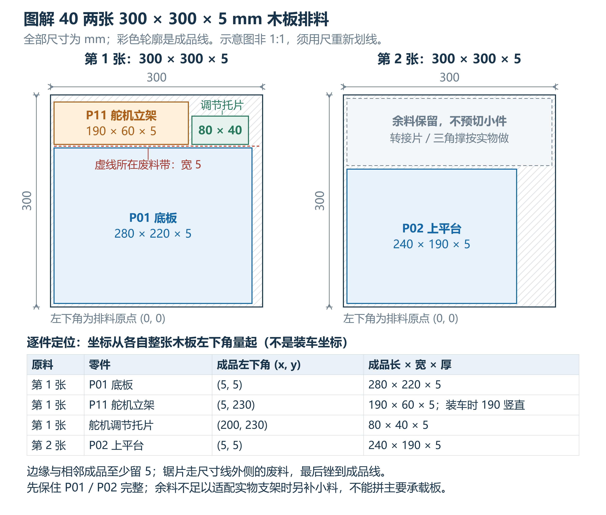
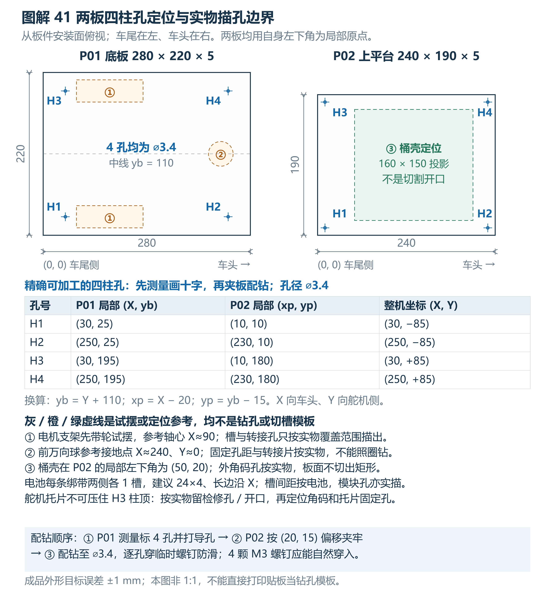
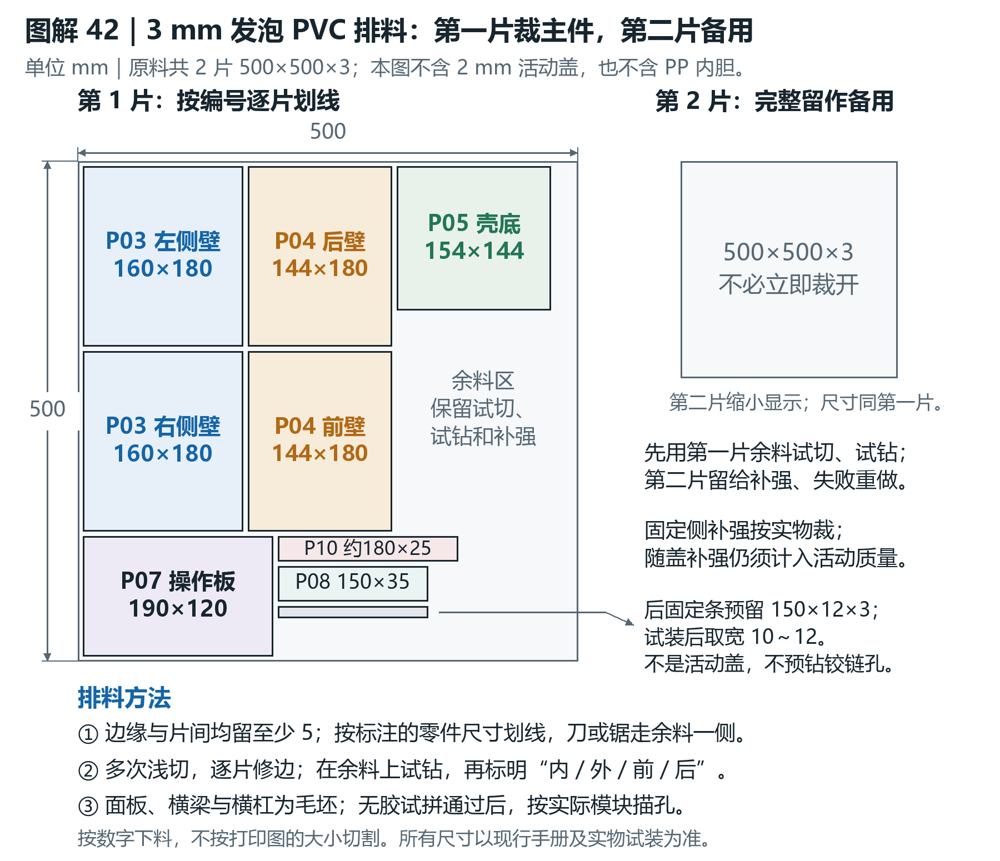
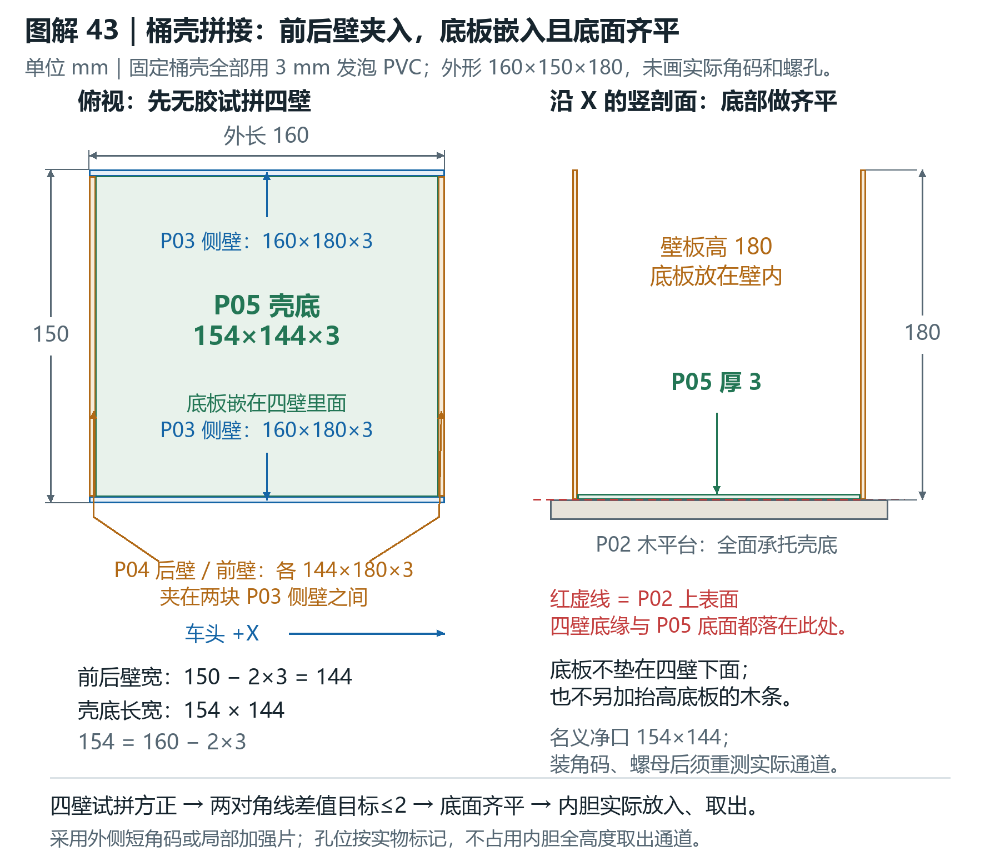
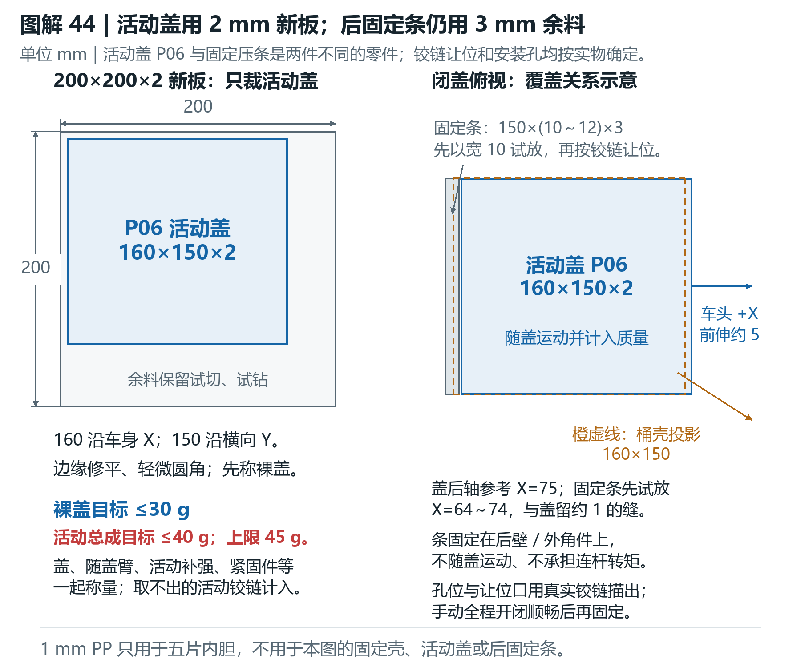

# 木板与PVC板裁剪图解

本组图解已加入同名图解增强版Word第62章。全部标注单位为毫米；这是尺寸关系图，不是1∶1打印描孔模板。沿成品线外侧废料切削，按数字量取尺寸。5mm是边距及零件之间的预留废料，不是刀具宽度。

| 图 | 内容 | 可缩放图源 |
| --- | --- | --- |
| 40 | 两张300×300×5木板的排料与余料 | [SVG](wood/wood_40_nesting.svg) |
| 41 | 280×220底板和240×190上平台四柱孔位 | [SVG](wood/wood_41_pillar_holes.svg) |
| 42 | 500×500×3发泡PVC排料 | [SVG](pvc/pvc_42_nesting.svg) |
| 43 | 四壁扣除板厚及壳底嵌入齐平 | [SVG](pvc/pvc_43_shell_joint.svg) |
| 44 | 200×200×2原料裁活动盖，区分固定后压条 | [SVG](pvc/pvc_44_lid_strip.svg) |

## 木板

第一张切底板280×220、立架190×60及调节托片80×40；第二张切上平台240×190，余料做按实物适配的转接件。图中排料坐标和装车坐标不同。

P01四孔为(30,25)、(250,25)、(30,195)、(250,195)，孔径3.4。P02自身四孔为(10,10)、(230,10)、(10,180)、(230,180)。P02相对P01偏移(20,15)。电机、万向球、绑带、电子板和舵机支架孔先按实物试摆，不照虚线区域盲钻。

## 发泡PVC

全部主要3mm切件可排入第一片500×500板，第二片完整保留补强、试切和重做。此图不含PP内胆，也不以3mm板替代活动盖。

左右侧壁各160×180×3；前后壁各144×180×3，夹在侧壁之间；壳底154×144×3嵌入且底面与壁板底缘齐平。组合外形160×150×180。壳底按实际内口逐边试修，不能因为通用外形公差就强挤。

活动盖160×150×2，裸盖目标≤30g；随盖运动总成目标≤40g，上限45g，必须实称。固定后条约150×10～12×3使用固定壳余料，不随盖运动。所有铰链让位及孔位按实物试装后描出。

## 生成与检查

wood/build_wood.cjs、pvc/build_pvc_diagrams.py是图源。运行需Node/Playwright/Edge或Python/Pillow与中文字体；运行环境路径在脚本顶部，可按实际环境调整。两个figure_manifest.json提供图注、说明与图片规格；geometry_checks.json、nesting_check.json和视检记录记录了几何检查及实际PNG检查。

build_cutting_manual.py用于增量修改，输入必须为Git提交616a7bc中的168页图解增强版，SHA256为251cd1a64bbd1a466630d4e966b3866fa1ca21587e8ba4a98dcf5b7da0dbdf59。以--input指定备份、--output指定输出，避免覆盖未合入修改；retained_formatting.py沿用原版格式。之后需要用Word更新目录、渲染并逐页检查。

本轮只增加机械裁剪图。PCB替代洞洞板正在讨论，现有电路基线仍为MCP23017模块与PWR/IO洞洞板。旧PCF8574 PCB归档不能直接拿来替代。所有图纸尚需实际加工和装配验证。
