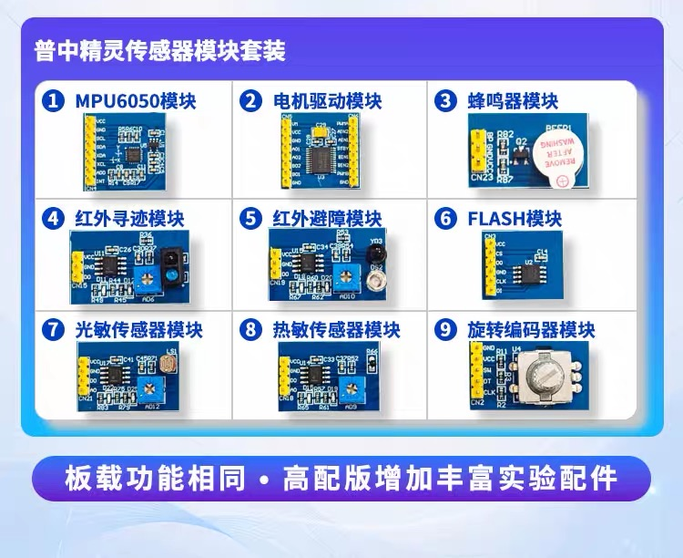

# 普中传感器套装参考图

用户提供的套装商品图，原文件名为“微信图片_20260923153733_19_66.jpg”。用于识别已有模块，未经改图。

图中右下角第9项为旋转编码器模块，对应图解增强版手册已有配件表的“H11 旋转编码器”，A1底板使用J24接口。按VCC、GND、CLK、DT、SW信号名核对接线，不按商品图左右位置推定连接次序。

这张图不能确认实物的电阻阻值、上拉连接或供电兼容性；R27、R28、R33是否安装仍按实物资料或测量结果及[A1装配说明](../pcb-a/manufacturing/order-and-assembly.md)决定。
