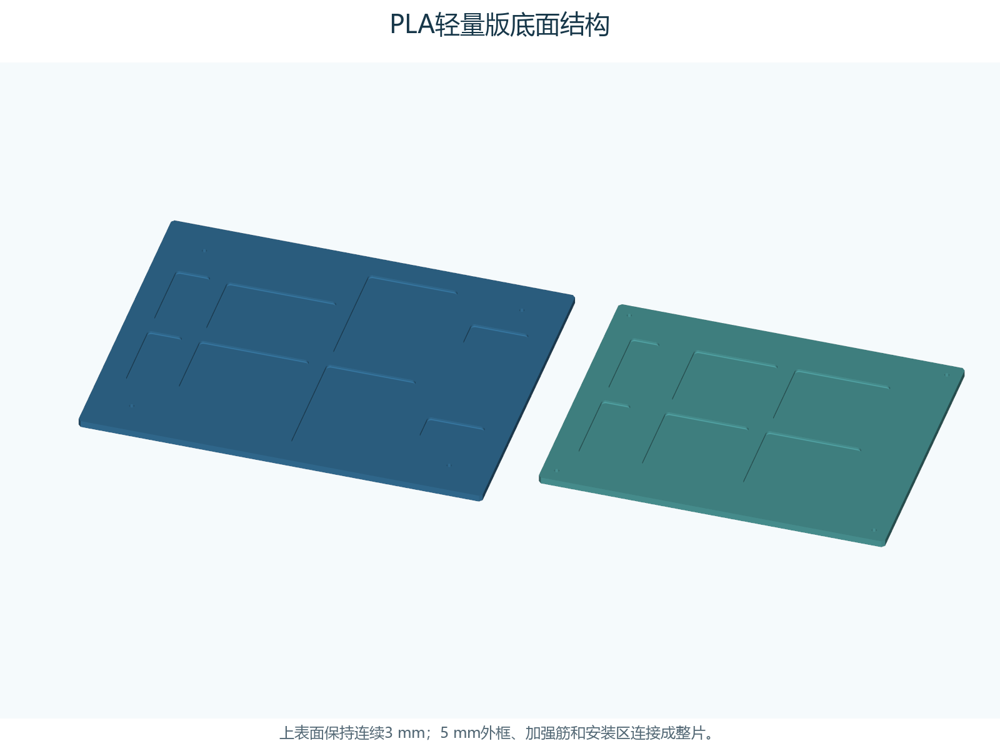
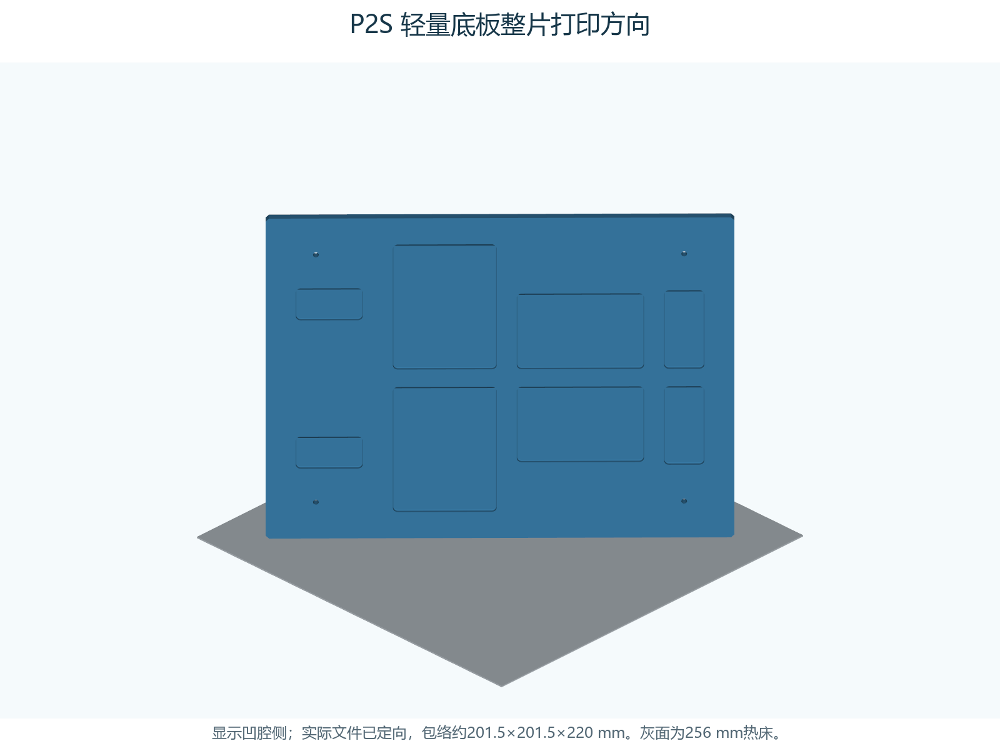
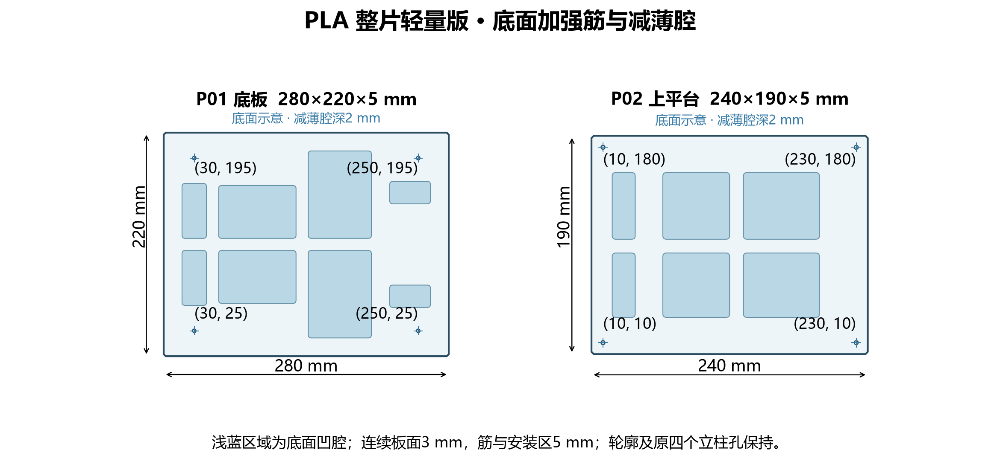

# PLA 整片轻量版 底板与上平台

按用户选择的PLA制作，继续适配拓竹P2S、整片打印。外形、原四个Ø3.4立柱孔、5 mm安装高度和60 mm柱保持。通过底面局部减薄留下连续3 mm板面、5 mm外框与加强筋，已知安装区保留5 mm；没有大面积贯穿孔。

| 板件 | 原5 mm实心体积 cm³ | 轻量版体积 cm³ | CAD实体体积减少 |
| --- | ---: | ---: | ---: |
| P01底板 | 307.78 | 262.92 | **14.6%** |
| P02上平台 | 227.78 | 195.66 | **14.1%** |

两片合计CAD体积减少约14.4%。这是同种材料全实心的几何对比；实际耗材、brim、支撑和打印时间须在同一P2S/PLA切片配置下比较，不能把这个比例当作实际耗材节省或强度保留比例。

## 直接打开哪些文件

| 文件，位于3mf/P2S/ | 数量 | 包络 mm | 打印方向 |
| --- | ---: | --- | --- |
| `P01_light_upright45.3mf` | 1 | 201.53×201.53×220 | 底板侧立，280 mm边沿热床对角线，220 mm边向上 |
| `P02_light_face_down.3mf` | 1 | 240×190×5 | 连续安装面贴床、减薄腔朝上 |
| `C01_upright_hole_test.3mf` | 1 | 70×5×24 | 先试孔 |

同目录结构的 `stl/P2S/` 提供等价STL。3MF是毫米单位的通用几何文件，已烘焙打印方向，**不含机器预设或G-code**。在Bambu Studio选择实际P2S、喷嘴、热床和PLA，各主板分成独立打印任务，保持100%比例与文件方向。

底板不点自动朝向令其躺平，也不把280 mm边直接朝上。上平台这次翻面打印：凹腔必须朝上，连续安装面贴床，打印后翻回安装方向。模型的装车坐标中上表面仍是Z=5、底面Z=0，未改变安装高度。

## 保留强度的具体做法

- 全板安装面连续3 mm，减薄腔只从底面进入2 mm。外框与腔之间至少12 mm的筋保留完整5 mm，腔的XY圆角R3，腔根圆角R0.6。
- 四个立柱孔孔心周围半径14 mm的原板内材料保留5 mm。P02孔靠近外边，保留区域限于原板边界，未向外加大轮廓。
- P01保留电机转接参考区：局部X=45～135，yb=0～50与170～220；前万向球转接区X=214～270、yb=78～142。以上为参考布置的完整厚料区，实际模块仍须描孔。
- P02桶壳外包络按手册在平台局部(50,20)到(210,170)，其四壁脚下周围24 mm宽支撑带保留5 mm；减薄腔布置在带外及桶底内侧，避免直接掏薄壁脚。
- 底板竖放时，以原Y为打印向上方向。每个减薄腔收口的深度沿Y用45°坡面从2 mm归零，避免在腔顶突然横跨整个凹腔；仍须在切片中检查这一区域。

此结构保留了明确的承载路径和安装位置，但减薄区的局部刚度会下降。用户未指定最大工作载荷，**没有额定承重值，也没有验证与原5 mm实心板等强**。装车后按实际支承点逐步加载并检查，不能只凭数字模型宣布强度保证。

## PLA切片起点

可先用实际P2S的0.20 mm Standard与匹配PLA预设，尝试**4道壁、30% gyroid填充、顶底各8层**；孔边和立柱区可用修改器提高局部填充。保留足够壁厚，避免仅依靠降低填充减重。该建议参考[Prusa填充与外壁说明](https://help.prusa3d.com/article/infill_42)，具体数值是本项目未实打的试制起点。

底板可从12 mm外侧brim开始，保守包络225.53×225.53×220 mm；上平台可从5 mm brim开始，包络250×200×5 mm。二者均在P2S名义256 mm空间内；模型不包含brim，需在切片中开启。实际可打印区和辅助支撑以所用配置为准。[P2S官方规格](https://blog.bambulab.com/the-icon-redefined-meet-the-p2s-a-completely-reengineered-version-of-the-ultra-productive-p1-series/)

竖板从较低外壁速度与加速度开始，检查首层连续接触、顶部晃动、凹腔收口及水平孔顶部。C01沿原X从左到右孔径为3.2、3.4、3.6、3.8 mm；需要时调整孔补偿或打印后夹紧修孔。上平台已经翻面，大面积凹腔不需要打印平顶桥面，但桥接、悬垂和支撑仍应逐层预览。

## 安装和后续加孔

P01孔：(30,25)、(250,25)、(30,195)、(250,195)；P02局部孔：(10,10)、(230,10)、(10,180)、(230,180)。上平台相对底板偏移(20,15)，沿用4根60 mm柱，底板底面到上平台顶面仍为70 mm。

电机、电池绑带、万向球、桶壳和电子托板的真实孔槽仍需实测后增补。新增受力螺钉优先放在5 mm厚料区；若必须穿过3 mm减薄区，应在CAD中加局部实心垫台并重新校验，不按原5 mm厚度直接选紧固件。主电池、轮组等不靠薄腔面上的单点紧固。

首次断电加载按真实支承点，从空桶逐步加到计划的实际使用载荷；记录挠度、层间裂纹、孔边白化和立柱松动。异常时停止加重，换回厚板或加实心加强区后复核；合格再手推、架空轮组和低速测试。PLA应按实际材料说明和使用环境验证，不因几何检查通过而假定长期载荷可靠。

## 原厚板备选和可编辑源

- `3mf/reference/P01_solid5_upright45.3mf`、`P02_solid5_flat.3mf`是原5 mm整片厚板，可作切片耗材对照及实物强度备选；同名STL在 `stl/reference/`。
- `step/P01_light.step`、`P02_light.step`是轻量版装车坐标实体；`step/P01_full.step`、`P02_full.step`及`stl/full/`是原5 mm厚板。`ASSEMBLY_VIEW_ONLY.step`仅看装配。
- `source/parameters.json`包含凹腔矩形、保留区域与PLA条件；运行 `source/build_models.py` 可重建。独立Python3.12环境依赖见 `requirements.txt`。OpenSCAD简易源仅对应原5 mm实心备选。
- `checks/validation.json`记录体积、连续板面、5 mm保留区、12 mm筋间距、单连通网格、STEP/3MF回读及P2S包络；`SHA256.json`校验导出文件。

目前未进行实际Bambu Studio切片、有限元分析、实物打印或承重试验。模型检查与实测检查分别记录。
