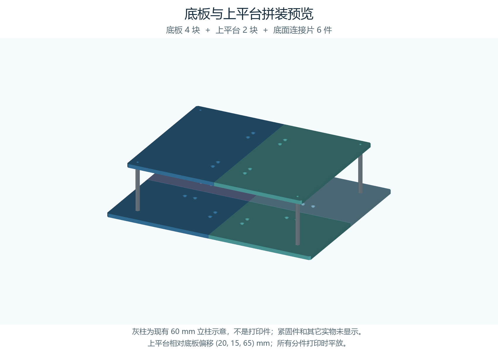

# 底板与上平台 3D 打印备用件

这是木板锯错时的备用结构，尺寸来自现行手册。按 **毫米、100% 比例**导入切片软件，不要为了放进热床缩放模型。

针对约 220×220 或 256×256 mm 热床，使用 `3mf/split/` 或 `stl/split/` 下的分块文件。3MF 明确写入毫米单位；STL 按毫米导入。各文件都是一件零件，需要逐件安排打印任务，不能把全部件一起塞入一张热床。

## 先打印哪些文件

| 文件名，不含扩展名 | 数量 | 外形 mm | 用途 |
| --- | ---: | --- | --- |
| P01_rear_minusY | 1 | 139.85×109.85×5 | 底板车尾、−Y侧 |
| P01_front_minusY | 1 | 139.85×109.85×5 | 底板车头、−Y侧 |
| P01_rear_plusY | 1 | 139.85×109.85×5 | 底板车尾、+Y侧 |
| P01_front_plusY | 1 | 139.85×109.85×5 | 底板车头、+Y侧 |
| P02_rear | 1 | 119.85×190×5 | 上平台车尾半片 |
| P02_front | 1 | 119.85×190×5 | 上平台车头半片 |
| J01_joiner_print_6 | **6** | 64×28×4 | 底面连接片，底板4件、上平台2件 |
| C01_hole_test | 1 | 70×24×5 | 先打印的孔径试片，非装车件 |

孔径试片靠 y=8 一排，从左到右为 Ø3.2、3.4、3.6、3.8；另一个孔是 Ø3.4／顶口 Ø6.4 的90°沉头孔。用实际 M3 螺钉试穿，先确认 Ø3.4 间隙孔和沉头匹配再打印大件。若需孔径补偿，只调整切片的孔补偿或修改模型参数，不要缩放整块板；沉头尺寸也须核对。

## 保持的装配尺寸

拼装后 P01 为 **280×220×5**，P02 为 **240×190×5**，四角 C2。拼缝设计宽 0.3；分片尺寸因此小于原尺寸的一半，不能把拼缝挤到完全消失。

P01 立柱孔：(30,25)、(250,25)、(30,195)、(250,195)。P02 局部立柱孔：(10,10)、(230,10)、(10,180)、(230,180)。均为 Ø3.4 贯通孔。装配时 P02 左下角对齐 P01 的 (20,15)，四孔同轴；沿用4根60 mm双通立柱。底板底面至上平台顶面仍为70 mm。

坐标 X 从车尾向车头，yb 从板材一侧向另一侧递增，+Y 为舵机侧。`minusY` 是 yb 较小的一侧。所有分件在文件里均已平放、最低面 Z=0；上表面的新增拼接孔带90°沉头，立柱孔保持普通直孔。

电机转接槽、电池绑带槽、万向球孔、桶壳固定孔和电子托板孔**没有预开**。现有资料要求实物描孔，其精确位置未提供。打印前应描好实物布局，避开连接片、拼缝与螺钉；可在 `source/parameters.json` / `build_models.py` 中增补，或在 STEP 中继续建模。需要后加工时，拆下电子件、电池并夹紧板件。不可在拼缝边缘固定电机或把电池绑在未连接的分块上。

## 新增紧固件与连接方式

需要 **24颗 M3×16、90°沉头机螺钉，24颗M3金属螺母，24片M3平垫**。这是分块连接的新增用量，不包含原四根立柱、轮组及其它部件的紧固件。螺钉头实测直径应不大于6.4 mm，试装确认头顶能与板面齐平；不要使用盘头螺钉强压沉头孔。

每块连接片4颗螺钉，沉头从板面朝下装入，底部依次为连接片、平垫、螺母。连接片不直接攻塑料螺纹。可使用匹配的防松螺母，但须按实际总厚度选螺钉长度和检查突出量。轻拧至不松动，避免沉头挤裂板件。

4 mm连接片加螺母和M3×16螺钉，会在板底新增约11 mm的局部包络，必须检查底板离地间隙、轮组与循迹传感器，以及上平台下方线束和模块的空间。预览省略螺钉、螺母、轮组、桶壳和电子件；不代表已确认所有实物无碰撞。

1. 先打印试片并检查孔配合，再打印6块主板和6块连接片。打印参数按下一节试样，不以几何检查代替强度验证。
2. 在平整台面按图摆四块底板，X=140和yb=110的拼缝各留0.3；用约0.3厚的实测垫片定位。量外形280×220、对角相等，再从底面装4块连接片，每片4颗螺钉。
3. 上平台两块在X=120处留0.3拼缝，量外形240×190并装2块连接片。先松装，复核外形及4个立柱孔，再对称紧固。
4. 放入四根60 mm柱，P02按(20,15)偏移安装。原立柱螺钉仍按5 mm板厚选择，确认没有顶到柱内螺纹底部。
5. 按实物孔位装轮组、托板和桶壳，检查紧固件净空。确认沉头不高于板面，桶壳底面平稳落在P02上。
6. 在整机实际支承点、断电条件下逐步加到计划使用的真实载荷；观察中部下挠、拼缝张开、孔边白化或裂纹和螺钉松动，再手推检查。出现明显变形应停用并改厚板或加连续金属加强条，同时重新检查高度链与孔槽。最后才做架空轮组及低速动态试验。

## 切片建议与验证边界

这套模型针对 FDM。可优先用 PETG 试制，采用打印机与耗材厂家匹配的预设；PLA可用于室内配合试装。材料说明参考 [Prusa PETG 指南](https://help.prusa3d.com/article/petg_2059)。大面平放、沉头向上、无需支撑；首轮试制建议0.4喷嘴、0.2层高、6道壁、顶底各8层、40% gyroid填充，连接片可100%填充。这些数值是本方案的试制起点，未经本机实打验证，不能作为承重保证。

可从5 mm brim开始检查边角翘起，PETG的热床表面及隔离层按厂家要求选择。所有分件连5 mm brim的最大包络约129.85×200 mm，适合220或256 mm热床，但须在切片中复核实际可打印区、裙边和禁区。[Prusa 翘曲说明](https://help.prusa3d.com/article/warping_2011)。

**打印塑料不等同于5 mm胶合板；分块连接也不等同于整板。**当前只完成数字几何检查：封闭网格、法向、实体体积、STEP回读、3MF回读、孔位同轴、拼缝和连接片几何。尚未进行切片器实测预览、实物打印、承重、跌落、长期蠕变或整机动态验证。只在逐项实测合格后将其作为运行承载件；木板能继续用时仍可保留原木板。

## 可编辑文件与大平台版本

- `step/`：每个零件的精确STEP实体，可在SolidWorks等CAD中改孔槽。`ASSEMBLY_VIEW_ONLY.step`只看装配，包含现有立柱示意，不能整体送打印。
- `stl/full/P01_full.stl`、`P02_full.stl`：原尺寸整片备用文件，仅有原4个立柱孔，不含分块连接孔。需要更大热床或外协打印；不在220/256热床上缩小使用。
- `source/parameters.json`：尺寸及拼接参数；`build_models.py`：可复现CAD和预览；`whole_plates.scad`：整片板的简易参数源。
- `checks/validation.json`、`SHA256.json`：几何校验及制造文件哈希。

重建：在独立Python3.12环境安装 `source/requirements.txt`，再运行 `python source/build_models.py`。不要把运行环境或依赖库加入仓库。
