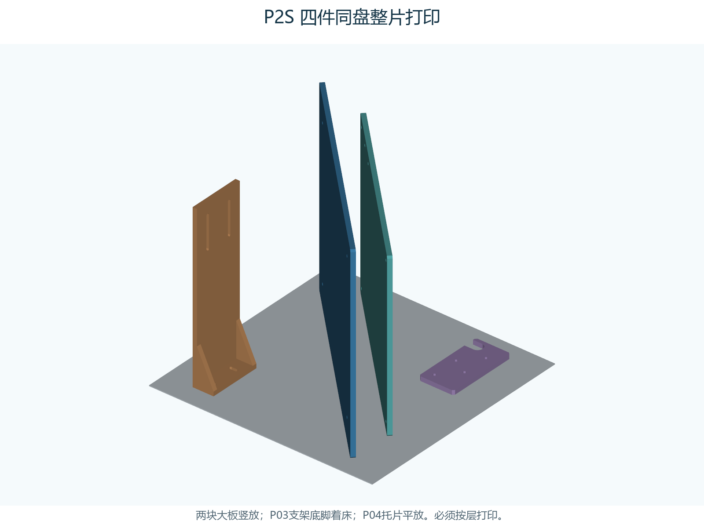
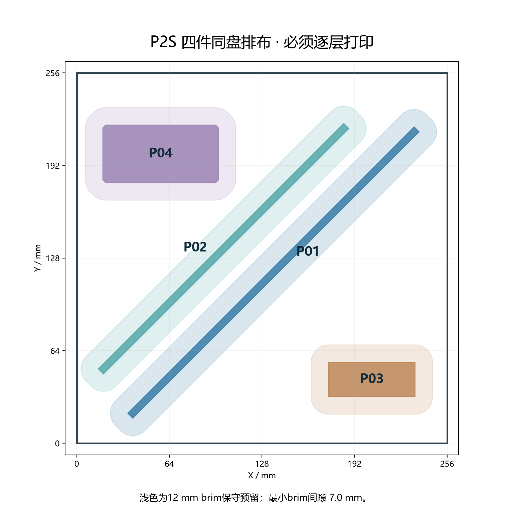
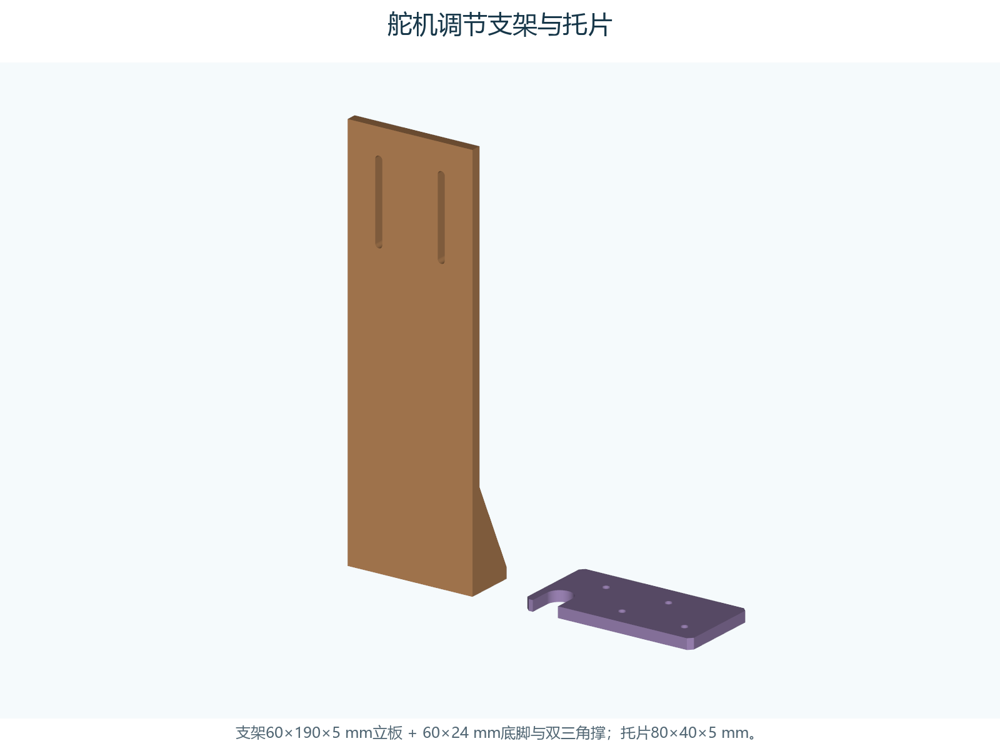
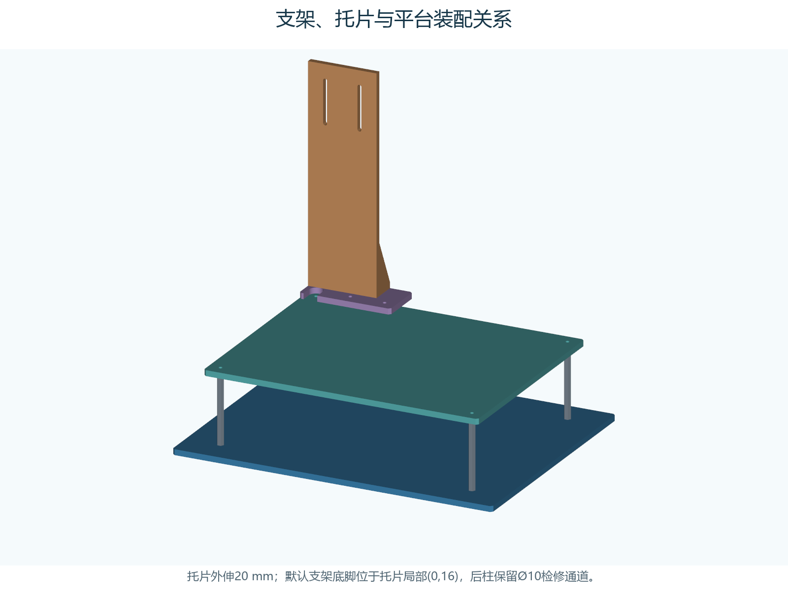

# 2026-11-05 万向轮增高垫块（R3D PETG）

[增高垫块 H3 / H4 / H5](caster-spacer-20261105/README.md)：回应“底板上平面到轮胎/地面约70 mm、万向轮不够高”。按高度链 5+41+20=66 mm 名义值判断万向轮短约4 mm，主选H4（4 mm），另附H3/H5测量容差版；56×24 mm、Φ3.4孔距40 mm，复用一体座原孔(240,90)/(240,130)；P2S/0.4喷嘴/纹理PEI/R3D PETG、0.2 mm层高、6墙、45% gyroid、无支撑、5 mm brim；切片估计H3约19分28秒/4.45 g、H4约22分47秒/5.44 g、H5约26分11秒/6.45 g（不必都打）；螺钉需加长约4 mm，按实物试装。高度依据为口述“约70 mm”+既有高度链，未做实物装配/强度验证，装车后须复测三点着地与水平。

# 2026-11-04 树形支撑加速候选

[快速打印检查](integrated-pla-fast-20261104/README.md)：用户确认24小时按单件、打印机为拓竹P2S；三件均已0.28 mm层高——下半件约13小时41分、面板盖约57分51秒、上半件约32小时58分仍超时；三件合计约47小时38分/1203.9 g，原模型孔位不变。0.08 mm方案继续保留。

# 2026-11-04 R3D PETG 替代料版本

[R3D PETG 全件0.28最快候选](r3d-petg-fast-20261104/README.md)：按用户要求改用 R3D PETG 再输出一版（PLA 版保持不变）。R3D 无 Bambu Studio 官方配置，参数按官网建议区间取保守值（喷嘴250 ℃、热床60 ℃、体积流量12 mm³/s、风扇10–40 %、流量比0.95）；三件均0.28 mm层高——下半件约13小时54分/371.3 g、面板盖约58分14秒/26.8 g、上半件约33小时26分/797.2 g，整套约48小时18分/1195.3 g；上半件单件24小时目标仍未达，PETG 版本未实物打印验证。

# 2026-11-04 易拆支撑验证版 0.28 mm

[易拆支撑验证](easy-support-20261104/README.md)：回应“树形支撑拆除时细杆会不会被拉断/碎裂”。层高与主体参数不变，仅把支撑改成好拆——顶/底间隙0.42 mm（1.5层）、界面1层、界面间距1.0 mm、支撑与模型XY距离0.5 mm、界面速度60 mm/s。切片实测反而略快略省料：PLA整套约47小时13分/1191.2 g（-24分49秒/-12.7 g）、R3D PETG整套约47小时53分/1182.7 g（-24分49秒/-12.6 g）；支撑界面接触量下半主体降约49%、上半主体降约21%。面板无支撑未改；未实物打印验证，如需采用再并入正式包与手册。

# 当前一体打印结构 2026-11-04

[PLA两主体一体结构和0.08 mm工程](integrated-pla-20261104/README.md)：P2S、0.4 mm喷嘴、纹理PEI、256×256 mm打印盘；底板和上平台筒壁各一体，操作面板可拆；匹配B1 PCB。历史分片/PETG工程保留归档。

# 万向轮与循迹模块底板转接件

[D05万向轮首选H41轻量增高支架](caster-riser-20261103/README.md)：按65mm轮、原45mm底板离地参考和新增16mm电机下移量，名义增高41mm；一架两柱切片约18.4g，复用A1原孔。实物轴高与安装片孔径仍需试装核对。

[三路循迹模块轻量转接架](tracker-mount-20261103/README.md)：复用底板拼接孔，模块59.5mm孔距，打印工程约9.6g。

[H41 万向轮支架与循迹架同盘打印](caster-tracker-plate-20261103/README.md)：10件同盘，P2S切片约27.7g。

# 当前桶盖打印版本

[PETG高精度最终打印工程](lid-petg-final-20261103/README.md)：0.08mm层高，六件，约3小时53分钟。替代此前PLA打印设置，安装结构不变。

# 桶盖试装版

[轻量桶盖与随盖附件](lid-fine-20261103/README.md)：原金属合页、M2连杆保留，先验合页小样。

# 已打印旧底座的附件修复

[光敏可调L压条和红外对射IR下托压盖](sensor-retainers-fix-20261103/README.md)：只重打两根压条与两个压盖，旧底座和筒壁保持；P2S/PLA/0.12mm，一盘约41分钟、3.6g。实物装配待试装确认。

# 筒壁免钻孔压脚 高精度打印版

[一盘四只压脚与四只小压垫的P2S工程](wall-clamps-fine-20261103/README.md)：0.12mm层高、6墙、60%填充、树状支撑，预计约3小时20分钟、30.5g。原孔位和筒壁高度保持；打印后仍需清理支撑、试装并逐步加载。

# 筒壁免钻孔压脚 方案预览

[四只压脚与现有孔安装关系](wall-clamp-preview-20261103/README.md)：筒壁不垫高，三个立柱孔和一个舵机托片孔固定，从上方轻压原底脚。仅供方案查看，尚未作为最终打印件发布。

# 当前电机转接板 保守轻量化版

[两块轻量化转接板与打印工程](motor-existing-holes-light-20261103/README.md)：孔位、16mm安装高度及原穿槽座保持，保留主筋和孔台，新增7处浅腔。同参数切片约136g、9小时41分，比上一版省料7.5%、省时89分钟；承力区保留不等于实物等强验证。

# 当前电机固定方案 复用底板现有孔

[两块16mm厚转接板与安装说明](motor-existing-holes-20261102/README.md)：不新增底板孔，原已试配穿槽座继续用；共用9个现有孔，电机下移16mm。两块同盘约11小时10分、147g，0.16mm层高、6墙、60%填充。原直装钻孔方案作为历史记录。

# 当前电机连接件：尺寸确认后的最终精细版

[左右两件同盘最终版](motor-adapter-clearance2-final-20261102/README.md)：保留已试配合适的1.3 mm轮侧边及全部尺寸，0.16 mm层高、4墙、40%填充、顶底7层，约1小时9分25秒。

# 筒壁精细版：0.16 mm四盘

[新版打印文件及参数](wall-panels-fine-20261102/README.md)：四盘平放，外墙60 mm/s、顶面80 mm/s；四台并行最长约9小时24分，模型与原版一致。

# 轮子侧再次减薄的电机座试配版

[左右两件快速试配](motor-adapter-clearance2-20261102/README.md)：轮子侧槽外壁3.3→1.3mm，仅用于尺寸试配，两件约31分34秒。

# 四块平放筒壁与元件安装件

[四盘打印文件及装配说明](wall-panels-20261102/README.md)：前、后、左、右壁各自一体平放，含可拆元件夹座。正常质量、需要处自动树状支撑，四台并行最长约7小时20分；实物配合与开盖行程需首次试装。

# 轮胎干涉修订：电机座避让试装版

先快速试配轮子：[左右电机座快速版](motor-adapter-clearance-20261102/quick-fit/README.md)，单件约20分钟或两件同盘约32分34秒；两种电机座均降低墙层和填充，其他打印文件保持原配置。

[打印新版两件电机座](motor-adapter-clearance-20261102/README.md)：穿槽本体36→30 mm，槽外留3.3 mm承托边，预计42分37秒、14.66 g。槽位、3 mm承托厚及固定耳保持；实际轮胎间隙尚未测量，先完整试装再确定底板孔位。此前0.16/0.28版保留归档，不作为本次干涉修订文件。

# D06电机正式转接座

[打印两件转接座并查看安装说明](motor-adapter-20261101/README.md)：保留试配成功的3mm穿槽面，宽头腔6mm，无字；两件同盘约46分30秒、16.3g。先装完整轮组试摆，再确定底板孔位。

# 当前附件使用底座带标牌版

[打开带标牌打印文件与预览](labeled-bases-20261101/README.md)：4/5号附件更新；2/3号底板可沿用，昨天第二盘继续。

# 当前打印文件：昨天第二盘继续＋四台补打底板和精细附件

1号机正在打印昨天第二盘的上平台、舵机支架、喇叭圈，共3件。其余4台用[四台补打正确清单](parallel-after-old-plate2-20261101/README.md)，打印两片底板和全部精细附件/托片/连接片，共48件，同时启动约5小时20分完成。之前按“43件精细附件正在打印”安排的parallel-four-p2s工程不适用本次，也不要重复打印43件附件合盘或旧主体三盘。

[单机备用全套三盘与拼接装配说明](flat-split-20261101/README.md)仅用于尚未打印任何附件时。保留280×220底板外形与原孔位，两片平放后螺栓连接；上平台一整片平放。51件约22小时45分/649g PLA，已切片，未实打。旧mounted-20261031斜撑工程已停用，夹具尺寸仍有效。新图解见同名Word第66章。

旧的侧立同盘已发生倾倒，下方仅作历史记录。仅支撑原型未经模块安装位集成，不是本轮打印文件。

---

# 历史：四件侧立同盘（曾倾倒，停止推荐）

历史工程 **`3mf/combined/P2S_ALL4_PLA_0p4_READY.3mf`**：底板、上平台、舵机调节支架、舵机调节托片已排在同一256mm热床上，均是完整单件。工程保留P2S 0.4mm、Generic PLA、0.20mm层高、4道壁、30% gyroid、顶底8层、12mm外侧brim及**逐层打印**参数；不含G-code，仍需按实际喷嘴/热床/耗材重新切片。

已用官方Bambu Studio 02.08.02.61实际完成切片，返回成功；估算约**25.5小时、550g PLA**，未实打。四个物体重读后位置和数量一致。当前排布另避开P2S配置中的后侧检测预留区(153,235)到(216,256)。各物体的全高度XY投影加12mm brim预留后仍在热床内，最小brim边间隙约**7.0mm**。

**保持逐层打印，保持本文件方向和排布。**不要切到逐件打印，不要自动朝向或自动排布。上平台在同盘工程里也改为竖放，不能拿前一版平放上平台直接叠到同盘工程中。各高件每层一起打印；该排布没有按逐件模式做打印头净空验证。

通用几何备份为 `3mf/combined/P2S_ALL4_BY_LAYER.3mf`，只有四件几何和位置，不带机器预设。两份选一份打开，不能重复导入。单独打印文件和原厚板备选见后文。

## 新增舵机调节支架和托片

| 零件 | 本版结构 | 单独打印文件，位于3mf/P2S/ |
| --- | --- | --- |
| P03舵机调节支架 | 60×190×5 mm立板，整体60×24×5 mm底脚，双5 mm厚/45 mm高三角撑 | `P03_stand_back_down.3mf`，宽面贴床 |
| P04舵机调节托片 | 80×40×5 mm，12 mm宽U形后柱检修缺口，两组Ø3.4孔 | `P04_tray_flat.3mf` |

P03上端两条3.4mm宽槽，中心X=15/45，槽端心Z=140/176，用于根据实物制作的舵机转接夹片进行高度调整。**这不是已核定的SG90安装耳孔距**；舵机本体、安装耳、输出轴方向和转接夹片仍按原M47—M49试装、描孔。模型不声称直接卡住任何商品SG90。

底脚两条3.4mm宽短槽位于X=20/50、Y端心11/17；托片底脚孔为(20,28)/(50,28)。托片固定到平台的孔为(40,10)/(70,10)。P02已新增平台局部**(40,180)/(70,180)**两孔，均在5mm厚料区；原四个立柱孔保持。

托片装在P02局部(0,170,5)，对应原整机X=20～100、Y=75～115，外伸20mm；支架底脚默认放在托片局部(0,16,5)。后柱映射到托片(10,10)，已核对10mm直径工具通道。默认支架底脚应保持Y=16；若滑槽调到别的位置，重新检查后柱通道，向内移动可能遮挡检修。

托片到平台、支架底脚到托片共需**4套M3×16、平垫和螺母**；上端转接夹片的紧固件另按实物厚度选择，舵机耳部用实际合适螺钉。不要把上端调节槽当作已确认的舵机耳孔。

P03单独打印可宽面贴床，改善其层间受力方向；同盘为容纳四件，P03以底脚着床，未证明其与宽面打印等强。首先验证底脚、三角撑与竖板层间质量，按原20/50/20/50机构检查轴距与桶壁净隙，断电手动装配后再接舵机。实物带载和额定承重尚未验证。

## 单件打印与轻量化说明

按用户选择的PLA制作，继续适配拓竹P2S、整片打印。外形、原四个Ø3.4立柱孔、5 mm安装高度和60 mm柱保持；P02另有两处托片固定孔。通过底面局部减薄留下连续3 mm板面、5 mm外框与加强筋，已知安装区保留5 mm；没有大面积贯穿孔。

| 板件 | 原5 mm实心体积 cm³ | 轻量版体积 cm³ | CAD实体体积减少 |
| --- | ---: | ---: | ---: |
| P01底板 | 307.78 | 262.92 | **14.6%** |
| P02上平台 | 227.69 | 195.57 | **14.1%** |

两片合计CAD体积减少约14.4%。这是同种材料全实心的几何对比；实际耗材、brim、支撑和打印时间须在同一P2S/PLA切片配置下比较，不能把这个比例当作实际耗材节省或强度保留比例。

## 分开打印时打开哪些文件

| 文件，位于3mf/P2S/ | 数量 | 包络 mm | 打印方向 |
| --- | ---: | --- | --- |
| `P01_light_upright45.3mf` | 1 | 201.53×201.53×220 | 底板侧立，280 mm边沿热床对角线，220 mm边向上 |
| `P02_light_face_down.3mf` | 1 | 240×190×5 | 连续安装面贴床、减薄腔朝上 |
| `C01_upright_hole_test.3mf` | 1 | 70×5×24 | 先试孔 |

同目录结构的 `stl/P2S/` 提供等价STL。3MF是毫米单位的通用几何文件，已烘焙打印方向，**不含机器预设或G-code**。在Bambu Studio选择实际P2S、喷嘴、热床和PLA，各主板分成独立打印任务，保持100%比例与文件方向。

底板不点自动朝向令其躺平，也不把280 mm边直接朝上。上平台这次翻面打印：凹腔必须朝上，连续安装面贴床，打印后翻回安装方向。模型的装车坐标中上表面仍是Z=5、底面Z=0，未改变安装高度。

## 保留强度的具体做法

- 全板安装面连续3 mm，减薄腔只从底面进入2 mm。外框与腔之间至少12 mm的筋保留完整5 mm，腔的XY圆角R3，腔根圆角R0.6。
- 四个立柱孔孔心周围半径14 mm的原板内材料保留5 mm。P02孔靠近外边，保留区域限于原板边界，未向外加大轮廓。
- P01保留电机转接参考区：局部X=45～135，yb=0～50与170～220；前万向球转接区X=214～270、yb=78～142。以上为参考布置的完整厚料区，实际模块仍须描孔。
- P02桶壳外包络按手册在平台局部(50,20)到(210,170)，其四壁脚下周围24 mm宽支撑带保留5 mm；减薄腔布置在带外及桶底内侧，避免直接掏薄壁脚。
- 底板竖放时，以原Y为打印向上方向。每个减薄腔收口的深度沿Y用45°坡面从2 mm归零，避免在腔顶突然横跨整个凹腔；仍须在切片中检查这一区域。

此结构保留了明确的承载路径和安装位置，但减薄区的局部刚度会下降。用户未指定最大工作载荷，**没有额定承重值，也没有验证与原5 mm实心板等强**。装车后按实际支承点逐步加载并检查，不能只凭数字模型宣布强度保证。

## PLA切片起点

可先用实际P2S的0.20 mm Standard与匹配PLA预设，尝试**4道壁、30% gyroid填充、顶底各8层**；孔边和立柱区可用修改器提高局部填充。保留足够壁厚，避免仅依靠降低填充减重。该建议参考[Prusa填充与外壁说明](https://help.prusa3d.com/article/infill_42)，具体数值是本项目未实打的试制起点。

底板可从12 mm外侧brim开始，保守包络225.53×225.53×220 mm；上平台可从5 mm brim开始，包络250×200×5 mm。二者均在P2S名义256 mm空间内；模型不包含brim，需在切片中开启。实际可打印区和辅助支撑以所用配置为准。[P2S官方规格](https://blog.bambulab.com/the-icon-redefined-meet-the-p2s-a-completely-reengineered-version-of-the-ultra-productive-p1-series/)

竖板从较低外壁速度与加速度开始，检查首层连续接触、顶部晃动、凹腔收口及水平孔顶部。C01沿原X从左到右孔径为3.2、3.4、3.6、3.8 mm；需要时调整孔补偿或打印后夹紧修孔。上平台已经翻面，大面积凹腔不需要打印平顶桥面，但桥接、悬垂和支撑仍应逐层预览。

## 安装和后续加孔

P01孔：(30,25)、(250,25)、(30,195)、(250,195)；P02局部孔：(10,10)、(230,10)、(10,180)、(230,180)。上平台相对底板偏移(20,15)，沿用4根60 mm柱，底板底面到上平台顶面仍为70 mm。

电机、电池绑带、万向球、桶壳和电子托板的真实孔槽仍需实测后增补。新增受力螺钉优先放在5 mm厚料区；若必须穿过3 mm减薄区，应在CAD中加局部实心垫台并重新校验，不按原5 mm厚度直接选紧固件。主电池、轮组等不靠薄腔面上的单点紧固。

首次断电加载按真实支承点，从空桶逐步加到计划的实际使用载荷；记录挠度、层间裂纹、孔边白化和立柱松动。异常时停止加重，换回厚板或加实心加强区后复核；合格再手推、架空轮组和低速测试。PLA应按实际材料说明和使用环境验证，不因几何检查通过而假定长期载荷可靠。

## 原厚板备选和可编辑源

- `3mf/reference/P01_solid5_upright45.3mf`、`P02_solid5_flat.3mf`是原5 mm整片厚板，可作切片耗材对照及实物强度备选；同名STL在 `stl/reference/`。
- `step/P01_light.step`、`P02_light.step`是轻量版装车坐标实体；`step/P01_full.step`、`P02_full.step`及`stl/full/`是原5 mm厚板。`ASSEMBLY_VIEW_ONLY.step`仅看装配。
- `source/parameters.json`包含凹腔矩形、保留区域与PLA条件；运行 `source/build_servo_pack.py` 可重建四件几何和通用同盘排布；原生工程需在Bambu Studio中按本节参数重建或保存。单运行 `source/build_models.py` 只重建主板。独立Python3.12环境依赖见 `requirements.txt`。OpenSCAD简易源仅对应原5 mm实心备选。
- `checks/validation.json`记录体积、连续板面、5 mm保留区、12 mm筋间距、单连通网格、STEP/3MF回读及P2S包络；`SHA256.json`校验导出文件。

本轮已对四件同盘工程实际切片；尚未做有限元、实物打印和承重试验。CLI原厂结束脚本有T65535解析提示，切片/导出返回码均为0；未改厂商结束脚本，交付工程不含G-code。日志与结果见checks/bambu_slice.json及bambu_cli_notes.txt。
