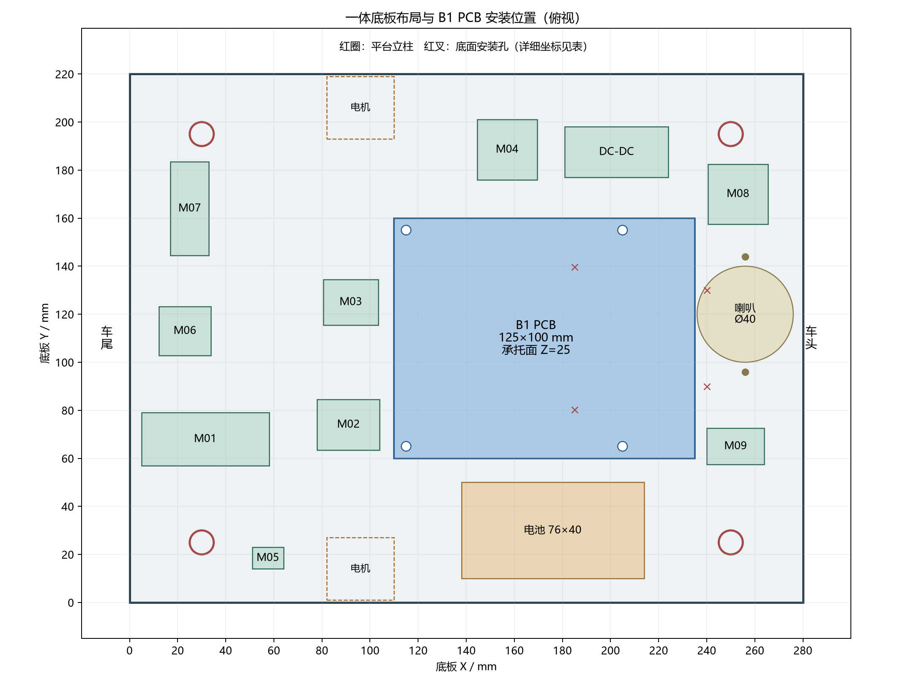
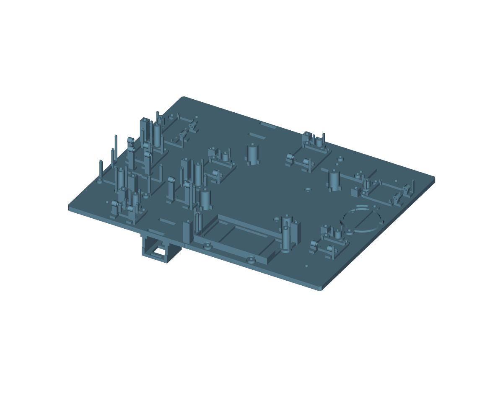
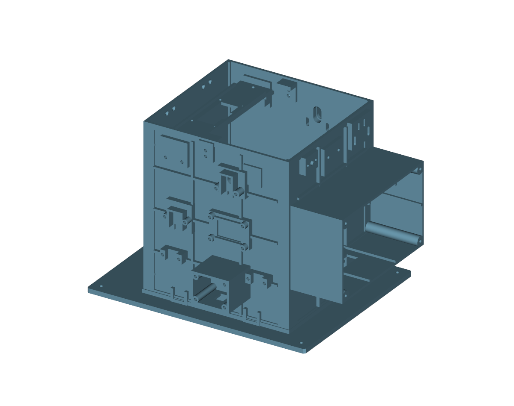

# 装配顺序与模块安装（一体两主体 + B1 PCB）

2026-11-05。适用：PLA 一体两主体（`integrated-pla-20261104`，0.08 mm 工程）或其 0.28 mm 快打候选（`integrated-pla-fast-20261104`）——两者**结构完全相同**，装配方法一致。打印机拓竹 P2S、0.4 mm 喷嘴，文档对应手册第 68 章（一体结构与紧固）、第 69 章（快打）。五金见 [fasteners-20261105](../fasteners-20261105/README.md)。

**先看整体尺寸**：
**看下主体外形**：、

---

## 0. 先分清"哪些要打、哪些沿用、哪些已不用打"

### 0.1 必打的三个大件

| 件 | 工程 | 内容 |
|---|---|---|
| 下半主体 | `projects/P2S_LOWER_H41_B1_PLA_008.3mf`（或快打 0.28 版） | 280×220×5 底板 + 9 种模块卡座 + 电池托架 + 降压座 + 喇叭座 + B1 四支柱 + 电机承托 + 循迹支架 + H41 万向轮增高，全部一体 |
| 上半主体 | `P2S_UPPER_INTEGRATED_PLA_008.3mf` | 240×190×5 平台 + 160×150×180 筒壁 + 操作仓 + 固定传感器座 + 超声横梁，一体 |
| 可拆操作面板 | `P2S_PANEL_COVER_PLA_008.3mf` | 原四颗螺钉可拆 |

### 0.2 沿用的旧附件（`mounted-20261031` 两盘里的部分物体）

**只打这些，跳过 body/cradle**（卡座已并入下半主体，再打是重复且装不上）：

| 物体 | 数量 | 作用 |
|---|---:|---|
| `M01_lid` … `M09_lid` | 9 | 压框（可翻开的上盖） |
| `M01_detent` … `M09_detent` | 9 | 定位簧片（只定位、不承载） |
| `M01_keeper` … `M09_keeper` | 9 | 刚性拨片/锁片（承受抬起力） |
| `BAT_L/R_detent`、`BAT_L/R_keeper` | 4 | 电池端部双锁片 |
| `P04_TRAY` | 1 | 电子托板（按需） |

**不要打**：`M*_body`（已一体）、`P01_BASE_WITH_CRADLE`、`P02_UPPER`、`P03_STAND`、`P05_BATTERY_cradle`、`P06_BUCK_cradle`、`P07_SPEAKER_cradle`（均已并入一体件）。零件索引见 `mounted-20261031/source/parts_index.csv`，盘上 XY/盘号可直接对照取件。

### 0.3 另外两组小附件

- 传感器压条：`sensor-retainers-fix-20261103`（光敏 L 压条 ×2、红外下托压盖 ×4）。**不能用**会掉探头的旧直压条。
- 筒壁压脚：`wall-clamps-fine-20261103`（C1–C4 + 4 颗调压螺丝）。
- 活动盖及五金：`lid-fine-20261103`。

---

## 1. 阶段 A：底板与承托（全程不上电）

1. **清孔**：Φ3.4 孔用 3.2 mm 钻头/针轻通一遍（PLA 会缩孔），不要把孔扩成椭圆。服务孔位置见 `checks/module_positions.csv`。
2. **装 B1 PCB**：4 颗 M3×35 穿过四孔 (115,65)/(205,65)/(115,155)/(205,155) 的 20 mm 一体柱 → 下方小垫圈 + M3 锁母；**对角交叉分两次拧紧**，PCB 不翘、不压焊点。长度按实际露牙确认（见紧固件清单待核对第 1 项）。
3. **降压模块**：M2.5×16 两孔（模块本地 (7,19)/(36,2)），下方 M2.5 螺母；四角焊盘不是安装孔。
4. **喇叭**：定位圈在 (256,120)，两耳孔 (256,96)/(256,144)；M3×30 从下穿、上侧可调螺母 + 垫圈，耳高 E + 耳厚 t ≤ 19 mm，**不能强压耳片**。

□ 检查：PCB 四角等高（卡尺量四角到台面，差 ≤0.5 mm）；降压与喇叭都不遮挡排针插拔。

---

## 2. 阶段 B：9 个模块（核心步骤）

### 2.1 位置与五金对照（来自 `checks/module_positions.csv`）

| ID | 模块 | 中心 (X,Y) mm | 绕 Z 旋转 | PCB 承托 Z | 铰链轴 | 拨片轴 + 簧片锚 |
|---|---|---|---:|---:|---|---|
| M01 | STM32 核心板 | (31.5, 68) | 180° | 25 | M3×30 | 2×M3×40 |
| M02 | MCP23017 | (91, 74) | 0° | 25 | M3×30 | 2×M3×40 |
| M03 | FLASH | (92, 125) | 0° | 9 | M3×30 | 2×M3×25 |
| M04 | TB6612 驱动 | (157, 188.5) | 0° | 9 | M3×30 | 2×M3×25 |
| M05 | 3.3V 稳压 | (57.5, 18.5) | 0° | 15 | M3×30 | 2×M3×30 |
| M06 | DFPlayer | (23, 113) | 0° | 25 | M3×30 | 2×M3×40 |
| M07 | HC-05 蓝牙 | (25, 164) | 90° | 10 | M3×30 | 2×M3×25 |
| M08 | MPU6050 | (253, 170) | 90° | 9 | M3×30 | 2×M3×25 |
| M09 | 蜂鸣器 | (252, 65) | 0° | 9 | M3×30 | 2×M3×25 |

坐标原点＝底板左下角（X 向车头、Y 向舵机侧），底板底面 Z=0。

### 2.2 每个模块的 5 步（同一个套路重复 9 次）

1. **空装试合**：模块 PCB 放进一体卡座，四角搭接、排针/电解电容/塑壳不顶压框；接口方向朝外便于插线。
2. **压框就位**：`Mxx_lid` 放到卡座轴座上，与卡座耳孔对穿。
3. **插铰链轴**：M3×30（**ISO7380 低圆头 Ø5.7×1.65**，换高圆柱头会顶避空）穿过，加垫圈 + 锁母；锁母只锁轴向，**留 0.1–0.2 mm 间隙**，压框要能自由翻动。
4. **装定位簧片**：`Mxx_detent` 平放，用簧片锚钉（M3×25/30/40）从**底板下方**穿入（头在底板下面），上方加 Ø≤6 mm 小垫圈 + 4 mm 锁母。簧片只防误转，不受承载。
5. **装刚性拨片**：`Mxx_keeper` 装到轴上，垫圈 + 锁母；拨片轴座与拨片之间**不要**再加圆垫圈（会遮住定位凸点）。
6. **开合 3 次验收**：闭合到硬止挡、不压弯 PCB；锁片能挡住压框不被线束顶开；拨片手感有明确"入位"。

> 顺序建议：先装 Z 低、靠中间的 M03→M04→M08→M09→M07→M05，最后装 Z=25 的 M01/M02/M06（这 3 个高、占位大，先装会挡手）。

### 2.3 每个模块的专项注意

- **M01 核心板（180°）**：SWD 排针和串口要能直接插 USB-TTL；装完先测 SWD 能连，再继续往上装。
- **M02 MCP23017**：I²C 走线最近，A0–A2 地址跳线先在座上设好再上盖。
- **M04 TB6612**：电机线、VM、GND 是动力线，接头留应力弯，不要被压框夹住。
- **M07 HC-05（90°）**：天线朝外，别贴筒壁；状态 LED 要能看见。
- **M08 MPU6050（90°，在 (253,170)）**：安装方向和旧坐标不同，**装好后必须重新校准零点**，并按新方向改轴映射（否则前后/左右倾斜报警会反）。
- **M09 蜂鸣器 (252,65)**：出声孔朝外，别被线束堵住。

---

## 3. 阶段 C：电池与走行（仍不上电）

1. **电池托架**：托条铺 2 mm EVA；电池 76×40×20、2S 串联放入，**出线朝 +X**；`BAT_L/R_keeper` 加 M3×40 轴与锚钉（各 2 根），双锁片只夹端部塑料壳，**不挤压电芯**。
2. **电机（左右镜像）**：左电机输出轴朝 −Y、右电机朝 +Y；**轮侧 1.3 mm 薄边朝轮胎**，3.3 mm 厚边朝车内。用原配 T 形金属固定片 + 原配横向螺栓，先轻紧。装上前先架空单轮低 PWM 试方向（手册步骤 146/147），一侧反就**断电**交换该电机两根线，不许带电换线。
3. **万向轮**：H4 增高垫块 + M3×60 穿 (240,90)/(240,130)（一体座 Z=−41）；锁母啮合 2–3 扣，螺钉端不得先于轮胎触地。
4. **循迹模块**：M3×55 穿 (185,80.25)/(185,139.75)（Z=−43.4，孔距 59.5）；探头离地约 8 mm，且**探头必须低于螺钉末端**。

□ 检查：两驱动轮 + 万向轮三点同时着地；车体水平；用手推直行不跑偏。

---

## 4. 阶段 D：上平台与附件

1. **四根 60 mm 尼龙双通柱**：底板四孔 (30,25)/(250,25)/(30,195)/(250,195)；下面 M3×10（平垫 + 底板 + 柱），上面 M3×6 接上平台四孔（平台本地 (10,10)/(230,10)/(10,180)/(230,180)，平台相对底板偏移 (20,15,65)）。**对角顺序拧到不松动即可，不要靠拧紧柱把翘板硬拉平**。尼龙柱有有效螺纹深度，不能顶到柱底。
2. **上主体落位**：平台四孔对准柱子放下，先手旋上 M3×6，全部对位后再逐颗收力。
3. **可拆操作面板**：原四颗 M3×10~12，先不上死（要反复开合维护仓）。
4. **传感器**：光敏 L 压条 2 颗 M3×20（槽可调 29.4–42.6）；红外对射压盖每端 2 颗 M3×25，共 4 颗。
5. **筒壁压脚**：C1–C3 用 M3×16 固定端（三个原立柱孔），C4 共用 P04 舵机托片孔（M3×20）；C1–C4 各一颗 M3×8 调压螺丝，**螺丝头必须悬空不顶筒壁**。
6. **舵机与盖**：按**真实铰链轴**定位（手册第 15 章 + 第 60 章详图），舵机轴与盖铰链轴**同高、平行、轴间距 50 mm**，形成不交叉平行四边形；输出盘带动 20 mm 舵臂 + 20 mm 侧臂 + 双球头拉杆。
7. **活动盖**：铰链连接座 4 颗 M2.5、连杆臂 2 颗 M2.5、开关支脚 2 颗、触片 2 颗；铰链座底部 M2×8 沉头 4 颗，**头不得凸出底面**；M2 球头拉杆用原配，长度按实物调。

---

## 5. 阶段 E：电气（严格按手册章节顺序，先测后接）

**原则：先做能测的小系统，通过后再加下一级；电源和停止回路通过之前不接执行器。**

| 顺序 | 内容 | 手册 |
|---|---|---|
| E1 | 断电测通断/短路：电池座 ±、总开关、保险、地 | 第 21 章 |
| E2 | 最小系统：3V3_CORE + SWD + 串口 | 第 22 章 |
| E3 | I²C 总线 + MCP23017 + OLED | 第 23 章 |
| E4 | MPU6050 / RC522 / FLASH 逐一验证 | 第 24 章 |
| E5 | 输入电平适配 + 按键/编码器/碰撞/盖检测 + 急停 | 第 25–27 章 |
| E6 | TB6612 架空空转 → SG90 空载 → 再带机械负载 | 第 29 章 |
| E7 | 对射/循迹/避障/靠近开盖 | 第 30 章 |
| E8 | 蓝牙、DFPlayer、电池 ADC | 第 32–33 章 |

每级都填一次实测记录（电压、电流、现象），不合格不进下一级。

---

## 6. 阶段 F：收线与最后合装

- **分道走线**：动力线（电池→开关→TB6612/舵机）单独走，远离信号线与 RFID 天线区；主电流不走细杜邦线。
- 每个接插件留一段应力弯，扎带不勒紧杜邦线；穿板处加护线圈（手册第 17 章）。
- 线束**不压压框、不进轮井、不被轮胎扫到**；压框能全程自由开合 90°。
- 最后再做一遍：通电空载跑 → 载物跑 → 连续开合 10 次 → 三轮着地复测。

---

## 7. 最容易出错的 8 条

1. 用高圆柱头代替 ISO7380 低圆头 → 压框/避空处顶死。
2. 锁母拧到底 → 压框翻不动，甚至把轴座撑裂；应留 0.1–0.2 mm。
3. 把 PLA 簧片当承载钩用 → 拆装几次就断，抬起力必须由刚性拨片承担。
4. 拨片轴与拨片之间乱加垫圈 → 遮住定位凸点，锁不住。
5. 先接电机再测电源 → 烧 TB6612；一定先 E1/E2 再 E6。
6. 电池锁片压到电芯本体 → 鼓包/漏液风险，只夹端部塑料壳。
7. 靠拧紧四根尼龙柱把上平台拉平 → 螺纹滑牙/平台变形。
8. M08 装完不重新标定 → 倾斜报警方向反了。

---

## 8. 数据来源与边界

- 结构/坐标：`integrated-pla-20261104/checks/module_positions.csv`、`critical_dimensions.json`、`assembly_audit.json`，以及 `source/build_lower.py`、`source/build_upper.py`。
- 夹具五金与装配法：`mounted-20261031/README.md`、`checks/HARDWARE_REVIEW.md`、`source/parts_index.csv`。
- 紧固件：`fasteners-20261105/README.md`。
- 电气顺序：手册第 21–33 章；机械细节：手册第 68/69 章。
- **本文件是设计/文档层面的装配顺序，不是已完成的实物装配记录。** 整机尚未实物装配、承重、耐久或通电验收；坐标、长度、孔位以实物试装为准，装车后必须复测三点着地与探头离地。