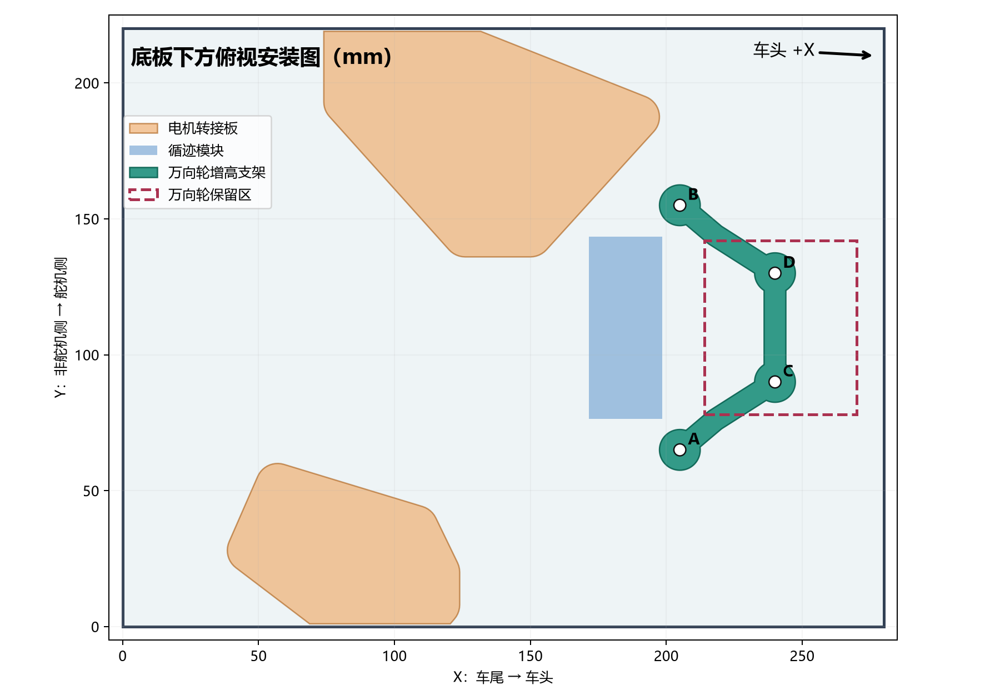
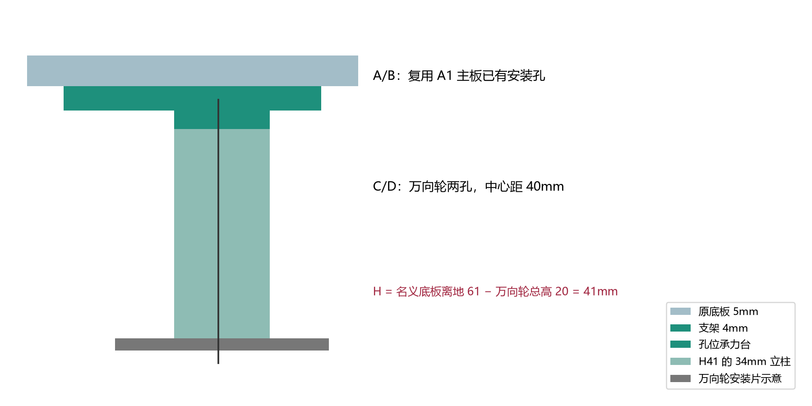

# D05 万向轮轻量增高支架

需要与循迹架一次打印时，使用[H41 与循迹架同盘 P2S 工程](../caster-tracker-plate-20261103/README.md)。

本设计按“制定智能垃圾桶搭建步骤1”中用户实测：D05 万向轮从地面到安装片上表面 **20 mm**、两安装孔中心距 **40 mm**。孔径和安装片外形尚无实测数据。

**按原方案高度链确定首选高度：**65 mm 轮胎半径为 32.5 mm；原方案底板离地参考为 45 mm，等价于轮轴低于底板下表面 12.5 mm。已打印的电机转接板将轮轴下移 16 mm，因此新底板名义离地为 `32.5+12.5+16=61 mm`；万向轮总安装高度实测 20 mm，所以增高件名义高度为 **`61−20=41 mm`**。首选打印 [H41 工程](P2S_CASTER_RISER_H41_LIGHT_016.3mf)。原方案的轮轴偏移是设计参考，不是电机实物测量，装车后仍要确认三轮同时着地。

采用底板已有的 A1 主 PCB 前侧两孔，不钻新孔。两根镂空支臂把万向轮载荷引至底板前部原 5 mm 实心加强区；两只直径 13 mm 的中空立柱承压，M3 金属贯穿螺栓负责连接，支架上方螺钉头藏入沉孔，不顶底板。其他高度为实装修正选项，不要四份都打印：

| 底板离地 Hb | 增高 H=Hb−20 | P2S 打印工程 | 整盘切片估计 |
|---:|---:|---|---:|
| 约55 mm | 35 mm | [H35](P2S_CASTER_RISER_H35_LIGHT_016.3mf) | 16.6 g |
| 约60 mm | 40 mm | [H40](P2S_CASTER_RISER_H40_LIGHT_016.3mf) | 18.1 g |
| **名义61 mm** | **41 mm** | **[首选 H41](P2S_CASTER_RISER_H41_LIGHT_016.3mf)** | **18.4 g** |
| 约65 mm | 45 mm | [H45](P2S_CASTER_RISER_H45_LIGHT_016.3mf) | 19.7 g |

四份均包含一块支架、两只等长立柱，采用 P2S、0.4 mm 喷嘴、Generic PLA、0.16 mm 层高、6 墙、45% gyroid、无支撑、5 mm brim。作为工程打开、100% 比例、保持已有朝向。切片估计不等于实物质量或强度试验。

## 孔位和选高度

以底板车尾左下角为原点，X 向车头，Y 向舵机侧，单位 mm。A=(205,65)、B=(205,155) 是已有的 A1 主 PCB 固定孔；C=(240,90)、D=(240,130) 是万向轮两孔，中心距 40 mm。万向轮安装中心为 (240,110)，位于原设计 X=214～270、Y=78～142 的实心加强区。数字模型检查支架与两块电机转接板、上轮交付的循迹转接架无实体相交；**真实万向轮安装片外形和转动包络未建模**。

先按现有设计数据选择 H41。装好两侧电机、65 mm 轮子和 H41 万向轮后，在平整桌面上检查三轮同时接地、底板大致水平。若实物轮轴相对固定片的偏移与原方案参考不同，再测桌面至底板**下表面**的实际距离 Hb，按 `H=Hb−20 mm` 修正；不能靠强拧螺钉使三轮着地。

## 装配顺序与五金

1. **断电并移开 A1 PCB 线束**。只处理 A/B 两个已有固定孔，保持另两个 A1 固定点。核对原 10 mm 绝缘柱、PCB 和底板孔同轴。
2. 将两颗万向轮连接螺钉从支架的 C/D **上面**穿入沉孔，螺钉头下各用外径不超过 6 mm、厚约 0.5 mm 的平垫。沉孔名义直径 6.4 mm、深 2.2 mm，适用于头径不超过 5.7 mm、高不超过 1.65 mm 的 M3 ISO7380 低圆头。螺钉头和垫片必须完全低于支架上平面。
3. 在支架下方套两只**同高度**立柱，再装 D05 万向轮安装片，下面各放平垫和 M3 防松螺母。按安装片约 2 mm 厚的参考叠层，**H41 先试 M3×50**；安装片真实厚度未测，螺钉应穿出锁母至少一扣且不能碰滚轮，长度以试装为准。若 D05 孔径小于 3.4 mm 或安装片外形碰到立柱，暂停并按实物修订接口，不能强拧或任意扩孔。
4. 先把万向轮和支架组装好，再将支架平贴底板下表面。A/B 与 A1 主 PCB 的 10 mm 绝缘柱**共用原底板孔**，用两颗适长 M3 螺钉连接。按 1.6 mm PCB、10 mm 隔离柱、5 mm 底板、4 mm 支架及垫片/锁母估算，先试 M3×30；原板上部元件和实物螺钉露牙需复核。不得让螺钉或支架顶到 PCB 背面焊点。
5. 将车放到平桌面，确认两侧 65 mm 驱动轮与万向轮同时接地、底板大致水平。手转驱动轮和万向轮一整圈，查支架、螺母、循迹模块与线束均不擦碰；目标净隙至少 3 mm。先空载手推，再逐步增加实际载荷观察立柱、支臂、底板和螺母。

两只立柱的外径 13 mm、中心孔 Φ3.4 mm，单侧径向实料 4.8 mm。支架采用 4 mm 连续双支臂，万向轮孔位有总深 7 mm 的承力台；C/D 螺钉可用金属锁母，塑料不承担机螺纹。CAD 封闭网格、已有孔、其他转接件避让及 P2S 切片已通过；额定载重、疲劳、冲击和实物装配尚未验收。
