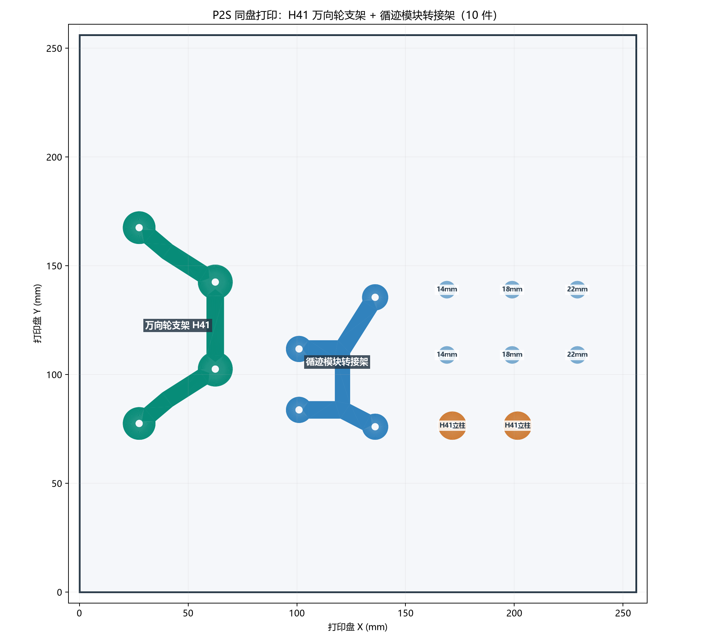

# 万向轮 H41 与循迹转接架同盘打印

[打开 P2S 同盘打印工程](P2S_CASTER_H41_TRACKER_ALL_012.3mf)。工程内含 **10 件**：H41 万向轮支架 1 件、34 mm 立柱 2 件、循迹模块转接架 1 件，以及 14/18/22 mm 循迹垫柱各 2 件。三种垫柱是试装选项，实际安装只用其中一对等高垫柱，其余留作备件。

采用 Bambu Lab P2S、0.4 mm 喷嘴、Generic PLA、0.12 mm 层高、6 墙、45% gyroid、5 mm brim、无支撑。原模型的朝向和尺寸保持不变，各件打印占地外包框至少相隔 10.2 mm。原生 P2S 切片 **10 件同盘通过、无警告**，预估约 **2 小时 32 分、27.7 g**。打印工程不含 G-code；作为工程打开，确认 100% 比例后按实际材料重新切片。

万向轮 H41 的由来、螺钉及安装顺序见[万向轮支架说明](../caster-riser-20261103/README.md)；循迹板孔位、垫柱试选和线束避让见[循迹架说明](../tracker-mount-20261103/README.md)。同盘打印只合并打印摆放，不改变两件在底板上的安装位置。实物打印、万向轮转动包络、三轮着地和循迹探头离地距离仍需首件试装确认。
