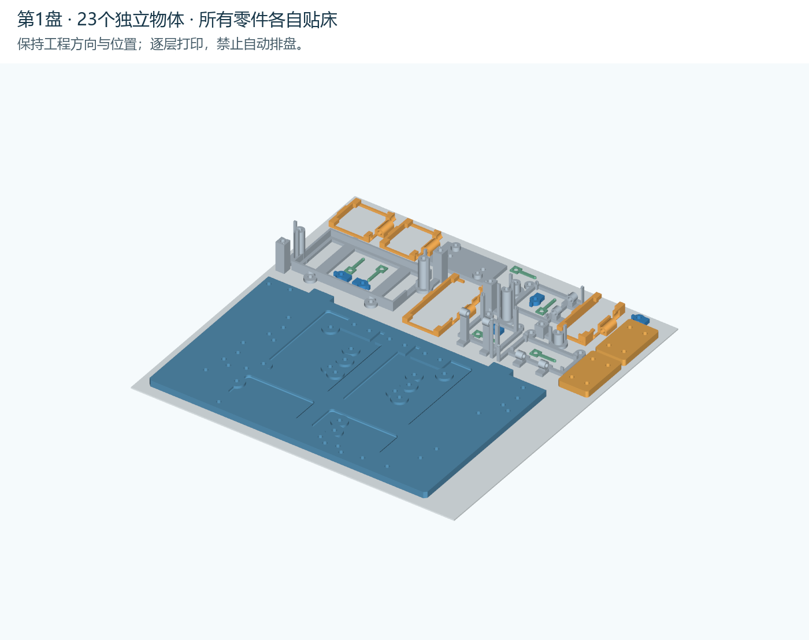
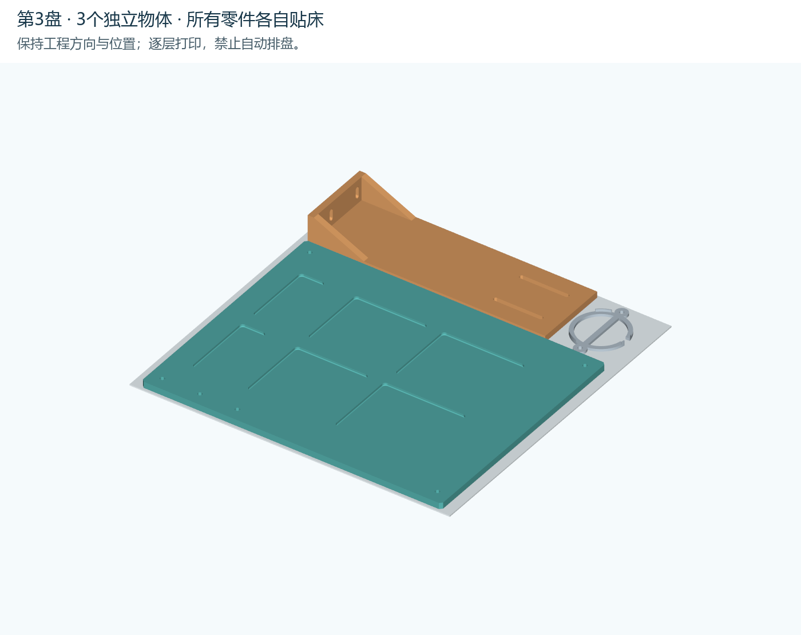
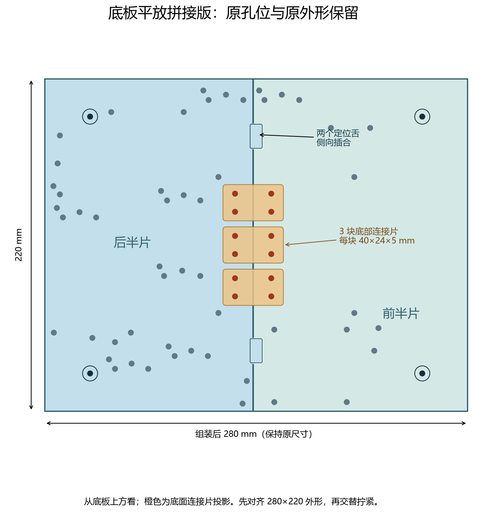
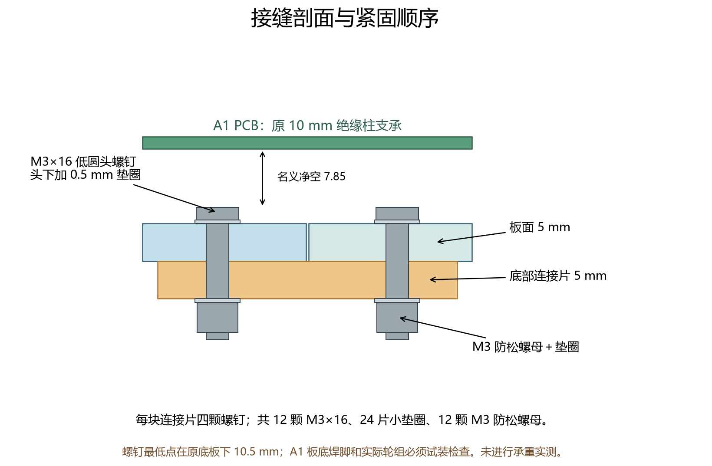

# 当前打印版：原尺寸底板平放拼接，上平台一体平放

**已先打印附件精细盘的用户：后续请用[主体补打三盘](../body-after-accessories-20261101/README.md)，不要再打印下表全量盘中的重复附件。**

旧50°底板斜撑方案已停用。用户允许在缩短底板会影响原方案时改为拼接。本版保留280×220×5 mm外形、原4个立柱孔、52个模块孔、原电机与前万向球实心加强区、上平台偏移(20,15)和60 mm立柱。没有缩放模块、卡座或螺丝孔。

缩短为250 mm会截掉原前万向球加强区X=214..270的一部分，并改变X=250的前柱和上平台定位，因此没有采用缩短方案。

## 打印只打开这三份工程

| 盘号 | 文件 | 内容 | 预计时间 | PLA |
| --- | --- | --- | --- | --- |
| 1 | [P2S_FLAT_SPLIT_PLATE_1.3mf](projects/P2S_FLAT_SPLIT_PLATE_1.3mf) | 底板后半片＋部分卡座及连接片 | 7小时25分49秒 | 187.1 g |
| 2 | [P2S_FLAT_SPLIT_PLATE_2.3mf](projects/P2S_FLAT_SPLIT_PLATE_2.3mf) | 底板前半片＋托片及其余卡座/连接片 | 7小时33分28秒 | 192.1 g |
| 3 | [P2S_FLAT_SPLIT_PLATE_3.3mf](projects/P2S_FLAT_SPLIT_PLATE_3.3mf) | 整片上平台＋平放舵机支架＋喇叭圈 | 7小时45分16秒 | 269.4 g |

合计 **22小时44分33秒、648.6 g PLA**，共51件。含三次起止脚本，不含人工换板。较上一版同套夹具的斜撑任务28小时53分减少约6小时、64 g；换盘次数从2次任务增为3次。当前排布已验证，但不宣称三盘是所有任意形状套排的数学最优解。

以“项目”打开，保留100%比例、原位置、朝向及逐层打印。不要自动排盘或逐件打印。模型均直接贴床，底板与上平台的连续平面朝床、减重槽朝上；装车时翻回光滑面朝上。工程不含G-code，按实际P2S/0.4 mm喷嘴/PLA/板型重新切片。

参数已写入：0.24 mm层高，首层0.20 mm，4墙，30% gyroid，顶底7层/最小1.6 mm，Generic PLA 220℃、纹理PEI 60℃。第1、2盘外侧防翘边2 mm，第3盘1 mm，间隙0；自动支撑、擦料塔关闭。保留喷嘴缠料检测关闭，第三盘占后侧检测区；相机炒面检测可开。使用标准100%速度、打印前调平并清洁床面。

## 底板如何拼接

两片在X≈138 mm处连接，主体接缝名义0.30 mm。两个定位舌只用于对齐；定位槽每侧留0.25 mm间隙。三块40×24×5 mm连接片装在底板下面，中心为(138,82)、(138,110)、(138,138)。连接片与底板接触处补为5 mm实心厚度。

新增12孔Ø3.4 mm：X=126/150，Y=76/88/104/116/132/144。每片连接片的孔距为24×12 mm。新增五金（原方案夹具五金另计）：

| 五金 | 规格 | 数量 |
| --- | --- | ---: |
| 螺钉 | M3×16，ISO7380低圆头，头Ø5.7/高1.65 | 12 |
| 平垫圈 | 内径3.2、外径≤6、厚0.5 mm | 24 |
| 防松螺母 | M3 DIN985，高4 mm | 12 |

先去毛边、在平桌上侧向插合两片，量外形280×220并检查板面齐平。将三块连接片放到底面，螺钉从光滑板面向下穿：头下垫圈→底板→连接片→垫圈→防松螺母。先将12颗全部带上，再交替轻拧到连接片贴紧；不得压裂PLA。定位舌不能强掰。完成拼接后再装A1 PCB和其他模块。

M3×16螺钉最低点在原底板下10.5 mm；按原底板底面离地45 mm参考，名义余量34.5 mm。上方头部含垫圈高2.15 mm，距A1板底名义7.85 mm。实际轮组、导线及A1背部焊脚包络仍需试装；未知实物尺寸没有被数字检查替代。

## 校验与试装边界

两片底板、三块连接片及其余小件共51个独立封闭网格；所有件直接贴床、无实体相交。原56个孔逐孔检查保留，新增12孔检查；三个原电机/万向球加强区无被切除部分。新增螺钉头与已有夹具没有数字模型交集。三盘官方P2S CLI切片返回0且无警告；原生3MF几何和摆放与实际受测工程一致，实际首层23/25/3个对象都在256 mm床内。未修改用户打印机或发送打印任务。

尚未进行实物打印、接缝承重或疲劳验证，无额定承重值。装配后先空载、再逐步加实际使用重量检查接缝开口、板面弯曲、螺母松动及轮组/导线干涉；不能把PCB当作接缝连接件。原43件模块夹具的尺寸和固定方式仍按第65章；旧65.6–65.11斜撑排布仅归档，打印以本版/第66章为准。

项目入口是projects/的三份3MF。parts/是独立平放STL；step/是装配坐标CAD源；source/parts_index.csv用于按盘号和XY坐标辨认小件。source/assembly_*.stl与P01_ASSEMBLY_VIEW_ONLY.step只供看装配，不能当作一件送去打印。
