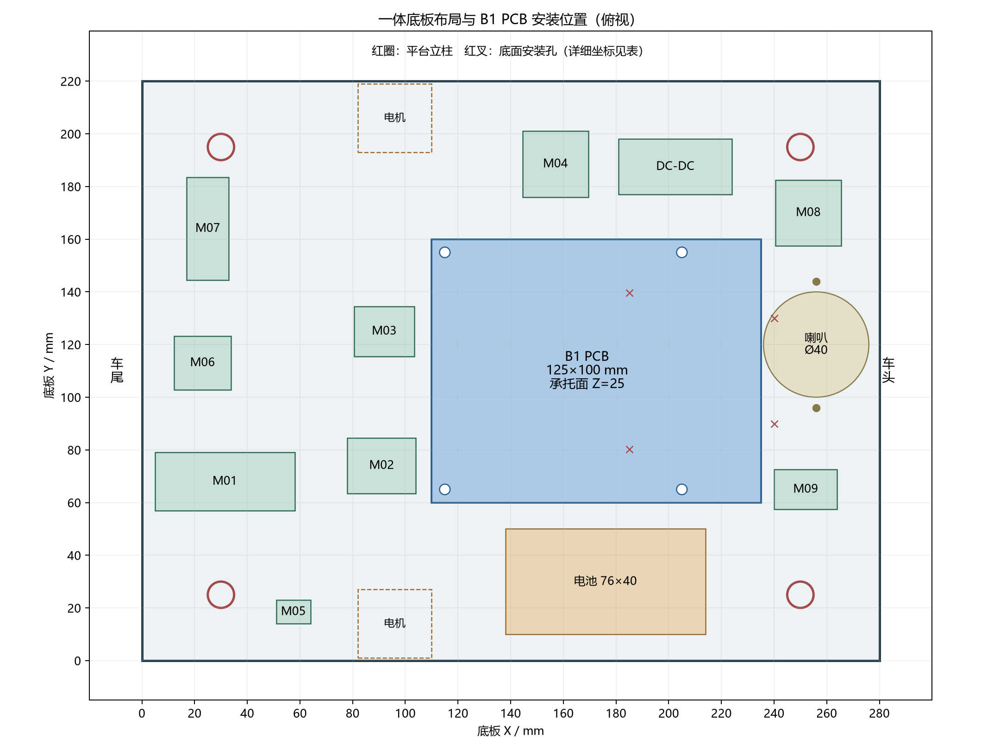

# PLA两主体一体结构与0.08 mm打印工程

本版以用户2026-11-04最后确认为准：PLA、拓竹P2S、0.4 mm喷嘴、纹理PEI、256×256 mm打印盘。保留B1 PCB的125×100 mm外形及90×90 mm孔距。请先读同名装配手册第68章；旧的PETG工程和分片结构不用于本版。

| 打印工程 | 切片估算耗时 | PLA含支撑 |
|---|---:|---:|
| [下半主体](projects/P2S_LOWER_H41_B1_PLA_008.3mf) | 109小时43分 | 653.9 g |
| [上半主体](projects/P2S_UPPER_INTEGRATED_PLA_008.3mf) | 200小时34分 | 1212.5 g |
| [可拆操作面板](projects/P2S_PANEL_COVER_PLA_008.3mf) | 3小时30分 | 27.5 g |

作为**工程**打开3MF，保留100%比例、已保存方向及项目参数，选择实际PLA料盘，再在Bambu Studio重新切片检查。下半件竖立并在盘内转45°；上半件倾斜；可拆操作面板单独平放。文件没有预制G-code，也没有发送打印任务。0.08 mm是当前0.4 mm喷嘴配置的最细层高，耗时较长，不等同于±0.08 mm尺寸精度。

## 结构

- 下半主体：280×220×5 mm底板，九种模块底座、电池托架、降压座、喇叭座、四个PCB支柱、电机承托、循迹支架和H41万向轮增高架均一体。原底板拼接片、模块座脚紧固件、电机16 mm厚孔位转接板取消。
- 上半主体：240×190 mm平台、160×150×180 mm筒壁、操作仓、固定传感器底座和超声横梁一体，四角连接件取消。操作面板仍可用原四颗螺钉打开。
- 活动盖、模块压框/锁片、传感器压盖仍可拆。复用已有附件；光敏压条和红外下托压盖采用[sensor-retainers-fix-20261103](../sensor-retainers-fix-20261103/README.md)的修复版，不能用会掉探头的旧直压条。
- STEP零件在step/，ASSEMBLY_REFERENCE.step只用于查看整体装配，不能当成一件打印。源码在source/；重建需要本仓库已有的原始STEP和CAD环境。

## 关键配合与强度安排

电机接触核心与用户已试配成功模型逐体比对，差异0 mm³：12×2.4 mm槽、21 mm槽距、3 mm承托厚、1.3 mm轮侧薄边保留；槽中心为(96,14)/(96,206)，接触面Z=−25。新增根部承力筋直接连接底板，去除旧固定耳。所有坐标单位mm，底板底面为Z=0。

B1承托面Z=25，四孔(115,65)/(205,65)/(115,155)/(205,155)。MPU6050位于(253,170)并旋转90°；蜂鸣器(252,65)，喇叭(256,120)，喇叭耳孔(256,96)/(256,144)。MPU安装后重新校准零点，并检查车体前后/左右倾斜报警；若需要车体坐标姿态，按新安装方向调整轴映射。

万向轮孔距40、安装面Z=−41；H41来自原手册66.19的名义61 mm离地高度减20 mm轮高，并非新实测。循迹孔距59.5，安装面Z=−43.4；按用户8 mm探头突出量和暂定1.6 mm板厚，探头名义离地8 mm。装车后检查三轮着地和探头不擦地。

在原浅腔中心减薄到2 mm连续面皮，保留12 mm主筋和孔周厚料，仅此项约去掉14.7 cm³实体；筒壁保留原1.6 mm面皮。下半件5墙/20%螺旋体，上半件4墙/15%，顶底0.8 mm。此为受安装与承力约束的轻量化，尚无载荷试验或有限元证据证明等强或绝对最轻。

## PLA精细参数与检查

层高0.08、首层0.16 mm；外墙/顶面25、内墙50 mm/s，外墙加速度600 mm/s²；喷嘴220℃、纹理PEI床55℃、最大体积速度8 mm³/s。保留基础PLA流量，未无依据更改缩放、孔补偿或Z偏移。

混合自动树形支撑，枝径3 mm、分支角35°、2道支撑壁；上下Z间隙0.16、XY间隙0.35 mm；上接触3层、下接触2层，接触间距0.35 mm；独立支撑层高已启用。两主体6 mm外侧裙边。每件的完整参数、耗时及材料见checks/*_slicing.json。

已经检查实体/网格、关键孔槽、PCB与活动夹具静态空间、平台立柱、面板和实际挤出路径。支撑和裙边的路径均在256 mm床面内。图与切片不代表已实物打印：完整轮胎/桶盖运动、实际排针焊点、线束弯曲、支撑拆除和承载仍需试装；当前环境未运行FreeCAD独立验证。

建模与检查使用[GitHub codex-cad技能](https://github.com/alexanderkoller/codex-cad/blob/main/cad/SKILL.md)的参数、实体、网格、测量和切片流程；支撑含义参考[OrcaSlicer树形支撑文档](https://github.com/OrcaSlicer/OrcaSlicer/wiki/support_settings_tree)，并核对[Bambu Studio实际配置定义](https://github.com/bambulab/BambuStudio/blob/master/src/libslic3r/PrintConfig.cpp)。3MF按项目打印交付需要保留。
