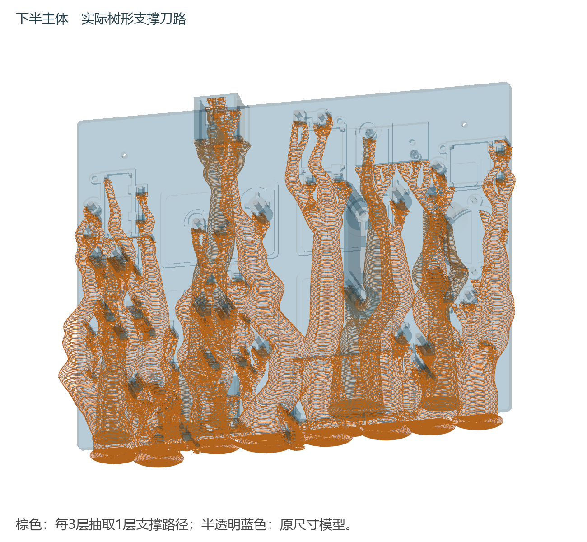
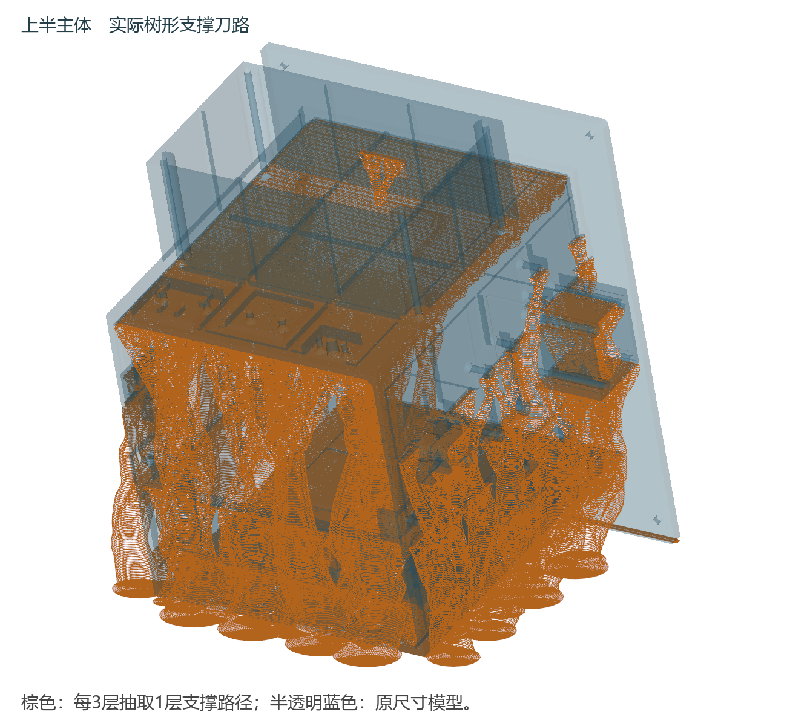

# PLA树形支撑 全件0.28 mm最快打印工程

**三件全部按 0.28 mm 层高交付。** 用户要求“更改这三个文件的层高，使其达到最佳打印时间”，并确认打印机为拓竹 P2S。上一版中下半主体（r3）和上半主体（r4）已经用 0.28 mm；仍为 0.20 mm 的面板盖本轮按同一加速参数重切片为 0.28 mm（r7）。0.28 mm 是 0.4 mm 喷嘴的实用层高上限（约喷嘴直径的 70%），在不改结构、不提高未校准流量、不关闭必要支撑的前提下，这已是可交付的最快已检查设置。

|打印件|层高|预计时间|PLA含支撑|
|---|---:|---:|---:|
|[下半主体](projects/P2S_LOWER_H41_B1_PLA_FAST_CANDIDATE.3mf)|0.28 mm|13小时41分|373.9 g|
|[上半主体](projects/P2S_UPPER_INTEGRATED_PLA_FAST_CANDIDATE.3mf)|0.28 mm|32小时58分|803.0 g|
|[面板盖](projects/P2S_PANEL_COVER_PLA_FAST_CANDIDATE.3mf)|0.28 mm|57分51秒|27.0 g|
|**合计**|0.28 mm|**约47小时38分**|**1203.9 g**|

切片器原始值：下半主体 49278.74 s / 373.948 g；上半主体 118706.35 s / 802.975 g；面板盖 3471.18 s / 27.013 g；合计 171456.27 s（47小时37分36秒）/ 1203.936 g。不含换盘、冷却取件和人工拆支撑。

## 24小时目标状态

用户口径为每个主体不超过24小时：下半主体约13小时41分，达标；上半主体约32小时58分，仍未达标（保持结构与PLA材料、官方 Generic PLA 12 mm³/s 体积流量上限下，0.28 mm 已是最快已检查设置）。

面板盖改 0.28 mm 仅省约3分50秒、多用约1.7 g；它是外露件，0.28 mm 的顶面台阶会比 0.20 mm 更明显。另外该件高 5.40 mm 不能被 0.20+0.28 整除，本切片器把最后一层放在 5.52 mm（顶面比模型高约 0.12 mm），几何文件本身未变——若需严格 5.40 mm 厚度或更好的外观，可继续用 0.20 mm 版本（仅慢约4分钟，历史切片见 checks/r1_PANEL_COVER_slicing.json）。

## 打印设置

仍为 P2S、0.4 mm 喷嘴、纹理 PEI、256×256 mm、PLA；喷嘴220℃、热床55℃。三件均 0.28 mm 层高、3道墙，主体10%螺旋体填充、面板盖15%螺旋体填充，顶底各3层且最小0.8 mm；外墙120、内墙230 mm/s，实际受官方 Generic PLA 的 12 mm³/s 体积流量和悬垂限速约束。树形为自动细树形：枝径3、分支间距5、分支角40°、阈值35°、一道支撑壁，支撑与模型同步层高，上下Z间隙0.28、XY间隙0.35 mm，接触上下各两层、间距0.5 mm，主体6 mm裙边；面板盖平放无支撑。

棕色图形抽取实际刀路每3层中的1层显示。作为工程打开 projects/ 内 3MF，保持100%比例和已保存方向后重新切片；工程包含模型和参数，不含机器 G-code，也没有启动打印。

## 变更与校验

- 面板盖几何与 r1 完全相同（同一 geometry.3mf，sha256 一致；网格 12682 顶点/25456 面逐字节相同），只改层高 0.20→0.28、顶底壳层数 4→3，其余参数沿用；r7 切片返回成功、warning 字段为空，project.3mf 无 G-code、.model 与切片输出逐字节一致。
- 几何校验：导出 project.3mf 与 r1 相比，只有 CreationDate/ModificationDate、model_settings.config 的 part UUID、以及 process 的 layer_height/top/bottom_shell_layers/print_settings_id 不同；摆放位置、X/Y 范围与切片前一致，详见 checks/layer028_change.json 的 geometry_validation。
- 切片副作用（如实记录）：面板盖 5.40 mm 高在 0.28 mm 层高下被切片器收在 5.52 mm 顶面（最后层高 0.28 不整除），实际打印厚度约 +0.12 mm；其余两件 0.28 mm 分层恰好整除（下半 220.0 mm/786 层、上半 245.2 mm/876 层），不存在此偏差。
- 下半/上半主体 3MF 未改动（sha256 与上一版一致）；原CAD模型与安装孔槽未改变，仅此前轮次对上半件做过刚性旋转、平移。
- 未假定未知 PLA 能支持更高流量，也未通过提高流量或关闭支撑换取时间。实打、装配、承重与拆支撑尚未验证；提高层高会降低表面精细度，不能声称与 0.08 mm 版表面质量或强度相同。
- 手册第69章已同步为上述数字：正文改为“三件合计耗材约1203.9 g”和“面板盖同为0.28 mm”，末表面板盖行改为0.28 mm / 57分51秒 / 27.0 g；2439段落、84表、330步、目录69条均未变。用LibreOffice渲染前后PDF均265页，全265页逐像素比对仅第263页（第69章标题与表格页）不同，页脚仍为“第263页”；本机未驱动Word进程，记录见 checks/manual_qa.json、checks/word_render.json。
- 交付目录与zip内附更新后的同名手册docx（sha256 8FD54B21…24BE8，与仓库docs/manual和本机根目录副本字节一致）。
- 本轮新增：checks/layer028_change.json（变更与数值）、checks/r7_PANEL_COVER_slicing.json（切片原始结果）、source/r7.json（参数补丁）、source/slice_panel028.py（重切片脚本）。各轮历史结果保留在 checks/*_slicing.json，选用下半件 r3、上半件 r4、面板盖 r7；r5有机树形、r6混合树形实测没有更快。
- 检查参考 [GitHub codex-cad](https://github.com/alexanderkoller/codex-cad/blob/main/cad/SKILL.md)、[OrcaSlicer 树形支撑参数](https://github.com/OrcaSlicer/OrcaSlicer/wiki/support_settings_tree)。本机为 Bambu Studio 02.08.02.61。
