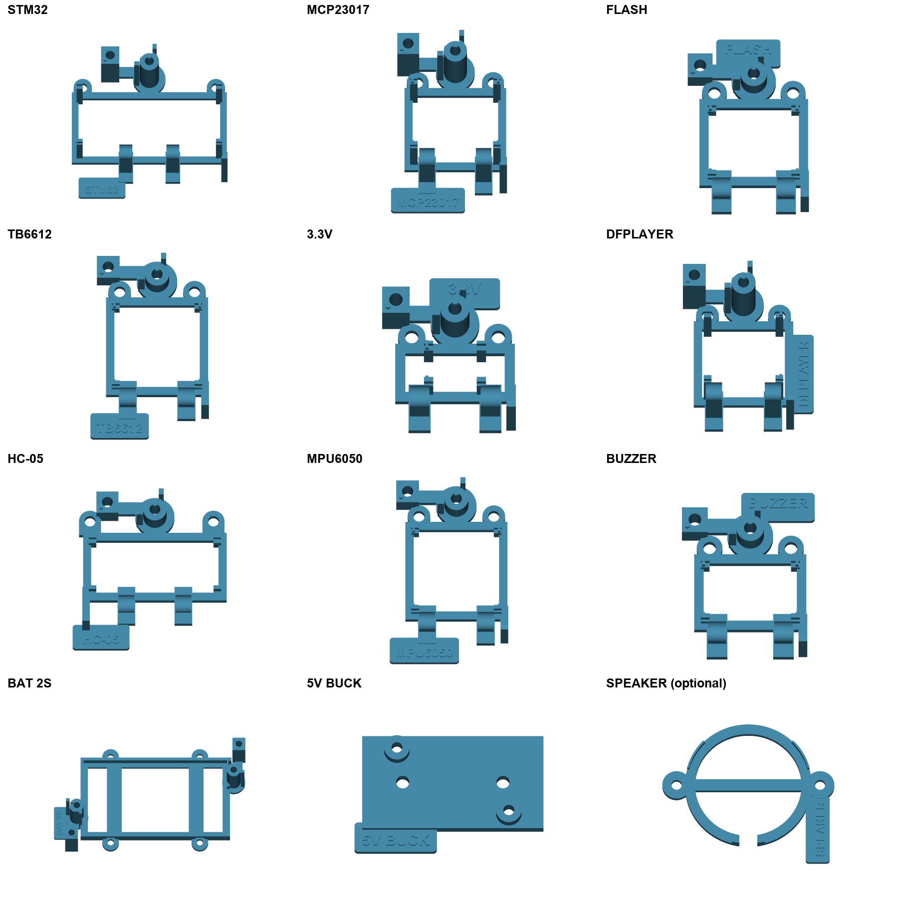

# 模块底座带一体标牌版

当前1号机继续昨天第二盘，上平台、舵机支架、喇叭圈不重复打印。2/3号机底板形状与上一版相同；4/5号机附件改用本目录带标牌工程，旧附件文件不再使用。

| 机器 | 文件 | 预计时间 | PLA |
| --- | --- | --- | --- |
| 2号 | [P2S_PRINTER_02_BASE_REAR.3mf](projects/P2S_PRINTER_02_BASE_REAR.3mf) | 4小时32分 | 141.8 g |
| 3号 | [P2S_PRINTER_03_BASE_FRONT.3mf](projects/P2S_PRINTER_03_BASE_FRONT.3mf) | 4小时16分 | 141.3 g |
| 4号 | [P2S_PRINTER_04_LABELED_CLAMPS_A.3mf](projects/P2S_PRINTER_04_LABELED_CLAMPS_A.3mf) | 5小时17分 | 54.4 g |
| 5号 | [P2S_PRINTER_05_LABELED_CLAMPS_B.3mf](projects/P2S_PRINTER_05_LABELED_CLAMPS_B.3mf) | 5小时33分 | 49.3 g |

本轮11个待打印底座添加名称小板，上盖、拨片、簧片和托片不加标牌；9个模块座、电池托架、5V降压托架已更换。标牌厚1.8 mm、字高4 mm、凸字高0.64 mm，圆角边缘，与底座一体打印。静态装配模型及安装螺钉通道已避让，原安装孔保留。

名称对应：STM32核心板、MCP23017扩展、FLASH存储、TB6612电机驱动、3.3V稳压、DFPLAYER播放器、HC-05蓝牙、MPU6050姿态模块、BUZZER蜂鸣器、BAT 2S串联电池、5V BUCK降压。

喇叭底座已在运行中的昨天第二盘内；另提供可选带SPEAKER标牌的parts/P07_SPEAKER_cradle.stl和对应STEP，不放入当前任务，不需要为它停止打印或重复打印。A1主PCB直接装在底板上，没有独立附件底座，本次不改底板。

4/5号机两盘各23件，重新分开排布，保留0.16 mm层高、4墙、30% gyroid、3 mm防翘边、外墙40/内墙80 mm/s；自动支撑关闭。作为项目打开，保持100%比例、原排布和逐层打印，重新切片，标准100%速度。2/3号机仍为0.24 mm层高与5 mm防翘边。

四份工程实际切片无警告；首层1/1/23/23件均在床内。与正在打印的3件合计51件，无重复。改变底座只增加标牌，未改变上盖和活动零件几何；连接片和底板拼接按手册66.1、66.2。尚未实物打印、接线或寿命试验；装配时核实实际导线与标牌的距离。

