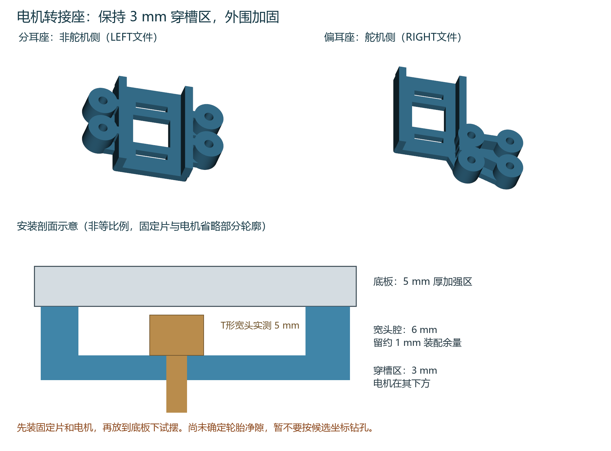

# 电机穿槽转接座 两件同盘

打印 **[P2S_D06_ADAPTER_PAIR_028.3mf](P2S_D06_ADAPTER_PAIR_028.3mf)**。两个不同的座各一件，预计46分30秒、16.3g PLA；P2S/0.4mm喷嘴，作为项目打开，保持100%比例与原朝向重新切片。0.28mm层高、首层0.20mm、4墙、40%直线填充、顶底4层、外侧2mm防翘边，无支撑，标准100%速度。这个工程取代试配件用于下一步完整轮组干装，不代表已经过承重验证。

已确认：B件12×2.4mm槽、两槽中心距21mm、3mm穿槽承托厚度，用户实物试配合适。T形宽头实际高5mm，本座在3mm承托面上方留6mm腔，名义余量1mm。外围固定耳和加强筋总高9mm，与电机接触的底面无文字、无凸起。相较试配件增加了外围区域，仍需检查整个电机、螺母和轮子的实际包络。

## 先打印并干装，暂不钻底板

1. 冷却后去掉防翘边。两种座都把有加强筋、凹腔的一面朝上；平整底面朝向下方电机。T形固定片从上向下穿入两条窄槽，宽头坐在凹腔内。中央大孔为减料孔。
2. 用原配横向螺栓安装电机，再装轮子，保持断电。应能自然对孔，不靠拧紧拉弯固定片。核对5mm宽头能进入6mm腔、螺栓和螺母可接近，电机不被新增固定耳或加强区域顶住。
3. 两组轮组放到底板下方试摆：四个固定耳分在两侧的 **LEFT文件** 用于非舵机侧；固定耳集中在一侧的 **RIGHT文件** 用于舵机侧，其带四孔的一翼朝车头。文件里的LEFT/RIGHT是零件标识，不代替车体坐标定义。
4. 固定耳顶部和加强筋顶面朝底板底面。先手扶或临时夹持，转动轮子一整圈；轮胎与底板、转接座、螺母等固定件净隙目标至少3mm，两轮轴应共线。检查转接座四个孔的上方没有模块脚、旧孔或立柱遮挡。不得此时通电行驶。
5. **反馈整组试摆的俯视与侧面照片，以及轮胎最小侧隙。** 目前只有候选位置的数字避让检查，轮轴相对固定片的偏移、轮毂轴伸和整个轮组包络未测定，所以不按候选坐标直接钻孔。确认轮组位置和孔周围实心材料后，才用转接座配钻。

## 后续固定所需五金

两个座合计8颗M3×20低圆头螺栓（ISO7380、头径约5.7mm、头高约1.65mm），16片外径不超过6mm、厚0.5mm的M3平垫圈，8颗高约4mm的M3尼龙锁紧螺母。先核实手头规格，无需重复购买已有件。

确认位置后，螺栓从底板上方依次穿过：头下垫圈 → 5mm底板实心区 → 9mm固定耳 → 下垫圈 → 锁紧螺母。名义夹持长度19mm，M3×20约余1mm；若实物垫圈/螺母不同，需重新核对螺纹穿出锁紧圈。固定孔设计直径3.4mm。不能把四颗紧固螺栓直接拧进PLA孔，也不要用收紧螺母消除零件干涉。

轮组装好后再量底板实际离地高度Hb。另一聊天已记录前万向球安装高度20mm、两孔中心距40mm，垫高件需按实际Hb−20mm确定，不能直接沿用旧参考Hb=45mm。新增转接座也会改变下侧包络。

## 检查范围

两件均为有效单实体、封闭网格，未减少已验证试配件的材料；两条穿槽及宽头腔有数字间隙验证。候选位置的四个固定耳落在底板完整5mm区，螺钉头避开当前带标牌夹具、旧孔及喇叭本体。候选坐标仅保存在checks/design.json供设计复核，不是已经确认的钻孔模板。左右座采用不同固定耳布局以避让上侧模块。

CLI切片成功、无警告；交付3MF几何与受测切片一致，不含G-code。尚未进行完整轮组实物干装、承重、疲劳或行驶验证，无额定载荷声明；未改动底板、上平台、电子模块卡座及当前打印任务。图解64已合入同名手册66.10节，226页已渲染检查，原330步骤保留；记录见checks/manual_qa.json。
