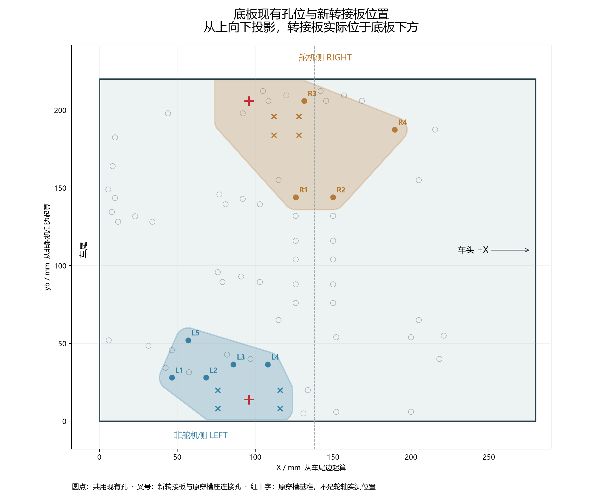
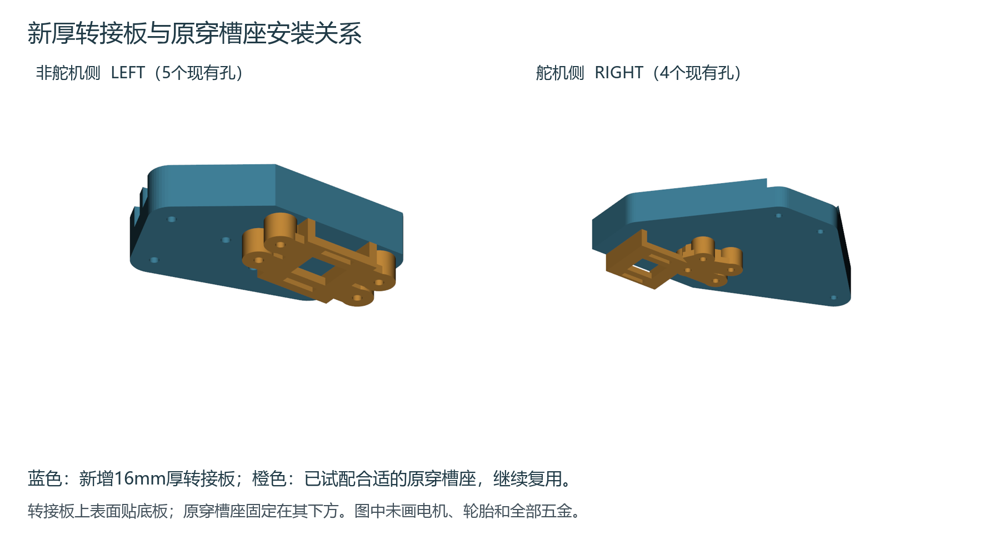
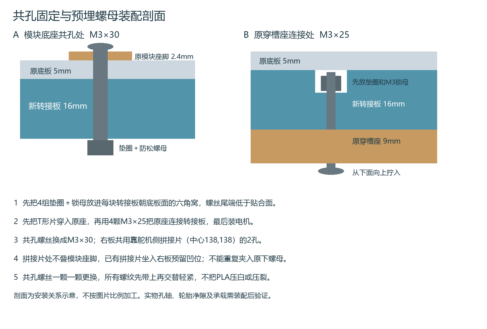

# 复用底板现有孔的电机厚转接板

底板不再新增电机安装孔。新增两块16mm厚转接板，连接已试配合适的原电机穿槽座与底板现有孔；上面的电子模块底座位置不变。原穿槽座继续使用，不需要重印。相对旧直装方案，电机及轮组整体下移16mm，前后和左右穿槽基准保持。

[打印两块新转接板](P2S_D06_EXISTING_HOLES_CARRIERS_016.3mf)。3MF只含这两块新板，P2S、0.4mm喷嘴、PLA，0.16mm层高、6墙、60%螺旋体填充、顶底各8层、3mm外侧裙边。预计11小时10分、约147g。保持100%尺寸、现有平放朝向和逐层打印，打开为工程并按实际耗材重新切片；凹位朝上、连续平底面贴床，不开支撑，不自动翻面。尚未发送打印任务。

## 共用哪些现有孔

从底板上方向下投影。X=0为车尾边、X正向朝车头；yb=0为非舵机侧边，底板280×220mm。

| 图中孔号 | 原部件 | X mm | yb mm |
|---|---|---:|---:|
| L1 | M05 1117稳压模块座脚 | 46.5 | 28 |
| L2 | M05 1117稳压模块座脚 | 68.5 | 28 |
| L3 | M09 蜂鸣器座脚 | 86 | 36.5 |
| L4 | M09 蜂鸣器座脚 | 108 | 36.5 |
| L5 | M01 STM32核心板座脚 | 57 | 52 |
| R1 | 靠舵机侧的拼接片 | 126 | 144 |
| R2 | 靠舵机侧的拼接片 | 150 | 144 |
| R3 | M08 MPU6050模块座脚 | 131.5 | 206 |
| R4 | BUCK 5V降压托架 | 189.5 | 187.5 |

LEFT用于非舵机侧，RIGHT用于舵机侧。新板与原穿槽座的四孔只存在于新板，不需要在底板对应位置钻孔。完整通孔、六角窝、原五金及拼接片避空的坐标见[接口坐标图](interface_coordinates.pdf)和[接口表](source/interface_positions.csv)；模型为最终轮廓，不按截图比例加工。

## 两级转接结构

从上到下为原模块座脚或拼接孔螺丝、原底板、新16mm转接板、原9mm穿槽座、电机。右板贴底板面为原5mm拼接片留41×25mm、深5mm的凹位；原未更换的拼接螺母和尾端另外留深12mm的局部避空。其他覆盖到的原五金留Ø8、深8mm避空。两块新板的打印包络约85.5×59×16mm和123.5×83×16mm。

原座仍使用12×2.4mm双槽、21mm槽距、3mm电机接触面、6mm宽头腔。原已试配的轮侧1.3mm边也保留；本次未把未测量的电机轴伸或轮轴位置写成已验证尺寸。穿槽基准保持(96,14)/(96,206)mm，旧手册X≈90mm的轮轴位置是参考值，两者不是同一基准。

## 五金和安装顺序

| 五金 | 本连接总用量 | 作用 |
|---|---:|---|
| M3×30 ISO7380低圆头 | 9颗 | 新板共用现有孔，替换这些孔原短螺丝 |
| M3×25 ISO7380低圆头 | 8颗 | 原穿槽座从下面连接新板 |
| M3 DIN985防松螺母 约4mm高 | 17颗 | 8颗放六角窝，9颗装共孔底面 |
| M3平垫 外径≤6mm 厚0.5mm | 34片 | 每颗螺丝2片；已有适配件可复用 |

这些是本连接的装配总量，不是要求重复购买的数量。用户原有M3×8、×12、×16不能直接替代上面的长度。

1. 断开全部电源，取下电子板、移开线束，空模块底座保持原位置。不要让金属屑进入板件。
2. 在每块新板贴底板面的4个六角窝中，先放0.5mm垫圈、再放4mm高M3防松螺母。
3. 先把T形固定片从原穿槽座上方向下穿入，宽头留在腔内；再将原座用4颗M3×25从下向上固定到新板，每颗头下加0.5mm垫圈。最后装电机和轮子。
4. 用直尺横跨新板贴底板面，确认螺丝尾端没有顶出。名义尾端低于贴合面0.5mm、穿过锁母1mm；实际螺丝和锁母不符时先调整，不能用底板把尾端强压进去。
5. 图中9个共孔逐个换M3×30，并去掉这些孔原底板下的螺母。RIGHT跨在靠舵机侧的拼接片上，该片中心为(138,138)mm；R1/R2下的原螺母移除，其余两孔原螺丝和螺母保留并进入避空。不要把原螺母夹在新板与底板之间。
6. 每颗共孔螺丝上方保持原低圆头和小垫圈；下方新板底面加小垫圈、锁母。全部先带上螺纹，再交替轻紧，不压白或压裂PLA。两侧贴合后手转轮子全周检查。

原座已安装到新板后，预埋锁母不能从贴底板面取出，维修时先拆新板。模块座脚、铰链轴、拨片轴和簧片锚钉不可混用，图中只更换明确列出的座脚及拼接孔。

## 结构与检查范围

采用16mm连续承力板、圆角过渡、五点或四点贯穿螺栓和金属锁母，避免在PLA中直接形成受力机螺纹。切片按6墙、60%填充、顶底各8层保存。用户未规定最大整机质量，本版没有额定载重、有限元强度或寿命验收结论。

已核对9个孔与当前底板坐标一致、各固定点原底板为完整5mm厚料、两块新板STEP重读有效、导出网格封闭，以及原穿槽座、拼接片和原拼接五金的几何避让。上方共孔螺丝头仍沿用原位置与低圆头包络。所有切片模型挤出路径均在热床内；实际首层2件齐全，无切片警告。

装好后再确认两轮轴共线，轮胎全周与转接板、底板及五金的净隙目标至少3mm。先空载手推，再逐步增加计划实际载荷，检查发白、裂纹、永久变形、松动和底板挠曲，合格后低速试车。数字避让不等于完整实物轮组、承重或行驶验证。

万向球转换件按装好轮组后的实际底板离地高度Hb确定：原万向球安装高度20mm，需要的垫高量为Hb−20mm；本轮不预先固定该高度。

安装图和接口坐标已同步同名Word第66.12节、图解71—75。更新目录和页码后渲染239页，233页正文与已检查基线一致，6个变化页已逐页检查，原330步骤及78张表保留。记录见checks/manual_qa.json。

STEP装配文件保持原底板XY坐标，并以底板下表面Z=0为基准：新板Z=−16～0，原座Z=−25～−16mm。打印STL已独立归零并保留正确平放方向，不把装配STEP直接当作摆盘工程。
