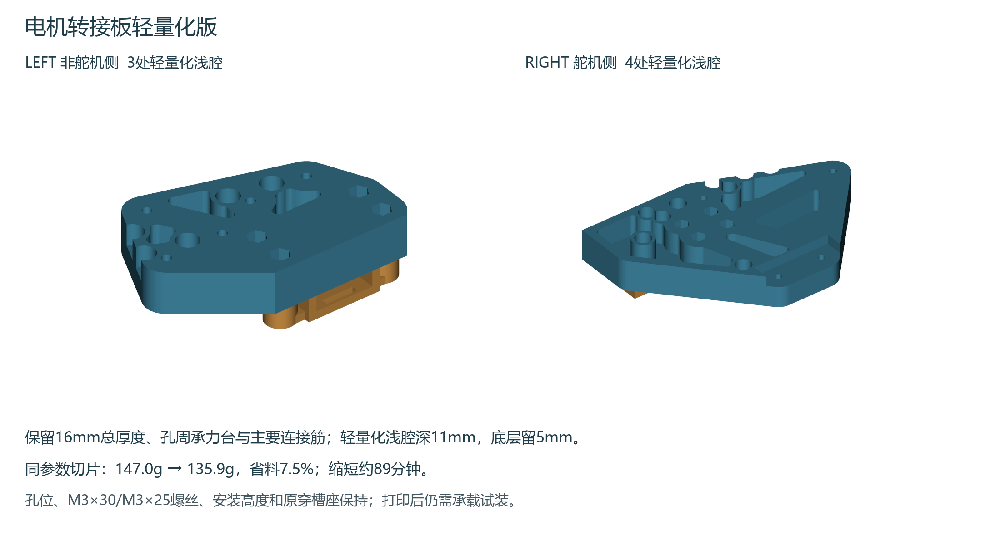

# 电机转接板保守轻量化版

用两块带浅腔的16mm板替换上一版两块厚板。底板不钻新孔，原穿槽座继续使用；共用的9个底板孔、8个原座连接孔、轮组位置、16mm下移量和全部五金规格均保持。

[下载两块轻量化板的打印工程](P2S_D06_EXISTING_HOLES_LIGHT_016.3mf)。作为工程打开，P2S、0.4mm喷嘴、PLA、100%比例，保留现有平放方向。两件同盘预计 **9小时41分、135.9g**。连续平底面贴床，所有凹位朝上，无支撑，不自动翻面或缩放。工程不含G-code，也未发送打印任务。

## 保留与减重区域

- 总厚度16mm、孔周承力台和主要连接筋保留；轻量化区域采用深11mm的上开口浅腔，留下5mm底层。
- 主筋采用11mm宽保护带，右板另有8mm宽斜向保护带；孔周保护半径8mm、外缘保留4mm。原来已有的五金孔和凹位不填回、不继续削薄。
- 左板3个浅腔、右板4个浅腔，名义轮廓圆角R2。原最薄4mm的拼接五金避空处保持。
- 在原模型上只做减料。程序逐区验证孔台、直接连接筋及下部5mm范围的原材料没有被切除；原五金和拼接片的避让不会缩小。

这里的保护带说明设计保留区，不代表有原五金孔穿过的每一截都具有完整11mm实体。没有把几何保留检查当作强度试验。

## 同参数实际切片对比

| 项目 | 上一版 | 轻量化版 |
|---|---:|---:|
| CAD实体总体积 | 160.7cm³ | 133.1cm³ |
| 切片估算PLA | 147.0g | 135.9g |
| 切片估算时间 | 11小时10分 | 9小时41分 |
| 层高 | 0.16mm | 0.16mm |
| 墙数与填充 | 6墙、60%螺旋体 | 6墙、60%螺旋体 |
| 顶底壳层 | 各8层 | 各8层 |

实体体积减少约17.2%，实际省料约7.5%、省时约89分钟。新增浅腔会增加打印外壁，不能把实体体积降幅直接当作耗材降幅。没有通过降低墙数或填充率来放大减重数字。

## 安装和五金

完全沿用[上一版安装步骤与原孔坐标](../motor-existing-holes-20261102/README.md)：9颗M3×30低圆头、8颗M3×25低圆头、17颗约4mm高DIN985防松螺母、34片OD≤6mm/厚0.5mm平垫；已有件继续复用，不需要因轻量化另买五金。

先放六角窝内垫圈和锁母，T形固定片先穿入原座，再把原座连接新板，最后装电机。贴底板前确认预埋螺丝尾端没有顶出贴合面；共孔处逐颗更换，移除原底面螺母。靠舵机侧拼接片坐入既有凹位，不让新板隔着旧螺母悬空。旧安装图、螺丝叠层和万向球按Hb−20mm确定高度的方法保持。

[浅腔定位图PDF](lightening_pockets.pdf)标出每个新浅腔的定位包络、深度和保留底层；包络框不是矩形加工指令，实际边界由[轮廓点表](source/pocket_contours.csv)、STEP和打印STL给出。环号0为外边界，大于0表示保留材料岛边界。原孔坐标仍按上一版接口图，不需要在底板增加孔。

## 检查范围

已完成CAD保护区域布尔差检查、孔轴及整体包络复核、单实体与封闭网格、STEP重读、四视图、原生打印工程一致性和实际全层挤出路径检查。两件首层齐全，全部模型挤出路径在热床内，无实际支撑挤出，切片结果无对象警告。

原厂CLI日志仍可能输出既有的结束脚本T65535解析提示；原生工程没有预生成G-code，未修改厂商结束脚本。以checks中的模型和路径检查记录为准。

本次是优先保留承力区的保守减重，轻量化会改变整体刚度。用户未指定额定载重，没有宣称与实心厚板等强，未完成实物承载、疲劳或行驶试验。先空载手推，再逐步加到计划实际载荷并检查发白、裂纹、永久变形和紧固件松动，合格后低速试车。承力筋、孔台和5mm底层不要继续掏薄。

安装图及浅腔定位已合入同名Word第66.13节、图解76—78。已更新目录和页码、渲染242页，前239页正文与上一版像素一致，新增3页逐页检查，330个步骤和此前79张表保持。记录见checks/manual_qa.json。上一版厚板文件保留。
