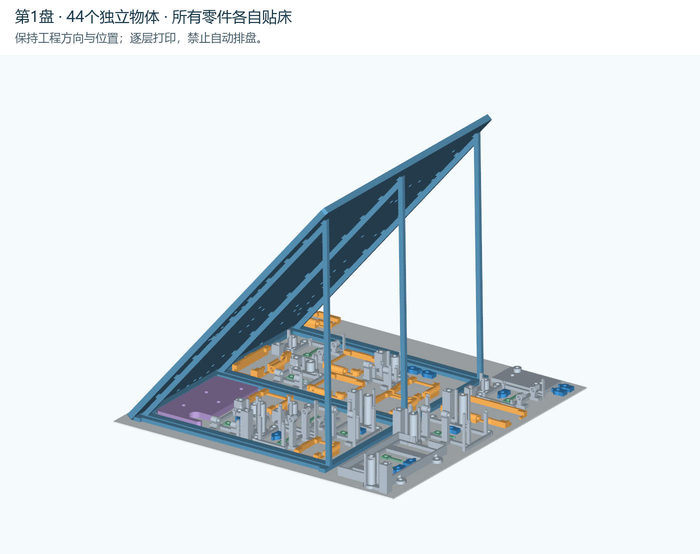
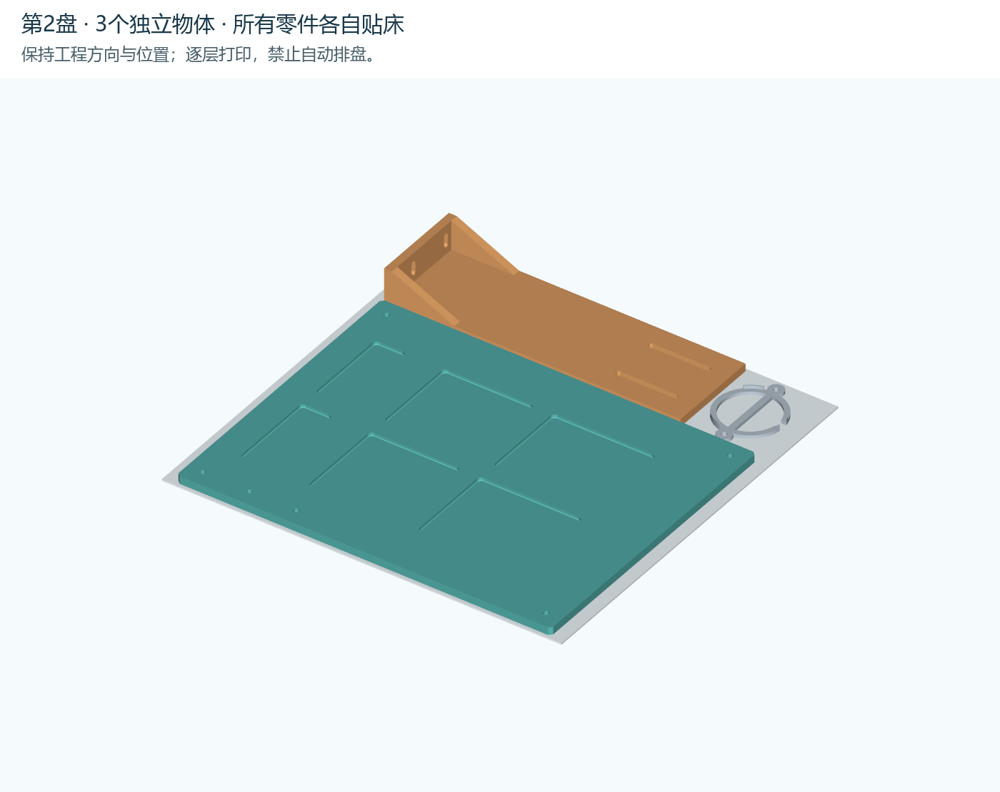
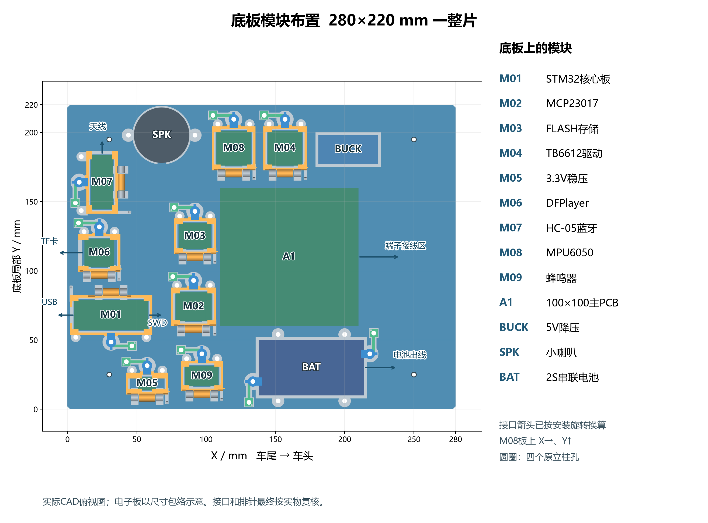
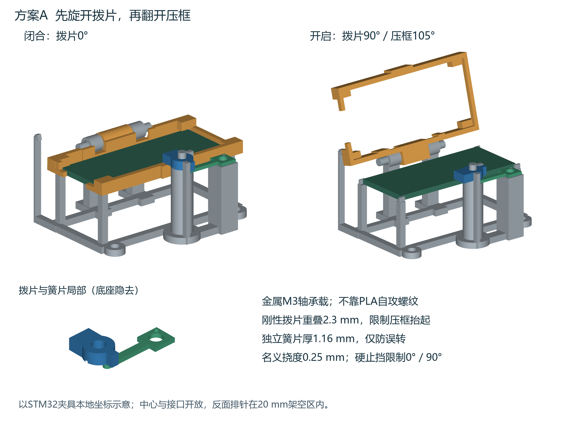

# 一体底板、上平台与方案A活动夹具 · 两盘版

用户已选择方案A。底板280×220×5mm、上平台240×190×5mm均保持一整片；另配9套可开启模块夹具、电池托架双锁片、降压载座和喇叭定位圈。四个主体及43个附件合计47件，实际排在两盘。

## 打印只打开这两份工程

| 任务 | Bambu Studio工程 | 物体数 | 实际切片估算 | PLA |
| --- | --- | ---: | ---: | ---: |
| 第1盘 | [P2S_MOUNTED_PLATE_1.3mf](projects/P2S_MOUNTED_PLATE_1.3mf) | 44 | 21小时14分 | 444 g |
| 第2盘 | [P2S_MOUNTED_PLATE_2.3mf](projects/P2S_MOUNTED_PLATE_2.3mf) | 3 | 7小时39分 | 269 g |
| 合计 | 分两次启动，人工换盘另计 | 47 | 28小时53分 | 713 g |

第一盘为完整底板及宽底斜撑、舵机托片和全部夹具小件（喇叭圈除外）；第二盘为平放上平台、平放舵机支架及喇叭圈。工程不含可直接执行的G-code，打开为**项目**后按实际P2S、0.4mm喷嘴、PLA和热床重新切片。

保持100%比例、原朝向、原位置和**逐层打印**。不要自动排布、自动朝向或切到逐件打印。所有物体各自贴床；部分小件放在卡座/压框的镂空区和斜撑的空区内，经过实体无交集与取件通道检查。不要将设计用的ASSEMBLY_VIEW_ONLY.step或绿色电子板示意体当作打印文件。

P2S 0.4mm，0.24mm层高、首层0.2mm、4道墙、30% gyroid、顶底7层/最小1.6mm、PLA热床60℃。第一盘3mm防翘边，第二盘1mm，间隙0；模型已有专用斜撑，全局自动支撑关闭。第二盘后缘达到Y254mm，**保留工程中的喷嘴缠料检测关闭**；这项会占用后侧检测区，相机炒面检测是独立功能，可保持开启。已核对最终测试G-code没有执行G39。不要擅自加宽第二盘防翘边。

底板50°斜放，三组三角框架高205mm、杆宽4mm/厚3.2mm，撑脚宽12mm/厚3.2mm、展开约175mm，底轨连接。完全冷却后托住板面，用斜口钳逐个剪掉短连接点、框架与起始边，再修平残留；不扭折或切开板件本体。首层及中途若脱底、翘起或明显晃动应停止处理。几何加强不能保证零失败。

## 模块固定与取件

先转开蓝色锁片，再翻开橙色压框。金属M3铰链轴与刚性拨片承载；独立PLA簧片只定位，不作承载钩。轴座已补偿实际落座高度，锁母留0.1–0.2mm轴向转动间隙。簧片锚点上方垫圈外径不得超过6mm，不在拨片轴座与拨片间另加圆垫圈遮住凸点。

拆下小件前按[零件索引](source/parts_index.csv)的盘号、XY位置和模块ID做好标记。先去除防翘边，细簧片不要直接扭断；保持1.16mm自由梁完整。各电子板先空装试合，压框仅搭角边，不能压弯PCB；排针塑壳、焊点及插好杜邦线后的弯线包络须按实物复核。接口方向与20mm等架空高度见design.json。维护时可先拆上平台。

电池76×40×20mm、2S串联，托条铺2mm EVA，双锁片只约束端部塑料外壳、不挤压电芯；出线朝+X。喇叭Ø40×14、耳距48mm，耳高未实测，使用可调螺母与垫圈，不能强压耳片。5V降压两安装孔按用户实测(7,19)/(36,2)、Ø3mm，四角焊盘不作安装孔；M2.5螺母先装入底面六角窝，再固定载座。

## 五金（不含原四柱与舵机转接件）

| 名称 | 规格 | 数量 | 用途与注意 |
| --- | --- | ---: | --- |
| M3低圆头螺钉 | M3×12，ISO7380圆头高1.65mm | 22 | 9卡座18颗＋电池座4颗；头在座脚上，两片0.5mm小垫圈，底板下方用高2.4mm普通六角螺母；此长度不配高4mm锁紧螺母。 |
| M3螺栓或金属轴 | M3×30，ISO7380低圆头Ø5.7×1.65mm | 9 | 9个金属轴铰链；此头型为铰链避空依据，不可换高圆柱头；自锁螺母只锁轴向间隙，压框应能自由翻动。 |
| M3拨片轴及簧片锚钉 | M3×40 | 10 | M01/M02/M06各2根＋电池左右各2根；全部头在5mm底板下面；每根上下各1片0.5mm垫圈、上方4mm高锁母。轴顶留0.1–0.2mm转动间隙，锚钉固定簧片头。 |
| M3拨片轴及簧片锚钉 | M3×30 | 2 | M05稳压模块2根；同40mm组装法，簧片头上垫圈外径不得超过6mm。 |
| M3拨片轴及簧片锚钉 | M3×25 | 10 | M03/M04/M07/M08/M09各2根；同40mm组装法，不在拨片轴座与拨片之间另加圆垫圈，以免遮住定位凸点。 |
| M3降压载座固定螺钉 | M3×16，ISO7380圆头高1.65mm | 2 | BUCK载座与5mm底板；头在载座上、锁母在底板下；两片0.5mm垫圈及4mm高锁母，载座厚3.2mm；两颗不包含于22颗座脚螺钉。 |
| M3绝缘双通柱 | 10mm | 4 | A1 PCB；A1四孔90×90mm。 |
| M3绝缘柱下螺钉 | M3×10 | 4 | A1柱底固定；头在5mm底板下，配0.5mm垫圈，名义入柱4.5mm；先核对实物盲孔深度。 |
| M3绝缘柱上螺钉 | M3×6 | 4 | A1 PCB固定；板厚1.6mm＋0.5mm垫圈后名义入柱3.9mm。 |
| M2.5螺钉及螺母 | M2.5×8 | 2 | 5V模块两大孔；螺母先放到降压座底面六角窝。此处不加垫圈，约1.8mm有效吃牙；轻载试装，勿换长螺钉顶底板。 |
| M3喇叭螺钉 | M3×30，暂定 | 2 | 喇叭两耳；每根头下、耳下、耳上共3片垫圈，耳下普通螺母、耳上锁母。耳下表面距底板顶面E与耳厚t须满足E+t≤19mm；不得压弯耳片或抬高到脱离定位圈。 |
| M3普通六角螺母 | 高2.4mm、对边5.5mm | 24 | 22座脚＋2喇叭耳下调高；仅新增模块固定件，不含原立柱及舵机螺丝。 |
| M3尼龙锁紧螺母 | DIN985，高4mm、螺距0.5mm | 35 | 9铰链＋22轴/锚＋2降压座＋2喇叭耳上；不要用高型锁母直接替换4mm高型。 |
| M3小外径平垫圈 | 内径3.2mm、外径≤6mm、厚约0.5mm | 124 | 新增全部M3连接的配套垫圈；簧片锚点上方必须小外径，不能压住12mm自由弹臂；124片为上述选定方案数量，不含备用。 |

P03/P04原接口保持，托片和支架脚另需4套M3×16、平垫与螺母。P03顶端调节槽仍为通用转接接口，不是已经测定的SG90安装耳孔。

## 验证与文件

已完成47件封闭网格、床面/边界、逐对实体相交、套排件取出、9套压框开盖和最终P2S实际切片检查。两份原生工程不含G-code；重读后的全部model XML与实际切片时一致。首层路径见preview/07、08，详细记录见checks/。

**新版尚未实物打印、循环寿命或承重验证，无额定载荷。**背针角落塑壳、喇叭耳高仍需试装；电机支架、万向球、循迹/碰撞模块、保险与总开关的真实孔距未提供，未伪造已测安装孔。安装后按原手册逐步加载检查。

parts/为归零的独立小件STL，step/为CAD与整片板源，geometry/为已排盘网格，source/design.json记录孔位、模块朝向和五金。构建与渲染源在上一级source/。旧四件侧立同盘曾倾倒，停止推荐；旧仅支撑原型的22小时45分不适用于新增43件安装机构的本版。
