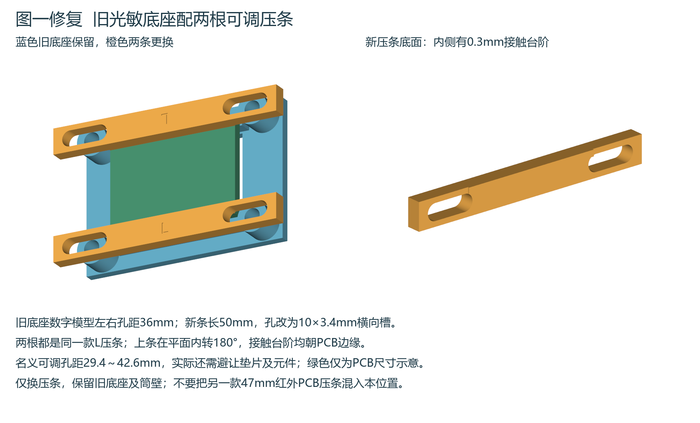
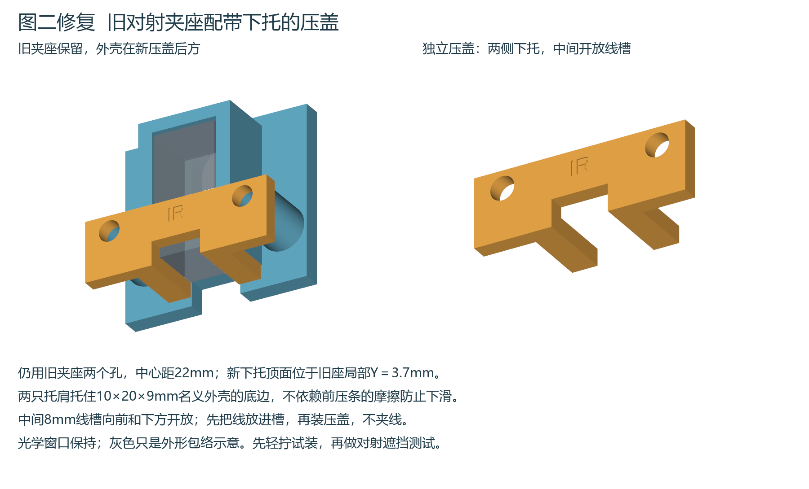

# 旧底座附件修复 光敏压条与红外对射下托压盖

[下载修复3MF](P2S_LIGHT_BARS_IR_CUPS_FIX_FINE_012.3mf)。保留已经打印的光敏底座`LIGHT_CRADLE`、红外对射夹座`BEAM_SEAT`及筒壁，只打印两根`LIGHT_BAR_V2`和两个`BEAM_CUP_V2`，一盘4件。

P2S 0.4mm喷嘴、Generic PLA、纹理PEI、0.12mm层高／0.20mm首层、6墙、60%螺旋体填充、顶底12层、外壁35mm/s，宽平面贴床，无支撑，3mm裙边。预计约41分钟、3.6g。用Bambu Studio作为工程打开，保持100%比例和工程朝向，再切片。没有向打印机发送任务。

## 图一 光敏模块的两根压条

旧底座数字模型外形44×30mm，左右孔距36mm、上下孔距23mm；旧配套压条的名义孔距同样为36mm。用户确认底座是以前打印的，本轮未重测实物孔距，不能把失配具体原因当作已查明。

新压条长50mm，带两个10×3.4mm横向调节槽，槽中心距36mm；理论孔距调整范围29.4～42.6mm，实际还要避让垫片和元件。两根完全相同并刻有L，底面内侧有0.3mm接触台阶。上条在平面内转180°安装，让两条台阶都朝向PCB边；下条不转。保留原夹持带，不遮住PCB中部与左右接口。

先把四颗螺丝都穿过槽并松带螺母，对正后交替轻拧，只压PCB边缘，不能压元件或把板拧弯。M3×20配平垫和普通M3螺母按模型估算，实际以叠层与露牙为准。原47mm的`APPROACH_EDGE_BAR`用于另一款前方红外PCB托架，不用于本位置。

## 图二 红外对射外壳的下部承托

旧夹座底部开放、原直压条没有实体下托，存在外壳下滑的结构遗漏。新IR压盖保留旧夹座22mm孔距和2.4mm前盖厚度，两侧增加托肩，托面位于原座局部Y=3.7mm，名义外壳10×20×9mm的下沿由实体托住。中间8mm线槽向前和下方开放，光学窗口保持。

先断电，扶住旧夹座拆原直压条；放入红外外壳，将线束放进开放槽，安装IR新盖。确认外壳下沿落在两个托肩上、线没有被压住，再交替轻拧两颗螺丝。两端对射各换一个，共四颗M3×25、平垫和普通M3螺母按模型估算；复用符合长度的旧五金，实际叠层和露牙需核对。断电轻晃确认不再下滑，再恢复遮挡测试。

## 验证范围

已核对新件与保存的旧底座STEP、名义PCB／红外外壳包络无穿透，原孔与光学通道保持；将名义外壳向下、向外各移0.1mm，均被新压盖实体阻挡。验证8mm开放线槽、STEP重读、封闭连通细分网格、原生3MF四件几何还原、四件首层及94层全部18634段挤出路径，无支撑或切片警告。

这些检查不是旧打印实物或实际模块、线束的装配验收；接触面和孔腔需清理后轻装，不强压尺寸不符的模块。0.12mm为层高、0.01mm为网格设置，均不保证实物公差。

同名Word第66.16节、图解85—86已收录本修复，保留原330步骤和此前79张表，目录页码及排版检查见`checks/manual_qa.json`。旧整盘打印工程保留历史，新打印这两类附件应使用本修复工程。
