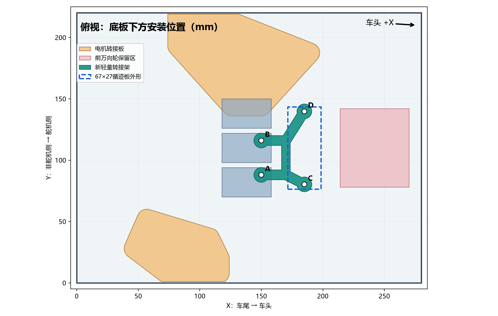
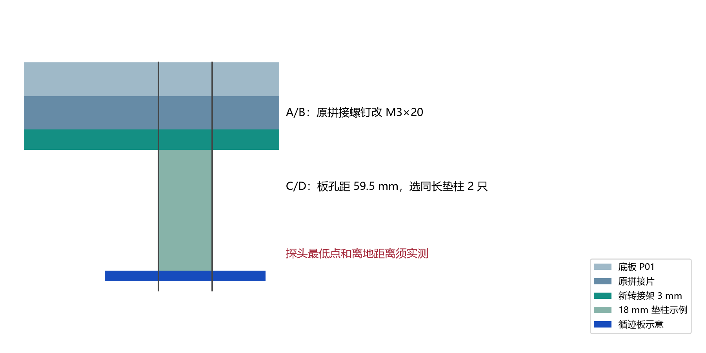

# 三路红外循迹模块轻量转接架

需要与 H41 万向轮增高支架一次打印时，使用[同盘 P2S 工程](../caster-tracker-plate-20261103/README.md)。

用于已打印的 P01 分体底板和两块轻量电机转接板。循迹模块按商品图 **67×27 mm、两端孔距 59.5 mm、孔径 Φ3 mm** 建模；商品图尺寸尚未用实物卡尺复核。模块长边沿车身左右，三探头朝地，中间探头在底板中心线 Y=110 mm。

打印工程：[P2S_TRACKER_LIGHT_FINE_012.3mf](P2S_TRACKER_LIGHT_FINE_012.3mf)。含一块 3 mm 厚镂空支架，以及 14、18、22 mm 垫柱各两只；同一装配只选一对等长垫柱。P2S、0.4 mm 喷嘴、Generic PLA、0.12 mm 层高、4 墙、30% gyroid、无支撑、4 mm brim。实际切片估算 1 小时 09 分、9.6 g，尚未实物试打。作为工程打开，保持 100% 比例和原朝向；3MF 不含 G-code。

## 孔位和避让

以底板车尾左下角为原点，X 向车头，Y 从非舵机侧向舵机侧，单位 mm。支架在底板下方，利用原拼接螺钉孔 A=(150,88)、B=(150,116)。循迹板螺钉孔 C=(185,80.25)、D=(185,139.75)，C/D 孔距 59.5 mm。模块外形名义范围 X=171.5～198.5、Y=76.5～143.5。

已用现有 CAD 源检查支架、模块名义外形与两块已打印电机转接板、三块拼接片和其余拼接螺钉不相交。模块最前沿距设计中万向轮保留区 X=214 起点 **15.5 mm**。保留区不是万向轮实物完整包络，安装后需转动万向轮、轮胎全周并检查线束，目标净隙至少 3 mm。

## 紧固件与安装

1. **断电**，卸下 A/B 两颗原 M3×16 拼接螺钉。拼接片保留在原位，不松开其他拼接螺钉。
2. 从底板上方以两颗 **M3×20 低圆头螺钉**穿过原孔、底板、原拼接片和新支架 A/B 孔；上下面各用一片 OD≤6 mm、厚约 0.5 mm 的 M3 平垫，下面用 M3 防松螺母。先均匀带紧，再轻拧到贴合，不要压裂 PLA。核对拼接片仍与底板贴平。
3. C/D 各放一只**相同长度**的垫柱。螺钉从模块探头面穿过原 Φ3 孔、垫片、垫柱和支架，上面用平垫及 M3 防松螺母。14 mm 垫柱用 M3×25；18 mm 用 M3×30；22 mm 用 M3×35。螺钉头、垫片不能遮住探头、电阻或焊点，必要时改用外径更小的垫片。
4. 先用 **14 mm** 垫柱试装，车轮落地后测探头最低点至地面的实际距离，再按该模块的实测工作距离选 18 或 22 mm。静态及车体轻压时都不能擦地。没有实测底板离地高度和探头凸出量，不能预定最终垫柱长度。
5. 手转两侧轮胎和前万向轮一整圈；确认模块、螺钉、支架和线束均不碰轮。线束沿支架向后上方固定，避免拖地及进入轮胎。检查完成后再接电，循迹信号电平适配另按 A1 接线设计核实。

支架打印实体体积约 3.19 cm³，14/18/22 mm 每只垫柱实体体积约 0.58/0.74/0.91 cm³。数字几何与切片检查通过；实际抗振、离地距离、轮胎动态包络及模块尺寸仍需首件试装确认。
