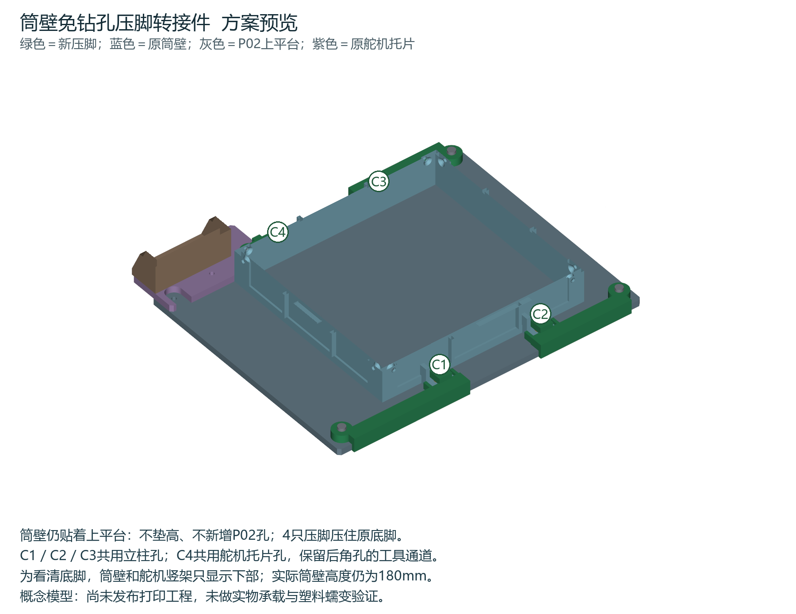

# 筒壁免钻孔压脚转接件方案预览

这是按现有P02上平台、P04舵机托片和W01—W04筒壁制作的概念模型，供查看安装方式。筒壁位置不变、不垫高，P02不新增孔；尚未发布打印工程，也没有额定载荷或实物承载结论。

## 固定方式

四只绿色压脚从上方压住原筒壁底脚，不依赖P02在原底脚下方有孔。三只长压脚共用立柱孔，沿平台边缘的挡肩限制转动，底脚两侧的小挡块限制前后滑动。舵机侧后方改用短压脚，借用P04托片孔并沿托片边缘限位，保留后角孔的工具通道。

压脚底面装入普通M3螺母；2.4mm厚上挡肩承受调压螺丝的反力，不能改成上方敞口的螺母窝。螺母应在压脚安装前放入。M3×8调压螺丝头悬空，下面通过Ø8×1.2mm小压垫轻压3.2mm厚原底脚；不能把螺丝头拧到贴住压脚。小压垫跨过原底脚孔，螺丝不穿入P02。

| 压脚 | 借用现有孔 X,Y / mm | 末端施压点 X,Y / mm | 固定端拟用螺丝 |
|---|---|---|---|
| C1 非舵机侧后方 | 10,10 | 90,13 | M3×16 |
| C2 非舵机侧前方 | 230,10 | 170,13 | M3×16 |
| C3 舵机侧前方 | 230,180 | 170,177 | M3×16 |
| C4 舵机侧后方 | 70,180，P04托片孔 | 90,177 | M3×20 |

原点为P02后侧与非舵机侧的外角；X向前，Y向舵机侧。上平台240×190×5mm，主框外沿X50～210、Y20～170。施压点不是新钻孔。

初步需三颗M3×16、一颗M3×20、四颗M3×8、四颗普通M3螺母；固定端使用垫片，托片下方复用锁母。用户最后确认的螺丝长度是M3×8、×12、×16，不能据此认为M3×20已经持有。以上仅为方案长度估算，最终打印版前仍需核实立柱盲孔深度、螺丝头和工具空间。

## 查看文件

- [整体安装预览](preview/01_mounting_overview.png)
- [普通压脚细节](preview/02_pressure_clamp_detail.png)
- [舵机托片侧细节](preview/03_servo_side_detail.png)
- [孔与压点定位图](preview/04_anchor_plan.png)
- [完整装配STEP预览](step/WALL_CLAMPS_ASSEMBLY_PREVIEW.step)：包含完整高度的原筒壁、平台、舵机架及新压脚和简化五金。
- 单件STEP位于`step/`；`qa_meshes/`是装配坐标网格，仅供几何检查，不是排版好的打印文件。

## 检查范围

已检查四个压脚为有效单实体、网格封闭连通，与完整原筒壁、P02、P04、P03及模型化五金无实体穿透；重读STEP后核对固定孔、底装螺母腔和上挡肩。实体预览图和四视图已复核。详见`checks/design.json`与`checks/reopened_geometry.json`。

此轮没有证明实体强度、长期抗蠕变或打印装配公差，也未制作最终材料/朝向/圆角/切片方案，不应直接作为承载打印版本使用。细化后仍需轻压试装和实际载荷逐步加载。

同名Word手册第66.14节、图解79—82收录本预览；保留原330步骤和此前全部表格。排版及目录检查记录见`checks/manual_qa.json`。
