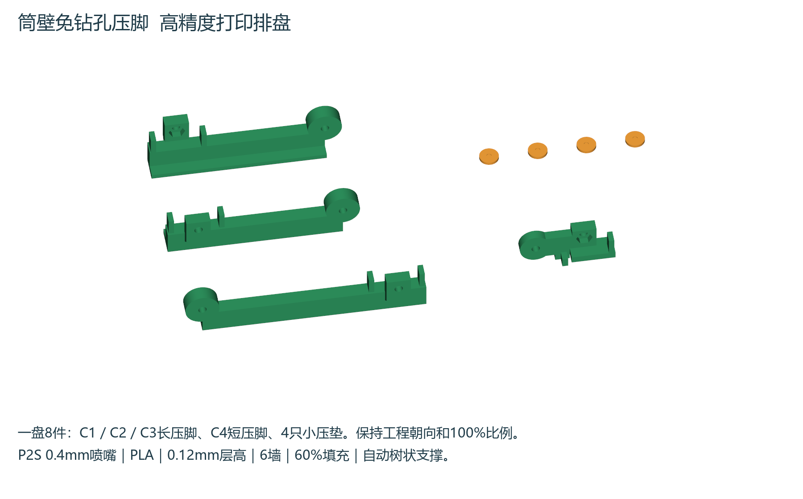

# 筒壁免钻孔压脚 高精度打印版

[下载P2S高精度3MF工程](P2S_WALL_CLAMPS_AND_PADS_FINE_012.3mf)。一盘8件：四只不同的压脚C1—C4，以及四只相同的Ø8×1.2mm小压垫。打开时选择作为工程加载，保留保存的朝向、位置、数量和100%比例，再切片打印。示意图用颜色区分零件，工程可使用同一种PLA打印。

## 已保存的参数

| 项目 | 设置 |
|---|---|
| 打印机与喷嘴 | Bambu Lab P2S，0.4mm |
| 耗材与热床 | Generic PLA，纹理PEI |
| 层高与首层 | 0.12mm／0.20mm |
| 墙与填充 | 6道墙，60%螺旋体 |
| 顶底壳层 | 各12层 |
| 外壁速度与加速度 | 35mm/s，700mm/s² |
| 支撑 | 自动树状，仅从热床生成，Z间隙0.12mm |
| 外裙边 | 5mm，间距0.1mm |
| 预计时间与用料 | 约3小时20分钟，30.5g，含切片中的支撑等用量 |

3MF包含模型及打印设置，不含可直接执行的G-code，也没有向打印机发送任务。实际耗材应与选择的配置一致；本工程的PLA参数不能直接用于其他材料。保留首层校准，喷嘴缠料检测按此前验证保持关闭；相机炒面检测为独立功能，不要求关闭。

## 相对预览的细化

固定孔、筒壁位置、贴合高度及螺母挡肩沿用[66.14节预览](../wall-clamp-preview-20261103/README.md)。三只长压脚新增45°过渡斜撑和R0.6长外缘圆角，短压脚下外缘R0.4，采用0.01mm线性偏差网格。压脚侧放，小压垫平放，实际树状支撑已切片检查。0.12mm是层高，0.01mm是网格设置，都不表示实物尺寸公差保证。

## 打印后试装

冷却取件后清理裙边和支撑，尤其是圆孔、六角螺母窝及贴平台的面；保留2.4mm螺母上挡肩。先用普通M3螺母和螺丝试装，螺母应完整贴到上挡肩，不强压明显过紧的孔腔。

先从压脚底面放入四颗普通M3螺母；将四只小压垫放在原筒壁四个底脚孔上方；松装压脚固定端，再将四颗M3×8调压螺丝轻轻拧到小压垫接触底脚。调压螺丝头必须悬空，不能拧到贴住压脚。固定端拟用三颗M3×16接原立柱、一颗M3×20共用舵机托片孔，配垫片与原锁母。实际立柱盲孔深度、螺丝头和这些长度的持有数量尚未全部确认；安装前核对，不靠硬拧补偿长度。

几何与切片检查通过不等于实物承载验证。完成试装后逐步加载，检查松动、发白、裂纹及永久变形。尚未进行打印实测或长期抗蠕变试验。

## 检查与源文件

- `step/`：装配坐标与打印坐标实体；`parts/`：细分网格。
- `source/layout.json`：8件保存位置。
- `checks/design.json`：实体、网格、孔腔、2.4mm挡肩及完整原件干涉检查。
- `checks/slicing.json`：原生工程与测试切片一致，切片无警告。
- `checks/path_review.json`：8件首层、168层、97430段挤出运动，全部位于256×256mm热床范围。
- `preview/03_actual_first_layer.png`和`preview/04_actual_support_review.png`：实际切片首层及支撑检查图。
- 同名Word手册第66.15节、图解83—84，原330步骤和此前79张表保持；目录、页码和完整文档渲染复核见`checks/manual_qa.json`。
