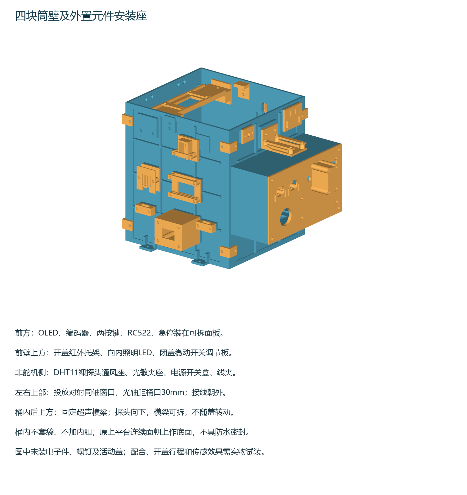

> 2026-11-03附件修复：光敏旧底座继续用，改装可调L压条；红外对射旧夹座继续用，直压条改为带下托的IR压盖。[只需重打四件的修复工程](../sensor-retainers-fix-20261103/README.md)。本目录整盘文件保留历史；新打印这两类附件采用修复工程，其他零件保持。

# 四块平放筒壁与元件安装件

四块筒壁各自一体打印，小附件随四盘排入；使用 PLA、P2S 0.4 mm 喷嘴，保持 100% 尺寸。模型和切片检查已通过，这是尚需实物试装的首版。电机座的快速试配配置不用于这些筒壁。

| 打印项目 | 包含对象 | 切片预计时间 | 耗材 |
| --- | ---: | ---: | ---: |
| [01 前壁和操作面板](projects/P2S_WALL_01_FRONT_CONTROLS.3mf) | 15 | 7小时19分31秒 | 192.4 g |
| [02 后壁及附件](projects/P2S_WALL_02_REAR.3mf) | 19 | 4小时47分42秒 | 126.6 g |
| [03 左壁及附件](projects/P2S_WALL_03_LEFT.3mf) | 26 | 4小时09分03秒 | 107.2 g |
| [04 右壁及附件](projects/P2S_WALL_04_RIGHT.3mf) | 4 | 2小时54分04秒 | 85.8 g |

四台同时打印时，最长一盘约7小时20分，另计设备准备和冷却；合计约512 g。3MF含模型、摆盘及参数，没有预生成G-code。用Bambu Studio打开项目，确认P2S/0.4 mm、实际PLA耗材和纹理PEI板，切片后再发送。不要自动重新摆盘或缩放。每件附件对应的盘号和数量见[source/parts_by_plate.csv](source/parts_by_plate.csv)。

前盘层高0.20 mm，其余0.24 mm，首层0.20 mm；3墙、15%螺旋体填充、上下4层、2 mm外侧裙边。树状支撑按[Bambu Studio官方GitHub配置](https://github.com/bambulab/BambuStudio/blob/master/resources/profiles/BBL/process/fdm_process_common.json)取值，源blob为6a1c7e9e911b4e6d64845f26c5047d7823176f1d：自动树状、默认样式、阈值30°、分支45°/2 mm、自动壁层、上下接触层各2层、接触间距0.5 mm、XY间距0.35 mm、底部图案间距2.5 mm；Z间距跟随层高。第1、2、4盘实际生成支撑，第3盘不需要。原始配置记录在source/github_support_source.json。

## 元件位置和固定方式

| 元件 | 位置与固定 |
| --- | --- |
| OLED | 前操作面板玻璃窗25×15 mm，2个可调孔、下缘承托；插线空间留在外置操作腔内 |
| 编码器 | 前面板Ø7.4 mm套筒孔，以原螺母固定；前出排针单独避让罩 |
| MODE和BACK按钮 | 两个独立可调托架、压框及8.2 mm隔柱，避开原板上不能用的孔；垫片用于实物高度微调 |
| RC522 | 前面板1.2 mm薄壁刷卡区之后，边缘托轨和可拆压条，不依赖不确定的孔位 |
| 急停 | Ø22.6 mm孔，局部4 mm加强面；原螺母夹紧，接线位于深60 mm操作腔内 |
| 靠近开盖红外 | 前壁上部外侧水平托架，31×20 mm板用边缘压条固定；探头伸出板边10 mm并朝人，排针侧开放 |
| 投放对射TX/RX | 左右壁相对外置夹座，光轴在桶底上150 mm，即桶口下30 mm；9×17 mm光窗、上下调节长孔 |
| DHT11 | 左壁外侧通风罩，按12×16×6 mm裸蓝色探头设计，底端开放出线 |
| 光敏模块 | 左壁外侧夹座，左侧插针、右侧感光区开放，避开桶内LED |
| KCD1总开关 | 左壁下部独立接线盒，2 mm可换安装片；19.4×12.4 mm孔是试配尺寸 |
| HC-SR04 | 桶内可拆横梁，横梁底面距桶底162 mm，探头向下；PCB边缘压条固定，不向Ø1.5 mm孔硬塞M2螺丝 |
| 闭盖微动开关 | 前壁内侧上部可调片，模块孔距9.5 mm配M2螺丝；独立触片装到原活动盖 |
| 白色LED | 前壁桶口固定位置，名义5 mmLED配Ø5.3 mm小安装片，朝桶内照明 |
| 合页及盖止挡 | 后壁顶部2个20×20 mm合页位置；左右内侧止挡座加2 mm软垫承受闭盖载荷 |
| 线束 | 外置操作腔底部出口和4组可拆线夹；电机动力线与传感信号线分开走 |

前避障、循迹和碰撞横杠仍在底盘低位；喇叭、蜂鸣器、蓝牙、DFPlayer及主控电源模块沿用底板安装座。本次未增加未提供尺寸的充电插座，也未更改活动盖、舵机立架或底板模块座。

## 装配顺序

1. 冷却后取件，拆掉支撑和裙边，先在小托架上试装各模块。压条只压PCB空白边缘，不能压元件、玻璃或排针；未量全的插头按实物检查。
2. 用8个外侧角码连接四壁，上下各一圈。壁板连续薄面朝桶内，加强筋朝外；名义桶外形160×150×180 mm，内壁主薄面1.6 mm，边缘及局部螺孔加厚。
3. 现有P02上平台连续平整面朝上，作为裸桶底；用户已确认不用内胆、不套袋。数字检查确认154×144 mm内腔下有连续面层，但接缝和FDM表面不具备防水保证。
4. 整体试摆到P02上平台。桶脚候选孔在P02原模型局部坐标(90,13)、(170,13)、(90,177)、(170,177) mm，建议通孔Ø3.4 mm；四处已核实处于完整5 mm厚区域。务必对照模型原点、车头和原立柱，实物试摆后再划线钻孔，不能把壁板坐标当平台坐标。本次没有改孔或重印上平台。
5. 前操作腔向外伸60 mm，约超出上平台前缘29 mm、底板前缘9 mm。先试装急停原螺母、触点块和接线，再合上面板，不能挤压端子。按钮托架用长孔和垫片调整高度。
6. 安装超声横梁和两侧托耳，使探头朝下，插线从中央缺口引出；横梁可拆卸清理。对射两端光轴对齐，固定压条后再做遮挡测试。
7. 沿用原活动盖和舵机结构，先断电手动检查全行程。两处2 mm软垫承担闭盖接触，微动开关只作信号，不能承担盖重。右侧后上方留给连杆，但完整运动包络尚需实物核对。
8. 检查按键按下及回弹、旋钮和USB/TF维护路径、RFID读卡、红外开盖、对射遮挡、温湿度与光敏响应，再紧固。

## 五金准备

以下长度按模型叠层估算，装配时以实际螺母、垫圈和PCB高度为准，螺钉末端不能顶到电路。所有螺纹连接采用配套螺母，不假定PLA小孔已经有螺纹。

| 螺丝 | 预计数量 | 用途 |
| --- | ---: | --- |
| M3×10 | 约20 | 四角连接16、超声横梁两端2、盖触片2 |
| M3×12 | 约16 | 平台脚4、横梁托耳4、红外托架2、止挡4、微动安装片2 |
| M3×16 | 4 | 红外PCB压条 |
| M3×20 | 约14 | DHT罩2、光敏压条4、线夹8 |
| M3×25 | 4 | 两端对射夹座 |
| M3×45 | 4 | 总开关接线盒 |
| M3×70 | 4 | 前操作腔四角贯穿固定 |
| M2.5×8/10/12/16/20/35 | 约8/2/6/4/4/4 | 合页/OLED/LED和超声压条/RFID/按钮/排针罩 |
| M2 | 2 | 微动开关本体，长度须按实物厚度选 |

同时准备对应螺母、垫圈、PCB处绝缘垫片和两块2 mm软止挡垫。实际型号或螺母厚度有差异时用所附1/2 mm垫片调节，不能靠拧紧把玻璃或PCB拉弯。

## 图纸与检查范围

[四壁及操作面板孔位图](interface_coordinates.pdf)和[85个孔槽坐标](source/interface_positions.csv)壁板使用外侧视图、操作面板使用背面视图的左下角作为u/v原点，单位mm。长孔表列出总长和宽度。附件的完整参数、孔位和变换见source脚本及checks/design.json，不按截图比例测孔。

已检查33种零件、64个打印实例的实体有效性和网格封闭性；57个装配实例的潜在接触对无实体穿透，85处壁板/面板孔轴贯通。四盘均完成CLI切片、首层对象数和含圆弧的路径边界检查，无切片警告。检查不包含实物电子元件、全部五金、舵机和活动盖完整运动轨迹，也不能代替承重、耐久或传感器功能测试。

安装图和孔位图已同步同名Word手册66.11节、图解65—70。原330步骤和78张表保留；234页已渲染，新8页已逐页检查，前226页正文像素与旧版一致。记录见checks/manual_qa.json。
